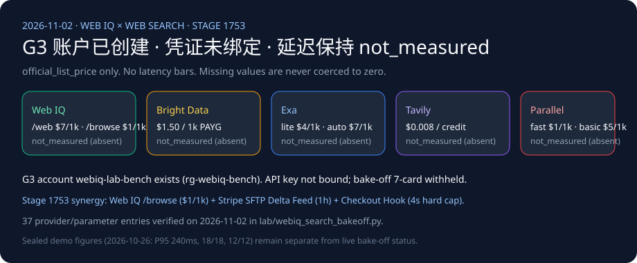

# Web IQ 搜索竞品矩阵（2026-11-02）

🌐 **Language / 语言导航**: **中文 (当前)** | **[English](2026-11-02-webiq-search-competitive.en.md)** | **[2026-11-01 笔记](2026-11-01-webiq-search-competitive.md)** | **[Browse passage 笔记](2026-11-01-webiq-azure-browse-passage.md)**

## 发现（2026-11-02 核验）

1. **实测状态严格保持 `not_measured`**：实验室付费订阅下的 G3 账户 `webiq-qichen2-bench`（`Microsoft.WebIQ/accounts@2026-06-01-preview`，`location=global`，`kind=WebIQ.Grounding`，`statisticsEnabled=false`）已于 2026-11-01 创建成功，但本机环境仍未绑定生产可自动化调用的 `WEBIQ_API_KEY`，且 `BRIGHTDATA_API_KEY`、`EXA_API_KEY`、`TAVILY_API_KEY`、`PARALLEL_API_KEY` 均不在本机环境变量中（`credential="absent"`）。因此五家供应商全部严格标记为 `call="not_called"`、`latency="not_measured"`、`success="not_measured"`、`citation_check="not_measured"`。缺失延迟绝不写成 `0`。跨厂商实测 7-card 延迟卡在出现真实 `summary.json` 之前继续暂缓（`withheld_until_measured_latency_exists`）。
2. **与密封基线严格区分**：本仓库 `2026-10-26.stage1746` / `2026-11-02.stage1753` 的密封回放数字（Web IQ `/v3/search/web` P95 `240ms`、任务成功率 `18/18`、注入拦截 `12/12`、批量并发 `1.52s vs 4.18s`）仍归属 `sealed_demo` 确定性回放基准，绝不混入本次跨厂商实时 bake-off 表。
3. **2026-11-02 新增架构耦合洞察（Web IQ Grounding × Stripe SFTP 混合目录流 × Seller Checkout Hooks）**：
   - 今日核验的 Stripe SFTP 混合目录导入契约（`Product Master` 每 24 小时全量 + `Delta` 每 1 小时增量，`manifest.json` 原子屏障，`disable_checkout=true` 仅发现禁内嵌结账）与 Seller Checkout Hooks（`delegated_commerce.product_price_availability` 实时价格/库存回调 + `v1.delegated_checkout.finalize_checkout` **4,000 ms 硬超时**）揭示了企业级商业智能体的**三层接地协同范式**：
     1. **开放网与长尾商品发现（T-0 发现层）**：对尚未接入商户 SFTP 目录或标记了 `disable_checkout=true`（如处方药、高单价定制商品、需跳转外部 `link` 页面商品）的 SKU，使用 **Microsoft Web IQ `POST /v3/search/web` (`$7/1k`, `contentFormat="passage"`)** 进行全网发现，再用 **`POST /v3/browse` (`$1/1k`, 默认 $\le 3000$ 字符)** 抽取已知政策/商品页的原始段落并完成预-LLM 提示词注入清洗（`PROMPT_INJECTION_RE`）。
     2. **结构化商户目录同步（T-1 小时级增量层）**：已入驻 Stripe Catalog 的商户通过 **SFTP `Delta` feed（每 1 小时）+ `manifest.json` 原子屏障**同步最新目录快照；若某行 `delete=true`，除 `id` 与 `delete` 外其余列全部忽略。
     3. **结账前毫秒级权威裁决（T-2 结账签名层）**：在发起 `RequestedSession` 或 `UCP` 结账完成前，绝不能把任何外部搜索引擎（Web IQ、Bright Data SERP、Exa、Tavily、Parallel）的缓存摘要直接当作扣款金额；必须通过 `delegated_commerce.product_price_availability` 钩子核对实时库存与 `CheckoutStore` SHA-256 价格摘要，且最终 `v1.delegated_checkout.finalize_checkout` 必须在 **4,000 ms** 内返回 `2xx`（否则非 `2xx` 向 Agent 映射为 `HTTP 424 Failed Dependency`）。

## 账户状态

- 资源组 `rg-webiq-bench`，区域 `southeastasia`。账户位置是 `global`。
- `provisioningState=Succeeded`。
- 没有把订阅 ID、内部 ID、网关主机名或登录邮箱写入本笔记。
- 门户 https://webiq.microsoft.ai/profiles 才能签发 `x-apikey`。Azure CLI 不能为 `https://api.microsoft.ai/.default` 取令牌。
- Browse 仍是 AppID 按申请开通。Auto 在 beta 期间不计费。
- 没有创建 Bright Data、Exa、Tavily 或 Parallel 账户。

## 官方标价，不是分数

标签一律是 `official_list_price`。核验日 2026-11-02。这些数字不能画成延迟条。

| 供应商 | 官方标价 | 来源 | 不计入测量的说法 |
|---|---|---|---|
| Web IQ | `/web`、`/video`、`/news`、`/images` 每 1,000 次 $7；`/browse` 每 1,000 次 $1。生效日 2026-10-16，页面更新 2026-10-29。 | [定价](https://learn.microsoft.com/en-us/web-iq/resources/pricing) | Auto beta 不计费，不是延迟。 |
| Bright Data SERP | 每月 5,000 次免费；按量每 1,000 次成功请求 $1.50；Scale $499/月含 380,000 次，超出每 1,000 次 $1.30。页面写明展示价可能是本币估算，USD 为结算价。 | [SERP 定价](https://brightdata.com/pricing/serp) | 「under 1 second」是营销句，不是测量。 |
| Exa | lite/instant $4/1k，auto/fast $7/1k，contents 每种内容 $1/1k 页，answer $5/1k，monitors $15/1k。deep-lite/deep $12/1k，deep-reasoning $15/1k。Agent 固定档 $0.012–$1.00/次。免费额度 $10，每月 1 日重置。 | [定价](https://exa.ai/pricing) | [搜索参考](https://docs.exa.ai/reference/search) 写 include/exclude domains 各最多 1,200 条，用域名过滤，不要在 query 里加 `site:`。页面上的秒数是厂商自述，不进延迟图。 |
| Tavily | basic、fast、ultra-fast 都是 1 credit，advanced 2 credits。按量 $0.008/credit。文档表自带单价：Project $0.0075，Bootstrap $0.0067，Startup $0.0058，Growth $0.005。Research pro 15–250 credits，mini 4–110。每月 1,000 免费 credits。 | [API credits](https://docs.tavily.com/documentation/api-credits) | [搜索参考](https://docs.tavily.com/documentation/api-reference/endpoint/search) 写 `max_results` 默认 10、最大 20。`chunks_per_source` 1–3。失败的抽取和 Map 不计费。无本次延迟。 |
| Parallel | turbo/fast $1/1k，basic/advanced $5/1k，额外结果 $1/1k。extract $1/1k URL。Task lite $5/1k 成功运行，ultra8x $2,400/1k。Responses medium $50/1k。 | [定价](https://docs.parallel.ai/getting-started/pricing) | [搜索参考](https://docs.parallel.ai/api-reference/search/search) 写欧盟地址 `https://eu.parallel.ai` 只支持 basic。Image Search 的默认是 advanced，不要当成网页搜索默认值。200 ms–3 s 是 `vendor_stated`。 |

## 离线契约

[`lab/webiq_search_bakeoff.py`](../../lab/webiq_search_bakeoff.py)（`VERIFIED_ON = "2026-11-02"`）不打开网络。三条密封问题覆盖退货窗口、可引用价格页、以及是否存在应停止补货的公开召回。缺密钥时 `latency` / `success` / `citation_check` 都是 `not_measured`。密钥存在时记录 `credential=present`、`call=not_called`，仍然不打付费请求。

## 架构边界对比：Microsoft Web IQ 原始 Passage 返回 vs. Foundry Grounding with Bing Search vs. Stripe SFTP/Hooks

根据 2026-11-02 核验的 Microsoft Learn 官方文档（[Web IQ Browse Reference](https://learn.microsoft.com/en-us/web-iq/reference/browse)、[Web IQ Error Handling](https://learn.microsoft.com/en-us/web-iq/reference/error-handling) 与 [Foundry Agents Web Grounding Overview](https://learn.microsoft.com/en-us/azure/foundry/agents/how-to/tools/web-overview)）以及 Stripe Agentic Commerce 文档：

| 维度 | Microsoft Web IQ (`/v3/search/web`, `/v3/browse`) | Microsoft Foundry Grounding with Bing Search | Stripe SFTP Feed + Seller Checkout Hooks | 对 Agentic Commerce 的架构含义 |
|---|---|---|---|---|
| **检索正文对调用方代码可见性** | **直接返回给调用方代码**（`results[].content` / `contentFormat="passage"` 默认 $\le 3000$ 字符） | **不对开发者返回原始检索块**（仅在微软托管边界内把检索结果喂给模型，只向调用方返回最终回答与引用链接） | 结构化 CSV/JSON/XML 目录字段 + `delegated_commerce.product_price_availability` JSON 回调 | 高保障商业智能体必须在进入 LLM 前做确定性提示词注入清洗（`PROMPT_INJECTION_RE`），并与商户目录/实时钩子做 SHA-256 价格摘要比对，因此**外网接地必须使用 Web IQ** 而非黑盒 Grounding |
| **`retryAfter` 与超时契约** | `AuthUserThrottled` (429) / `InternalServerError` (500) 返回相对时长 `"60s"`；`Browse 202` 与 `TooManyOnDemandCrawls` (**同为 HTTP 429!**) / `520` / `523` / `524` 返回 ISO-8601 UTC 时间戳 | 托管在 Foundry Agent 服务内部 | `v1.delegated_checkout.finalize_checkout` 强制 **4,000 ms 硬超时**；非 `2xx` 对 Agent 映射为 **`HTTP 424`** | 检索层需按 `error.code` 双格式解析退避；结账层绝不能在 `finalize_checkout` 同步钩子中串联慢速外部网页爬虫（如 `liveCrawl=fallback` + `renderDynamicPages=true`），必须将 Web IQ 检索前置到发现/比价阶段 |

## 读法

数字分四类，不能混用。

| 标签 | 含义 |
|---|---|
| `official_list_price` | 官方标价页上的单价。不是延迟，也不是质量分。 |
| `vendor_published_benchmark` | 厂商自己公布、对手匿名的对比。`independently_reproduced=false`。 |
| `vendor_stated` | 营销或文档里的速度/成功率句子，没有可复现的查询集。 |
| `not_measured` | 本仓库没有打这笔调用。缺失值不是 0。 |

## 四类产品，不要当成同一种搜索

| 类型 | 返回什么 | 适合商业代理的哪一步 | 不适合 |
|---|---|---|---|
| 索引接地 | 排序后的 passage、引用 URL、抓取时间 | 不知道 URL 时找证据，或处理 `disable_checkout=true` 仅发现 SKU，再交给模型 | 把摘要本身当成零售商标价 |
| URL 抽取 | 指定页面的 passage 或全文 | 已经有政策页、商品页 URL（如 Web IQ `/v3/browse` `$1/1k`） | 发现新召回新闻 |
| SERP 抓取 | 搜索引擎结果页的广告、自然结果、购物位 | 监控某市场的搜索展示和比价入口（如 Bright Data SERP） | 作为改价或退货期限的唯一权威 |
| 答案 API | 模型已经写好的答案加引用 | 低风险摘要 | 结账授权。商业裁决必须留在本仓库的 authority 层 |

## 商业代理怎么选（架构路由表）

这是架构建议（`label="architecture_guidance"`），不是实测胜负。

| 场景 | 先调用 | 原因 | 不要 |
|---|---|---|---|
| 不知道商品页在哪，要可引用的现价 | Web IQ `/web`，`contentFormat=passage`，必要时 `site:` 零售商域；再对返回 URL 调 `/browse` | 搜索负责发现，Browse 负责页内证据。`crawledAt` 用来判断证据新旧 | 用 SERP 摘要直接改授权金额 |
| 已经有退货政策 URL | Web IQ `/browse`，`passage` + 非空 `query`，`liveCrawl=fallback` 仅当索引 404 | $1/1k，且段落按问题截取。无全文权限时最多 3000 字符 | 为了一页政策去买 SERP |
| 召回或安全新闻，决定是否停止补货 | Web IQ `/news`，读 `source`、`lastUpdatedAt`、`crawledAt` | Web 没有日期过滤；FAQ 要求新闻走 News | 把旧网页 passage 当成“今天没有召回” |
| 商品图、是否可嵌视频 | `/images`、`/videos` | 有宿主页、尺寸、水印和嵌入字段 | 用图片结果代替价格证据 |
| 多意图问题 | 拆成多次 `/web` 或 `/news`。Auto beta 可做分类型 evidence，但未计费且契约会变 | FAQ：一次 Web 请求只处理一个查询 | 把整段用户话术塞进一个 1000 字符 query |
| 要看某国 Google 购物位、广告、排名 | Bright Data SERP，`gl`/`hl` 放在引擎 URL | 这是结果页监控，官方用例包含 price comparison | 把它当成出版商页面的全文 |
| 已知 URL 但被拦截，要原始 HTML | Bright Data Web Unlocker，或 Exa `/contents`、Tavily Extract、Parallel Extract | Unlocker 解决抓取；Exa/Tavily/Parallel 卖的是页面文本。价格单位不同 | 用 Unlocker 做点击式结账。文档写明它不是浏览器交互 |
| 要点击、登录后页面、截图 | Bright Data Browser API | 产品选择页的明确边界 | 用 Browse `renderDynamicPages` 假装能完成表单。它只在 liveCrawl fallback 时做动态渲染 |

完整的 37 项厂商官方定价与参数边界契约详见 [`lab/webiq_search_bakeoff.py`](../../lab/webiq_search_bakeoff.py) 及 [2026-11-01 详细笔记](2026-11-01-webiq-search-competitive.md)。
