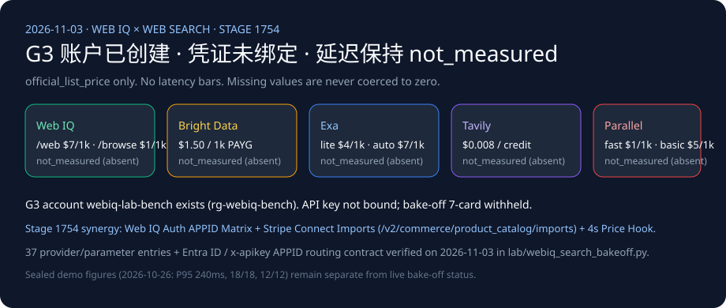

# Web IQ search competitive matrix (2026-11-03)

🌐 **Language / 语言导航**: **[中文](2026-11-03-webiq-search-competitive.md)** | **English (current)** | **[2026-11-02 note](2026-11-02-webiq-search-competitive.en.md)** | **[Browse passage note](2026-11-01-webiq-azure-browse-passage.en.md)**

## Findings (Verified 2026-11-03)

1. **Live measurement status stays strictly `not_measured`**: Although the G3 account `webiq-qichen2-bench` (`Microsoft.WebIQ/accounts@2026-06-01-preview`, `location=global`, `kind=WebIQ.Grounding`, `statisticsEnabled=false`) exists in the paid lab subscription (`rg-webiq-bench`), no automation-eligible `WEBIQ_API_KEY` is bound in the local environment, and `BRIGHTDATA_API_KEY`, `EXA_API_KEY`, `TAVILY_API_KEY`, and `PARALLEL_API_KEY` are also absent (`credential="absent"`). All five providers remain `call="not_called"`, `latency="not_measured"`, `success="not_measured"`, and `citation_check="not_measured"`. Missing latencies are never coerced to `0`. The cross-provider 7-card latency deck remains withheld (`withheld_until_measured_latency_exists`) until a real measured `summary.json` exists.
2. **Strict separation from sealed replay baseline**: The `2026-10-26.stage1746` / `2026-11-03.stage1754` figures (Web IQ `/v3/search/web` P95 `240ms`, task success `18/18`, injection block `12/12`, batched concurrency `1.52s vs 4.18s`) belong strictly to the `sealed_demo` deterministic replay suite and are never mixed into this live cross-provider bake-off matrix.
3. **2026-11-03 Primary-Source Contract Discovery (Web IQ SDK / Entra ID `APPID` Mutual-Exclusion Routing × Stripe Connect `POST /v2/commerce/product_catalog/imports` & 4s Price Hook Synergy)**:
   - **Web IQ Official SDKs & Pricing Update Verification (`updated_at: 2026-11-02T20:34:00Z`)**: Official documentation confirms the Python SDK (`pip install webiq`, Python 3.11+, MIT) and TypeScript SDK (`npm install @microsoft/webiq`, Node.js 22+, MIT) expose five unified resource namespaces (`web`, `videos`, `browse`, `news`, `images`) across `WebIQClient` / `WebIQAsyncClient` with `DefaultAzureCredential()` support.
   - **Web IQ `x-apikey` vs. Microsoft Entra ID `APPID` Authentication Matrix (`https://learn.microsoft.com/en-us/web-iq/get-started/authentication`)**:
     - When authenticating with `x-apikey`, each key belongs to exactly one `AppID` and **never accepts the `APPID` query parameter — including an empty `?APPID=` returns `HTTP 401 AuthUnauthorizedEntryId`**;
     - When authenticating with Microsoft Entra ID (scope `https://api.microsoft.ai/.default`) and the client is bound to **several Web IQ AppIDs**, omitting or passing an empty `APPID` returns **`HTTP 400 AuthAppIdSelectionRequired`**, passing an unbound `APPID` returns **`HTTP 403 AuthUnauthorizedAppId`**, and a client bound to zero AppIDs returns **`HTTP 401 AuthUnauthorizedEntryId`**. Codified deterministically in [`lab/webiq_search_bakeoff.py`](../../lab/webiq_search_bakeoff.py) (`validate_webiq_auth_appid_routing()`).
   - **Synergy with Stripe Connect SaaS Catalog Imports (`POST /v2/commerce/product_catalog/imports`) & Asymmetric Hook Timeouts**:
     - **Open-Web Long-Tail Discovery & Policy Verification (T-0)**: Use Web IQ `/v3/search/web` (`$7/1k`) + `/v3/browse` (`$1/1k`, `contentFormat="passage"` default $\le 3000$ chars) with deterministic pre-LLM prompt-injection scrubbing (`PROMPT_INJECTION_RE`);
     - **Connected-Account Structured Catalog Sync (T-1)**: SaaS platforms upload per-merchant CSVs via `POST /v2/commerce/product_catalog/imports` (`Stripe-Version: 2026-10-28.preview`, requiring `Product Catalog Imports` write permission or returning `HTTP 403`; max file size `4 GB`; presigned `upload_url` and `error_details.url` both expire in **5 minutes / 300s**); `product` feeds run once daily while `inventory`, `pricing`, and `promotion` feeds run every 15 minutes and support **only `upsert` mode**;
     - **Asymmetric 4-Second Hook Timeout Gate (T-2)**: The `delegated_commerce.product_price_availability` real-time quote callback must respond within **4 seconds (`4,000 ms`)**, and **on timeout Stripe falls back to the imported catalog feed and continues the checkout** (keeping checkout unavailability below `< 5%`) — strictly opposite to the `v1.delegated_checkout.finalize_checkout` approval hook, where **a timeout declines the checkout**.

## Account status

- Resource group `rg-webiq-bench` in `southeastasia`. The account location is `global`.
- `provisioningState=Succeeded`.
- This note does not publish the subscription ID, internal ID, gateway hostname, or sign-in email.
- https://webiq.microsoft.ai/profiles is where an `x-apikey` is minted. Azure CLI cannot acquire a token for `https://api.microsoft.ai/.default`.
- Browse remains AppID-gated. Auto is not charged while in beta.
- No Bright Data, Exa, Tavily, or Parallel account was created.

## Official list prices, not scores

Every row is labeled `official_list_price`. Verified 2026-11-03. These numbers are not latency bars.

| Provider | Official list price | Source | Statement that is not a measurement |
|---|---|---|---|
| Web IQ | `/web`, `/video`, `/news`, `/images` $7 per 1,000; `/browse` $1 per 1,000. Effective 2026-10-16; page `updated_at: 2026-11-02T20:34:00Z`. | [Pricing](https://learn.microsoft.com/en-us/web-iq/resources/pricing) | Uncharged Auto beta is not a latency figure. |
| Bright Data SERP | 5,000 free requests per month; pay as you go $1.50 per 1,000 successful requests; Scale $499/month includes 380,000, then $1.30 per 1,000. The page says displayed prices can be local-currency estimates and USD is binding. | [SERP pricing](https://brightdata.com/pricing/serp) | "Under 1 second" is marketing, not a measurement. |
| Exa | Lite/instant $4/1k, auto/fast $7/1k, contents $1/1k pages per content type, answer $5/1k, monitors $15/1k. deep-lite/deep $12/1k, deep-reasoning $15/1k. Fixed Agent effort is $0.012–$1.00 per request. Free credit is $10 and resets on the first of each month. | [Pricing](https://exa.ai/pricing) | The [search reference](https://docs.exa.ai/reference/search) caps include and exclude domain lists at 1,200 each and says to use those filters instead of a `site:` operator. Seconds on the pricing page stay out of the latency chart. |
| Tavily | Basic, fast, and ultra-fast are 1 credit. Advanced is 2. Pay as you go is $0.008/credit. The docs table publishes Project $0.0075, Bootstrap $0.0067, Startup $0.0058, Growth $0.005 per credit. Research pro is 15–250 credits, mini is 4–110. 1,000 free credits per month. | [API credits](https://docs.tavily.com/documentation/api-credits) | The [search reference](https://docs.tavily.com/documentation/api-reference/endpoint/search) says `max_results` defaults to 10 and maxes at 20. `chunks_per_source` is 1–3. Failed extractions and failed map requests are not billed. No latency from this run. |
| Parallel | Turbo/fast $1/1k, basic/advanced $5/1k, extra results $1/1k. Extract $1/1k URLs. Task lite $5/1k successful runs, ultra8x $2,400/1k. Responses medium $50/1k. | [Pricing](https://docs.parallel.ai/getting-started/pricing) | The [search reference](https://docs.parallel.ai/api-reference/search/search) says `https://eu.parallel.ai` supports only basic mode. Image Search documents advanced as its own default. Do not copy that onto web search. The 200 ms–3 s range stays `vendor_stated`. |

## Offline contract & `APPID` routing guard

[`lab/webiq_search_bakeoff.py`](../../lab/webiq_search_bakeoff.py) (`VERIFIED_ON = "2026-11-03"`) never opens a network connection. Three sealed questions cover the return window, a citable price page, and whether a public recall should stop replenishment. When a key is missing, `latency`, `success`, and `citation_check` are `not_measured`. When a key is present, the row records `credential=present` and `call=not_called`. It still does not make a paid call. `validate_webiq_auth_appid_routing()` deterministically enforces the `x-apikey` vs. Entra ID `APPID` boundary.

## Architectural boundary: Microsoft Web IQ caller-visible passages vs. Foundry Grounding with Bing Search vs. Stripe Connect Imports & Hooks

Verified on 2026-11-03 against official Microsoft Learn documentation ([Web IQ Authentication](https://learn.microsoft.com/en-us/web-iq/get-started/authentication), [Web IQ SDKs](https://learn.microsoft.com/en-us/web-iq/integrations/sdk), and [Foundry Agents Web Grounding Overview](https://learn.microsoft.com/en-us/azure/foundry/agents/how-to/tools/web-overview)) and Stripe Connect Agentic Commerce documentation ([Enable in-context selling on AI agents](https://docs.stripe.com/connect/saas/tasks/enable-in-context-selling-on-ai-agents.md)):

| Dimension | Microsoft Web IQ (`/v3/search/web`, `/v3/browse`) | Microsoft Foundry Grounding with Bing Search | Stripe Connect Catalog Imports + Seller Hooks | Agentic Commerce Architectural Impact |
|---|---|---|---|---|
| **Caller visibility of raw retrieved passages** | **Returned directly to caller code** (`webResults[].content`, `contentFormat="passage"` default $\le 3000$ chars) | **Hidden from caller code** (raw search chunks stay inside the managed Foundry boundary; caller only receives the model synthesis + citation URLs) | `POST /v2/commerce/product_catalog/imports` (5-min presigned CSV URL) + `product_price_availability` JSON callback | Deterministic pre-LLM prompt-injection scrubbing (`PROMPT_INJECTION_RE`) and SHA-256 price digest verification (`CheckoutStore`) require **Web IQ** for open-web grounding |
| **Authentication & AppID tenant isolation** | `x-apikey` rejects any `APPID` parameter (`401 AuthUnauthorizedEntryId`); multi-AppID Entra client missing `APPID` returns `400 AuthAppIdSelectionRequired` | Managed inside Azure Foundry connection & RBAC | Connect platform requires `Product Catalog Imports` write permission (`403` if absent) and `Stripe-Account` header per seller | Multi-tenant agent gateways must strictly separate `x-apikey` headers from Entra token `APPID` query parameters |
| **Timeout & fallback semantics** | `AuthUserThrottled` (429) emits duration strings (`"60s"`); `TooManyOnDemandCrawls` (429) & `Browse 202` emit ISO-8601 UTC timestamps | Abstracted inside managed Foundry tool | `product_price_availability` **falls back to catalog feed on 4s timeout**; `finalize_checkout` **declines checkout on 4s timeout** | Checkout approval hooks must never chain slow on-demand live crawls (`liveCrawl=fallback`) |

## How a commerce agent should route

This is architecture guidance (`label="architecture_guidance"`), not a measured winner.

| Scenario | Call first | Why | Do not |
|---|---|---|---|
| Current price, URL unknown | Web IQ `/web` with `contentFormat=passage`, optional `site:` on the retailer, then `/browse` on the returned URL | Search discovers; Browse reads the page. Use `crawledAt` to judge age | Change an authorized amount from a SERP snippet |
| Return policy, URL known | Web IQ `/browse`, `passage` plus a non-blank `query`. Use `liveCrawl=fallback` only after an index 404 | $1/1k and the passage is query-targeted. Without full-document access, content stops at 3000 characters | Buy a SERP call for one known policy page |
| Recall or safety news that should stop replenishment | Web IQ `/news`, then read `source`, `lastUpdatedAt`, and `crawledAt` | Web has no date filter; the FAQ sends news scenarios to News | Treat an old web passage as "no recall today" |
| Product image or embeddable video | `/images` or `/videos` | Host page, size, watermark, and embed fields exist | Use an image result as price evidence |
| Several questions in one user turn | Split into separate `/web` or `/news` calls. Auto beta can return typed evidence, but it is uncharged and the contract can change | The FAQ says one Web request handles one query | Stuff the whole utterance into one 1000-character query |
| Google shopping units, ads, or rank in a country | Bright Data SERP, with `gl` / `hl` on the engine URL | Official use cases include price comparison and rank tracking | Treat it as the publisher page |
| Known URL blocked, raw HTML needed | Bright Data Web Unlocker, or Exa `/contents`, Tavily Extract, Parallel Extract | Unlocker is the unblocker. The others sell page text. Units differ | Use Unlocker for click-through checkout. Docs say it is not browser interaction |
| Clicks, logged-in pages, screenshots | Bright Data Browser API | Explicit product-selector boundary | Pretend Browse `renderDynamicPages` submits forms. It only renders when live crawl is fallback |

For the full 37-entry official pricing and parameter appendix, see [`lab/webiq_search_bakeoff.py`](../../lab/webiq_search_bakeoff.py) and the [2026-11-01 detailed matrix](2026-11-01-webiq-search-competitive.en.md).
