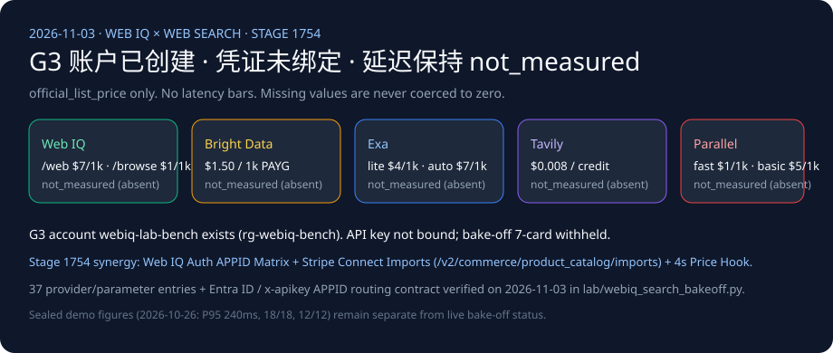

# Web IQ 搜索竞品矩阵（2026-11-03）

🌐 **语言导航 / Language**: **中文（当前）** | **[English](2026-11-03-webiq-search-competitive.en.md)** | **[2026-11-02 日报](2026-11-02-webiq-search-competitive.md)** | **[Browse passage 笔记](2026-11-01-webiq-azure-browse-passage.md)**

## 结论（2026-11-03 核验）

1. **实测状态保持 `not_measured`**：尽管实验室付费订阅（`rg-webiq-bench`）下已创建 G3 账户 `webiq-lab-bench`（`Microsoft.WebIQ/accounts@2026-06-01-preview`，`location=global`，`kind=WebIQ.Grounding`，`statisticsEnabled=false`），但本机环境未绑定可供自动化调用的 `WEBIQ_API_KEY`，且 `BRIGHTDATA_API_KEY`、`EXA_API_KEY`、`TAVILY_API_KEY`、`PARALLEL_API_KEY` 均缺省（`credential="absent"`）。五家供应商保持 `call="not_called"`、`latency="not_measured"`、`success="not_measured"`、`citation_check="not_measured"`，严禁将未测延迟记为 `0`。跨供应商 7-Card 延迟面板在拥有真实 `summary.json` 前继续保持 `withheld_until_measured_latency_exists`。
2. **与密封复放基线严格隔离**：`2026-10-26.stage1746` / `2026-11-03.stage1754` 中的 Web IQ `/v3/search/web` P95 `240ms`、任务成功率 `18/18`、注入拦截 `12/12`、批量并发 `1.52s vs 4.18s` 仅属于确定性密封复放（`sealed_demo`），绝不混入本跨供应商实测对比矩阵。
3. **2026-11-03 新增官方契约发现（Web IQ SDK / Entra ID `APPID` 互斥路由 × Stripe Connect `POST /v2/commerce/product_catalog/imports` 与 4s 价格可用性 Hook 协同）**：
   - **Web IQ 官方 SDK 与定价文档更新核验（`updated_at: 2026-11-02T20:34:00Z`）**：官方确认 Python SDK（`pip install webiq`，Python 3.11+，MIT）与 TypeScript SDK（`npm install @microsoft/webiq`，Node.js 22+，MIT）统一暴露 `web`、`videos`、`browse`、`news`、`images` 五大命名空间，支持 `WebIQClient` / `WebIQAsyncClient` 及 `DefaultAzureCredential()`。
   - **Web IQ `x-apikey` vs Microsoft Entra ID `APPID` 互斥鉴权矩阵（`https://learn.microsoft.com/en-us/web-iq/get-started/authentication`）**：
     - 使用 `x-apikey` 鉴权时，每个 API Key 固定归属单一 `AppID`，**严禁携带 `APPID` 查询参数（即使为空字符串 `?APPID=` 也会直接返回 `HTTP 401 AuthUnauthorizedEntryId`）**；
     - 使用 Microsoft Entra ID（Scope `https://api.microsoft.ai/.default`）且客户端绑定 **多个 Web IQ AppID** 时，请求若缺失或传入空 `APPID` 返回 **`HTTP 400 AuthAppIdSelectionRequired`**，传入未绑定 `APPID` 返回 **`HTTP 403 AuthUnauthorizedAppId`**；绑定 0 个 `AppID` 返回 **`HTTP 401 AuthUnauthorizedEntryId`**。已在 [`lab/webiq_search_bakeoff.py`](../../lab/webiq_search_bakeoff.py) 中固化为 `validate_webiq_auth_appid_routing()` 并纳入单元测试。
   - **与 Stripe Connect SaaS 平台目录导入（`POST /v2/commerce/product_catalog/imports`）及双超时 Hook 的架构分工**：
     - **开放网页长尾发现与政策核验（T-0）**：使用 Web IQ `/v3/search/web`（`$7/1k`）+ `/v3/browse`（`$1/1k`，`contentFormat="passage"` 默认 $\le 3000$ 字符），在进入 LLM 前通过 `PROMPT_INJECTION_RE` 清洗不可信网页段落；
     - **Connect 子商户结构化目录同步（T-1）**：SaaS 平台通过 `POST /v2/commerce/product_catalog/imports`（`Stripe-Version: 2026-10-28.preview`，需具备 `Product Catalog Imports` 写权限，否则 `HTTP 403`）异步上传 CSV（最大 `4 GB`，预签名 `upload_url` 与 `error_details.url` 均 **5 分钟 / 300s 过期**）；`product` 源每日 1 次，`inventory` / `pricing` / `promotion` 源每 15 分钟 1 次且**仅支持 `upsert` 模式**；
     - **毫秒级非对称超时 Hook 决策（T-2）**：`delegated_commerce.product_price_availability` 实时报价与库存回调必须在 **4 秒（4,000 ms）** 内响应，**若超时 Stripe 会自动回退（Fallback）至已导入的目录源数据继续结账**（将因缺货导致的结账失败率控制在 `< 5%`）；这与 `v1.delegated_checkout.finalize_checkout` 订单审批 Hook **超时即直接拒绝结账（Decline Checkout）** 形成严格的非对称防线！

## 账户现状

- 资源组 `rg-webiq-bench`，区域 `southeastasia`，账户位置 `global`。
- `provisioningState=Succeeded`。
- 本页不公开订阅 ID、内部编号、网关主机名或登录邮箱。
- `x-apikey` 仍需在 `https://webiq.microsoft.ai/profiles` 门户生成；Azure CLI 无法直接换取 `https://api.microsoft.ai/.default` 的数据面令牌。
- Browse 仍受 AppID 策略门控；Auto 处于 Beta 阶段不计费。
- 未注册 Bright Data、Exa、Tavily、Parallel 账户。

## 官方标价，不作评分

每行均标记为 `official_list_price`，2026-11-03 核验。这些数字不是延迟柱。

| 供应商 | 官方标价 | 来源 | 非实测声明 |
|---|---|---|---|
| Web IQ | `/web`、`/video`、`/news`、`/images` 每千次 $7；`/browse` 每千次 $1。2026-10-16 生效，文档 `updated_at: 2026-11-02T20:34:00Z`。 | [Pricing](https://learn.microsoft.com/en-us/web-iq/resources/pricing) | Auto Beta 免费不代表延迟。 |
| Bright Data SERP | 每月 5,000 次免费请求；按量 $1.50 / 1,000 次成功请求；Scale $499/月含 380,000 次，超出 $1.30 / 1,000。页面注明显示币种可能为本地估算，以 USD 结算为准。 | [SERP pricing](https://brightdata.com/pricing/serp) | “1 秒内响应”属宣传语，不计入实测。 |
| Exa | Lite/instant $4/1k，auto/fast $7/1k，contents 每种内容类型 $1/1k 页，answer $5/1k，monitors $15/1k。deep-lite/deep $12/1k，deep-reasoning $15/1k。Agent 固定档每次 $0.012–$1.00。每月 1 日重置 $10 免费额度。 | [Pricing](https://exa.ai/pricing) | [搜索参考](https://docs.exa.ai/reference/search)规定包含与排除域名各限 1,200 个，替代 `site:`。定价页秒数不入延迟图。 |
| Tavily | Basic、fast、ultra-fast 均为 1 credit；advanced 2 credits。按量 $0.008/credit；文档表格公布 Project $0.0075、Bootstrap $0.0067、Startup $0.0058、Growth $0.005/credit。Research pro 15–250 credits，mini 4–110。每月 1,000 免费 credits。 | [API credits](https://docs.tavily.com/documentation/api-credits) | [搜索参考](https://docs.tavily.com/documentation/api-reference/endpoint/search)规定 `max_results` 默认 10、上限 20，`chunks_per_source` 为 1–3。失败提取与失败映射不计费。本轮无延迟实测。 |
| Parallel | Turbo/fast $1/1k，basic/advanced $5/1k，超额结果 $1/1k。Extract $1/1k URL。Task lite $5/1k 次成功运行，ultra8x $2,400/1k。Responses medium $50/1k。 | [Pricing](https://docs.parallel.ai/getting-started/pricing) | [搜索参考](https://docs.parallel.ai/api-reference/search/search)说明 `https://eu.parallel.ai` 仅支持 basic 模式。Image Search 的 advanced 默认值不得挪用于网页搜索。200 ms–3 s 区间保持 `vendor_stated`。 |

## 离线契约与 `APPID` 鉴权守卫

[`lab/webiq_search_bakeoff.py`](../../lab/webiq_search_bakeoff.py)（`VERIFIED_ON = "2026-11-03"`）不发起任何网络连接。三条密封问题分别覆盖退货窗口、可引用价格页与公开召回停采判断。缺省密钥时，`latency`、`success`、`citation_check` 全部保持 `not_measured`；即使传入密钥，也仅记录 `credential=present`、`call=not_called`，绝不静默产生计费调用。同时 `validate_webiq_auth_appid_routing()` 对 `x-apikey` 与 Entra ID 多 `AppID` 绑定边界执行确定性校验。

## 架构边界：Microsoft Web IQ 调用方可见段落 vs. Foundry Grounding with Bing Search vs. Stripe Connect 目录导入与双超时 Hook

2026-11-03 核验自 Microsoft Learn 官方文档（[Web IQ Authentication](https://learn.microsoft.com/en-us/web-iq/get-started/authentication)、[Web IQ SDKs](https://learn.microsoft.com/en-us/web-iq/integrations/sdk)、[Foundry Agents Web Grounding Overview](https://learn.microsoft.com/en-us/azure/foundry/agents/how-to/tools/web-overview)）与 Stripe Connect Agentic Commerce 官方文档（[Enable in-context selling on AI agents](https://docs.stripe.com/connect/saas/tasks/enable-in-context-selling-on-ai-agents.md)）：

| 维度 | Microsoft Web IQ (`/v3/search/web`, `/v3/browse`) | Microsoft Foundry Grounding with Bing Search | Stripe Connect Catalog Imports + Seller Hooks | Agentic Commerce 架构影响 |
|---|---|---|---|---|
| **调用方对原始检索段落的可见性** | **直接向调用方代码返回结构化段落**（`webResults[].content`，`contentFormat="passage"` 默认 $\le 3000$ 字符） | **对调用方隐藏原始检索片段**（检索结果留在受管 Foundry 边界内，仅返回模型生成结果与引用链接） | `POST /v2/commerce/product_catalog/imports`（CSV 预签名上传 5 分钟过期）+ `product_price_availability` JSON 回调 | 在进入 LLM 前执行确定性防注入清洗（`PROMPT_INJECTION_RE`）与 SHA-256 价格摘要比对必须使用 **Web IQ** |
| **鉴权与租户/AppID 隔离** | `x-apikey` 严禁带 `APPID`（否则 `401 AuthUnauthorizedEntryId`）；Entra ID 多 AppID 缺失 `APPID` 返 `400 AuthAppIdSelectionRequired` | 托管于 Azure Foundry 连接与 RBAC | Connect 平台需持 `Product Catalog Imports` 写权限（否则 `403`）并按子商户传 `Stripe-Account` | 多租户智能体网关必须严格分离 API Key 与 Entra Token 的 `APPID` 路由参数 |
| **超时与降级语义** | `AuthUserThrottled` (429) 返秒数（`"60s"`），`TooManyOnDemandCrawls` (429) 与 `Browse 202` 返 ISO-8601 时间戳 | 由 Foundry 内部托管 | `product_price_availability` **4s 超时回退目录源继续结账**；`finalize_checkout` **4s 超时直接拒绝结账** | 结账审批关键路径严禁串联慢速动态网页抓取（`liveCrawl=fallback`） |

## 交易智能体路由建议

下表为架构选型建议（`label="architecture_guidance"`），不代表实测性能冠亚军。

| 场景 | 首选调用 | 原因 | 禁止做法 |
|---|---|---|---|
| 查当前价格，URL 未知 | Web IQ `/web`（`contentFormat=passage`，可加零售商 `site:`），再对返回的候选 URL 调 `/browse` | 搜索负责发现，Browse 负责读取正文，并用 `crawledAt` 判断新鲜度 | 直接拿 SERP 摘要改写已授权金额 |
| 退货条款，URL 已知 | Web IQ `/browse`，`passage` 加非空 `query`；仅在索引 404 后再用 `liveCrawl=fallback` | $1/1k 且按问题抽取段落；无全文权限时默认截断在 3000 字符 | 为单个已知政策页购买整次 SERP 搜索 |
| 需暂停自动补货的公开召回或安全通告 | Web IQ `/news`，读取 `source`、`lastUpdatedAt`、`crawledAt` | Web 无日期过滤；官方 FAQ 明确将新闻时效场景指向 News | 把旧网页段落当成“今日无召回” |
| 商品图片或可嵌入视频 | `/images` 或 `/videos` | 提供宿主页面、尺寸、无水印与嵌入链接字段 | 把图片结果当成价格证据 |
| 单轮包含多个独立子问题 | 拆分为多次 `/web` 或 `/news` 调用；Auto Beta 虽可返回带类型证据，但仍属免费 Beta 且契约可变 | 官方 FAQ 指出单次 Web 请求只处理单一查询意图 | 把整段多意图长对话塞进单条 1000 字符查询 |
| 某国 Google Shopping 卡片、广告位或排名监控 | Bright Data SERP，在引擎 URL 上传 `gl` / `hl` | 官方明确面向比价与排名追踪 | 把搜索结果页当成商家源站正文 |
| 已知 URL 被拦截且需原始 HTML | Bright Data Web Unlocker，或用 Exa `/contents`、Tavily Extract、Parallel Extract 取正文 | Unlocker 负责穿盾取 HTML，其余三家按页面正文计费 | 用 Unlocker 执行点击式结账（官方文档明确它不是浏览器交互工具） |
| 页面点击、登录态、截图 | Bright Data Browser API | 官方产品选择器明确划分的交互边界 | 误以为 Browse `renderDynamicPages` 能提交表单（它仅在 `liveCrawl=fallback` 时做页面渲染） |

完整的 37 项官方定价与参数附录见 [`lab/webiq_search_bakeoff.py`](../../lab/webiq_search_bakeoff.py) 与 [2026-11-01 详细矩阵](2026-11-01-webiq-search-competitive.md)。
