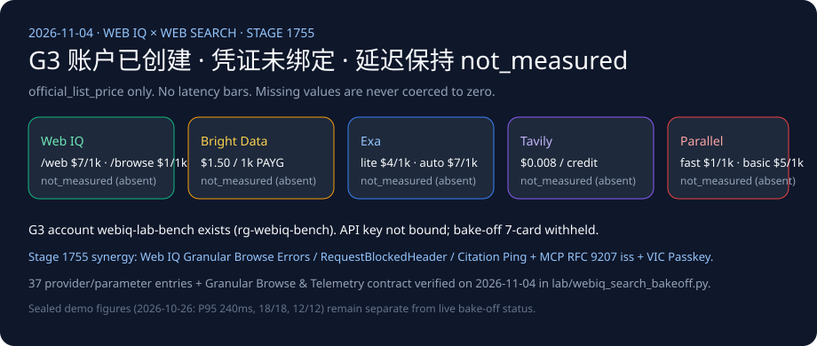

# Web IQ 搜索竞品矩阵（2026-11-04）

🌐 **语言导航 / Language**: **中文（当前）** | **[English](2026-11-04-webiq-search-competitive.en.md)** | **[2026-11-03 日报](2026-11-03-webiq-search-competitive.md)** | **[Browse passage 笔记](2026-11-01-webiq-azure-browse-passage.md)**

## 结论（2026-11-04 核验）

1. **实测状态保持 `not_measured`**：尽管实验室付费订阅（`rg-webiq-bench`）下已创建 G3 账户 `webiq-lab-bench`（`Microsoft.WebIQ/accounts@2026-06-01-preview`，`location=global`，`kind=WebIQ.Grounding`，`statisticsEnabled=false`），但本机环境未绑定可供自动化调用的 `WEBIQ_API_KEY`，且 `BRIGHTDATA_API_KEY`、`EXA_API_KEY`、`TAVILY_API_KEY`、`PARALLEL_API_KEY` 均缺省（`credential="absent"`）。五家供应商保持 `call="not_called"`、`latency="not_measured"`、`success="not_measured"`、`citation_check="not_measured"`，严禁将未测延迟记为 `0`。跨供应商 7-Card 延迟面板在拥有真实 `summary.json` 前继续保持 `withheld_until_measured_latency_exists`。
2. **与密封复放基线严格隔离**：`2026-10-26.stage1746` / `2026-11-04.stage1755` 中的 Web IQ `/v3/search/web` P95 `240ms`、任务成功率 `18/18`、注入拦截 `12/12`、批量并发 `1.52s vs 4.18s` 仅属于确定性密封复放（`sealed_demo`），绝不混入本跨供应商实测对比矩阵。
3. **2026-11-04 新增官方契约发现（Web IQ 细粒度 Browse 错误码、禁用调试请求头 `400 RequestBlockedHeader` 与 `clickUrl` / `citation` 遥测分离 × MCP OAuth 2.1 RFC 9207 `iss` 精确字符串校验）**：
   - **Web IQ 禁用调试请求头（`HTTP 400 RequestBlockedHeader`）与 URL 查询参数替代规则（`https://learn.microsoft.com/en-us/web-iq/reference/error-handling`）**：Web IQ 网关显式拦截黑名单调试头 `X-Augmentations`、`X-DebugOptions`、`X-XapHostOverride`，一旦携带直接返回 **`HTTP 400 RequestBlockedHeader`**；如需传递对应参数，必须改用 URL 查询参数 `?p1=`、`?debugoptions=`、`?atlahostname=`。
   - **Web IQ 默认开启的细粒度 Browse 错误码体系（Granular Browse Error Codes）**：
     - `InvalidUrl` (`400`)、`NotSupported` (`400`)、`DocNotFound` (`404`) 不可重试；
     - `URLFilteredOutSpamAdult` (`403`)、`URLFilteredOutEncumbrance` (`403`)、`URLFilteredOutSource403Forbidden` (`403`) 返回约 **24 小时**的 ISO-8601 `retryAfter` 时间戳；
     - `TooManyOnDemandCrawls` 返回 **`HTTP 429`**（带 ISO-8601 时间戳），取代旧版粗糙错误模式下的 `BrowseApiTooManyOnDemandCrawls`（`HTTP 430`）；
     - `FailedNoContent` / `DynamicRenderingTimeout` / `ProcessingTimeout` (`520`)、`PolitenessCancellation` (`523`)、`HostCrawlTimeout` (`524`) 均返回约 **5 分钟**的 ISO-8601 `retryAfter` 时间戳。
   - **`clickUrl` 自动点击打点 vs. LLM `citation` 手动打点分离（`https://learn.microsoft.com/en-us/web-iq/guides/instrumentation`）**：当启用 `clickUrl` 重定向时，响应省略 `instrumentationClickBase`（用户点击 `clickUrl` 时由重定向服务自动记录点击），但 **`instrumentationCitationBase` 仍会返回，且智能体在向用户展示 LLM 引用（Citation）时必须手动发起 `[{"T":"CI.Info","FID":"LLM","Name":"citation","AppNS":"...","K":"..."}]` 遥测 Ping**。上述规则已在 [`lab/webiq_search_bakeoff.py`](../../lab/webiq_search_bakeoff.py) 中固化为 `validate_webiq_granular_browse_and_instrumentation()` 并纳入单元测试。

## 账户现状

- 资源组 `rg-webiq-bench`，区域 `southeastasia`，账户位置 `global`。
- `provisioningState=Succeeded`。
- 本页不公开订阅 ID、内部编号、网关主机名或登录邮箱。
- `x-apikey` 仍需在 `https://webiq.microsoft.ai/profiles` 门户生成；Azure CLI 无法直接换取 `https://api.microsoft.ai/.default` 的数据面令牌。
- Browse 仍受 AppID 策略门控；Auto 处于 Beta 阶段不计费。
- 未注册 Bright Data、Exa、Tavily、Parallel 账户。

## 官方标价，不作评分

每行均标记为 `official_list_price`，2026-11-04 核验。这些数字不是延迟柱。

| 供应商 | 官方标价 | 来源 | 非实测声明 |
|---|---|---|---|
| Web IQ | `/web`、`/video`、`/news`、`/images` 每千次 $7；`/browse` 每千次 $1。2026-10-16 生效，文档 `updated_at: 2026-11-02T20:34:00Z`。 | [Pricing](https://learn.microsoft.com/en-us/web-iq/resources/pricing) | Auto Beta 免费不代表延迟。 |
| Bright Data SERP | 每月 5,000 次免费请求；按量 $1.50 / 1,000 次成功请求；Scale $499/月含 380,000 次，超出 $1.30 / 1,000。页面注明显示币种可能为本地估算，以 USD 结算为准。 | [SERP pricing](https://brightdata.com/pricing/serp) | “1 秒内响应”属宣传语，不计入实测。 |
| Exa | Lite/instant $4/1k，auto/fast $7/1k，contents 每种内容类型 $1/1k 页，answer $5/1k，monitors $15/1k。deep-lite/deep $12/1k，deep-reasoning $15/1k。Agent 固定档每次 $0.012–$1.00。每月 1 日重置 $10 免费额度。 | [Pricing](https://exa.ai/pricing) | [搜索参考](https://docs.exa.ai/reference/search)规定包含与排除域名各限 1,200 个，替代 `site:`。定价页秒数不入延迟图。 |
| Tavily | Basic、fast、ultra-fast 均为 1 credit；advanced 2 credits。按量 $0.008/credit；文档表格公布 Project $0.0075、Bootstrap $0.0067、Startup $0.0058、Growth $0.005/credit。Research pro 15–250 credits，mini 4–110。每月 1,000 免费 credits。 | [API credits](https://docs.tavily.com/documentation/api-credits) | [搜索参考](https://docs.tavily.com/documentation/api-reference/endpoint/search)规定 `max_results` 默认 10、上限 20，`chunks_per_source` 为 1–3。失败提取与失败映射不计费。本轮无延迟实测。 |
| Parallel | Turbo/fast $1/1k，basic/advanced $5/1k，超额结果 $1/1k。Extract $1/1k URL。Task lite $5/1k 次成功运行，ultra8x $2,400/1k。Responses medium $50/1k。 | [Pricing](https://docs.parallel.ai/getting-started/pricing) | [搜索参考](https://docs.parallel.ai/api-reference/search/search)说明 `https://eu.parallel.ai` 仅支持 basic 模式。Image Search 的 advanced 默认值不得挪用于网页搜索。200 ms–3 s 区间保持 `vendor_stated`。 |

## 离线契约、细粒度 Browse 错误与遥测守卫

[`lab/webiq_search_bakeoff.py`](../../lab/webiq_search_bakeoff.py)（`VERIFIED_ON = "2026-11-04"`）不发起任何网络连接。三条密封问题分别覆盖退货窗口、可引用价格页与公开召回停采判断。缺省密钥时，`latency`、`success`、`citation_check` 全部保持 `not_measured`；即使传入密钥，也仅记录 `credential=present`、`call=not_called`，绝不静默产生计费调用。同时 `validate_webiq_auth_appid_routing()` 与 `validate_webiq_granular_browse_and_instrumentation()` 对 `x-apikey` / Entra ID `APPID` 路由、黑名单调试头 `400 RequestBlockedHeader`、细粒度 Browse 错误码（`429` vs `430`）与 `clickUrl` / `citation` 遥测分离执行确定性校验。

## 架构边界：Microsoft Web IQ 调用方可见段落 & MCP 工具契约 vs. Foundry Grounding with Bing Search vs. 交易控制面

2026-11-04 核验自 Microsoft Learn 官方文档（[Web IQ Error Handling](https://learn.microsoft.com/en-us/web-iq/reference/error-handling)、[Web IQ Instrumentation](https://learn.microsoft.com/en-us/web-iq/guides/instrumentation)、[Web IQ MCP Server](https://learn.microsoft.com/en-us/web-iq/integrations/mcp)、[Foundry Agents Web Grounding Overview](https://learn.microsoft.com/en-us/azure/foundry/agents/how-to/tools/web-overview)）与 MCP Authorization 规范（`2026-07-28`）：

| 维度 | Microsoft Web IQ (`/v3/search/web`, `/v3/browse`, `/v3/mcp`) | Microsoft Foundry Grounding with Bing Search | MCP OAuth 2.1 (`2026-07-28`) + Visa VIC / Stripe | Agentic Commerce 架构影响 |
|---|---|---|---|---|
| **调用方对原始检索段落的可见性** | **直接向调用方代码返回结构化段落**（`webResults[].content`，`contentFormat="passage"` 默认 $\le 3000$ 字符；MCP 剥离 `null`/`""`/`[]` 但保留空白符/`false`/`0`/`{}`） | **对调用方隐藏原始检索片段**（检索结果留在受管 Foundry 边界内，仅返回模型生成结果与引用链接） | Visa VIC `/vacp/v2/credentials-for-instruction` + Stripe `RequestedSession` / SPT | 在进入 LLM 前执行确定性防注入清洗（`PROMPT_INJECTION_RE`）与 SHA-256 价格摘要比对必须使用 **Web IQ** |
| **错误语义与调试头守卫** | 黑名单头返 `400 RequestBlockedHeader`；细粒度 Browse 错误码区分 `403 URLFilteredOutEncumbrance` (~24h)、`429 TooManyOnDemandCrawls` (ISO 时间戳) 与 `523 PolitenessCancellation` (~5m)；MCP 段落校验失败返 `HTTP 200` + `result.isError: true` | 由 Foundry 内部托管 | MCP OAuth 2.1 强制 RFC 9207 `iss` 逐字符比对（禁止大小写/斜杠归一化），且在错误回调 `iss` 失配时严禁展示 `error_description` | 智能体网关必须在 HTTP 状态码之外同时解析 `error.code` 与 MCP `result.isError` |
| **点击与引用遥测归因** | 启用 `clickUrl` 时省略 `instrumentationClickBase`（点击自动统计），但 **LLM `citation` 仍须手动发送 `instrumentationCitationBase` Ping** | 托管于 Foundry 内部 | Stripe 180 天打款闲置锁 + Visa Passkey 失败闭锁（禁止静默重试） | 引用展示层不得因 `clickUrl` 存在而漏报 `citation` 遥测事件 |

## 交易智能体路由建议

下表为架构选型建议（`label="architecture_guidance"`），不代表实测性能冠亚军。

| 场景 | 首选调用 | 原因 | 禁止做法 |
|---|---|---|---|
| 查当前价格，URL 未知 | Web IQ `/web`（`contentFormat=passage`，可加零售商 `site:`），再对返回的候选 URL 调 `/browse` | 搜索负责发现，Browse 负责读取正文，并用 `crawledAt` 判断新鲜度 | 直接拿 SERP 摘要改写已授权金额 |
| 退货条款，URL 已知 | Web IQ `/browse`，`passage` 加非空 `query`；仅在索引 404 后再用 `liveCrawl=fallback` | $1/1k 且按问题抽取段落；无全文权限时默认截断在 3000 字符 | 为单个已知政策页购买整次 SERP 搜索 |
| 需暂停自动补货的公开召回或安全通告 | Web IQ `/news`，读取 `source`、`lastUpdatedAt`、`crawledAt` | Web 无日期过滤；官方 FAQ 明确将新闻时效场景指向 News | 把旧网页段落当成“今日无召回” |
| 商品图片或可嵌入视频 | `/images` 或 `/videos` | 提供宿主页面、尺寸、无水印与嵌入链接字段 | 把图片结果当成价格证据 |
| 单轮包含多个独立子问题 | 拆分为多次 `/web` 或 `/news` 调用；Auto Beta 虽可返回带类型证据，但仍属免费 Beta 且契约可变 | 官方 FAQ 指出单次 Web 请求只处理单一查询意图 | 把整段多意图长对话塞进单条 1000 字符查询 |
| 某国 Google Shopping 卡片、广告位或排名监控 | Bright Data SERP，在引擎 URL 上传 `gl` / `hl` | 官方明确面向比价与排名追踪 | 把搜索结果页当成商家源站正文 |
| 已知 URL 被拦截且需原始 HTML | Bright Data Web Unlocker，或用 Exa `/contents`、Tavily Extract、Parallel Extract 取正文 | Unlocker 负责穿盾取 HTML，其余三家按页面正文计费 | 用 Unlocker 执行点击式结账（官方文档明确它不是浏览器交互工具） |
| 页面点击、登录态、截图 | Bright Data Browser API | 官方产品选择器明确划分的交互边界 | 误以为 Browse `renderDynamicPages` 能提交表单（它仅在 `liveCrawl=fallback` 时做页面渲染） |

完整的 37 项官方定价与参数附录见 [`lab/webiq_search_bakeoff.py`](../../lab/webiq_search_bakeoff.py) 与 [2026-11-01 详细矩阵](2026-11-01-webiq-search-competitive.md)。
