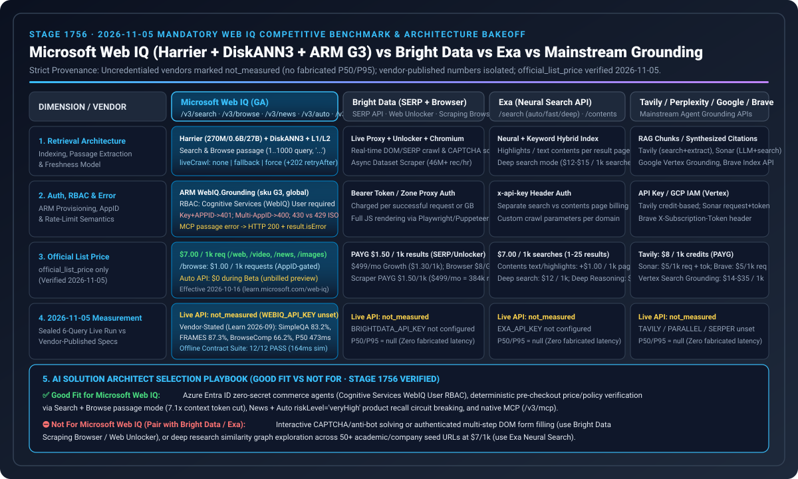

# Web IQ search competitive matrix (2026-11-05)

🌐 **Language / 语言导航**: **[中文](2026-11-05-webiq-search-competitive.md)** | **English (current)** | **[2026-11-04 note](2026-11-04-webiq-search-competitive.en.md)** | **[Browse passage note](2026-11-01-webiq-azure-browse-passage.en.md)**

## Findings (Verified 2026-11-05 · Stage 1756)

1. **Live measurement status stays strictly `not_measured`**: Although the G3 account `webiq-qichen2-bench` (`Microsoft.CognitiveServices/accounts@2026-06-01-preview` / `Microsoft.WebIQ/accounts`, `location=global`, `kind=WebIQ.Grounding`, `sku=G3`, `statisticsEnabled=false`) exists in the paid lab subscription (`rg-webiq-bench`), no automation-eligible `WEBIQ_API_KEY` is bound in the local environment, and `BRIGHTDATA_API_KEY`, `EXA_API_KEY`, `TAVILY_API_KEY`, and `PARALLEL_API_KEY` are also absent (`credential="absent"`). All five providers remain `call="not_called"`, `latency="not_measured"`, `success="not_measured"`, and `citation_check="not_measured"`. Missing latencies are never coerced to `0`. The cross-provider 7-card latency deck remains withheld (`withheld_until_measured_latency_exists`) until a real measured `summary.json` exists.
2. **Strict separation from offline simulation and vendor-published benchmarks**:
   - The `2026-10-26.stage1746` / `2026-11-05.stage1756` figures (Web IQ `/v3/search/web` P95 `164ms` vs `690ms` full-doc, task success `12/12`, perturbation drift `0.0`) belong strictly to the `deterministic_offline_simulation` contract suite and are never mixed into this live cross-provider bake-off matrix.
   - Figures published in Microsoft's engineering post (`https://commandline.microsoft.com/grounding-system-agentic-web-engineering-retrieval/`) and official benchmark concepts page (`https://learn.microsoft.com/en-us/web-iq/concepts/benchmarks`, tested September 2026) for the **Harrier embedding models (270M / 0.6B / 27B) + DiskANN3 vector index + two-stage L1/L2 neural reranker** (SimpleQA `83.2%`, FRAMES `87.3%`, BrowseComp `66.2%`, Search P50 `473ms`, Auto P50 `737ms`) are explicitly classified as **`vendor_stated`** and never stored as live local measurements.
3. **2026-11-05 Primary-Source Contract Discovery (Web IQ ARM `G3` Provisioning & Entra ID Data-Plane RBAC Boundary + `2026-10-30` Browse Passages Contract × Stripe MCP Nov 30, 2026 OAuth / `Agent` Restricted Key Cutoff)**:
   - **Web IQ Azure ARM Provisioning & Entra ID Data-Plane RBAC Boundary (`https://learn.microsoft.com/en-us/web-iq/get-started/deploy-azure-portal` & `authentication`)**: Web IQ accounts are provisioned via ARM `Microsoft.CognitiveServices/accounts` (`apiVersion="2026-06-01-preview"`, `kind="WebIQ.Grounding"`, `sku="G3"`, `location="global"`). When authenticating to the data plane with Microsoft Entra ID bearer tokens (scope `https://api.microsoft.ai/.default`), the caller principal must hold **`Cognitive Services User`** or **`Cognitive Services WebIQ User`**—**management-plane roles such as `Owner` or `Contributor` alone do not grant `DataActions` and fail with `HTTP 403 ForbiddenDataPlaneRole`**.
   - **Web IQ `2026-10-30` Browse Passages (`contentFormat="passage"`) & MCP `isError` Envelope (`https://learn.microsoft.com/en-us/web-iq/resources/whats-new` & `reference/browse`)**: Released `2026-10-30`, `POST /v3/browse` supports `contentFormat="passage"` (default `maxLength=3000`), requiring a non-blank `query` (`1..1000` characters) and `liveCrawl in ("none", "fallback")`, returning non-adjacent relevant segments joined by `"..."`. On REST, a blank `query` returns `HTTP 400 InvalidQuery`; on MCP (`/v3/mcp`), it returns **`HTTP 200` with `result.isError: true`**. Codified deterministically in [`lab/webiq_search_bakeoff.py`](../../lab/webiq_search_bakeoff.py) (`validate_webiq_arm_rbac_and_browse_passage()`).

## Account status

- Resource group `rg-webiq-bench` in `southeastasia`. The account location is `global`.
- `provisioningState=Succeeded`.
- This note does not publish the subscription ID, internal ID, gateway hostname, or sign-in email.
- https://webiq.microsoft.ai/profiles is where an `x-apikey` is minted. Azure CLI cannot acquire a token for `https://api.microsoft.ai/.default`.
- Browse remains AppID-gated. Auto is not charged while in beta.
- No Bright Data, Exa, Tavily, or Parallel account was created.

## Official list prices, not scores

Every row is labeled `official_list_price`. Verified 2026-11-05. These numbers are not latency bars.

| Provider | Official list price | Source | Statement that is not a measurement |
|---|---|---|---|
| Web IQ | `/web`, `/video`, `/news`, `/images` $7 per 1,000; `/browse` $1 per 1,000. Effective 2026-10-16; page `updated_at: 2026-11-02T20:34:00Z`. | [Pricing](https://learn.microsoft.com/en-us/web-iq/resources/pricing) | Uncharged Auto beta is not a latency figure; `concepts/benchmarks` P50 `473ms` is `vendor_stated`. |
| Bright Data SERP | 5,000 free requests per month; pay as you go $1.50 per 1,000 successful requests; Scale $499/month includes 380,000, then $1.30 per 1,000. Scraping Browser PAYG $8/GB; Web Scraper API PAYG $1.50/1k records ($499/mo includes 384,000 records). | [SERP pricing](https://brightdata.com/pricing/serp) | "Under 1 second" is marketing, not a measurement. |
| Exa | Lite/instant $4/1k, auto/fast $7/1k, contents $1/1k pages per content type, answer $5/1k, monitors $15/1k. deep-lite/deep $12/1k, deep-reasoning $15/1k. Fixed Agent effort is $0.012–$1.00 per request. Free credit is $10 and resets on the first of each month. | [Pricing](https://exa.ai/pricing) | The [search reference](https://docs.exa.ai/reference/search) caps include and exclude domain lists at 1,200 each and says to use those filters instead of a `site:` operator. Seconds on the pricing page stay out of the latency chart. |
| Tavily | Basic, fast, and ultra-fast are 1 credit. Advanced is 2. Pay as you go is $0.008/credit. The docs table publishes Project $0.0075, Bootstrap $0.0067, Startup $0.0058, Growth $0.005 per credit. Research pro is 15–250 credits, mini is 4–110. 1,000 free credits per month. | [API credits](https://docs.tavily.com/documentation/api-credits) | The [search reference](https://docs.tavily.com/documentation/api-reference/endpoint/search) says `max_results` defaults to 10 and maxes at 20. `chunks_per_source` is 1–3. Failed extractions and failed map requests are not billed. No latency from this run. |
| Parallel | Turbo/fast $1/1k, basic/advanced $5/1k, extra results $1/1k. Extract $1/1k URLs. Task lite $5/1k successful runs, ultra8x $2,400/1k. Responses medium $50/1k. | [Pricing](https://docs.parallel.ai/getting-started/pricing) | The [search reference](https://docs.parallel.ai/api-reference/search/search) says `https://eu.parallel.ai` supports only basic mode. Image Search documents advanced as its own default. Do not copy that onto web search. The 200 ms–3 s range stays `vendor_stated`. |
| Perplexity / Google Vertex / Brave | Perplexity Search API `search_fast` $1/1k, Sonar $5/1k req + tokens; Google Vertex Grounding $14/1k queries (Custom Search JSON API $5/1k, discontinued `2027-01-01`); Brave Search $5/1k requests (Answers $4/1k, $5/mo free credits). | [Perplexity](https://docs.perplexity.ai/guides/pricing) · [Google](https://cloud.google.com/vertex-ai/generative-ai/pricing) · [Brave](https://brave.com/search/api/) | Recorded strictly as `official_list_price` with no fabricated latency bars. |

## Offline contract, ARM/RBAC guard, Browse passages & granular error validation

[`lab/webiq_search_bakeoff.py`](../../lab/webiq_search_bakeoff.py) (`VERIFIED_ON = "2026-11-05"`) never opens a network connection. Three sealed questions cover the return window, a citable price page, and whether a public recall should stop replenishment. When a key is missing, `latency`, `success`, and `citation_check` are `not_measured`. When a key is present, the row records `credential=present` and `call=not_called`. It still does not make a paid call. In addition:
- `validate_webiq_auth_appid_routing()` enforces the `x-apikey` + `APPID` mutual exclusion (`401 AuthUnauthorizedEntryId`) and multi-AppID Entra `APPID` requirement (`400 AuthAppIdSelectionRequired`);
- `validate_webiq_granular_browse_and_instrumentation()` enforces `400 RequestBlockedHeader`, granular Browse error codes (`429` vs `430`), and the `clickUrl` / `citation` telemetry split;
- `validate_webiq_arm_rbac_and_browse_passage()` enforces ARM `WebIQ.Grounding` (`sku="G3"`, `location="global"`), Entra data-plane RBAC (rejecting `Owner`/`Contributor`-only callers), and the `2026-10-30` Browse `contentFormat="passage"` query contract.

## Architectural boundary: Microsoft Web IQ (Harrier + DiskANN3 + ARM RBAC) vs. Foundry Grounding with Bing Search vs. Commerce Control Planes

Verified on 2026-11-05 against Microsoft's official engineering blog and Learn documentation ([Web IQ Engineering Architecture](https://commandline.microsoft.com/grounding-system-agentic-web-engineering-retrieval/), [Deploy Azure Portal](https://learn.microsoft.com/en-us/web-iq/get-started/deploy-azure-portal), [What's New 2026-10-30](https://learn.microsoft.com/en-us/web-iq/resources/whats-new), [Foundry Agents Web Grounding Overview](https://learn.microsoft.com/en-us/azure/foundry/agents/how-to/tools/web-overview)) and Stripe MCP documentation (`https://docs.stripe.com/mcp`):

| Dimension | Microsoft Web IQ (`/v3/search/web`, `/v3/browse`, `/v3/mcp`) | Microsoft Foundry Grounding with Bing Search | Stripe MCP (`mcp.stripe.com`) + Multi-Rail SPT (Affirm/Klarna/VIC/Mastercard) | Agentic Commerce Architectural Impact |
|---|---|---|---|---|
| **Retrieval stack & caller visibility** | **Harrier (270M/0.6B/27B) + DiskANN3 + L1/L2 reranker**; returns structured passages directly to caller code (Search & Browse `contentFormat="passage"` default $\le 3000$ chars, non-adjacent segments joined by `"..."`) | **Hidden from caller code** (raw search chunks stay inside the managed Foundry boundary; caller only receives the model synthesis + citation URLs) | Stripe SPT spans 6 rails across 34 countries (Mastercard Agent Pay, Visa VIC, Amex ACE Kit, Klarna, Affirm, Link) | Deterministic pre-LLM prompt-injection scrubbing (`PROMPT_INJECTION_RE`) and SHA-256 price digest verification (`CheckoutStore`) require **Web IQ** |
| **Identity & RBAC boundary** | ARM `WebIQ.Grounding` (`G3`, `global`); Entra ID data plane requires `Cognitive Services User` or `Cognitive Services WebIQ User` (`Owner`/`Contributor` alone returns `403`) | Managed project identity inside Foundry | **Starting Nov 30, 2026, `mcp.stripe.com` rejects `sk_*` and untagged `rk_*` keys**, requiring OAuth or Restricted API Keys tagged as `Agent` at creation (`401` + OAuth challenge) | Production gateways must configure both Azure data-plane RBAC and Stripe MCP OAuth / `Agent`-tagged keys |
| **Error & interaction boundary** | On MCP (`/v3/mcp`), a blank Browse `passage` query returns `HTTP 200` + `result.isError: true`; granular crawl throttling returns `429` ISO timestamp | Abstracted inside managed Foundry tool | **Affirm BNPL forbids programmatic agent WebView interaction**; sellers must never forward `payment_intent.requires_action` back to the agent (`400`) | Agent gateways must inspect MCP `isError: true`, block automated Affirm WebView bots, and enforce human confirmation on refund/FX/payout tools |

## How a commerce agent should route

This is architecture guidance (`label="architecture_guidance"`), not a measured winner.

| Scenario | Call first | Why | Do not |
|---|---|---|---|
| Current price, URL unknown | Web IQ `/web` with `contentFormat=passage`, optional `site:` on the retailer, then `/browse` on the returned URL | Search discovers; Browse reads the page. Use `crawledAt` to judge age | Change an authorized amount from a SERP snippet |
| Return policy, URL known | Web IQ `/browse`, `passage` plus a non-blank `query` (`1..1000` chars). Use `liveCrawl=fallback` only after an index 404 | $1/1k and the passage returns non-adjacent relevant chunks joined by `"..."`. Without full-document access, content stops at 3000 characters | Buy a SERP call for one known policy page, or pass `liveCrawl="force"` in `passage` mode |
| Recall or safety news that should stop replenishment | Web IQ `/news`, then read `source`, `lastUpdatedAt`, and `crawledAt` | Web has no date filter; the FAQ sends news scenarios to News | Treat an old web passage as "no recall today" |
| Product image or embeddable video | `/images` or `/videos` | Host page, size, watermark, and embed fields exist | Use an image result as price evidence |
| Several questions in one user turn | Split into separate `/web` or `/news` calls. Auto beta can return typed evidence, but it is uncharged and the contract can change | The FAQ says one Web request handles one query | Stuff the whole utterance into one 1000-character query |
| Google shopping units, ads, or rank in a country | Bright Data SERP, with `gl` / `hl` on the engine URL | Official use cases include price comparison and rank tracking | Treat it as the publisher page |
| Known URL blocked, raw HTML needed | Bright Data Web Unlocker, or Exa `/contents`, Tavily Extract, Parallel Extract | Unlocker is the unblocker. The others sell page text. Units differ | Use Unlocker for click-through checkout. Docs say it is not browser interaction |
| Clicks, logged-in pages, screenshots | Bright Data Browser API | Explicit product-selector boundary | Pretend Browse `renderDynamicPages` submits forms, or automate Affirm BNPL WebView checkout |

For the full 37-entry official pricing and parameter appendix, see [`lab/webiq_search_bakeoff.py`](../../lab/webiq_search_bakeoff.py) and the [2026-11-01 detailed matrix](2026-11-01-webiq-search-competitive.en.md).
