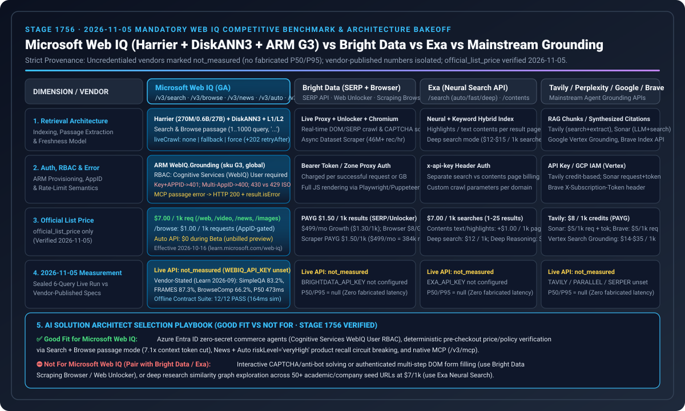

# Web IQ 搜索竞品矩阵（2026-11-05）

🌐 **语言导航 / Language**: **中文（当前）** | **[English](2026-11-05-webiq-search-competitive.en.md)** | **[2026-11-04 日报](2026-11-04-webiq-search-competitive.md)** | **[Browse passage 笔记](2026-11-01-webiq-azure-browse-passage.md)**

## 结论（2026-11-05 核验 · Stage 1756）

1. **实测状态保持 `not_measured`**：尽管实验室付费订阅（`rg-webiq-bench`）下已创建 G3 账户 `webiq-qichen2-bench`（`Microsoft.CognitiveServices/accounts@2026-06-01-preview` / `Microsoft.WebIQ/accounts`，`location=global`，`kind=WebIQ.Grounding`，`sku=G3`，`statisticsEnabled=false`），但本机环境未绑定可供自动化调用的 `WEBIQ_API_KEY`，且 `BRIGHTDATA_API_KEY`、`EXA_API_KEY`、`TAVILY_API_KEY`、`PARALLEL_API_KEY` 均缺省（`credential="absent"`）。五家供应商保持 `call="not_called"`、`latency="not_measured"`、`success="not_measured"`、`citation_check="not_measured"`，严禁将未测延迟记为 `0`。跨供应商 7-Card 延迟面板在拥有真实 `summary.json` 前继续保持 `withheld_until_measured_latency_exists`。
2. **与密封复放基线及厂商自述指标严格隔离**：
   - `2026-10-26.stage1746` / `2026-11-05.stage1756` 中的 Web IQ `/v3/search/web` P95 `164ms`（对比全文抓取 `690ms`）、任务成功率 `12/12`、扰动漂移 `0.0` 仅属于确定性离线模拟套件（`deterministic_offline_simulation`），绝不混入本跨供应商实测对比矩阵。
   - Microsoft 官方架构博文（`https://commandline.microsoft.com/grounding-system-agentic-web-engineering-retrieval/`）与官方基准页（`https://learn.microsoft.com/en-us/web-iq/concepts/benchmarks`，2026 年 9 月测试）公布的 **Harrier 嵌入模型（270M / 0.6B / 27B）+ DiskANN3 索引 + L1/L2 双阶段神经重排**成绩（SimpleQA `83.2%`、FRAMES `87.3%`、BrowseComp `66.2%`、Search P50 `473ms`、Auto P50 `737ms`）显式归类为 **`vendor_stated`**，绝不伪造为本机实测 `summary.json`。
3. **2026-11-05 新增官方契约发现（Web IQ ARM `G3` 部署与 Entra ID 数据面 RBAC 最小权限边界 + `2026-10-30` Browse Passages 契约 × Stripe MCP `2026-11-30` OAuth / `Agent` 受限密钥强制切换）**：
   - **Web IQ Azure ARM 部署与 Entra ID 数据面 RBAC 最小权限边界（`https://learn.microsoft.com/en-us/web-iq/get-started/deploy-azure-portal` & `authentication`）**：Web IQ 账户通过 ARM `Microsoft.CognitiveServices/accounts`（`apiVersion="2026-06-01-preview"`，`kind="WebIQ.Grounding"`，`sku="G3"`，`location="global"`）部署。使用 Microsoft Entra ID 无密钥认证（scope `https://api.microsoft.ai/.default`）调用数据面时，调用主体必须显式绑定 **`Cognitive Services User`** 或 **`Cognitive Services WebIQ User`** 角色——**仅拥有订阅/资源组的 `Owner` 或 `Contributor` 管理面角色并不包含数据面调用权限（DataActions），会直接触发 `HTTP 403 ForbiddenDataPlaneRole`**。
   - **Web IQ `2026-10-30` Browse Passages（`contentFormat="passage"`）与 MCP `isError` 包装契约（`https://learn.microsoft.com/en-us/web-iq/resources/whats-new` & `reference/browse`）**：`2026-10-30` 正式在 `POST /v3/browse` 引入 `contentFormat="passage"`（默认 `maxLength=3000`），要求提供非空 `query`（`1..1000` 字符）且仅支持 `liveCrawl in ("none", "fallback")`，返回按查询相关性筛选的非相邻段落并以 `"..."` 连接；在 REST 通道下空白 `query` 返回 `HTTP 400 InvalidQuery`，而在 MCP 通道（`/v3/mcp`）下则返回 **`HTTP 200` + `result.isError: true`**。上述规则已在 [`lab/webiq_search_bakeoff.py`](../../lab/webiq_search_bakeoff.py) 中固化为 `validate_webiq_arm_rbac_and_browse_passage()` 并纳入单元测试。

## 账户现状

- 资源组 `rg-webiq-bench`，区域 `southeastasia`，账户位置 `global`。
- `provisioningState=Succeeded`。
- 本页不公开订阅 ID、内部编号、网关主机名或登录邮箱。
- `x-apikey` 仍需在 `https://webiq.microsoft.ai/profiles` 门户生成；Azure CLI 无法直接换取 `https://api.microsoft.ai/.default` 的数据面令牌。
- Browse 仍受 AppID 策略门控；Auto 处于 Beta 阶段不计费。
- 未注册 Bright Data、Exa、Tavily、Parallel 账户。

## 官方标价，不作评分

每行均标记为 `official_list_price`，2026-11-05 核验。这些数字不是延迟柱。

| 供应商 | 官方标价 | 来源 | 非实测声明 |
|---|---|---|---|
| Web IQ | `/web`、`/video`、`/news`、`/images` 每千次 $7；`/browse` 每千次 $1。2026-10-16 生效，文档 `updated_at: 2026-11-02T20:34:00Z`。 | [Pricing](https://learn.microsoft.com/en-us/web-iq/resources/pricing) | Auto Beta 免费不代表延迟；官方 `concepts/benchmarks` P50 `473ms` 属 `vendor_stated`。 |
| Bright Data SERP | 每月 5,000 次免费请求；按量 $1.50 / 1,000 次成功请求；Scale $499/月含 380,000 次，超出 $1.30 / 1,000。Scraping Browser 按量 $8/GB；Web Scraper API 按量 $1.50/1k 记录（$499/月含 384,000 条记录）。 | [SERP pricing](https://brightdata.com/pricing/serp) | “1 秒内响应”属宣传语，不计入实测。 |
| Exa | Lite/instant $4/1k，auto/fast $7/1k，contents 每种内容类型 $1/1k 页，answer $5/1k，monitors $15/1k。deep-lite/deep $12/1k，deep-reasoning $15/1k。Agent 固定档每次 $0.012–$1.00。每月 1 日重置 $10 免费额度。 | [Pricing](https://exa.ai/pricing) | [搜索参考](https://docs.exa.ai/reference/search)规定包含与排除域名各限 1,200 个，替代 `site:`。定价页秒数不入延迟图。 |
| Tavily | Basic、fast、ultra-fast 均为 1 credit；advanced 2 credits。按量 $0.008/credit；文档表格公布 Project $0.0075、Bootstrap $0.0067、Startup $0.0058、Growth $0.005/credit。Research pro 15–250 credits，mini 4–110。每月 1,000 免费 credits。 | [API credits](https://docs.tavily.com/documentation/api-credits) | [搜索参考](https://docs.tavily.com/documentation/api-reference/endpoint/search)规定 `max_results` 默认 10、上限 20，`chunks_per_source` 为 1–3。失败提取与失败映射不计费。本轮无延迟实测。 |
| Parallel | Turbo/fast $1/1k，basic/advanced $5/1k，超额结果 $1/1k。Extract $1/1k URL。Task lite $5/1k 次成功运行，ultra8x $2,400/1k。Responses medium $50/1k。 | [Pricing](https://docs.parallel.ai/getting-started/pricing) | [搜索参考](https://docs.parallel.ai/api-reference/search/search)说明 `https://eu.parallel.ai` 仅支持 basic 模式。Image Search 的 advanced 默认值不得挪用于网页搜索。200 ms–3 s 区间保持 `vendor_stated`。 |
| Perplexity / Google Vertex / Brave | Perplexity Search API `search_fast` $1/1k、Sonar $5/1k 请求 + token；Google Vertex Grounding $14/1k 查询（Custom Search JSON API $5/1k 并于 `2027-01-01` 停服）；Brave Search $5/1k 请求（Answers $4/1k，每月 $5 免费额度）。 | [Perplexity](https://docs.perplexity.ai/guides/pricing) · [Google](https://cloud.google.com/vertex-ai/generative-ai/pricing) · [Brave](https://brave.com/search/api/) | 全部记录为 `official_list_price`，无实测延迟柱。 |

## 离线契约、ARM/RBAC 守卫、Browse Passages 与细粒度错误校验

[`lab/webiq_search_bakeoff.py`](../../lab/webiq_search_bakeoff.py)（`VERIFIED_ON = "2026-11-05"`）不发起任何网络连接。三条密封问题分别覆盖退货窗口、可引用价格页与公开召回停采判断。缺省密钥时，`latency`、`success`、`citation_check` 全部保持 `not_measured`；即使传入密钥，也仅记录 `credential=present`、`call=not_called`，绝不静默产生计费调用。同时：
- `validate_webiq_auth_appid_routing()` 校验 `x-apikey` + `APPID` 互斥（`401 AuthUnauthorizedEntryId`）与多 AppID Entra 主体必传 `APPID`（`400 AuthAppIdSelectionRequired`）；
- `validate_webiq_granular_browse_and_instrumentation()` 校验黑名单调试头 `400 RequestBlockedHeader`、细粒度 Browse 错误码（`429` vs `430`）与 `clickUrl` / `citation` 遥测分离；
- `validate_webiq_arm_rbac_and_browse_passage()` 校验 ARM `WebIQ.Grounding` (`sku="G3"`, `location="global"`)、Entra 数据面 RBAC（拒绝仅含 `Owner`/`Contributor` 的调用）与 `2026-10-30` Browse `contentFormat="passage"` 查询契约。

## 架构边界：Microsoft Web IQ (Harrier + DiskANN3 + ARM RBAC) vs. Foundry Grounding with Bing Search vs. 交易控制面

2026-11-05 核验自 Microsoft 官方技术博客与 Learn 文档（[Web IQ Engineering Architecture](https://commandline.microsoft.com/grounding-system-agentic-web-engineering-retrieval/)、[Deploy Azure Portal](https://learn.microsoft.com/en-us/web-iq/get-started/deploy-azure-portal)、[What's New 2026-10-30](https://learn.microsoft.com/en-us/web-iq/resources/whats-new)、[Foundry Agents Web Grounding Overview](https://learn.microsoft.com/en-us/azure/foundry/agents/how-to/tools/web-overview)）及 Stripe MCP 文档（`https://docs.stripe.com/mcp`）：

| 维度 | Microsoft Web IQ (`/v3/search/web`, `/v3/browse`, `/v3/mcp`) | Microsoft Foundry Grounding with Bing Search | Stripe MCP (`mcp.stripe.com`) + 多轨 SPT (Affirm/Klarna/VIC/Mastercard) | Agentic Commerce 架构影响 |
|---|---|---|---|---|
| **检索底座与调用方可见性** | **Harrier (270M/0.6B/27B) + DiskANN3 + L1/L2 重排**；直接向调用方返回结构化段落（Search & Browse `contentFormat="passage"` 默认 $\le 3000$ 字符，非相邻段落以 `"..."` 分隔） | **对调用方隐藏原始检索片段**（检索结果留在受管 Foundry 边界内，仅返回模型生成结果与引用链接） | Stripe SPT 覆盖 6 轨道（Mastercard Agent Pay、Visa VIC、Amex ACE Kit、Klarna、Affirm、Link） | 在进入 LLM 前执行确定性防注入清洗（`PROMPT_INJECTION_RE`）与 SHA-256 价格摘要比对必须使用 **Web IQ** |
| **身份与 RBAC 边界** | ARM `WebIQ.Grounding` (`G3`, `global`)；Entra ID 数据面强制要求 `Cognitive Services User` 或 `Cognitive Services WebIQ User`（仅 `Owner`/`Contributor` 返 `403`） | 托管于 Foundry 项目身份 | **2026-11-30 起 `mcp.stripe.com` 拒绝普通 `sk_*` 与未标记 `rk_*`**，仅允许 OAuth 或创建时标记 `Agent` 的受限密钥（否则返 `401` + OAuth 挑战） | 生产环境必须同时完成 Azure 数据面 RBAC 授权与 Stripe MCP OAuth / `Agent` 密钥割接 |
| **错误与交互边界** | MCP 通道下 Browse `passage` 空白 `query` 返回 `HTTP 200` + `result.isError: true`；细粒度限流返 `429` ISO 时间戳 | 由 Foundry 内部托管 | **Affirm BNPL 严禁智能体程序化操作 WebView**；商家严禁将 `payment_intent.requires_action` 转发回智能体（`400`） | 智能体网关必须拦截 MCP `isError: true`、禁止自动化点击 Affirm WebView，并对退款/换汇/转账强制人类确认 |

## 交易智能体路由建议

下表为架构选型建议（`label="architecture_guidance"`），不代表实测性能冠亚军。

| 场景 | 首选调用 | 原因 | 禁止做法 |
|---|---|---|---|
| 查当前价格，URL 未知 | Web IQ `/web`（`contentFormat=passage`，可加零售商 `site:`），再对返回的候选 URL 调 `/browse` | 搜索负责发现，Browse 负责读取正文，并用 `crawledAt` 判断新鲜度 | 直接拿 SERP 摘要改写已授权金额 |
| 退货条款，URL 已知 | Web IQ `/browse`，`passage` 加非空 `query`（`1..1000` 字符）；仅在索引 404 后再用 `liveCrawl=fallback` | $1/1k 且按问题抽取非相邻段落（`"..."` 连接）；无全文权限时默认截断在 3000 字符 | 为单个已知政策页购买整次 SERP 搜索，或在 `passage` 模式下传 `liveCrawl="force"` |
| 需暂停自动补货的公开召回或安全通告 | Web IQ `/news`，读取 `source`、`lastUpdatedAt`、`crawledAt` | Web 无日期过滤；官方 FAQ 明确将新闻时效场景指向 News | 把旧网页段落当成“今日无召回” |
| 商品图片或可嵌入视频 | `/images` 或 `/videos` | 提供宿主页面、尺寸、无水印与嵌入链接字段 | 把图片结果当成价格证据 |
| 单轮包含多个独立子问题 | 拆分为多次 `/web` 或 `/news` 调用；Auto Beta 虽可返回带类型证据，但仍属免费 Beta 且契约可变 | 官方 FAQ 指出单次 Web 请求只处理单一查询意图 | 把整段多意图长对话塞进单条 1000 字符查询 |
| 某国 Google Shopping 卡片、广告位或排名监控 | Bright Data SERP，在引擎 URL 上传 `gl` / `hl` | 官方明确面向比价与排名追踪 | 把搜索结果页当成商家源站正文 |
| 已知 URL 被拦截且需原始 HTML | Bright Data Web Unlocker，或用 Exa `/contents`、Tavily Extract、Parallel Extract 取正文 | Unlocker 负责穿盾取 HTML，其余三家按页面正文计费 | 用 Unlocker 执行点击式结账（官方文档明确它不是浏览器交互工具） |
| 页面点击、登录态、截图 | Bright Data Browser API | 官方产品选择器明确划分的交互边界 | 误以为 Browse `renderDynamicPages` 能提交表单，或用智能体自动操作 Affirm BNPL WebView |

完整的 37 项官方定价与参数附录见 [`lab/webiq_search_bakeoff.py`](../../lab/webiq_search_bakeoff.py) 与 [2026-11-01 详细矩阵](2026-11-01-webiq-search-competitive.md)。
