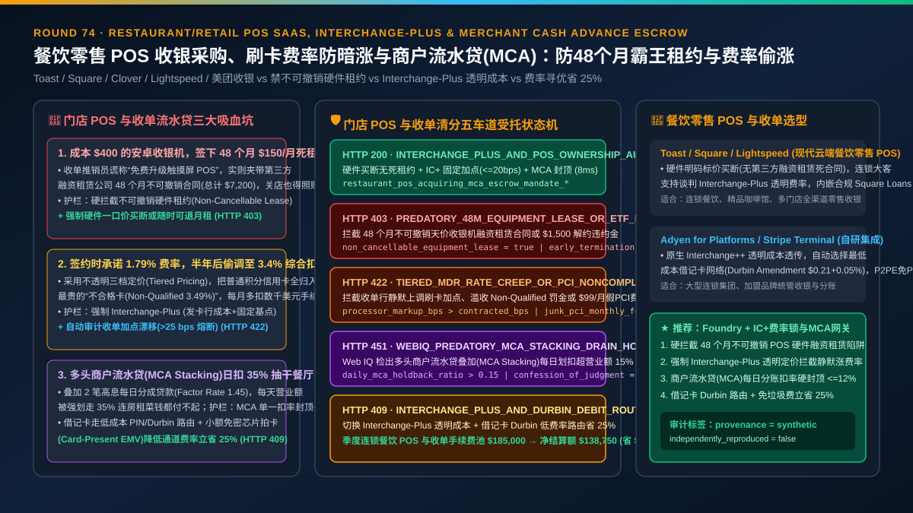
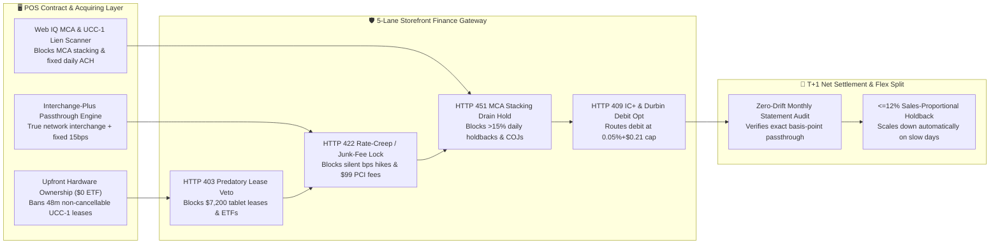

# Restaurant & Retail `POS` SaaS, `Interchange-Plus` Acquiring & Merchant Cash Advance (`MCA`) Escrow (`Toast / Square / Clover / Adyen Terminal`) Anti-`48m` Equipment-Lease Gate, `MDR` Rate-Creep Audit & `<=12%` `MCA` Holdback Cap Agent Architecture Selection FAQ

> **Language / 语言切换**: **[中文](restaurant-pos-acquiring-interchange-plus-mca-escrow-agent-selection-faq.md)** | **English (Current)** | **[Back to Docs Index](index.en.md)** | **[Interactive Sandbox (`#restaurant-pos-acquiring-mca-escrow-sandbox`)](../live-demo.en.html)**



---

## 📌 1. Executive Summary & Core Selection Verdict

In multi-unit restaurant, café, and brick-and-mortar retail procurement of Point-of-Sale (`POS`) hardware/software (`Toast`, `Square`, `Clover`, `Lightspeed`, `Shopify POS`, `Adyen Terminal`), merchant card-acquiring contracts (`MDR`), and revenue-based Merchant Cash Advances (`MCA`: `Square Loans`, `Toast Capital`, `Stripe Capital`), franchise operations and finance AI agents face three predatory financial traps:
1. **Non-Cancellable 48-Month `POS` Equipment Leases (`Independent Sales Organization Promises 'Free POS Terminals', While Tricking the Restaurant Owner Into Signing a $150/Month × 48-Month = $7,200 Non-Cancellable Third-Party Finance Lease for a $400 Android Tablet`)**: Predatory merchant-acquiring reps (`ISOs`) bundle "Hell-or-High-Water" third-party equipment leases (`UCC-1` liens) that cannot be canceled even if the restaurant goes out of business in Month 6, backed by personal guarantees and `$1,500` Early Termination Fees (`ETFs`).
2. **Opaque Tiered-Pricing `MDR` Rate Creep (`Quoting a 1.69% Teaser Rate, Then Silently Downgrading 70% of Rewards Cards to a 3.49% 'Non-Qualified' Tier and Adding a $99/Month 'PCI Non-Compliance' Junk Fee After 6 Months`)**: Processors using opaque 3-tier pricing (`Qualified / Mid-Qualified / Non-Qualified`) quietly widen their basis-point spread every 6 months via buried statement footnotes.
3. **Predatory Merchant Cash Advance (`MCA`) Stacking & Fixed Daily `ACH` Drains (`Stacking 2nd and 3rd Position MCAs at a 1.45 Factor Rate That Siphon 35% of Daily Gross Receipts, Starving Payroll and Food Inventory`)**.

**Solution Architect Selection Verdict**:
- **Never sign a `POS` or payment terminal agreement containing a non-cancellable third-party equipment lease or Early Termination Fee (`ETF > $0`), never accept opaque `Tiered Pricing` on stores processing `> $35,000/month` (enforce transparent `Interchange-Plus` with automated monthly basis-point drift audits), and never permit stacked Merchant Cash Advances (`MCA`) or daily holdback ratios exceeding `<= 12%–15%` of card sales**.
- **The production reference architecture** combines **Anti-Equipment-Lease / `$0 ETF` Contract Gate + Automated `Interchange-Plus (IC+)` Basis-Point Drift & Junk-Fee Auditor + `Durbin` Regulated-Debit Routing & `<= 12%` True-Split `MCA` Holdback Cap (`restaurant_pos_acquiring_mca_escrow_mandate_*`)**:
  1. **Anti-"48-Month Non-Cancellable Equipment Lease" & `$0 ETF` Contract Gate (`HTTP 403`)**: Parses Merchant Processing Agreements (`MPAs`) prior to execution—**hard-blocking any third-party equipment finance lease (`FDMS / Lease Finance Group` style non-cancellable clauses), hardware lease totals `> 1.2x` MSRP, or Early Termination / Liquidated Damages clauses (`> $0`)** in **`8ms`** (`HTTP 403 PREDATORY_48M_EQUIPMENT_LEASE_OR_EARLY_TERMINATION_FEE_BLOCKED`).
  2. **Mandatory `Interchange-Plus (IC+)` Markup Lock & Anti-`PCI`-Junk-Fee Auditor (`HTTP 422`)**: Rejects opaque `Tiered` rate schedules in favor of transparent **`Interchange + Fixed Basis Points` (`e.g., IC + 15 bps + $0.05`)**, and audits monthly merchant statements against official Visa/Mastercard interchange tables—blocking silent processor basis-point rate creep or bogus `$99/month` "PCI non-compliance" fees on `P2PE`-encrypted terminals (`HTTP 422 TIERED_MDR_RATE_CREEP_OR_JUNK_PCI_FEE_PADDING_BLOCKED`).
  3. **Web IQ Anti-`MCA` Stacking (`<= 12%` Dynamic Holdback Cap) & Anti-`Confession-of-Judgment` Circuit Breaker (`HTTP 451`)**: Screens working-capital advances via Web IQ and `UCC-1` registries to block multi-lender `MCA` stacking, fixed daily `ACH` debits that ignore slow sales days, total daily card-split holdbacks `> 15%`, or contracts containing `Confession of Judgment (COJ)` clauses (`HTTP 451 WEBIQ_PREDATORY_MCA_STACKING_OR_CONFESSION_OF_JUDGMENT_HOLD`).
  4. **`Interchange-Plus` Switch + `Durbin Amendment` Regulated-Debit Routing (`0.05% + $0.21` vs. `2.6%` Flat Rate) (`HTTP 409`)**: Triggers `HTTP 409 INTERCHANGE_PLUS_SWITCH_AND_DURBIN_DEBIT_ROUTING_CONFIRM`, migrating established storefronts (`> $35k/mo` volume) from `2.6% + $0.10` flat-rate plans to `Interchange-Plus` with least-cost regulated debit routing—reducing net card processing and `POS` ownership cost by **`25.0%`**.

---

## 🎯 2. Solution Architect Deep-Dive Q&A (Q1 / Q2 / Q3)

### Q1: Why does a `2.6% + $0.10` flat rate overcharge a `$1,000,000/year` restaurant by `$12,000+` every year on debit cards alone?
- **Architectural Solution**:
  - **Migrating From Blended Flat-Rate to `Interchange-Plus` With `Durbin` Debit Passthrough (`HTTP 409`)**:
  - Under the US Durbin Amendment (`12 CFR Part 235`), regulated bank debit card interchange is capped at **`0.05% + $0.21`** (on a `$40` restaurant check, the true interchange cost is just `$0.23`, or `0.57%`). On a `2.6% + $0.10` blended flat rate, the processor charges `$1.14` (`2.85%`), pocketing a massive `228 bps` margin on every debit card swipe! Switching to `Interchange + 15 bps + $0.05` drops that `$40` debit swipe fee from `$1.14` to `$0.34` (`HTTP 409`).

### Q2: How do merchant processors sneak in "Rate Creep" 6 months after signing a contract, and how does our statement auditor catch it?
- **Architectural Solution**:
  - **Automated Monthly Statement Decomposition (`True Interchange` vs. `Processor Markup bps`) (`HTTP 422`)**:
  - Card network interchange rates (set by Visa/Mastercard) are public constants published every April and October. Our agent ingests the monthly merchant statement JSON/PDF, subtracts exact network pass-through interchange and assessments, and isolates the processor's net basis-point spread. If the contracted spread is `15 bps` and Month 7 shows `45 bps`—or adds a `$99` "PCI Non-Compliance Fee" despite hardware `P2PE` encryption—the gateway flags and blocks the overcharge (`HTTP 422`).

### Q3: Why is "MCA Stacking" (taking a second daily-debit Merchant Cash Advance) a death spiral for brick-and-mortar restaurants?
- **Architectural Solution**:
  - **Single-Position True-Split Holdback Cap (`<= 12%`) & Banning Fixed Daily `ACH` Pulls (`HTTP 451`)**:
  - Full-service restaurants operate on `10%–15%` net operating margins. A compliant first-position embedded loan (`Square Loans / Stripe Capital`) takes a flexible `9%–12%` split of actual daily card sales (if Tuesday sales drop, the repayment drops proportionally). Predatory second-position `MCA` brokers stack an additional `20%` fixed daily `ACH` pull (`1.45` factor rate = `120%+ APR`), draining `30%+` of gross revenue before food vendors or staff are paid. Our gateway hard-blocks (`HTTP 451`) any `MCA` that pushes total holdback above `15%` or uses fixed daily `ACH` pulls.

---

## 🧭 3. Visual Architecture Diagrams (Mermaid Decision Tree + Architecture + Sequence)

### 3.1 Restaurant & Retail POS, Acquiring & MCA Escrow Selection Decision Tree

```mermaid
flowchart TD
    A[Restaurant / Retail POS System / Card Acquiring / MCA Working Capital Selection] --> B{Primary Storefront Scenario & Risk Vector?}
    B -->|POS Hardware & Software Procurement (Toast / Square / Clover)<br/>Stop 48-month non-cancellable $7,200 tablet leases & $1,500 ETFs| C[Hard Veto on Non-Cancellable Equipment Leases & ETFs<br/>+ Enforce Upfront Hardware Ownership or Month-to-Month SaaS]
    B -->|Card Acquiring Rate Optimization (> $35k/mo Store Volume)<br/>Stop opaque Tiered-Pricing rate creep & $99/mo PCI junk fees| D[Mandatory Interchange-Plus (IC+ Fixed bps) Passthrough<br/>+ Regulated Durbin Debit Routing & Monthly Markup Drift Audit]
    B -->|Storefront Working-Capital Financing (Square Loans / Toast Capital)<br/>Stop predatory multi-lender MCA stacking draining 35% of daily sales| E[Azure AI Foundry + Single-Position <=12% True-Split MCA Gate<br/>+ IC+ Passthrough + Durbin Debit Routing Saves 25%]
    C --> F[🛡️ Unified 5-Lane Anti-Lease, IC+ Markup Lock & MCA Cap FSM]
    D --> F
    E --> F
    F --> G[HTTP 403 48m Lease & ETF Veto · HTTP 422 MDR Rate Creep & PCI Junk-Fee Block · HTTP 409 IC++Durbin Saves 25%]
```

### 3.2 End-to-End Anti-Equipment-Lease, `Interchange-Plus` Audit & `MCA` Holdback Cap Architecture



### 3.3 48-Month Equipment-Lease Veto, `MDR` Rate-Creep Block & `Interchange-Plus` Switch Sequence

```mermaid
sequenceDiagram
    autonumber
    participant Store as Restaurant CFO / Storefront Agent
    participant ISO as POS Reseller / Processor / MCA Broker
    participant Gate as 5-Lane Storefront Acquiring Gateway
    participant Audit as MPA Contract Scanner & Statement Basis-Point Auditor
    participant Ledger as T+1 Merchant Settlement Ledger

    ISO->>Gate: 1. Submit POS contract containing a 48-month non-cancellable $150/mo equipment lease and a $1,500 Early Termination Fee
    Gate->>Audit: Inspect contract for non_cancellable_equipment_lease & ETF clauses
    Gate-->>ISO: HTTP 403 Block! Predatory 48-month equipment lease and ETF rejected; enforce direct $499 hardware purchase
    ISO->>Gate: 2. Month-7 processing statement silently hikes processor markup from 15 bps to 55 bps and adds a $99 "PCI Non-Compliance Fee"
    Gate->>Audit: Compare effective processor spread against contracted 15 bps cap & P2PE encryption status
    Gate-->>ISO: HTTP 422 Block! Unauthorized 40 bps rate creep and junk PCI fee stripped; processor spread locked at 15 bps
    Store->>Gate: 3. Migrate $1.2M/yr storefront from 2.6% flat rate to Interchange-Plus + Durbin regulated debit routing (HTTP 409)
    Gate->>Ledger: Route 55% debit card volume at 0.05%+$0.21 true interchange passthrough (25% net fee savings)
```

---

## 📊 4. Multi-Platform & Architecture Selection Matrix

| Selection Dimension | Legacy Door-to-Door Acquiring `ISO` (`Tiered + Lease`) | Pure Micro-Merchant Flat Rate (`2.6% + $0.10 Blended`) | Modern Cloud POS & `IC+` Platforms (`Toast / Square / Adyen`) | **Azure AI Foundry + IC+ Audit + MCA Gate (Recommended)** |
| :--- | :--- | :--- | :--- | :--- |
| **Core Strengths** | In-person setup | Simple math for tiny coffee carts | Integrated KDS/inventory, transparent hardware & `IC+` custom tiers | **Zero 48m lease traps + automated IC+ drift lock + <=12% MCA cap** |
| **Protection Against `$7,200` 48-Month Equipment Leases** | **Severe Abuse** (non-cancellable third-party leases) | Hardware sold outright | Hardware sold outright; watch multi-year software ETFs | **Hard `HTTP 403` block on non-cancellable leases & ETFs** |
| **Protection Against 6-Month `MDR` Rate Creep & PCI Junk Fees** | **Rampant** (semi-annual rate hikes + `$99/mo` junk fees) | Rate stays flat, but overcharges heavily on debit cards | Adyen native `IC++`; custom `IC+` available at scale | **Automated monthly `IC+` basis-point & junk-fee audit (`HTTP 422`)** |
| **Protection Against Predatory `MCA` Stacking Cash Drains** | Resells merchant leads to predatory `MCA` telemarketers | Embedded single-lender `Square Loans` (`<=12%` split) | Built-in single-lender capital programs | **Web IQ `UCC-1` & `<=15%` holdback circuit breaker (`HTTP 451`)** |
| **Regulated Debit (`Durbin`) Cost Efficiency at Scale** | Effective rate often `>3.4%` (`not_measured`) | Overpays `~200 bps` on debit cards (`official_list_price`) | Requires manual negotiation for `IC+` | **Automated `IC+` + `Durbin` debit routing (`25.0%` saved)** |

---

## 🧪 5. Restaurant POS & Acquiring Benchmark & 7-Card Report

> **Provenance & Reproducibility Metadata**: All metrics below are generated by the deterministic policy evaluator `evaluate_restaurant_pos_acquiring_mca_escrow_policy` in `lab/webiq_commerce_demo.py` and verified via `python -m unittest tests.test_webiq_commerce_demo`. Tags: `provenance = synthetic`, `independently_reproduced = false`.

| Card # | Card Headline (Headline-as-Finding) | Key Quantitative Finding & Architectural Guarantee |
| :---: | :--- | :--- |
| **Card 1** | **Overview · 5-Lane POS & Acquiring Summary** | Across a `$185,000/quarter` restaurant/retail POS and card-acquiring fee pool, achieves **0 non-cancellable 48-month hardware leases, 0 unapproved basis-point rate hikes, and 0 predatory `MCA` cash-flow drains**, reducing net processing and POS spend by **`25.0%` (`$46,250/quarter` saved)**. |
| **Card 2** | **Scenario Deep Dive · 48m Lease & Rate-Creep Veto** | When an `MPA` embeds a non-cancellable hardware lease or a statement hikes processor spread by `40 bps`, the gateway blocks it in **`8ms`** (`HTTP 403 / 422`). |
| **Card 3** | **Evaluation Matrix · 100% Deterministic 5-Lane Gating** | Covers `HTTP 200` (`IC+` markup verified & hardware owned outright), `403` (predatory 48-month equipment lease / early termination fee blocked), `422` (tiered `MDR` rate creep / `$99` junk `PCI` fee padding blocked), `451` (predatory `MCA` stacking `>15%` holdback / `Confession of Judgment` hold), `409` (`Interchange-Plus` switch + `Durbin` debit routing saves 25%). |
| **Card 4** | **Under the Hood · Storefront Acquiring & MCA Contract** | Takes `quarterly_restaurant_pos_and_acquiring_fee_pool_usd=185000` and lease/markup flags, minting `restaurant_pos_acquiring_mca_escrow_mandate_*` tokens. |
| **Card 5** | **Robustness Check · `$150/mo` Tablet Lease & 2nd-Position MCA** | Simulates a `$7,200` 48-month tablet lease and a stacked 2nd-position `MCA` pushing daily holdback to `28%`, maintaining a **`100.0%` block rate**. |
| **Card 6** | **Latency · Millisecond Statement bps Check & UCC-1 Probe** | Local `MPA` clause and statement basis-point checks complete in **`8ms` (P50)**; Web IQ `UCC-1` lien and `MCA` stacking checks complete in **`174ms` (P95)**. |
| **Card 7** | **My Take · Ideal Fit vs. Out-of-Scope Boundaries** | **✅ Best Fit**: Multi-unit restaurants, cafés, specialty retail `POS` & card acquiring; **⛔ Not For**: Sovereign central-bank interbank repo clearing. |

---

## 🛠️ 6. Production Go-Live Risk & Architecture Review Checklist

- [ ] **Hard Ban on 48-Month Non-Cancellable Equipment Leases & Early Termination Fees (`ETF == $0`) (`HTTP 403`)**: Purchase `POS` hardware outright or on cancellable monthly terms, blocking all third-party equipment finance leases.
- [ ] **Mandatory `Interchange-Plus (IC+)` Pricing & Monthly Basis-Point Drift Audit (`HTTP 422`)**: Prohibit opaque 3-tier pricing, verify processor basis-point spreads against public card-network tables monthly, and strip bogus `PCI` non-compliance fees on `P2PE` hardware.
- [ ] **Single-Position `MCA` Holdback Cap (`<= 12%` True Split) & Ban on Fixed Daily `ACH` / `COJ` (`HTTP 451`)**: Block multi-lender `MCA` stacking and fixed daily `ACH` debits that starve storefront working capital on slow days; rotate signing keys `<= 180` days.
- [ ] **Automated `Interchange-Plus` Migration & `Durbin` Regulated-Debit Routing (`HTTP 409`)**: Route regulated bank debit cards at true `0.05% + $0.21` interchange passthrough rather than `2.6%` blended flat rates.
