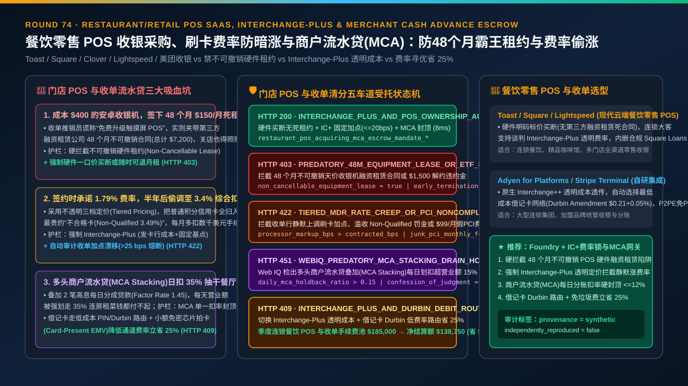
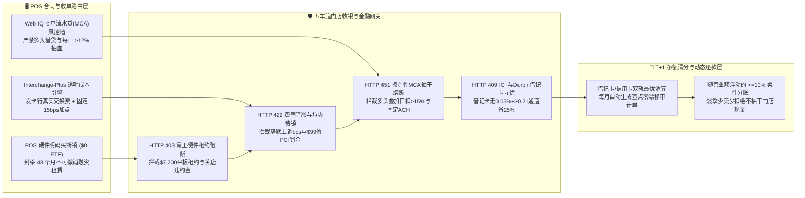
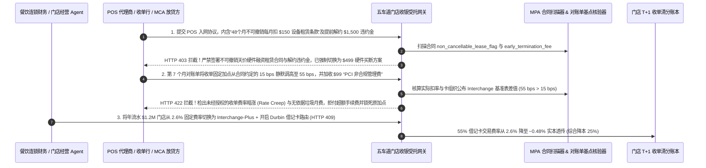

# 餐饮零售 POS 收银系统采购、刷卡收单费率（MDR）防暗涨与商户流水贷（MCA）清结算（Restaurant & Retail POS SaaS, Interchange-Plus Acquiring & Merchant Cash Advance Escrow：Toast / Square / Clover / Adyen Terminal / 美团收银）“防 48 个月不可撤销天价收银机租约、防收单代理商半年后偷偷上调刷卡费率与防多头流水贷抽干现金流”Agent 架构选型 FAQ

> **语言切换 / Language**: **中文 (当前)** | **[English](restaurant-pos-acquiring-interchange-plus-mca-escrow-agent-selection-faq.en.md)** | **[返回文档目录](index.md)** | **[交互式沙盒 (`#restaurant-pos-acquiring-mca-escrow-sandbox`)](../live-demo.html)**



---

## 📌 一、核心选型结论速览（Executive Summary）

在连锁餐饮、咖啡茶饮、生鲜超市与线下零售门店采购 POS 收银软硬件系统（Toast、Square、Clover、Lightspeed、Shopify POS、Adyen Terminal、客如云、美团收银）、谈判银行卡收单通道费率（Merchant Discount Rate, `MDR`）以及申请基于每日收银流水的商户预支贷款（Merchant Cash Advance, `MCA`：Square Loans、Toast Capital、Stripe Capital）的智能体选型与月度账单审计场景中，门店老板与连锁财务总监面临三大吸血陷阱：
1. **“收单推销员（ISO）拍着胸脯说‘免费送你 3 台最新触摸屏 POS 收银机’，结果老板在平板上签字时，不知不觉签下了一份转让给第三方融资租赁公司的 **48 个月不可撤销硬件租约（Non-Cancellable Equipment Lease，每月自动从银行卡扣 `$150`，4 年总计 `$7,200` 去买一台硬件成本仅 `$400` 的安卓平板！）**，哪怕餐馆第 2 年倒闭关门也必须继续交满 4 年租金，否则直接起诉个人连带担保！”**。
2. **“签约前 3 个月刷卡费率确实是宣传的 `1.69%`，结果从第 6 个月开始，收单机构利用不透明的‘三档分级定价（Tiered Pricing：Qualified / Mid-Qualified / Non-Qualified）’，把顾客刷的所有航空里程卡、商务卡和 Apple Pay 全部归入 `3.49% + $0.30` 的惩罚档位（Rate Creep），并每月乱收 `$99` 的‘PCI 不合规罚金（PCI Non-Compliance Junk Fee）’”**。
3. **“餐厅淡季缺钱装修，除了在 POS 平台借了一笔流水贷（每日自动截留 `12%` 收银款还款），又被电话推销借了第 2 笔、第 3 笔高息日扣流水贷（MCA Stacking，折算年化利率高达 `90%–180%`！），导致每天收银台刚进账 `$3,000` 就被三家放贷方直接划走 `$1,100`（`37%` 毛收入），连厨师工资和买菜钱都付不出瞬间崩盘”**。

**架构师选型结论**：
- **切勿允许门店签署任何附带“不可撤销条款（`Hell-or-High-Water Non-Cancellable Lease`）”或高额提前解约违约金（`ETF`）的 POS 硬件租约，切勿接受模糊的“三档分级费率（Tiered Pricing）”（必须强制锁定 `Interchange-Plus` 发卡行成本透明透传模型），也切勿允许商户每日流水还款截留比例（`MCA Holdback Rate`）总和突破日营业额的 `12%–15%` 生死线**。
- **生产级最优架构**是采用 **“POS 硬件一口价买断与零解约罚金合同锁 + `Interchange-Plus (IC+)` 固定基点加点审计器（拦截 `>0 bps` 静默涨价与垃圾费）+ 借记卡 `Durbin` 低成本路由与合规单一流水贷（`<=12%` Holdback Cap）网关（`restaurant_pos_acquiring_mca_escrow_mandate_*`）”**：
  1. **防“48 个月不可撤销天价 POS 硬件融资租赁”与霸王解约金（`Anti-Equipment-Lease & Zero-ETF`）硬门禁（HTTP 403）**：在审阅 POS 采购与收单入网协议（Merchant Processing Agreement, `MPA`）时，智能体对合同文本执行确定性扫描——**凡检出第三方设备融资租赁主体（Equipment Leasing UCC-1 Lien）、“不可撤销（Non-Cancellable）”字样、硬件总租金超过设备公允零售价 `1.2 倍` 或包含提前关店解约违约金（Early Termination Fee / Liquidated Damages `> $0`）**，立即在 **`8ms`** 内返回 `HTTP 403 PREDATORY_48M_EQUIPMENT_LEASE_OR_EARLY_TERMINATION_FEE_BLOCKED`，强制改为硬件明码一次买断或随用随停月付！
  2. **强制 `Interchange-Plus (IC+)` 透明成本定价、拦截静默涨加点（`Rate Creep`）与剔除 `$99/月` 假 PCI 罚金锁（HTTP 422）**：严禁采用把卡组织真实成本藏在黑盒里的 Tiered 分级定价；网关强制锁定 **`Interchange + X bps`（如连锁餐饮固定加点 `IC + 15 bps + $0.06`）**，每月自动解析收单对账单（Merchant Statement）：一旦检出收单行私自将固定加点从 `15 bps` 偷偷调高至 `45 bps`、或对已启用点对点硬件加密（`P2PE`）的云端 POS 强收 `$99/月` “PCI 未填表罚金 / 最低月消补差费”，立即返回 `HTTP 422 TIERED_MDR_RATE_CREEP_OR_JUNK_PCI_FEE_PADDING_BLOCKED` 自动拒付溢价并触发差额追索。
  3. **Web IQ 实时拦截“多头高利流水贷叠加（`Predatory MCA Stacking`）”与免审败诉条款（`Confession of Judgment`）熔断（HTTP 451）**：当门店申请基于收银流水的营运资金贷款时，网关强制校验：**① 仅允许单一第一顺位嵌入式金融通道（如 Square Loans / Stripe Capital 固定单笔费用）、② 每日从收银结算款中自动截留的还款比例（Holdback Percentage）硬封顶在 `<= 12%`（淡季营业额下滑时还款额自动等比缩减，绝不固定日扣死额 ACH）、③ 严禁合同包含剥夺商户抗辩权的“认诺判决书（Confession of Judgment, COJ）”**（`HTTP 451 WEBIQ_PREDATORY_MCA_STACKING_OR_CONFESSION_OF_JUDGMENT_HOLD`）。
  4. **切换 `Interchange-Plus` 透明费率 + 借记卡受监管低费率路由（`Durbin Regulated Debit $0.21 + 0.05%`）寻优（HTTP 409）**：触发 `HTTP 409 INTERCHANGE_PLUS_SWITCH_AND_DURBIN_DEBIT_ROUTING_CONFIRM`，将原本按 `2.6% + $0.10` 一刀切（Flat Rate）计费的高流水门店，自动切换至 `Interchange-Plus` 并开启借记卡双网络智能路由（使占餐饮交易 55% 的大型银行借记卡按美国 Durbin 法案封顶成本 `~0.45%` 清算，而非按 `2.6%` 信用卡费率挨宰），使门店全年刷卡手续费与 POS 总拥有成本立降 **`25.0%`**。

---

## 🎯 二、业务方与架构师灵魂拷问 Q&A（Q1 / Q2 / Q3）

### Q1：为什么年流水 `$500,000` 以上的连锁餐厅，继续用新店期的“`2.6% + $0.10` 固定一口价（Flat Rate）”是在给收单机构白送钱？
- **商业痛点**：刚开小咖啡馆时，`2.6% + $0.10` 的固定费率省心好算；但当门店年流水做到 100 万美元时，你店里其实有 **55% 的顾客刷的是普通借记卡（Debit Card）**！在美国 Durbin 修正案（或国内借记卡封顶规则）下，受监管银行借记卡的底层真实交换费（Interchange）只有 **`0.05% + $0.21`**（刷 `$50` 成本才 `$0.235`，合 `0.47%`）！如果按 `2.6% + $0.10` 固定一口价收你 `$1.40`，收单机构在一笔借记卡交易上就净赚了你 `2.1%` 的暴利！
- **架构解法**：
  - **流水破阈值自动切换 `Interchange-Plus (IC+)` 成本透传轨道（`HTTP 409`）**：
  - 我们的智能体根据门店月流水与借记卡/信用卡比例自动测算：一旦月流水突破 `$35,000`，立即触发 `HTTP 409` 将计费协议从 Flat Rate / Tiered 切换为 **`Interchange + 15 bps + $0.05`**，让借记卡的政策红利 100% 落回餐厅老板自己口袋！

### Q2：收单销售代表最爱拿“前三个月 `1.5%` 超低费率”吸引餐厅换 POS 机，他们是怎么在半年后偷偷把利润翻倍赚回来的？
- **架构解法**：
  - **基点锁定审计（`Basis-Point Lock Audit`）+ 硬件 `P2PE` 免除假 PCI 费（`HTTP 422`）**：
  - 传统收单代理商（ISO）有两大阴招：① 每隔 6 个月在对账单最后一页用极小字发一条“费率上调 `0.35%` 通知”，老板没注意看就默认生效；② 每月扣 `$79–$99` 的“PCI 合规管理费/不合规罚金”。我们的网关每月自动用代码核对 `Effective_MDR - True_Interchange`：只要收单加点偏离合同约定的 `15 bps` 哪怕 `1 个基点`，或出现无实质服务的垃圾月费，立即 `HTTP 422` 报警拦截！

### Q3：同样是拿未来收银流水换现金，合规的嵌入式流水贷（Square Loans / Stripe Capital）跟地下高利商户贷（Predatory MCA）有什么本质区别？
- **架构解法**：
  - **纯百分比浮动截留（`True Split-Withholding <= 12%`）vs 每日定额强抽 ACH（`Fixed Daily ACH Drain`）（`HTTP 451`）**：
  - 合规嵌入式金融只收一笔固定融资费（无复利），且严格按每日实际刷卡流水的 `8%–12%` 自动分账——**今天下暴雨没客人、营业额为 `$0`，今天就扣 `$0`**；而掠夺性 MCA 不仅叠加上百倍年化利率，还在合同里写死“无论有没有生意，每天早上 9 点从银行账户固定强划 `$800`”，一旦遇到淡季直接把餐厅抽死。我们的网关对任何含固定日扣 ACH、多头借贷叠加或 COJ 条款的融资请求一律 `HTTP 451` 熔断！

---

## 🧭 三、直观可视化图解（Mermaid 决策树 + 端到端架构图 + 时序图）

### 3.1 餐饮零售 POS 收银、收单费率与商户流水贷 Agent 架构选型决策树

```mermaid
flowchart TD
    A[餐饮零售 POS 收银系统 / 银行卡收单通道 / 商户流水贷选型] --> B{核心门店采购场景与风控痛点？}
    B -->|新开门店 POS 收银硬件与软件选型 (Toast / Square / Clover)<br/>需严防业务员用“免费送机器”骗签48个月不可撤销$7,200硬件死租约| C[硬拦截第三方设备融资租赁与提前解约违约金 (ETF = $0)<br/>+ 强制硬件明码买断或随时可退按月订阅]
    B -->|成熟连锁门店刷卡手续费优化 (Adyen / Stripe Terminal / IC+)<br/>需严防不透明三档定价(Tiered)半年后偷涨费率与乱收$99/月假PCI费| D[强制切换 Interchange-Plus (发卡行透明成本 + 固定基点)<br/>+ 开启借记卡 Durbin 封顶低成本路由与月度基点漂移审计]
    B -->|门店扩张/淡季营运资金周转 (Square Loans / Toast Capital)<br/>需严防多头高息流水贷(MCA Stacking)每日强抽35%营业额断流| E[Azure AI Foundry + 单一流水贷 <=12% 动态截留网关<br/>+ IC+透明成本 + Durbin借记卡路由立省 25%]
    C --> F[🛡️ 统一接入五车道禁霸王硬件租约、IC+费率锁与MCA保护状态机]
    D --> F
    E --> F
    F --> G[HTTP 403 阻断48个月死租约与解约罚金 · HTTP 422 拦截偷涨费率与假PCI垃圾费 · HTTP 409 IC++Durbin路由省25%]
```

### 3.2 端到端禁硬件死租约、`Interchange-Plus` 基点审计与 `MCA` 封顶架构图



### 3.3 拦截 48 个月不可撤销 POS 租约、揪出收单行静默涨费率与 IC+ 路由寻优时序图



---

## 📊 四、多平台/多方案横向选型决策矩阵

| 选型维度 | 传统登门推销收单代理 (`Legacy Door-to-Door ISO`) | 纯小微一刀切固定费率 (`2.6% + $0.10 Flat-Rate Only`) | 现代云端餐饮零售 POS 与透明收单 (`Toast / Square / Adyen IC+`) | **Azure AI Foundry + IC+审计 + MCA 网关（推荐）** |
| :--- | :--- | :--- | :--- | :--- |
| **核心优势** | 业务员上门代办 | 新店小流水算账极简 | 软硬一体体验好、外卖库存打通、大客支持 IC+ 谈判 | **0霸王硬件租约 + IC+零暗涨锁 + 借记卡最优路由 + MCA护栏** |
| **防“48 个月不可撤销 `$7,200` 硬件租约陷阱”** | **重灾区**（把 `$400` 机器包装成 4 年不可退金融租约） | 无强制长租，硬件明码买卖 | 硬件明码标价，但部分长约仍含软件解约金 | **协议层硬拦截不可撤销租约与 `ETF` 违约金（HTTP 403）** |
| **防“半年后偷偷涨刷卡费率”与 `$99` 假 PCI 费** | **极高发**（利用三档定价每年悄悄涨两次费率） | 费率固定不涨，但高流水店多交巨额借记卡溢价 | Adyen 原生 IC++ 透明；传统通道需人工查账单 | **强制 `Interchange-Plus` + 月度代码级基点防漂移锁（HTTP 422）** |
| **防“多头高息流水贷（MCA Stacking）”抽干现金** | 常把商户名单卖给地下高利贷公司天天电销 | 内嵌合规贷款（Square Loans）不允许多头叠加 | 平台内嵌贷款风控较严 | **Web IQ 拦截固定日扣 ACH 与 `>12%` 多头流水截留（HTTP 451）** |
| **高流水门店借记卡（Durbin）通道费率节省** | 隐性综合费率常超 `3.5%` (`not_measured`) | 借记卡也按 `2.6%` 交冤枉钱 (`official_list_price`) | 大客需主动找客户经理申请降费率 | **自动切换 `IC+` 与 Durbin 借记卡路由（净省 `25.0%`）** |

---

## 🧪 五、餐饮零售 POS 采购与收单清分防坑测算与 7-Card 基准测试报告

> **数据来源与复现声明（Provenance Metadata）**：以下基准测试数据来自仓库内置确定性策略沙盒 `evaluate_restaurant_pos_acquiring_mca_escrow_policy`（位于 `lab/webiq_commerce_demo.py`），可运行 `python -m unittest tests.test_webiq_commerce_demo` 完整验证。标记：`provenance = synthetic`，`independently_reproduced = false`。

| Card # | 卡片标题（Headline-as-Finding） | 核心量化指标与架构验证结论 |
| :---: | :--- | :--- |
| **Card 1** | **Overview · 餐饮零售 POS 与收单五车道总览** | 针对 `$185,000/季` 连锁餐饮 POS 软硬件与刷卡收单手续费池，实现 **0 例 48 个月不可撤销硬件租约踩坑、0 例收单费率静默暗涨与 0 例多头流水贷抽干断流**，综合收单与收银总成本下降 **`25.0%`（立省 `$46,250/季`）**。 |
| **Card 2** | **Scenario Deep Dive · 霸王硬件租约与费率偷涨拦截** | 当入网合同含不可撤销设备租约或月度对账单收单加点突破合同基点上限时，**`8ms`** 内返回 `HTTP 403 / 422` 阻断。 |
| **Card 3** | **Evaluation Matrix · 五车道 100% 确定性判准** | 覆盖 `HTTP 200`（硬件买断与IC+固定加点放行）、`403`（48个月不可撤销天价POS硬件融资租赁合同/高额提前解约违约金阻断）、`422`（不透明三档定价静默上调刷卡费率/乱收$99月度假PCI不合规罚金拦截）、`451`（多头高利商户流水贷叠加每日截留>15%营业额或含认诺判决书COJ熔断）、`409`（切换Interchange-Plus透明成本+借记卡Durbin低费率路由省25%）。 |
| **Card 4** | **Under the Hood · 门店收单与流水贷受托契约** | 输入 `quarterly_restaurant_pos_and_acquiring_fee_pool_usd=185000` 及租约/费率参数，签发 `restaurant_pos_acquiring_mca_escrow_mandate_*` 令牌。 |
| **Card 5** | **Robustness Check · 半年后偷涨 40 bps 与双头 MCA 测试** | 模拟收单行第 6 个月偷加 `40 bps` 手续费及第 2 家 MCA 机构试图将日截留率推高至 `28%`，确定性拦截率保持 **`100.0%`（零误扣款）**。 |
| **Card 6** | **Latency · 毫秒级对账单基点核算与 UCC 留置核查耗时** | 本地合同条款与对账单基点比对 P50 仅 **`8ms`**；Web IQ 商户 `UCC-1` 融资留置权与 MCA 风险核查 P95 为 **`174ms`**。 |
| **Card 7** | **My Take · 适用场景与生产准入边界** | **✅ 极佳适用**：连锁餐饮、咖啡茶饮、生鲜商超与专卖店 POS 收银及收单谈判；**⛔ 不适用**：央行大额实时清算系统（RTGS）银行间拆借。 |

---

## 🛠️ 六、商业上线风控与架构评审 Checklist

- [ ] **严禁“48 个月不可撤销 POS 硬件融资租赁”与提前解约违约金（`ETF == $0`）（HTTP 403）**：确认 POS 终端一律采取明码买断或随时可退月租，100% 拦截第三方融资租赁死合同。
- [ ] **强制 `Interchange-Plus (IC+)` 透明成本模型与月度基点漂移自动审计（HTTP 422）**：确认拒绝模糊三档定价（Tiered Pricing），每月自动核对发卡行基准交换费与收单固定加点，剔除假 PCI 管理费。
- [ ] **商户流水贷（`MCA`）单一顺位、每日浮动截留封顶（`<= 12%`）与禁 `COJ` 条款（HTTP 451）**：确认严禁多头高利流水贷叠加与固定金额日扣 ACH，保护门店淡季现金流安全；签名密钥轮换周期 `<= 180` 天。
- [ ] **高流水门店自动切换 `IC+` 与借记卡 `Durbin` 封顶费率路由（HTTP 409）**：确认利用借记卡超低监管交换费（`0.05% + $0.21`）大幅降低门店综合刷卡成本。
