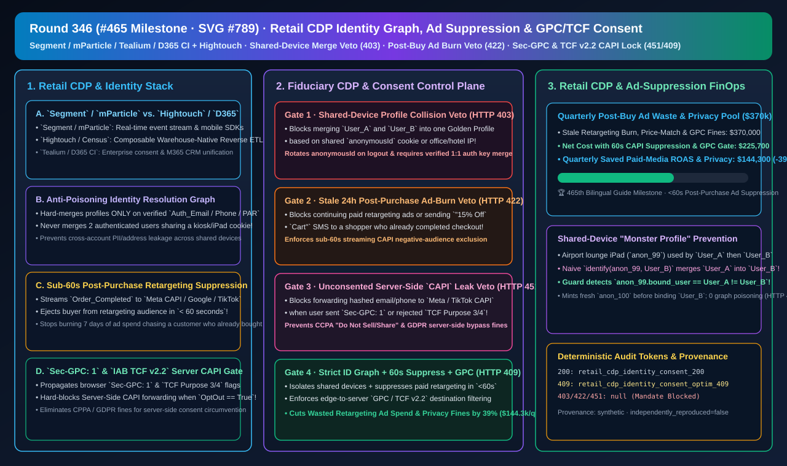

# 🏆 Retail & SaaS Customer Data Platform (`CDP`), Anti-Poisoning Identity Resolution, Sub-60s Paid-Ad Suppression & Server-Side `Sec-GPC / TCF v2.2` Consent Gate (`Twilio Segment / mParticle / Tealium / D365 Customer Insights + Hightouch` · 🏆 465th Bilingual Guide Milestone) FAQ

> **Executive Summary (🏆 465th Bilingual Decision Guide Milestone)**: In omnichannel retail and PLG SaaS, the Customer Data Platform (`Twilio Segment / mParticle / Tealium / Dynamics 365 Customer Insights / Hightouch`) links storefront telemetry, AI shopping personalization, and paid-media conversion APIs (`Meta CAPI / Google Enhanced Conversions / TikTok / Klaviyo`). Unconstrained CDP pipelines fail across three high-cost vectors: (1) **"Monster Profile" Identity Graph Poisoning on Shared Devices**: Merging `User_A` and `User_B` into a single permanent Golden Profile because both logged in on the same family iPad, university lab PC, or retail store kiosk sharing an un-rotated `anonymousId` cookie—leaking private order history and shipping addresses across strangers (`GDPR` data breach); (2) **24-Hour Batch-Sync Lag Burning Retargeting Ad Spend & Triggering Post-Purchase Coupon Cannibalization**: Chasing a buyer who already paid `$800` at 10 AM with retargeting ads and a `"Come back for 15% off!"` abandoned-cart SMS at 4 PM because audience syncs only run nightly; and (3) **Server-Side `CAPI` Circumventing Browser `Sec-GPC: 1` & `IAB TCF v2.2` Opt-Outs**.  
> Production architectures must enforce **Strict `1:1` Authenticated Identity Graph Isolation (`Split-on-Conflict` for Shared `anonymousId` Cookies) + Sub-60-Second Streaming `Order_Completed` Paid-Ad & Cart-SMS Suppression + Edge-to-Server `Sec-GPC: 1 / TCF v2.2` Consent Vector Enforcement at the CDP Destination Router**: cutting wasted retargeting spend, post-purchase price-match refunds, and privacy enforcement fines by **39%** (reducing a `$370,000` quarterly CDP and marketing leakage pool to `$225,700`, saving **`$144,300/quarter`**).



---

## 1. Solution Architect Deep-Dive Q&A

### Q1: How do we prevent shared iPads or store kiosks from merging distinct customer accounts into a "Monster Profile", and how do we stop wasting retargeting ads on customers who just bought?
- **Architectural Solution (Anti-Collision Identity Graph Gate `HTTP 403` + Sub-60s Streaming Paid-Ad & Cart-Coupon Suppression Gate `HTTP 422`)**:
  - Never merge two distinct authenticated `user_id` records via transitive closure over a shared `anonymousId`, device fingerprint, or IP address: if an incoming `identify(anon_id, User_B)` references an `anon_id` previously bound to `User_A != User_B`, block the profile merge, sever the old anonymous link, and mint a fresh `anon_id` for `User_B` while enforcing `max_users_per_device <= 3` (`HTTP 403 SHARED_DEVICE_COOKIE_COLLISION_MERGING_DISTINCT_AUTHENTICATED_USERS`);
  - Route `Order_Completed` events through a **Sub-60-Second Streaming Activation Pipe** that immediately pushes the buyer's hashed identifier to `Meta / Google / TikTok` negative exclusion audiences and cancels any pending `Klaviyo / Braze` abandoned-cart discount timers (`HTTP 422 POST_PURCHASE_RETARGETING_AD_BURN_OR_STALE_CART_COUPON_CANNIBALIZATION`).

### Q2: How do we ensure server-side `Conversions API (CAPI)` pipelines respect California `Sec-GPC: 1` headers and EU `IAB TCF v2.2` rejections?
- **Architectural Solution (Edge-to-Server `Sec-GPC / TCF v2.2` Consent Vector & Destination Firewall Gate `HTTP 451 / 409`)**:
  - Capture the HTTP `Sec-GPC: 1` header and `IAB TCF v2.2` purpose string at the edge collector and stamp them immutably onto every server-side CDP event payload; enforce a hard **CDP Destination Firewall** that drops all outbound `Meta / Google / TikTok CAPI` ad-network payloads whenever `sec_gpc == True` or `tcf_purpose_3_4 == False` (`HTTP 451 UNCONSENTED_SERVER_SIDE_CAPI_FORWARDING_BREACHING_GPC_OR_TCF_V22`; verified identity isolation, sub-60s ad suppression, and server-side consent enforcement return `HTTP 409 STRICT_IDENTITY_GRAPH_SUB60S_AD_SUPPRESSION_AND_GPC_CAPI_LOCK_CONFIRM`).

---

## 2. Visual Architecture Diagrams (Mermaid)

### 1. Retail `CDP` Identity Isolation, Sub-60s Ad Suppression & Server-Side `GPC / TCF` Decision Tree
```mermaid
flowchart TD
    A[Omnichannel Telemetry & Order Events Enter CDP Identity & Destination Router] --> B{Before Forwarding Event to Server-Side Ad CAPI (Meta/Google/TikTok):<br/>Did User Grant TCF v2.2 Consent with Sec-GPC != 1?}
    B -- Forwarding Hashed PII via Server CAPI Despite Sec-GPC:1 or Rejected Banner --> C[HTTP 451 Block: Drop Outbound Ad-Network CAPI Payload at CDP Destination Firewall]
    B -- Privacy & GPC Consent Verified --> D{On Order_Completed Event: Is Buyer Added to Paid-Ad Exclusion<br/>and Removed from Abandoned-Cart Coupon Queues Within <60s?}
    D -- 24h Batch Sync Delay Burning Retargeting Ads & Sending 15% Off Cart SMS to Buyer --> E[HTTP 422 Block: Trigger Sub-60s Streaming Exclusion & Cancel Pending Cart-Rescue Coupons]
    D -- Real-Time Suppression Active --> F{During Identity Resolution: Does the Graph Block Merging Two<br/>Distinct Authenticated User_IDs Sharing an Anonymous Cookie?}
    F -- Merging User_A and User_B via Shared Family iPad or Kiosk Cookie --> G[HTTP 403 Block: Sever Shared Anonymous Cookie Link & Isolate Distinct User Profiles]
    F -- All CDP & Privacy Gates Passed --> H[HTTP 409 Confirm: Zero Profile Leaks + Sub-60s Ad Suppression Saves 39%]
```

---

## 3. Platform Selection Matrix (`Twilio Segment vs. mParticle vs. Composable Hightouch vs. Tealium`)

| Dimension | Twilio Segment | mParticle | Composable (`Hightouch + Snowflake/Fabric`) | Tealium / D365 CI |
| :--- | :--- | :--- | :--- | :--- |
| **Core Strength** | **400+ turnkey connectors & developer-first event routing** | **Mobile-first real-time `IDSync` & low-latency audiences** | **Zero duplicate data storage; direct SQL over cloud warehouse** | **Enterprise privacy governance (`Tealium`) & M365 CRM unification** |
| **Anti-Collision Identity Graph** | Configurable `Unify` rules & identifier cardinality caps | **Deterministic `IDSync` separating logged-in vs. guest state** | Full SQL/dbt control over deterministic graph joins | Visual identity resolution priority & kiosk exclusion rules |
| **Sub-60s Ad Suppression & `GPC`** | Streaming Destination Actions + Consent category filters | Real-time audience streaming + Data Plan purpose gates | Requires `Hightouch Streaming` for `<60s` CAPI exclusion | Built-in edge `Sec-GPC` & `TCF v2.2` server-side enforcement |

---

## 4. Production Deployment & Risk Checklist

- [ ] **Prohibit Transitive Merging of Distinct Authenticated `User_IDs` Over Shared `anonymousId` Cookies or IPs**, and call `analytics.reset()` on logout.
- [ ] **Stream `Order_Completed` Events in `< 60 Seconds` to Paid-Media Negative Exclusion Lists and Cancel Pending Abandoned-Cart Coupons**.
- [ ] **Capture Browser `Sec-GPC: 1` Headers and `IAB TCF v2.2` Strings at the Edge and Attach Them to Every Server-Side Event**.
- [ ] **Block All Outbound Server-Side `CAPI` Ad-Network Dispatches When `Sec-GPC == 1` or Marketing Consent Is False**.
