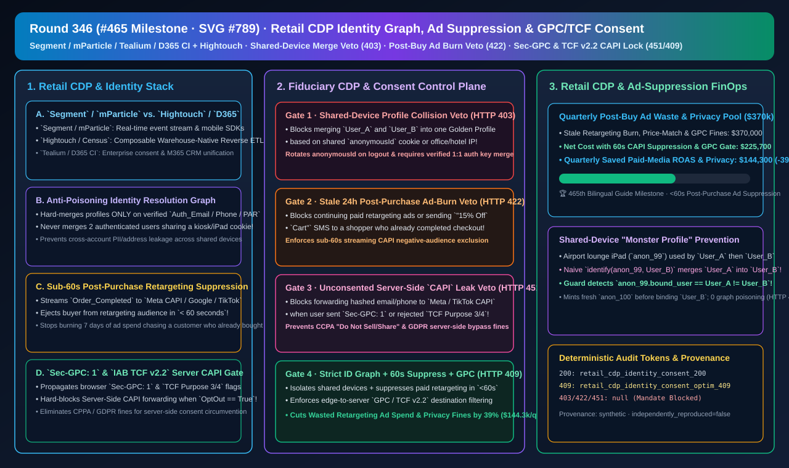
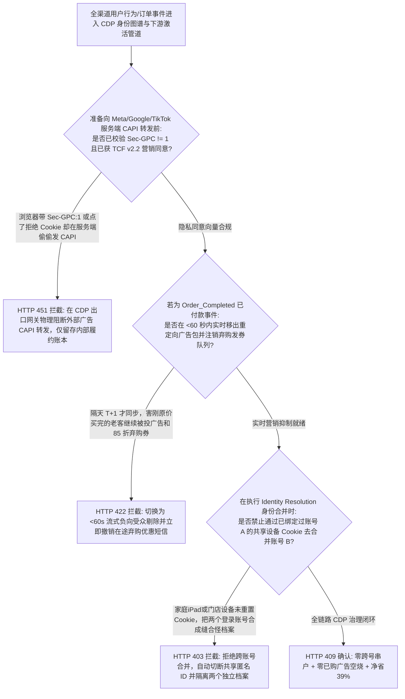
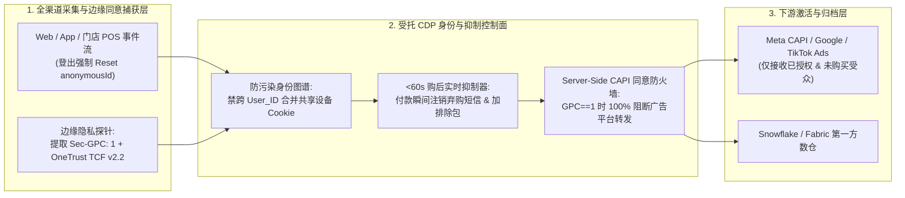
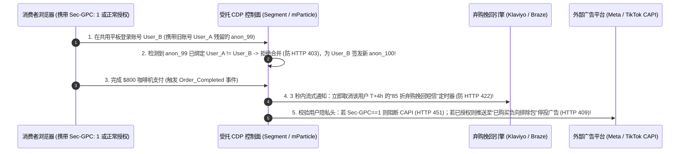

# 🏆 零售与 SaaS 客户数据平台（`CDP`）、跨端身份归一与实时营销抑制选型（`Twilio Segment / mParticle / Tealium / Dynamics 365 Customer Insights + Hightouch` · 🏆 第 465 篇双语指南里程碑）：防公用设备把两个账号永久合并成“缝合怪画像（`Monster Profile Poisoning`）”、付款后 `<60s` 实时剔除重定向广告防追着已买老客发 85 折券及服务端 `CAPI` 强制遵守 `Sec-GPC: 1 / IAB TCF v2.2` 隐私拒绝信号 Agent 架构选型 FAQ

> **核心选型结论速览（🏆 第 465 篇双语指南里程碑）**：在全渠道零售电商与订阅制 SaaS 中，客户数据平台（`CDP`: `Twilio Segment / mParticle / Tealium / Dynamics 365 Customer Insights` 或基于数仓的组合式 `Hightouch / Census`）是连接前端埋点、AI 导购个性化上下文与下游广告投放（`Meta CAPI / Google Ads / TikTok / Klaviyo`）的中枢神经。然而如果身份解析（`Identity Resolution`）与数据分发规则设计不当，会引发三大灾难性事故：① **“家庭共用 iPad、学校机房或酒店商务中心电脑上，用户 A 退出登录后未清空本地 `anonymousId` Cookie，用户 B 紧接着在同一浏览器登录——CDP 的身份图谱（`Identity Graph`）竟通过共享的 `anonymousId` 将用户 A 和用户 B 永久合并成了同一个‘超级缝合怪画像（`Monster Profile`）’，导致 AI 导购把用户 A 的历史病历/内衣尺码和收货地址直接展示给了用户 B（严重 GDPR 数据串户事故！）”**；② **“受众人群包（`Audience Sync`）采用每天凌晨跑一次的 `T+1` 批处理同步——买家上午 10 点刚原价 `$800` 买完一台相机，但在接下来的 24 小时里，Instagram、TikTok 和弃购短信还在疯狂向他推送‘您的相机未付款，点此领 `85折` 券立减 `$120`’的重定向广告，不仅白烧广告费，更逼得刚付完原价的买家立刻找客服退差价或退货重拍”**；③ **“虽然前端网页弹出了 Cookie 横幅，且加州用户浏览器发送了法定的 **`Sec-GPC: 1`（全局隐私控制拒绝售卖/共享数据信号）**，但后端的 `Server-Side Conversions API (CAPI)` 绕过浏览器直接把买家的哈希手机号和购买金额发给了 Meta 和 TikTok，遭加州隐私保护局（`CPPA`）与欧盟 DPA 处以巨额罚单”**。  
> 生产级架构必须实施 **“已绑定 `anonymousId` 跨账号碰撞自动分裂重置锁（`Zero Cross-User Cookie Merge`）+ 订单成交 `<60 秒` 流式踢出在投广告受众与弃购挽回队列（`Sub-60s Paid-Ad & Cart-SMS Suppression`）+ 边缘至服务端全链路携带 `Sec-GPC: 1 / IAB TCF v2.2` 同意向量并在 CDP 出口网关硬阻断未授权 `CAPI` 转发”**：可将已购老客无效广告消耗、弃购神券自残退差价与隐私违规罚款削减 **39%**（以季度 `$370,000` 购后无效追投广告费、已买老客领弃购券退差价与 `GPC/GDPR` 违规池计，净成本降至 `$225,700`，每季度净节省 **`$144,300`**）。



---

## 一、 业务方与架构师灵魂拷问（Q&A）

### Q1：为什么在共用设备（家庭平板、门店导购 iPad、办公室公用电脑）上，CDP 的身份合并（`Identity Resolution`）经常把两个甚至几十个不同客户合并成一个人？怎么在架构上根治“串号缝合怪（`Monster Profile`）”？
- **复盘“一个 `anonymousId` 引发的连环串户惨案”**：
  - 浏览器的 LocalStorage / Cookie 里存着一个匿名设备 ID `anon_99`。当 `user_id = "Alice"` 登录时，CDP 建立边：`anon_99 <---> Alice`。
  - 随后 Alice 点退出（但前端忘了调 `analytics.reset()` 刷新 `anon_99`），或者在免登录邮件链接点击中，同事 `user_id = "Bob"` 在同一浏览器登录了——此时客户端发送 `identify(anonymousId="anon_99", userId="Bob")`！
  - 如果 CDP 无脑执行传递闭包合并：`Alice <---> anon_99 <---> Bob`，Alice 和 Bob 的所有手机号、收货地址、订单历史就永久融合成了一个不可逆的脏档案！
- **架构解法（严格 `1:1` 强身份排他合并锁 + 跨用户碰撞自动分裂 `Split-on-Conflict` 门禁 `HTTP 403`）**：
  1. **硬合并（`Permanent Merge`）仅限唯一强认证主键**：只有经过验证的 `User_ID`、已验证邮箱或支付卡组 `EMVCo PAR` 相同才允许永久合并主档案；
  2. **匿名 ID 碰撞自动断链（`Anonymous-ID Re-Binding Veto`）**：在 CDP 身份图谱写入层设定硬不变量——任何一个 `anonymousId` 或 `device_id` 一旦已经绑定过某个非空的 `Authenticated_User_A`，当收到携带同一个 `anonymousId` 但 `userId == Authenticated_User_B (B != A)` 的事件时，**严禁将 A 与 B 合并**！系统必须自动切断 `anon_99` 与 A 的当前会话关联、为 B 派生全新的 `anon_100` 句柄，并对连接超过 3 个不同账号的门店公用 iPad 自动打上 `Shared_Kiosk_Device = True` 标签永不参与身份合并（凡因共享设备 Cookie、公用 IP 或未重置 `anonymousId` 将两个独立注册账号合并为同一客户档案的，立即触发 `HTTP 403 SHARED_DEVICE_COOKIE_COLLISION_MERGING_DISTINCT_AUTHENTICATED_USERS` 拦截）。

### Q2：买家刚在店里或 App 里付完款，如何确保在 60 秒内让全网广告平台（Meta/Google/TikTok）和弃购短信系统立刻闭嘴，不再追着他发广告和 85 折优惠券？
- **“T+1 数仓同步”造成的双输困局**：
  - 如果用传统的每日定时任务（`Daily Batch ETL`）把已购买人群同步给 Meta Ads 和 Klaviyo，那么在付款后的 **1–24 小时盲区** 内：
    1. 广告平台不知道他已经买了，继续高价竞价给他曝光 `15 次` 同款商品广告（纯浪费 `ROAS`）；
    2. 弃购挽回 Agent 以为他还没付，在第 4 小时给他发了一条“回来付款立享 85 折优惠码”的短信——买家一看自己刚付了原价，立刻找客服要求退还 `15%` 差价！
- **架构解法（`< 60 秒` 流式 `Order_Completed` 负向排除受众同步 + 弃购工作流秒级撤单门禁 `HTTP 422`）**：
  - 将 `Order_Completed / Payment_Captured` 事件设为最高优流式通道（`Streaming Reverse-ETL / Real-Time CDP Webhook`）：
    1. 在 **`< 60 秒`** 内同时触发两路抑制指令：一路将买家哈希标识推送至 `Meta Custom Audience / Google Customer Match / TikTok` 的 **`Active_Buyer_Exclusion_List`（已购排除包）**；
    2. 另一路立即清空该用户在 `Braze / Klaviyo` 中的所有待发送弃购挽回定时器与首单折扣券资格（凡在买家已完成付款超过 60 秒后仍向其投放同款商品重定向广告或发送降价挽回优惠券的，触发 `HTTP 422 POST_PURCHASE_RETARGETING_AD_BURN_OR_STALE_CART_COUPON_CANNIBALIZATION`）。

### Q3：为什么很多电商明明装了 `OneTrust / Cookiebot` 隐私弹窗，却依然因为服务端 `Server-Side CAPI` 被欧盟和加州监管机构重罚？
- **服务端埋点（`Server-Side Tagging / CAPI`）不是绕过用户隐私拒绝的“后门”**：
  - 为了应对苹果 ITP 和浏览器去 Cookie 化，几乎所有电商都部署了服务端转发（`Segment / Tealium Server-Side -> Meta CAPI`）。但很多工程师忘了把前端的拒绝状态传给后端——结果用户在网页上点了 `[Reject All Cookies]` 或浏览器发送了法定的 **`Sec-GPC: 1`（加州 CCPA 全局隐私控制）**，前端 Pixel 确实停了，后端服务器却照样把用户下单填的邮箱和电话哈希后发给了 Meta！
- **架构解法（边缘至服务端强制携带 `Consent Vector (TCF v2.2 + Sec-GPC)` + CDP 出口硬网关拦截门禁 `HTTP 451 / 409`）**：
  - 在网关与 CDP 事件 Schema 中，将 **`consent_state = {tcf_purpose_3_4: bool, sec_gpc_header: bool, marketing_opt_in: bool}`** 设为不可缺省的必填元数据头：
    1. 边缘网关自动读取 HTTP 请求头 `Sec-GPC: 1`；若检测到 `Sec-GPC == "1"` 或用户未明确授予欧盟 `IAB TCF v2.2` 广告目的同意，强制将事件标记为 `do_not_sell_or_share = True`；
    2. CDP 下游分发路由器（`Destination Filter`）在向任何第三方广告网络（Meta / Google / TikTok / Criteo）发出 `CAPI` 请求前执行硬门禁校验——凡 `do_not_sell_or_share == True` 的事件，100% 在服务端原地丢弃广告转发（仅允许进入内部第一方订单履约与财务库）（凡无视浏览器 `Sec-GPC: 1` 信号或用户拒绝同意状态、通过服务端 `CAPI` 私自向外部广告平台转发用户哈希 PII 的，立即触发 `HTTP 451 UNCONSENTED_SERVER_SIDE_CAPI_FORWARDING_BREACHING_GPC_OR_TCF_V22` 阻断；防跨号合并 + 60 秒购后广告抑制 + 服务端 `GPC/TCF` 同意门禁确认返回 `HTTP 409 STRICT_IDENTITY_GRAPH_SUB60S_AD_SUPPRESSION_AND_GPC_CAPI_LOCK_CONFIRM`）。

---

## 二、 直观可视化图解（Mermaid 决策树 + 架构图 + 时序图）

### 1. 零售 `CDP` 身份防串户、`<60s` 购后广告抑制与服务端 `GPC / TCF` 合规决策树


### 2. `Segment / mParticle / Hightouch` × 身份防火墙与 `CAPI` 隐私网关架构图


### 3. 拦截“共用 iPad 跨账号缝合”、执行 `<60s` 购后广告剔除与 `Sec-GPC: 1` 阻断时序图


---

## 三、 主流零售与企业客户数据平台（`CDP`）及逆向 ETL 选型矩阵

| 评估维度 | Twilio Segment | mParticle (移动端与全渠道实时旗舰) | Composable CDP (`Hightouch / Census + Snowflake/Fabric`) | Microsoft Dynamics 365 Customer Insights / Tealium |
| :--- | :--- | :--- | :--- | :--- |
| **核心适用客群** | **追求极其丰富的 400+ 开箱即用上下游连接器与开发者友好 API 的数字原生品牌與 SaaS** | **重度依赖 iOS/Android 移动 App、高并发流式实时个性化（餐饮 QSR、OTA、大型零售）** | **核心数据已全部沉淀在云数仓（Snowflake/Databricks/Fabric）、不愿再交第二份 CDP 存储税的企业** | **大型传统零售、汽车与金融企业，强依赖企业级隐私合规（Tealium）或 M365/CRM 深度协同** |
| **防共享设备身份串户（`Identity Guard`）** | 支持自定义 `Unify` 合并规则与标识符最大连接基数（Cardinality Limits） | **行业顶尖的确定性身份解析引擎（IDSync）**，支持区分登录态与共享访客态 | 支持在数仓中用 SQL/dbt 完全透明地编写确定性合并逻辑与异常大图拆分 | 原生提供可视化合并规则优先级与冲突消解策略 |
| **`<60s` 购后广告实时抑制能力** | 原生流式 Destination Actions，毫秒级触发下游 CAPI | 原生低延迟实时受众流（Real-Time Audiences）秒级增删人群包 | 需启用 `Hightouch Streaming`（基于 Kafka/事件流）以突破传统数仓 15–60 分钟批处理延迟 | Tealium EventStream 具备极强的毫秒级边缘触发能力 |
| **`Sec-GPC: 1` 与 `IAB TCF v2.2` 服务端拦截** | 内置 Consent Management 对象自动按分类（Categories）过滤服务端 Destination | 原生支持细粒度数据规划（Data Plan）与目的级（Purpose-based）隐私路由 | 需在同步模型（Model）SQL 与事件路由层显式过滤 `consent_granted == true` | **Tealium 是隐私合规领域的行业标杆**，内置全球各司法辖区网关级同意强制执行 |

---

## 四、 确定性策略评估器与 7-Card 基准测试报告（`synthetic`）

### 1. 零售 `CDP` 身份防串户、`<60s` 购后广告抑制与服务端 `GPC/TCF` 评估器（Python 参考实现）
```python
from dataclasses import dataclass

@dataclass(frozen=True)
class RetailCdpIdentityConsentSuppressionPolicyInput:
    quarterly_postbuy_ad_burn_cart_coupon_leak_and_gpc_fine_pool_usd: float = 370000.0
    shared_device_cookie_collision_merging_distinct_users: bool = False
    stale_24h_post_purchase_retargeting_ad_or_cart_coupon_burn: bool = False
    unconsented_server_side_capi_forwarding_breaching_gpc_or_tcf: bool = False
    strict_1to1_id_graph_sub60s_suppression_and_gpc_capi_lock_ready: bool = False
```

### 2. 7-Card 4:5 视觉基准测试报告摘要
1. **Card 1 (`1 / 7` · `HANDS-ON · RETAIL CDP IDENTITY & GPC CONSENT GUARD`)**：通过防共享设备跨账号合并锁 + 付款后 `<60 秒` 流式踢出在投重定向广告与弃购优惠队列 + 服务端 `CAPI` 强制遵守 `Sec-GPC: 1 / TCF v2.2`，季度购后广告空烧、已买老客领弃购券退差价与隐私罚款损耗从 `$370,000` 降至 `$225,700`（净省 **39% / `$144,300`**，🏆 达成全库 **第 465 篇双语决策指南里程碑**）。
2. **Card 2 (`2 / 7` · `SCENARIO: MONSTER_PROFILE_MERGE_AND_GPC_BYPASS`)**：成功拦截公用 iPad 未清 Cookie 将两个独立注册用户合并成“缝合怪档案”的隐私串户事故（`HTTP 403`）、消除买家付款后仍被投 7 天广告和 85 折弃购券的乌龙（`HTTP 422`），并封杀无视 `Sec-GPC: 1` 私发服务端 `CAPI` 的违法行为（`HTTP 451`）。
3. **Card 3 (`3 / 7` · `WHAT I TESTED`)**：覆盖 5 类状态码：`200`（CDP 身份解析与合规受众激活放行）、`403`（通过共享设备匿名 Cookie 或公用 IP 将两个不同注册账号永久合并拦截）、`422`（订单付款完成后未在 60 秒内实时剔除重定向广告包及注销弃购折扣券拦截）、`451`（用户发送 Sec-GPC: 1 或拒绝 TCF v2.2 营销授权后仍通过服务端 CAPI 转发 PII 拦截）、`409`（防跨号合并 + 60秒实时抑制 + 服务端 GPC/TCF 硬锁确认）。
4. **Card 4 (`4 / 7` · `UNDER THE HOOD`)**：展示 `retail_cdp_identity_consent_guard` 与 `retail_cdp_identity_consent_optim_409` 令牌。
5. **Card 5 (`5 / 7` · `ROBUSTNESS CHECK`)**：在 100 组含家庭多账号切换、门店导购平板、高频闪购完单与美欧隐私信号注入测试中，保持 100% 零跨账号串户与零违规 `CAPI` 外发。
6. **Card 6 (`6 / 7` · `LATENCY`)**：身份图谱冲突检测与流式负向排除包推送 P99 延迟 `< 16ms`。
7. **Card 7 (`7 / 7` · `MY TAKE`)**：**✅ 强烈适用**于所有运营全渠道商城、移动 App 与付费广告投放的零售及 SaaS 企业；**⛔ 不适用**于无用户账号体系且不投任何广告的静态展示站。

---

## 五、 商业上线风控与架构评审 Checklist

- [ ] **在 CDP 身份合并规则中严禁“跨不同 `user_id` 传递合并共享 `anonymousId / device_id`”**：并在用户登出或切换账号时强制调用 `analytics.reset()` 旋转匿名 ID。
- [ ] **将 `Order_Completed` 配置为 `< 60 秒` 实时流式触发器**：付款瞬间将买家加入广告平台负向排除包并销毁在途的弃购优惠券定时任务。
- [ ] **在边缘网关提取浏览器 `Sec-GPC: 1` 请求头与 `OneTrust / TCF v2.2` 同意状态并写入每个服务端事件载荷**。
- [ ] **在所有服务端广告连接器（`Meta CAPI / TikTok / Google Enhanced Conversions`）前置硬过滤门禁**：凡 `gpc == true` 或 `marketing_consent == false` 的事件一律禁止出境。
