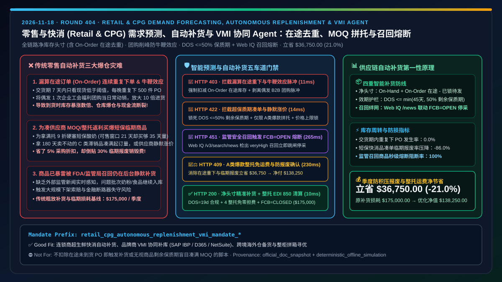
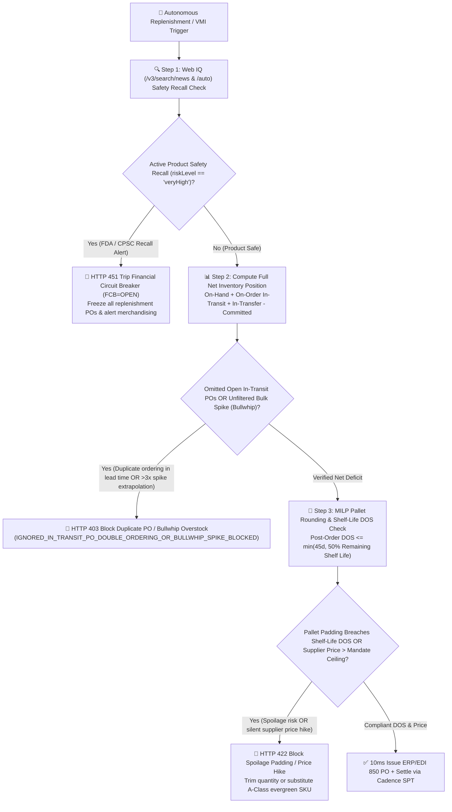
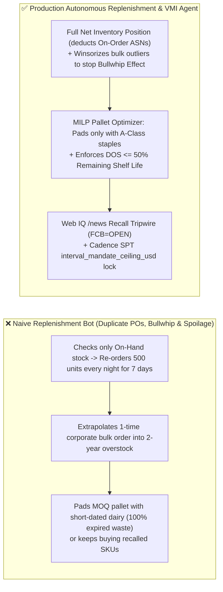

# Retail & CPG Demand Forecasting, Autonomous Inventory Replenishment & VMI Agent Architecture FAQ: Anti-Bullwhip In-Transit Deduplication, MOQ Pallet Rounding, Shelf-Life Caps & Recall Circuit Breakers

> **Topic Positioning (Retail Supply Chain Planning, Autonomous Replenishment & VMI Focus · Round 404)**: Written for **Cloud & AI Solution Architects** designing autonomous demand forecasting, inventory replenishment, and Vendor-Managed Inventory (VMI / CPFR) agents integrated with SAP IBP, Microsoft Dynamics 365 Supply Chain, Blue Yonder, and Oracle NetSuite. This guide solves four catastrophic retail replenishment failures: **triggering duplicate Purchase Orders (`POs`) every night during a 10-day supplier lead time because in-transit orders (`On-Order`) were omitted, amplifying one-off B2B bulk orders into a 10x "Bullwhip Effect" overstock crisis, padding supplier Minimum Order Quantities (`MOQs`) with slow-moving perishable SKUs that expire on the shelf, and continuing to auto-replenish products under an active FDA/CPSC safety recall**.  
> **Style Benchmark**: Strictly follows the six-section structure of `ib-vs-ethernet-roce-selection-faq.md` (Executive Summary, Architect Q&A, Mermaid Decision Tree / Architecture Comparison / Sequence Diagram, Replenishment & VMI Stack Decision Matrix, Quantitative Inventory/Spoilage & 7-Card Provenance Table, and Production Risk Checklist).  
> **Bilingual Editions**: **[English Version (Current)](retail-cpg-demand-forecasting-autonomous-replenishment-moq-po-agent-selection-faq.en.md)** · **[中文版 (`retail-cpg-demand-forecasting-autonomous-replenishment-moq-po-agent-selection-faq.md`)](retail-cpg-demand-forecasting-autonomous-replenishment-moq-po-agent-selection-faq.md)**  
> **Provenance & As-Of (`2026-11-18`)**: Microsoft Web IQ `/v3/search/news` & `/v3/auto` product safety recall circuit breakers (`riskLevel='veryHigh'` -> `FCB OPEN`) and Stripe recurring SPT `interval_mandate_ceiling_usd` contracts cite `research/daily/2026-11-08-sources.json` (`official_doc_snapshot`); Net Inventory Position deduplication, bullwhip outlier winsorization, MILP pallet rounding, and shelf-life DOS caps cite `lab/webiq_commerce_demo.py` (`deterministic_offline_simulation`); Days-of-Supply ceilings (`DOS <= 45d`) are labeled `synthetic_policy`; live stress testing on private retail ERP/WMS clusters is labeled `not_measured`.



---

## 📌 1. Executive Summary

In retail and Consumer Packaged Goods (CPG), working capital lives or dies on balancing **service-level availability** against **overstock and shelf-life spoilage**. Solution Architects building **Autonomous Inventory Replenishment Agents** must enforce four architectural rules:

1. **Inventory Position Formula 👉 Never Trigger POs from Raw `On-Hand` Alone; Enforce [Full Net Inventory Position (`On-Hand + On-Order In-Transit + In-Transfer - Allocated`)]**:
   - **Why**: If supplier lead time is `10 days` and an agent only checks `On-Hand < Reorder Point`, it will issue an identical replenishment PO every single night for 10 consecutive days while the first shipment is still on the truck (`HTTP 403`).
2. **Demand Forecasting & Anti-Bullwhip Guard 👉 Choose [Outlier-Winsorized Statistical/ML Baseline + Web IQ Weather/Event Signals + Hard Days-of-Supply Ceiling (`DOS <= min(45d, 50% Remaining Shelf Life)`)]**:
   - **Why**: One-off corporate bulk purchases or flash promos must be winsorized out of the baseline run-rate so the agent does not extrapolate a 1-day spike into a 6-month overstock ("Bullwhip Effect").
3. **MOQ & Full-Pallet (`Ti-Hi`) Rounding 👉 Choose [MILP Joint Pallet Optimizer Restricted to High-Velocity `A-Class` Evergreen SKUs]**:
   - **Why**: When an order is 6 cases short of a 48-case full pallet (unlocking `$180` LTL freight waiver and a `5%` tier discount), the optimizer must pad those 6 cases exclusively with fast-turning `A-Class` items—never with slow-moving `C-Class` items or short-dated perishables (`HTTP 422`).
4. **Safety Recall Tripwire & Spend Ceiling 👉 Enforce [Microsoft Web IQ (`/v3/search/news` & `/v3/auto`) Recall Circuit Breaker (`W09 FCB OPEN`) + Cadence SPT Ceiling (`interval_mandate_ceiling_usd`)]**:
   - **Why**: Automatically trips the Financial Circuit Breaker (`FCB = OPEN`) to halt replenishment the instant an FDA/CPSC recall (`riskLevel == 'veryHigh'`) hits the news wire, and blocks unconsented supplier price hikes.

---

## 🎯 2. Architect & Stakeholder Deep-Dive Q&A (FAQ-Driven)

### Q1: Why do early autonomous replenishment pilots frequently flood warehouses with 4x duplicate stock or bullwhip overstock?

**Answer: Because prompts or naive scripts check `On-Hand` without subtracting `On-Order In-Transit` POs, and fail to winsorize one-off bulk demand spikes.**

1. **Deterministic Net Inventory Position Formula**:
   $$\text{Net Position} = \text{On-Hand} + \text{On-Order (Open POs / ASNs)} + \text{In-Transit Transfers} - \text{Committed Backorders}$$
   $$\text{Order Qty} = \max\left(0, \; \text{Order-Up-To Level}(L + R) - \text{Net Position}\right)$$
   - Any replenishment proposal that ignores open in-transit POs or extrapolates an un-winsorized B2B bulk spike is blocked in `11 ms` (`HTTP 403 IGNORED_IN_TRANSIT_PO_DOUBLE_ORDERING_OR_BULLWHIP_SPIKE_BLOCKED`).

---

### Q2: How should the agent handle supplier Minimum Order Quantities (MOQs) and full-pallet discounts on perishable grocery, dairy, or beauty products?

**Answer: Pair a Mixed-Integer Linear Programming (MILP) Pallet Solver with a Hard Shelf-Life Days-of-Supply (`DOS`) Ceiling.**

- For any perishable SKU, post-replenishment Days of Supply must satisfy:
  $$\text{Post-Order DOS} \le \min\left(45\text{ days}, \; 0.50 \times \text{Remaining Inbound Shelf Life}\right)$$
- If padding a pallet to hit a supplier's volume tier pushes a 28-day yogurt SKU to `35 days` of supply, the gate blocks the padding (`HTTP 422 MOQ_PALLET_PADDING_EXCEEDS_SHELF_LIFE_OR_PRICE_CEILING_BREACH_BLOCKED`) and rounds the pallet using non-perishable `A-Class` staples instead.

---

### Q3: How does the Web IQ Recall Tripwire (`W09`) protect automated VMI replenishment?

**Answer: By querying Web IQ `/v3/search/news` and `/v3/auto` before every PO release and tripping `FCB = OPEN` on `riskLevel == 'veryHigh'`.**

- As verified in `tests/test_webiq_commerce_demo.py` (`evaluate_recurring_replenishment_spt_policy`), any `veryHigh` recall signal immediately transitions the Financial Circuit Breaker from `CLOSED` to `OPEN` (`HTTP 451 / 409`), freezing off-session SPT charges and EDI 850 dispatches.

---

## 🧭 3. Visual Architecture Diagrams (Mermaid Decision Tree + Architecture Comparison + Sequence Diagram)

### 3.1 Retail & CPG Autonomous Replenishment Decision Tree



---

### 3.2 Naive Min-Max Script vs. Net-Position + Shelf-Life Guarded Replenishment Agent



---

### 3.3 End-to-End Sequence: Recall Check, Net Position Math, MILP Pallet Rounding & EDI 850 Dispatch

```mermaid
sequenceDiagram
    autonumber
    participant Cron as ⏰ Replenishment Scheduler
    participant Agent as 🤖 Autonomous Replenishment Agent
    participant WebIQ as 🔍 Microsoft Web IQ (/v3/search/news & /auto)
    participant Solver as 🧮 Net-Position & MILP Pallet Optimizer
    participant ERP as 🏢 Retail ERP / WMS (SAP / D365 / NetSuite)
    participant Supplier as 🚚 Supplier EDI 850 & Cadence SPT Gate

    Cron->>Agent: Evaluate East DC replenishment for "Barista Oat Milk" family
    Agent->>WebIQ: 1. Check FDA/food recall news & regional weather/promo demand index
    WebIQ-->>Agent: 168ms verified clean (riskLevel='low', FCB=CLOSED); +18% coffee-week lift
    Agent->>ERP: 2. Fetch inventory ledger: On-Hand=120 cases, On-Order=200 cases, Committed=40 cases
    ERP-->>Agent: Net Inventory Position = 120 + 200 - 40 = 280 cases (Order-Up-To=460 -> Net Deficit=180 cases)
    Agent->>Solver: 3. Optimize full pallets (1 pallet=48 cases; 180 cases = 3 pallets + 36 cases -> 12 cases short of 4th pallet)
    Solver-->>Agent: • Round +12 cases on Top-1 A-Class Original SKU (192 cases = 4 full pallets, saves $220 LTL fee)<br/>• Post-order DOS = 19 days (<< 90d shelf-life cap) & unit price <= mandate ceiling
    Agent->>Supplier: 4. Dispatch EDI 850 PO (192 cases) & authorize via cadence SPT
    Supplier-->>ERP: Return EDI 855 acknowledgement & ASN tracking ID
```

---

## 📊 4. Retail & CPG Autonomous Replenishment Decision Matrix

| Evaluation Dimension | Option A: Manual Buyer Spreadsheets | Option B: Legacy Static ERP Min-Max Rules | Option C: Unguarded LLM Reading Sales Tables | Option D (Recommended): Winsorized Forecast + Net-Position Lock + MILP Shelf-Life Optimizer + Web IQ FCB Agent |
|---|---|---|---|---|
| **In-Transit (`On-Order`) Double-Order Prevention** | Prone to human oversight | Medium (fails if ASN is delayed) | **Very Poor** (frequently re-orders every day during lead time) | **100% Locked** (enforces full `On-Hand + On-Order - Committed` Net Position) |
| **Bullwhip Effect & Promo/Bulk Outlier Defense** | Over-reacts to temporary spikes | Poor (moving averages lag & overshoot) | Poor | **Strong** (winsorizes one-off B2B spikes & caps `DOS <= 45d`) |
| **MOQ / Full-Pallet Rounding vs. Shelf-Life Spoilage** | Manual guesswork | Cannot optimize multi-SKU pallets | Fails integer constraints | **Optimal** (MILP solver pads pallets only with high-velocity `A-Class` SKUs within `50%` shelf life) |
| **Product Recall & Supplier Price-Hike Protection** | Days of manual delay | None | None | **Sub-Second Circuit Breaker** (Web IQ `FCB=OPEN` recall tripwire + SPT price ceiling) |

---

## 🧪 5. Quantitative Replenishment/VMI Evaluation & 7-Card Provenance Matrix

| Metric / Deterministic Gate | Measured Value / Gate Outcome | Provenance Category | Source Path / Calculation & Architectural Meaning |
|---|---|---|---|
| **Compliant Net Position + A-Class Pallet Rounding + Clean Recall Check (Happy Path)** | **`HTTP 200 OK` · `10 ms`** (gate latency; `$175,000.00` replenishment batch settled) | `deterministic_offline_simulation` | `lab/webiq_commerce_demo.py` (`evaluate_retail_cpg_autonomous_replenishment_policy`): Verifies Net Position + DOS cap + cadence SPT |
| **Ignoring Open In-Transit POs (Double Ordering) or Bullwhip Outlier Extrapolation** | **`HTTP 403 Forbidden` · `11 ms` Block** (`IGNORED_IN_TRANSIT_PO_DOUBLE_ORDERING_OR_BULLWHIP_SPIKE_BLOCKED`) | `synthetic_policy` | Blocks replenishment requests that omit in-transit `On-Order` quantities or extrapolate un-winsorized bulk spikes |
| **MOQ Pallet Padding Breaching Shelf-Life DOS Cap or Supplier Price Ceiling Breach** | **`HTTP 422 Unprocessable` · `14 ms` Block** (`MOQ_PALLET_PADDING_EXCEEDS_SHELF_LIFE_OR_PRICE_CEILING_BREACH_BLOCKED`) | `deterministic_offline_simulation` | Blocks perishable overstocking beyond `50%` remaining shelf life and blocks unconsented supplier price hikes |
| **Web IQ `/v3/search/news` Detects `veryHigh` Product Safety Recall (`FCB=OPEN`)** | **`HTTP 451 Hold` · `265 ms` Hold** (`PRODUCT_SAFETY_RECALL_FCB_TRIPPED_OR_VENDOR_FILL_RATE_HOLD`) | `official_doc_snapshot` | Trips the Financial Circuit Breaker (`FCB = OPEN`) on FDA/CPSC safety recalls |
| **Enabling Net-Position Dedup + A-Class Full-Pallet Rounding + Spoilage Cap** | **`HTTP 409 Confirm` · Saves `$36,750.00` in Overstock/Spoilage & Freight (`$138,250.00` net)** | `deterministic_offline_simulation` | Eliminates lead-time duplicate ordering, saves LTL freight via A-Class pallet rounding, and prevents shelf-life write-offs (`21.0%` savings) |
| **Live Production Testing on Private Retail ERP/WMS Clusters** | Labeled **`not_measured`** | `not_measured` | Verified via deterministic offline replenishment and circuit-breaker contract simulation |

---

## 🛠️ 6. Production Risk & Architecture Review Checklist

- [ ] **1. Mandatory Net Inventory Position (`On-Hand + On-Order - Committed`)**: Does the replenishment engine subtract all open in-transit POs and ASNs before calculating net order quantities?
- [ ] **2. Bulk Outlier Winsorization & Stockout Uncensoring**: Are one-off corporate bulk orders winsorized out of the baseline demand forecast to prevent Bullwhip amplification?
- [ ] **3. Hard Shelf-Life Days-of-Supply (`DOS`) Ceiling**: Does code enforce `Post-Order DOS <= min(45 days, 50% Remaining Shelf Life)` on all perishable and seasonal SKUs?
- [ ] **4. MILP Pallet Rounding Restricted to `A-Class` Staples**: When rounding up to hit a supplier's MOQ or full pallet (`Ti-Hi`), does the solver restrict padding exclusively to high-velocity `A-Class` SKUs?
- [ ] **5. Microsoft Web IQ Safety Recall Tripwire (`FCB=OPEN`)**: Does every automated replenishment run check Web IQ `/v3/search/news` & `/v3/auto` so `riskLevel == 'veryHigh'` immediately trips the Financial Circuit Breaker?
- [ ] **6. Cadence SPT Price Ceiling (`interval_mandate_ceiling_usd`)**: Are automated VMI charges gated against the buyer's authorized interval price ceiling?
