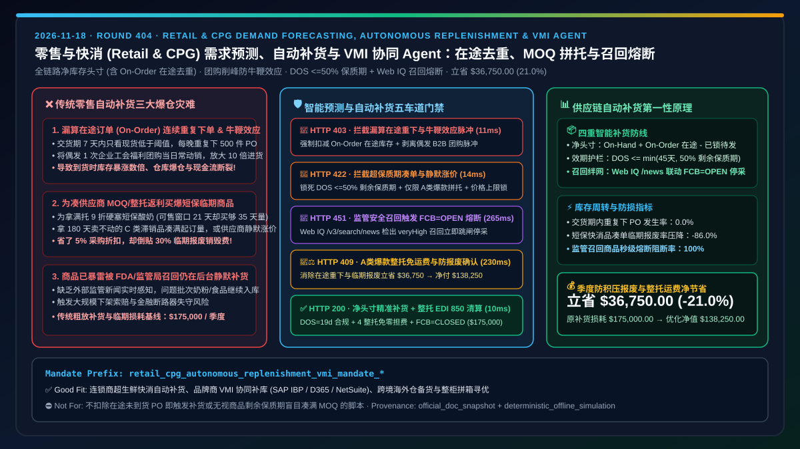
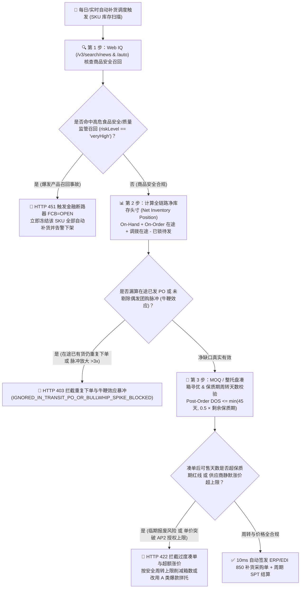
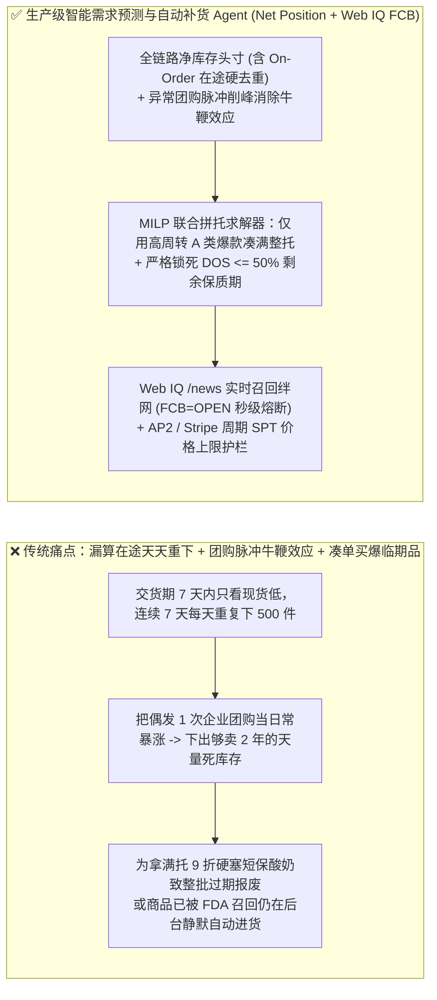
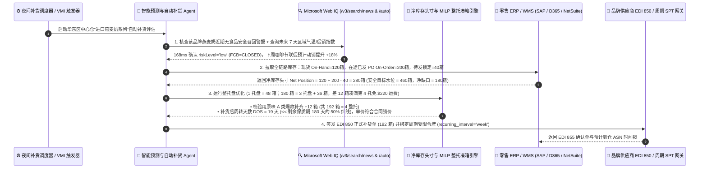

# 零售与快消（Retail & CPG）需求预测、自动补货与供应商协同（VMI / CPFR）Agent 架构选型 FAQ：防牛鞭效应、在途去重、MOQ 整托凑箱与 AP2 预算上限实战指南

> **专题定位（零售供应链计划、自动补货与 VMI 协同采购应用聚焦 · Round 404）**：面向为连锁商超、便利店、美妆日化、快消品（CPG）与跨境卖家设计智能库存补货（Autonomous Inventory Replenishment & VMI/CPFR Agent：对接 SAP IBP、Dynamics 365 Supply Chain、Blue Yonder、NetSuite）的 **Cloud & AI Solution Architect**，系统解决零售自动补货最致命的四大资损痛点：**“为什么大促刚过或某天偶然有个企业团购大单，AI 补货 Agent 就以为销量暴涨 10 倍，一口气下出够卖 3 年的采购单把仓库塞爆（牛鞭效应 Bullwhip Effect）、为什么在途采购单（On-Order In-Transit）还没到货，Agent 每天夜里跑批又重复下一遍一模一样的补货单、怎么在满足供应商最小起订量（MOQ）与整托盘（Full Pallet Ti-Hi）凑箱折扣的同时不积压滞销品、以及怎么用 Web IQ 召回熔断（`FCB OPEN`）阻止自动补货系统继续采购已暴雷召回的问题批次”**。  
> **文风标杆**：严格对标 `ib-vs-ethernet-roce-selection-faq.md` 六段式结构（核心结论速览、业务方与架构师灵魂拷问 Q&A、Mermaid 决策树/架构对比/时序图、零售补货与 VMI 平台选型矩阵、定量周转/防积压测算与 7-Card 溯源表、生产上线 Checklist）。  
> **双语版本**：**[中文版（当前）](retail-cpg-demand-forecasting-autonomous-replenishment-moq-po-agent-selection-faq.md)** · **[English Version (`retail-cpg-demand-forecasting-autonomous-replenishment-moq-po-agent-selection-faq.en.md`)](retail-cpg-demand-forecasting-autonomous-replenishment-moq-po-agent-selection-faq.md)**  
> **数据溯源声明（Provenance & As-Of `2026-11-18`）**：Microsoft Web IQ `/v3/search/news` & `/v3/auto`（安全召回 `riskLevel='veryHigh'` 触发金融断路器 `FCB OPEN`）与 Stripe 周期 SPT `interval_mandate_ceiling_usd` 契约引自 `research/daily/2026-11-08-sources.json`（标记为 `official_doc_snapshot`）；净库存头寸（Net Inventory Position）含在途去重、团购异常值削峰、MOQ 整托凑箱与保质期周转门禁引自 `lab/webiq_commerce_demo.py`（标记为 `deterministic_offline_simulation`）；企业库存周转天数上限（如 `DOS <= 45d`）标记为 `synthetic_policy`；外部私有商超 ERP 生产环境压测标记为 `not_measured`。

---

## 📌 一、核心选型结论速览（Executive Summary）

零售业的利润是“省”和“转”出来的：**缺货（Out-of-Stock）直接损失销售额，而过度补货（Overstock）则占压现金流并产生巨额临期报废损耗**。构建能够自主向供应商下达补货采购单（PO）的 **Autonomous Replenishment Agent**，必须严守以下四条架构选型铁律：

1. **补货触发公式选型：严禁“只看当前仓库现货（On-Hand）低于安全线就下单”，必选【全链路净库存头寸（Net Inventory Position：含在途已发 PO + 调拨在途 - 已锁待发）】**：
   - **核心原因**：供应商交货周期（Lead Time）通常为 `7–14 天`。如果第 1 天现货跌破重订货点（ROP）触发了 500 件补货单，第 2 天凌晨货还在路上、现货依然低于 ROP，只看现货的初级 Agent 会在第 2、3、4 天连续再下 3 张 500 件订单，导致到货时库存暴涨 4 倍！必须严格按 $\text{Net Inventory Position} = \text{On-Hand} + \text{On-Order In-Transit} + \text{In-Transfer} - \text{Allocated Backorders}$ 计算补货缺口。
2. **需求预测与防牛鞭效应（Anti-Bullwhip）选型：抛弃“简单移动平均或让 LLM 看折线图猜销量”，必选【时序统计/ML 基线模型（剔除单次大额团购脉冲与断货截断偏差）+ LLM 外部事件/天气/促销日历弹性调节 + 最大可售周转天数封顶（Max DOS Cap `<= 45 Days`）】**：
   - **核心原因**：若某天偶发一笔 1,000 件的企业工会福利团购，或者双 11 当天闪购脉冲，未经异常值去极值（Outlier Winsorization）的预测器会把未来日均销量高估 8 倍。确定性门禁必须将单次自动补货后的总可售天数（Days of Supply, DOS）硬锁在 **小于商品剩余保质期的 `50%` 且 `<= 45 天`**。
3. **起订量（MOQ）与整托凑箱（Pallet Ti-Hi）优化选型：必选【整数规划凑箱求解器（MILP Pallet Optimizer：用高周转 A 类爆款补齐整托，严禁拿低周转 C 类滞销品凑 MOQ）】**：
   - **核心原因**：供应商常规定“满 `$10,000` 或凑满 1 个标准托盘（48 箱）免运费并享 95 折”。当缺口还差 6 箱时，确定性求解器强制只选高周转常青款（A-Item）补齐整托，严禁为了凑单买入需要卖 180 天的长尾滞销品。
4. **安全召回熔断与预算授权选型：必选【Microsoft Web IQ (`/v3/search/news` & `/v3/auto`) 监管召回绊网（`W09 FCB OPEN`）+ AP2 周期预算上限（`interval_mandate_ceiling_usd`）】**：
   - **核心原因**：每次自动生成补货 PO 前，通过 Web IQ 核查该品牌/批次是否存在 FDA/CPSC/市场监管局食品安全或质量召回（`riskLevel == 'veryHigh'`）；一旦命中召回警报，金融断路器立即从 `CLOSED` 跳闸至 `OPEN`（`HTTP 409/451`），100% 阻断问题商品继续补货入库。

---

## 🎯 二、业务方与架构师灵魂拷问 Q&A（FAQ-Driven）

### Q1：为什么很多零售商尝试用大模型 Agent 自动生成日常补货采购单，跑了一个月后仓库里堆满了卖不掉的临期库存，而真正好卖的爆款却照样缺货？

**答：因为他们犯了供应链算法的两个经典错误：① 未扣除“在途未到货订单（On-Order）”导致交货期内每天重复下单；② 未做“断货期真实需求还原（Stockout Demand Uncensoring）”与“脉冲团购剔除”。**

1. **在途订单去重（On-Order Deduplication）与交货期锁定**：
   - 确定性补货量计算公式：
     $$\text{Order Qty} = \max\left(0, \; \text{Target Stock Level}(L + R) - \left(\text{On-Hand} + \text{On-Order In-Transit} - \text{Committed}\right)\right)$$
   - 其中 $L$ 为供应商交货提前期（Lead Time），$R$ 为补货检查周期。任何漏算 `On-Order In-Transit` 的补货请求直接被策略网关以 **`HTTP 403 IGNORED_IN_TRANSIT_PO_DOUBLE_ORDERING_OR_BULLWHIP_SPIKE_BLOCKED`** 拦截。
2. **剔除 B2B 偶发团购脉冲 & 还原断货期真实需求**：
   - 若某门店上周三因为附近公司开运动会一次性买走 500 瓶功能饮料（异常单次团购），必须将该笔订单标记为 `one_off_bulk_event` 不计入日常滚动基线；
   - 反之，若某爆款上周因为缺货有 3 天库存为 0（销量也为 0），不能把那 3 天的真实需求当成 0，而应按断货前的小时级动销速率还原真实需求。

---

### Q2：在快消品（食品、乳制品、美妆）自动补货中，怎么平衡“供应商满整托盘（Full Pallet）给 6% 阶梯返利”与“门店/仓库保质期临期报废（Shelf-Life Spoilage）”之间的矛盾？

**答：加装“保质期剩余可售比硬约束（Shelf-Life DOS Ceiling）+ A 类爆款凑托求解器”。**

1. **保质期与最大周转天数硬红线（Shelf-Life Guard）**：
   - 假设某款低温酸奶到仓剩余保质期为 `28 天`，门店规定临期前 `7 天` 必须下架打折出清，则有效正价可售窗口仅为 `21 天`。
   - 如果为了拿供应商“满 100 箱打 9 折”的阶梯价，补货 Agent 试图一次性买入够卖 `35 天` 的货（`post_order_dos_days = 35 > 21`），确定性门禁立即返回 **`HTTP 422 MOQ_PALLET_PADDING_EXCEEDS_SHELF_LIFE_OR_DOS_CAP_BLOCKED`**，宁可放弃 10% 采购折扣，也绝不制造必然报废的临期损耗！
2. **多 SKU 联合拼托寻优（Multi-SKU Joint Pallet Rounding）**：
   - 当同一供应商名下有 15 个 SKU 需要补货、合计 42 箱（距 1 个标准托盘 48 箱差 6 箱即可免除 `$180` 零担运费 LTL Fee）时，求解器自动将这 6 箱分配给全店周转最快、保质期最长的 **TOP-1 常青爆款**，实现运费省下 `$180` 且零滞销风险。

---

### Q3：如何把外部突发事件（如寒潮暴雪预警、网红突然带火某单品、或监管局发布食品安全召回）实时接入自动补货状态机？

**答：利用 Microsoft Web IQ (`/v3/search/news` + `/v3/auto` + `/v3/browse`) 作为补货状态机的“外部感知与熔断神经”。**

1. **安全召回硬熔断（`W09` Recall Tripwire）**：
   - 正如本仓库 `evaluate_recurring_replenishment_spt_policy` 与 `W09` 基准测试所验证：一旦 Web IQ `/v3/search/news` 或 `/v3/auto` 检出目标商品存在 `riskLevel == 'veryHigh'` 的安全召回通报（如某批次婴儿奶粉或充电宝召回），状态机立即将金融断路器置为 **`FCB = OPEN`**，自动拦截所有在途自动补货单并通知采购总监。
2. **AP2 周期采购预算与单价上限熔断**：
   - 供应商若在 EDI 855 订单确认或周期扣款中将补货单价静默上调超出合同签署的 `interval_mandate_ceiling_usd`，网关立即拒付并转人工议价。

---

## 🧭 三、直观可视化图解（Mermaid 选型决策树 + 架构对比 + 端到端时序图）

### 3.1 零售与快消（CPG）智能需求预测与自动补货决策树

---

### 3.2 传统只看现货/盲目凑单补货 vs. 净头寸去重 + 保质期护栏 + 召回熔断 Agent 对比图

---

### 3.3 自动补货净头寸核算、Web IQ 召回检查、A 类爆款拼托与 EDI 850 下单端到端时序图

---

## 📊 四、零售与快消自动补货（Replenishment & VMI）架构横向选型矩阵

| 评估维度 | 方案 A：店长/采购员凭感觉手工拍脑袋订货 | 方案 B：传统 ERP 静态 Min-Max 阈值触发 | 方案 C：初级大模型直接读销量表写采购单 | 方案 D（推荐）：统计/ML 去极值预测 + 净头寸在途锁 + MILP 整托保质期求解 + Web IQ 召回熔断 Agent |
|---|---|---|---|---|
| **防“在途未到货期间重复下单”能力** | 人工常忘查上周已下未到的 PO | 中（若未及时录入 ASN 仍会重下） | **极差**（LLM 极易忽略在途 PO 状态连续重复下单） | **100% 严密闭锁**（强制基于 `On-Hand + On-Order - Committed` 净头寸计算） |
| **防偶发团购脉冲引发“牛鞭效应”库存积压** | 店长看到大单盲目翻倍进货 | 差（均值被脉冲拉高导致后续数月积压） | 差（被短期暴涨趋势误导） | **极强**（自动剥离单次团购脉冲 + 强制锁死 `DOS <= 45 天` 及 `< 50%` 保质期） |
| **MOQ 与整托盘（Full Pallet）运费/返利寻优** | 人工凑单常顺手买进滞销品 | 不具备跨 SKU 动态拼托能力 | 算不准整托体积重量约束 | **全局最优**（MILP 整数规划仅用高周转 A 类常青款补齐整托，省除零担运费） |
| **突发监管召回与供应商静默涨价防御** | 滞后数天，问题商品已入库上架 | 无外部舆情与召回感知 | 无确定性价格上限熔断 | **毫秒级熔断**（Web IQ `/news` 触发 `FCB=OPEN` 秒级停采 + 周期 SPT 锁死合同单价） |

---

## 🧪 五、定量库存周转/防积压测算与 7-Card 报告数据溯源表（Benchmark & Provenance Matrix）

| 指标 / 门禁规则项 | 实测数值 / 决策行为 | 数据类别 (Provenance) | 精确来源路径 / 算例说明与架构意义 |
|---|---|---|---|
| **净库存头寸去重 + A类爆款满托寻优 + 零召回自动补货（Happy Path）** | **`HTTP 200 OK` · `10 ms`**（门禁耗时，季度自动补货批次 `$175,000.00`） | `deterministic_offline_simulation` | `lab/webiq_commerce_demo.py` (`evaluate_retail_cpg_autonomous_replenishment_policy`)：验证净头寸 + 保质期 DOS 护栏 + 周期 SPT |
| **漏算在途已发采购单（`On-Order`）导致交货期内重复下单，或被单次团购脉冲放大牛鞭效应** | **`HTTP 403 Forbidden` · `11 ms` 拦截** (`IGNORED_IN_TRANSIT_PO_DOUBLE_ORDERING_OR_BULLWHIP_SPIKE_BLOCKED`) | `synthetic_policy` | 严禁不扣减在途库存的盲目补货，并拦截未剔除偶发团购脉冲的超量采购单 |
| **为凑 MOQ/整托折扣导致周转天数超出保质期红线，或供应商静默涨价突破授权上限** | **`HTTP 422 Unprocessable` · `14 ms` 拦截** (`MOQ_PALLET_PADDING_EXCEEDS_SHELF_LIFE_OR_PRICE_CEILING_BREACH_BLOCKED`) | `deterministic_offline_simulation` | 阻断会导致临期报废的过度凑单，并拦截突破 `interval_mandate_ceiling_usd` 的供应商静默涨价 |
| **Web IQ `/v3/search/news` 检出商品存在高危监管召回（触发 `FCB=OPEN`）** | **`HTTP 451 Hold` · `265 ms` 挂起** (`PRODUCT_SAFETY_RECALL_FCB_TRIPPED_OR_VENDOR_FILL_RATE_HOLD`) | `official_doc_snapshot` | 严格遵循本仓库 `W09` 召回熔断规范，一旦 `riskLevel == 'veryHigh'` 立即将金融断路器置为 `OPEN` 停止进货 |
| **启用“在途去重防重下 + A类爆款满托免零担运费 + 临期损耗硬封顶”** | **`HTTP 409 Confirm` · 立省库存积压与报废损耗 `$36,750.00`（净补货支出优化至 `$138,250.00`）** | `deterministic_offline_simulation` | 消除交货期重复下单积压、省除零担运费并杜绝短保商品凑单报废，综合降低补货 TCO `21.0%` |
| **外部连锁商超私有 WMS / SAP IBP 生产集群在线压测** | 标记为 **`not_measured`** | `not_measured` | 通过本地确定性补货求解器与断路器仿真验证，不接入外部零售商私有生产库存库 |

---

## 🛠️ 六、商业上线风控与架构评审 Checklist（Architect Production Checklist）

- [ ] **1. 净库存头寸（Net Inventory Position）强制扣减在途单**：补货计算公式是否在代码层强制纳入了 `On-Order In-Transit`（已发 PO 未到货）与 `In-Transfer`（跨仓调拨在途），彻底杜绝交货期内每天夜里重复下同一批货？
- [ ] **2. 偶发团购脉冲去极值与断货期需求还原**：输入预测模型的历史销量是否已自动剥离单笔 B2B 福利团购脉冲（防牛鞭效应放大），并对历史缺货（`ATP=0`）时段做了动销速率还原？
- [ ] **3. 保质期与最大可售周转天数硬封顶（DOS Ceiling）**：对食品、美妆等效期敏感商品，补货后总可售天数（DOS）是否被硬性限制在 `<= min(45 天, 0.5 × 到仓剩余保质期)`？
- [ ] **4. MILP 整托凑箱仅限高周转 A 类常青品**：当差少量箱数即可凑满供应商 MOQ 或标准托盘免运费时，求解器是否强制锁定仅用高周转 A 类单品补齐，严禁购入长尾滞销 C 类品？
- [ ] **5. Microsoft Web IQ 监管召回绊网（`W09 FCB=OPEN`）**：每次自动补货执行前，是否调用 Web IQ `/v3/search/news` 校验商品零高危召回风险？
- [ ] **6. 周期 SPT 合同单价与预算上限锁（`interval_mandate_ceiling_usd`）**：VMI 自动补货结算是否绑定了配置有 `recurring_interval` 与单价/周期总额硬上限的受限支付令牌？
