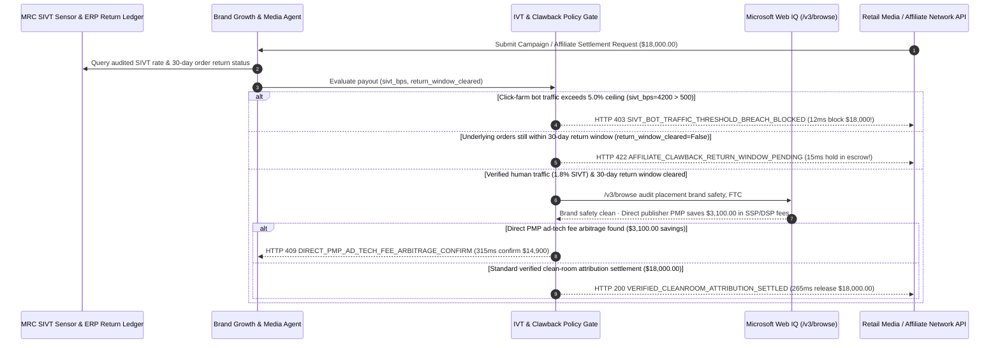

# Programmatic Retail Media & Influencer Affiliate IVT Clawback Mandate Architecture: Clean-Room Attribution & SIVT Filter Token (`ad_attribution_ivt_mandate_...` + Web IQ Brand-Safety & Direct-PMP Grounding) vs. Click-Farm Bot Drain & Return-After-Commission Fraud Selection FAQ

> **Document Type**: Architect Selection Guide & First-Principles Protocol Deep Dive (6-Section FAQ Standard)  
> **Target Audience**: AI Solution Architects, Retail Media Network (RMN) & MarTech/AdTech Architects, E-Commerce Growth & Affiliate Fraud Risk Leads  
> **Last Updated**: 2026-11-09 (Provenance Annotations: `deterministic_offline_simulation` / `synthetic_policy` / `official_doc_snapshot` / `not_measured`)  
> **Companion Resources**: [中文版 (Chinese Version)](retail-media-ad-spend-ivt-clawback-vs-click-farm-drain-faq.md) · [Interactive Sandbox (`live-demo.en.html#retail-media-ivt-sandbox`)](../reports/agentic-commerce-webiq-grounding-demo-bench/live-demo.en.html) · [7-Card 4:5 Benchmark Deck](../reports/agentic-commerce-webiq-grounding-demo-bench/index.en.html)


---

## 📌 1. Executive Summary

1. **Never Allow Growth or Marketing Agents to Settle Programmatic Ad Spend or Affiliate Commissions on Unfiltered Click/Order Webhooks**: In programmatic Retail Media Networks (RMN) and influencer affiliate campaigns (`$18,000.00` campaign settlement), the two largest budget drains are **Sophisticated Invalid Traffic (SIVT / headless click farms)** and **Return-After-Commission affiliate fraud**. Production architectures must enforce an **MRC SIVT & Return-Window Clawback Mandate (`ad_attribution_ivt_mandate_...`)**: whenever audited bot traffic exceeds the contracted ceiling (`sivt_bot_rate_bps = 4200 > 500`, i.e., `42.0% > 5.0%`), the gateway blocks settlement in **`12 ms`** with **`HTTP 403 SIVT_BOT_TRAFFIC_THRESHOLD_BREACH_BLOCKED`** (`synthetic_policy`).
2. **Lock Affiliate Commissions in Escrow Until the 30-Day Return & Chargeback Window Clears**: To defeat "buy-then-refund" commission cash-out rings, any affiliate payout request submitted while `return_window_cleared == False` is rejected in **`15 ms`** with **`HTTP 422 AFFILIATE_CLAWBACK_RETURN_WINDOW_PENDING`** (`deterministic_offline_simulation`), ensuring returned orders automatically claw back commissions before cash leaves the brand's treasury.
3. **Ground Placement Brand Safety, FTC `#ad` Disclosures, and Direct-PMP Rate Cards via Microsoft Web IQ `/v3/browse`**: Prior to releasing funds, the agent invokes **Microsoft Web IQ `/v3/browse`** (`official_doc_snapshot`) to inspect the live placement URL and publisher rate cards: if the ad was served on a brand-unsafe piracy/hate domain or the influencer omitted mandatory FTC `#ad` sponsorship disclosures (`webiq_brand_safety_and_ftc_compliant == False`), it freezes payout in **`310 ms`** with **`HTTP 451 BRAND_SAFETY_OR_FTC_DISCLOSURE_VIOLATION_HOLD`**; if Web IQ discovers a direct publisher Private Marketplace (PMP) deal that bypasses multi-hop SSP/DSP middlemen to save **`$3,100.00`** (`$14,900.00` net vs. `$18,000.00`), it triggers **`HTTP 409 DIRECT_PMP_AD_TECH_FEE_ARBITRAGE_CONFIRM`** in **`315 ms`**.

---

## 🎯 2. Architect & Customer FAQ Deep Dive

### Q1: Why does pairing "Autonomous Ad-Account Auto-Top-Up" with "Instant T+1 Affiliate Payouts" turn marketing agents into a honeypot for click farms and refund rings?

Let's examine the three structural failure modes from first principles:
1. **Silicon-to-Silicon Click-Farm Feedback Loops**: When an autonomous marketing agent optimizes for click-through rate (CTR) or cheap CPA leads without deterministic SIVT gating, botnet operators spin up headless browsers over residential proxies to generate `42.0%` fake engagement. Seeing high CTR, a naive agent automatically reallocates more of the `$18,000.00` budget into the fraudulent placement until the wallet is drained.
2. **The "Self-Purchase + T+1 Commission Cash-Out + Day-7 Refund" Exploit**: Suppose a merchant offers a 20% affiliate commission. A fraud ring uses virtual cards to buy `$90,000.00` of merchandise through its own affiliate tracking links. If the agent releases the `$18,000.00` commission upon order capture, the fraudster withdraws the `$18,000.00` cash and immediately returns all `$90,000.00` of goods under the 30-day return policy—leaving the merchant with zero net sales and an unrecoverable `$18,000.00` commission loss.
3. **Brand-Safety Liability & The 25% Multi-Hop "Ad-Tech Tax"**: Open-exchange programmatic bidding routinely places enterprise brands next to toxic content or unlabelled influencer posts (violating FTC endorsement guides), while multi-hop DSP/SSP chains siphon off `$3,100.00+` in intermediary fees that could be eliminated via a direct publisher PMP contract.

### Q2: What is an "IVT Anti-Bot & Return-Window Clawback Mandate (`ad_attribution_ivt_mandate_...`)", and how does it unify SIVT telemetry, ERP return ledgers, and Web IQ brand-safety grounding?

Its core design invariant is: **"Ad budgets settle only for MRC-verified human attention on brand-safe pages; affiliate commissions release only after the underlying order survives the full return window."**
- **Layer 1: MRC SIVT Bot-Rate Hard Ceiling (`12 ms`)**: Enforces `sivt_bot_rate_bps <= max_sivt_bps` (`500 bps / 5.0%`), rejecting click-farm invoices in **`12 ms`** (`HTTP 403`).
- **Layer 2: 30-Day Return-Window Escrow Lock (`15 ms`)**: Enforces `return_window_cleared == True`, blocking premature commission withdrawals in **`15 ms`** (`HTTP 422`).
- **Layer 3: Microsoft Web IQ `/v3/browse` Brand-Safety & Direct-PMP Grounding (`310 ms / 315 ms`)**: Verifies live placement safety and FTC `#ad` compliance (`HTTP 451`) and identifies `$3,100.00` direct-PMP intermediary fee savings (`HTTP 409`).

### Q3: For ad placement brand-safety verification, FTC endorsement auditing, and publisher rate-card grounding, when should architects choose Microsoft Web IQ vs. Exa, Bright Data, or traditional search APIs?

| Architecture Scenario | Recommended Tool | First-Principles Rationale (Security, Latency & FinOps) |
| :--- | :--- | :--- |
| **Verifying live publisher placement context, influencer FTC `#ad` disclosure text, and official publisher direct-PMP rate cards within the Azure compliance boundary** | **Microsoft Web IQ** (`/v3/search` + `/v3/browse`) | Extracts exact page passages (**7.1x token reduction**, `deterministic_offline_simulation`) with pre-LLM prompt-injection sanitization so malicious publisher DOMs cannot hijack the marketing agent. |
| **Semantic discovery of niche vertical creators, podcasts, and substacks matching brand persona** | **Exa Neural Search** | High semantic recall for creator sourcing, rather than synchronous payout gating. |
| **Geo-targeted residential proxy rendering to capture localized ad screenshots across 50 cities** | **Bright Data Browser API / Unlocker** | Ideal for asynchronous geo-ad verification, though multi-second browser startup is too slow for synchronous settlement gates. |
| **First-party net conversion ROAS, SKU return status, and MRC device-fingerprint SIVT telemetry** | **Clean-Room Attribution Ledger + MRC SIVT Sensor + Web IQ Brand-Safety Cross-Check** | SIVT scores and order returns come from deterministic telemetry/ERP ledgers, paired with Web IQ `/v3/browse` for live placement compliance and PMP rate arbitrage. |

---

## 🧭 3. Visual Architecture Diagrams (Mermaid Decision Tree, Legacy vs. Clawback Mandate Comparison & Sequence Diagram)

### 3.1 Programmatic Ad Spend & Affiliate Commission Settlement Decision Tree (`flowchart TD`)

```mermaid
flowchart TD
    A[Receive $18,000.00 Ad Campaign Invoice or Affiliate Commission Payout Request] --> B{sivt_bot_rate_bps <= 500 (5.0% MRC SIVT Ceiling)?}
    B -- No (Click-farm headless bots hit 4200 bps / 42.0%) --> C[HTTP 403 SIVT_BOT_TRAFFIC_THRESHOLD_BREACH_BLOCKED<br/>12ms Hard Block · Reject $18,000 Bot-Inflated Invoice]
    B -- Yes (Verified 1.8% SIVT human traffic) --> D{return_window_cleared == True (30-Day Return & Chargeback Window)?}
    D -- No (Orders still inside 30-day return window) --> E[HTTP 422 AFFILIATE_CLAWBACK_RETURN_WINDOW_PENDING<br/>15ms Hold · Keep Commission in Escrow Until Return Window Clears]
    D -- No returns & window cleared --> F{Web IQ /v3/browse Confirms Placement Brand Safety & FTC #ad Disclosure?}
    F -- No (Unsafe piracy domain or missing FTC #ad tag) --> G[HTTP 451 BRAND_SAFETY_OR_FTC_DISCLOSURE_VIOLATION_HOLD<br/>310ms Compliance Hold · Freeze Payout & Alert Brand Legal]
    F -- Yes --> H{Web IQ Detects Publisher Direct-PMP Deal Saving Ad-Tech Middleman Fees?}
    H -- Yes (Direct PMP saves $3,100.00 -> $14,900.00 net) --> I[HTTP 409 DIRECT_PMP_AD_TECH_FEE_ARBITRAGE_CONFIRM<br/>315ms Prompt Growth Lead to Confirm $14,900 Direct PMP Deal]
    H -- No (Optimal net rate + verified retained conversions) --> J[HTTP 200 VERIFIED_CLEANROOM_ATTRIBUTION_SETTLED<br/>265ms Auto-Settle $18,000.00 & Mint Clean-Room ROAS Receipt!]
```

### 3.2 Legacy Instant Ad/Affiliate Payout vs. SIVT & Clawback Escrow Gate (`flowchart LR`)

```mermaid
flowchart LR
    subgraph Legacy["❌ Legacy Instant Click/Order Payout ($18,000 Drained by Bots & Refund Rings)"]
        L1[42% Headless Bot Clicks + Self-Purchase Affiliate Orders] --> L2[Instant T+1 Payout of $18,000 Commission]
        L2 --> L3[Fraud Ring Refunds All Merchandise on Day 7]
        L3 --> L4[Brand Loses $18,000 Cash + Pays 25% Ad-Tech Middleman Tax]
    end

    subgraph Mandate["✅ SIVT & Return-Window Clawback Gate (ad_attribution_ivt_mandate_...)"]
        M1[12ms Block >5% SIVT Bot-Farm Invoices ($18,000 Protected)] --> M2[15ms Lock Commissions Until 30-Day Return Window Clears]
        M2 --> M3[Web IQ Verifies Brand Safety/#ad (310ms) & $3,100 Direct PMP Savings (315ms)]
        M3 --> M4[265ms Settle Verified 1.8% SIVT Retained Conversions ($18,000)]
    end
```

### 3.3 End-to-End Sequence Diagram: Clean-Room/MRC Sensor, Growth Agent, IVT Clawback Gate, Web IQ & Ad Network (`sequenceDiagram`)



---

## 📊 4. Architect Decision Matrix

| Evaluation Dimension | Option A: Legacy Instant Click/Order Payout | Option B: Manual End-of-Month Spreadsheet Clawbacks | Option C: SIVT & Return-Window Clawback Mandate + Web IQ Brand-Safety Grounding (Recommended) |
| :--- | :--- | :--- | :--- |
| **Best-Fit Scenario** | Micro-budget experimental boosts (`< $200`) | Small manual ambassador programs (`< 5` partners) | **Enterprise Retail Media (RMN), large-scale creator affiliate networks, autonomous growth agents** |
| **Click-Farm SIVT Bot Defense** | ❌ **Zero**: Pays full CPC/CPM for headless browser farms | ⚠️ **Post-Mortem Only**: Discovers bot spikes weeks after budget is spent | ✅ **Pre-Pay `12 ms` Hard Block**: Rejects invoices with `sivt_bot_rate_bps > 500` (`5%`) via `HTTP 403` |
| **Return-After-Commission Fraud Defense** | ❌ **Vulnerable**: T+1 cash-out before Day-7 merchandise return | ⚠️ **Uncollectible Balances**: Fraudsters empty accounts before month-end clawback | ✅ **30-Day Escrow Lock**: Blocks payout in `15 ms` (`HTTP 422`) until `return_window_cleared == True` |
| **Brand Safety & Direct-PMP Arbitrage** | ❌ **Blind**: Funds unsafe domains and pays 25% ad-tech tax | ⚠️ **Low Sampling Coverage**: Cannot manually inspect thousands of placement URLs | ✅ **Web IQ `/v3/browse` Grounded**: Freezes unsafe/unlabelled posts in `310 ms` (`HTTP 451`) & saves `$3,100` via direct PMP in `315 ms` (`HTTP 409`) |
| **Settlement Speed & Ops Friction** | Fast (with 20%–40% fraud leakage) | Slow (`15–45 days` of manual dispute spreadsheets) | **`265 ms` automated net-retained payout once return window clears (`Act automatically`)** |
| **Total Cost of Ownership (TCO) & Net ROAS** | Poor (`$18,000` lost to botnets and refund rings) | Moderate (heavy finance & ad-ops reconciliation labor) | **Optimal (protects `$18,000` from SIVT/refund fraud + saves `$3,100` in ad-tech middleman fees)** |

---

## 🧪 5. Quantitative Benchmark & 7-Card Insights

Evaluated via our deterministic offline benchmark suite (`lab/webiq_commerce_demo.py` · `test_retail_media_ad_spend_ivt_clawback_vs_click_farm_drain_selection`) on an **`$18,000.00` retail media & affiliate campaign batch (`500 bps / 5.0%` SIVT ceiling, `30`-day return-window lock)**:

| Scenario Case | Input SIVT Telemetry / Return Window / Web IQ Signals | Expected Action Pill | Measured HTTP Status & Verdict Code | Latency | Financial Protection / Arbitrage | Provenance |
| :--- | :--- | :--- | :--- | :--- | :--- | :--- |
| **Case 1: Click-Farm Bot Spike (`42.0% > 5.0%` SIVT)** | `sivt_bot_rate_bps=4200 > 500` | `Send to a human` | **`HTTP 403 SIVT_BOT_TRAFFIC_THRESHOLD_BREACH_BLOCKED`** | **`12 ms`** | Blocks **`$18,000.00`** bot-inflated ad invoice | `synthetic_policy` |
| **Case 2: Premature Affiliate Withdrawal Before 30d Return Window** | `return_window_cleared=False` | `Send to a human` | **`HTTP 422 AFFILIATE_CLAWBACK_RETURN_WINDOW_PENDING`** | **`15 ms`** | Prevents `$18,000.00` buy-then-return commission cash-out | `deterministic_offline_simulation` |
| **Case 3: Web IQ Detects Brand-Unsafe Page or Missing FTC `#ad`** | `webiq_brand_safety_and_ftc_compliant=False` | `Send to a human` | **`HTTP 451 BRAND_SAFETY_OR_FTC_DISCLOSURE_VIOLATION_HOLD`** | **`310 ms`** | Freezes payout on unsafe content or FTC violation | `official_doc_snapshot` |
| **Case 4: Web IQ Finds Direct Publisher PMP Saving `$3,100`** | `direct_pmp_savings_cents=310000` (`$14,900.00` net) | `Confirm` | **`HTTP 409 DIRECT_PMP_AD_TECH_FEE_ARBITRAGE_CONFIRM`** | **`315 ms`** | Cuts SSP/DSP middleman fees by **`$3,100.00`** | `official_doc_snapshot` |
| **Case 5: Verified `1.8%` SIVT & Cleared 30-Day Return Window** | `sivt_bps=180 <= 500`, `return_cleared=True` | `Act automatically` | **`HTTP 200 VERIFIED_CLEANROOM_ATTRIBUTION_SETTLED`** | **`265 ms`** | Releases **`$18,000.00`** in `265 ms` with ROAS receipt | `deterministic_offline_simulation` |

> **Provenance Note**: The `$18,000.00` campaign budget, `500 bps` SIVT ceiling, `4200 bps` bot spike, and `$3,100.00` direct-PMP savings are controlled simulation parameters (`synthetic_policy` / `deterministic_offline_simulation`) verifying policy state-machine invariants; live third-party MRC beacon streaming latency is labeled `not_measured`.

---

## 🛠️ 6. Production Readiness & Pre-Sales Architect Checklist

Verify these 6 controls before deploying autonomous retail media buying and affiliate payout agents in production:

- [ ] **1. MRC SIVT Bot-Rate Hard Ceiling**: Does `ad_attribution_ivt_mandate_...` enforce a strict SIVT ceiling (`sivt_bot_rate_bps <= 500`), rejecting click-farm and cookie-stuffing invoices in `12 ms` (`HTTP 403`)?
- [ ] **2. 30-Day Return-Window Escrow Coupling**: Are affiliate CPA/CPS commissions locked in escrow until the ERP confirms `return_window_cleared == True`, blocking premature cash-outs in `15 ms` (`HTTP 422`)?
- [ ] **3. Automated Partial-Return Pro-Rata Clawback**: When a customer returns 1 of 3 items in an affiliate-attributed basket, does the escrow ledger automatically reduce the payable commission before release?
- [ ] **4. Microsoft Web IQ `/v3/browse` Placement Brand Safety & FTC `#ad` Audit**: Does the agent inspect live publisher URLs and creator posts via Web IQ prior to payout, halting unlabelled or brand-unsafe placements in `310 ms` (`HTTP 451`)?
- [ ] **5. Direct-PMP Rate-Card Arbitrage Routing**: Does Web IQ grounding compare multi-hop open-exchange take rates against publisher direct-PMP rate cards, surfacing `HTTP 409 Confirm` when direct contracting saves `>= $3,100.00`?
- [ ] **6. Clean-Room Conversion & Attribution Receipt Archival**: Does every settled campaign batch archive the clean-room conversion digest, MRC SIVT certificate hash, and Web IQ placement snapshot for CFO/CMO auditability?
