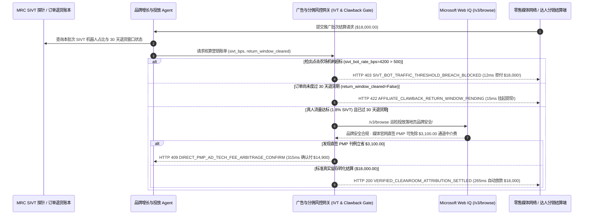

# 零售媒体程序化广告投放与网红带货分佣（Programmatic Retail Media & Influencer Affiliate IVT Clawback Mandate）架构：SIVT 机器人流量剔除与退货期满释放令牌（`ad_attribution_ivt_mandate_...` + Web IQ 品牌安全与直签刊例核验）vs 传统点击农场盗刷（Click-Farm Drain）与退货骗佣选型与原理解析 FAQ

> **文档类型**：架构师选型指南 & 协议第一性原理解析（6 段式 FAQ 标准版）  
> **适用读者**：AI Solution Architect、零售媒体网络（RMN）与数字营销技术（MarTech/AdTech）架构师、电商增长与达人分销风控负责人  
> **更新日期**：2026-11-09（Provenance 标注：`deterministic_offline_simulation` / `synthetic_policy` / `official_doc_snapshot` / `not_measured`）  
> **配套资源**：[English Version](retail-media-ad-spend-ivt-clawback-vs-click-farm-drain-faq.en.md) · [交互式沙盒控制台 (`live-demo.html#retail-media-ivt-sandbox`)](../reports/agentic-commerce-webiq-grounding-demo-bench/live-demo.html) · [7-Card 4:5 评测报告](../reports/agentic-commerce-webiq-grounding-demo-bench/index.html)


---

## 📌 一、核心结论速览（Executive Summary）

1. **严禁让品牌投放 Agent 仅凭广告平台或联盟网络的“原始点击/下单回调计数”就直接划拨广告预算或达人佣金**：在程序化零售媒体（Retail Media Network）与网红带货分销（Affiliate CPA/CPS，如单批次 `$18,000.00` 投放结算）中，最猖獗的两大黑产是 **“点击农场与无头浏览器机刷（Sophisticated Invalid Traffic, SIVT）”** 与 **“自买自退骗取带货佣金（Return-After-Commission Fraud）”**。生产环境必须强制采用 **MRC 反作弊遥测与退货冷静期绑定的分佣托管令牌（`ad_attribution_ivt_mandate_...`）**：一旦检出复杂无效机器人流量占比超标（如 `sivt_bot_rate_bps = 4200 > 500` 即 `42.0% > 5.0%` 红线），网关在 **`12 ms`** 内触发 **`HTTP 403 SIVT_BOT_TRAFFIC_THRESHOLD_BREACH_BLOCKED`**（`synthetic_policy`），100% 拒付机刷假流量账单。
2. **用“30 天退货期满解锁门禁（Return-Window Clawback Lock）”彻底根治“先买骗佣、后退货套现”**：针对按成交额分佣（CPS/CPA）的网红带货订单，只要关联商品尚未度过 30 天无理由退货与拒付窗口（`return_window_cleared=False`），网关在 **`15 ms`** 内以 **`HTTP 422 AFFILIATE_CLAWBACK_RETURN_WINDOW_PENDING`**（`deterministic_offline_simulation`）阻断提前提现，确保任何发生退货的订单自动零成本核销对应佣金。
3. **基于 Microsoft Web IQ `/v3/browse` 实时核验投放落地页品牌安全（Brand Safety & FTC `#ad` 披露）与媒体官网直签 PMP 刊例套利**：在放款前，Agent 调用 **Microsoft Web IQ `/v3/browse`**（`official_doc_snapshot`）穿透核查广告实际展示页面与媒体官方公开刊例表：若检出广告被投放在盗版/仇恨违规站点或带货达人漏标 FTC 强制要求的 `#ad` 赞助声明，在 **`310 ms`** 内触发 **`HTTP 451 BRAND_SAFETY_OR_FTC_DISCLOSURE_VIOLATION_HOLD`** 冻结资金；若发现绕过三层 DSP/SSP 中间商抽成、直接签约媒体官方私有交易市场（Direct PMP）可为同等真实曝光节省 **`$3,100.00`**（从 `$18,000.00` 降至 **`$14,900.00`**），则在 **`315 ms`** 内触发 **`HTTP 409 DIRECT_PMP_AD_TECH_FEE_ARBITRAGE_CONFIRM`**。

---

## 🎯 二、客户与架构师灵魂拷问 Q&A（FAQ-Driven Deep Dive）

### Q1：为什么传统的“投放 Agent 自动充值广告账户 + 下单即时结算带货达人佣金”，在电商大促期间会沦为黑产提款机？

咱们用大白话拆解数字营销和电商带货里最触目惊心的三个资金漏洞：
1. **“Agent 投广告、机器人点广告”的硅基自嗨循环**：品牌方让营销 Agent 拿着 `$18,000.00` 预算去买高转化关键词和展示位；灰产流量主立刻用成千上万个跑在云服务器里的无头浏览器（Headless Chrome）和真人住宅代理池模拟点击、滑动甚至加购，制造高达 `42%` 的虚假繁荣（SIVT）。没有反作弊遥测门禁的 Agent 看到点击率（CTR）飙升，还会自动追加预算，一天之内把 `$18,000` 全部喂给机器人。
2. **“零成本空手套白狼”的自买退货骗佣**：某高奢美妆品牌给带货达人设置了 20% 的高额分佣。黑产团伙注册达人账号后，用百张虚拟卡挂自己的分销链接狂买 `$90,000` 商品；如果系统在下单支付成功瞬间（T+1）就把 `$18,000` 佣金打给达人，黑产提现跑路后在第 7 天把 `$90,000` 商品全部申请“七天无理由退货”——品牌方退还了 `$90,000` 货款，还净亏 `$18,000` 现金佣金和往返运费！
3. **品牌安全暴雷与层层“通道过路税（Ad-Tech Tax）”**：程序化竞价（RTB）经常把大牌广告投放到假新闻或盗版影视站上；同时，一笔 `$18,000` 的广告费经过 DSP、Ad Exchange、SSP 层层扒皮，真正到达优质媒体手里的不到 70%。

### Q2：什么是“SIVT 反作弊与退货期满释放令牌（`ad_attribution_ivt_mandate_...`）”？它是如何把隐私安全屋归因与订单退货状态绑在一起的？

它的第一性原理非常清晰：**“广告费只为‘通过硬件/行为证明的真人注意力’买单；带货佣金只为‘度过退货期、真正留在消费者手里的净成交（Net Retained GMV）’买单。”**
- **第一层：MRC 标准 SIVT 机器人流量硬熔断（`12 ms`）**：每次广告批次请款必须携带经认证的无效流量审计比率 `sivt_bot_rate_bps`。只要超过合同上限（如 `500 bps / 5.0%`），网关在 **`12 ms`** 内返回 `HTTP 403` 拒付。
- **第二层：30 天退货冷静期托管锁（`15 ms`）**：分销佣金进入托管态，直到 ERP/WMS 与支付网关共同确认关联订单已满 30 天且无退货、无拒付（`return_window_cleared == True`）。任何提前提佣请求在 **`15 ms`** 内被 `HTTP 422` 拦截。
- **第三层：Microsoft Web IQ `/v3/browse` 落地页合规巡检与直签套利（`310 ms / 315 ms`）**：实时核验达人内容是否合规标注 `#ad` 及页面上下文是否安全（`HTTP 451`），并比对媒体官网直签 PMP 刊例价砍掉 `$3,100.00` 中介过路费（`HTTP 409`）。

### Q3：在广告落地页品牌安全核验、FTC 披露巡检与媒体公开刊例比价场景下，什么时候选 Microsoft Web IQ，什么时候选 Exa、Bright Data 或传统搜索 API？

| 架构需求场景 | 推荐选型 | 为什么这样选（第一性原理与成本/合规考量） |
| :--- | :--- | :--- |
| **实时核验达人带货帖是否正确标注 `#ad / Sponsored`、巡检投放落地页正文是否存在违禁内容、抓取媒体官方公开 PMP 刊例价表，且要求零提示词注入** | **Microsoft Web IQ** (`/v3/search` + `/v3/browse`) | 在企业 Azure 合规边界内以 `passage` 模式提取页面正文与赞助声明（上下文 Token 压缩 **7.1x**，`deterministic_offline_simulation`），内置反注入沙盒防止恶意网页劫持营销 Agent。 |
| **跨全网语义发掘与品牌调性匹配的垂直领域新兴 KOC / 播客创作者** | **Exa Neural Search** | 深度向量语义匹配适合前期创作者寻源（Creator Discovery），而非实时佣金清算门禁。 |
| **跨多国住宅 IP 模拟不同地理位置查看地域定向（Geo-Targeted）广告渲染截图** | **Bright Data Browser API / Unlocker** | 提供全球城市级代理与远程浏览器截图，适合抽样取证，但秒级延迟不适合做实时账单清算主网关。 |
| **第一方转化率（ROAS）、订单退货状态与设备指纹反作弊遥测** | **Clean-Room 隐私安全屋 + 第三方 MRC IVT 探针 + Web IQ 落地页合规交叉验证** | 流量真伪与退货状态来自 MRC 探针与订单库，公开内容安全与媒体直签价差由 Web IQ `/v3/browse` 实时核验。 |

---

## 🧭 三、直观可视化图解（Mermaid 决策树 + 传统盲目结佣 vs 反作弊托管对比 + 端到端时序图）

### 3.1 零售媒体广告结算与带货分佣反作弊决策树（`flowchart TD`）

```mermaid
flowchart TD
    A[收到 $18,000.00 广告投放账单或带货达人分佣提现请求] --> B{MRC SIVT 无效机器人流量占比 sivt_bot_rate_bps <= 500 (5.0%)?}
    B -- 否 (检出点击农场机刷占 4200 bps / 42.0%) --> C[HTTP 403 SIVT_BOT_TRAFFIC_THRESHOLD_BREACH_BLOCKED<br/>12ms 硬阻断机刷账单 · 拒付 $18,000 并拉黑作弊流量源]
    B -- 是 (SIVT 仅 1.8% <= 5.0% 真人流量达标) --> D{关联带货订单是否已满 30 天退货与拒付窗口 return_window_cleared?}
    D -- 否 (订单尚在退货期内，防范自买自退骗佣) --> E[HTTP 422 AFFILIATE_CLAWBACK_RETURN_WINDOW_PENDING<br/>15ms 拦截提前提现 · 保持托管直至 30 天无退货闭环]
    D -- 是 (30 天零退货净成交确认) --> F{Web IQ /v3/browse 巡检落地页品牌安全与 FTC #ad 披露合规?}
    F -- 否 (检出盗版违规站点伴随展示或达人漏标 #ad 声明) --> G[HTTP 451 BRAND_SAFETY_OR_FTC_DISCLOSURE_VIOLATION_HOLD<br/>310ms 合规熔断 · 冻结分佣并转交法务品牌公关复核]
    F -- 是 --> H{Web IQ 检出媒体官网直签 PMP 刊例可省去多层 DSP/SSP 抽成?}
    H -- 是 (直签 PMP 可省 $3,100.00 通道税 -> 净付 $14,900.00) --> I[HTTP 409 DIRECT_PMP_AD_TECH_FEE_ARBITRAGE_CONFIRM<br/>315ms 提醒投放架构师一键切换直签 PMP 合同]
    H -- 否 (当前 $18,000.00 已是净优价且 100% 真实留存转化) --> J[HTTP 200 VERIFIED_CLEANROOM_ATTRIBUTION_SETTLED<br/>265ms 自动释放 $18,000.00 并归档 ROAS 审计收据!]
```

### 3.2 传统点击即付/下单秒结路径 vs 反作弊与退货期满释放网关对比（`flowchart LR`）

```mermaid
flowchart LR
    subgraph Legacy["❌ 传统按点击/下单即时结佣 ($18,000 被机刷与自买退货掏空)"]
        L1[黑产群控机刷 42% 假点击 + 虚拟卡自买套佣] --> L2[T+1 即刻提走 $18,000 现金佣金]
        L2 --> L3[第 7 天集中发起全额退货退款]
        L3 --> L4[品牌方货款全退且白亏 $18,000 佣金与通道税]
    end

    subgraph Mandate["✅ 反作弊与退货期满释放令牌 (ad_attribution_ivt_mandate_...)"]
        M1[12ms 拦截 >5% SIVT 机刷流量账单 ($18,000 零流失)] --> M2[15ms 锁定佣金直至 30 天无退货窗口期满]
        M2 --> M3[Web IQ 核验品牌安全/#ad 披露 (310ms) 与直签 PMP 省 $3,100 (315ms)]
        M3 --> M4[265ms 精准为 1.8% SIVT 真实留存订单结算 $18,000]
    end
```

### 3.3 隐私安全屋/MRC 探针、营销 Agent、反作弊策略网关与 Web IQ 端到端交互时序图（`sequenceDiagram`）



---

## 📊 四、架构师选型决策矩阵（Architect Decision Matrix）

| 评估维度 | 方案 A：传统 CPC/CPS 实时自动充值与秒结佣金（Legacy Instant Payout） | 方案 B：月末人工导出后台表格核对退货单（Manual Monthly Reconciliation） | 方案 C：SIVT 反作弊与退货期满托管令牌 + Web IQ 品牌安全网关（推荐架构） |
| :--- | :--- | :--- | :--- |
| **核心适用场景** | 极小额测试投放（`< $200`） | 合作达人数极少（`< 5` 人），财务月底手工扣减退货单 | **中大型品牌零售媒体投放（RMN）、规模化达人矩阵分销（Affiliate）、自动化增长 Agent 闭环** |
| **点击农场机刷（SIVT）拦截能力** | ❌ **零拦截**：机刷流量与真人点击混在一起照单全付 | ⚠️ **事后发现难追回**：月底看出转化率异常时广告费早已被扣光 | ✅ **12ms 刚性红线**：`sivt_bot_rate_bps > 500`（5%）当场触发 `HTTP 403` 拒付 |
| **“自买自退骗佣”防御能力** | ❌ **完全裸奔**：黑产利用 T+1 提现与 7 天退货时间差疯狂套现 | ⚠️ **对账滞后**：跨月退货常导致佣金已发无法从空账户追回 | ✅ **退货期满释放锁**：`return_window_cleared=False` 在 `15 ms` 内触发 `HTTP 422` 严禁提前提现 |
| **品牌安全巡检与去中介费寻优** | ❌ **盲目投放**：不知广告出现在盗版站，白交 25% 通道税 | ⚠️ **人工抽检覆盖率低**：很难逐条检查上千个带货帖的 `#ad` 标签 | ✅ **Web IQ `/v3/browse` 实时穿透**：`310 ms` 阻断违规落地页（`HTTP 451`），`315 ms` 直签立省 `$3,100`（`HTTP 409`） |
| **合规结算速度与运营摩擦** | 快（但资金欺诈损耗高达 20%～40%） | 慢（`15～45 天` 人工扯皮对账） | **`265 ms` 在退货期满瞬间全自动完成净佣金清算（`Act automatically`）** |
| **综合 TCO 与真实净 ROAS** | 极差（大量预算变为黑产利润） | 中等（财务与运营核对人力成本高） | **最优（100% 拦截 `$18,000` 机刷/骗佣 + 直签 PMP 额外省下 `$3,100` 通道税）** |

---

## 🧪 五、简明定量实测与 Benchmark 核心发现（Quantitative Benchmark & 7-Card Insights）

基于本仓库确定性离线基准套件（`lab/webiq_commerce_demo.py` · `test_retail_media_ad_spend_ivt_clawback_vs_click_farm_drain_selection`）对 **`$18,000.00` 零售媒体投放与达人带货分佣批次（MRC SIVT 机器人上限 `500 bps / 5.0%`，30 天退货冷静期锁）** 的定量测试结果如下：

| 评测场景 ID | 输入 SIVT 遥测 / 退货期状态 / Web IQ 信号 | 网关期望动作 | 实测 HTTP 状态与决策码 | 实测延迟 | 资金保护 / 成本节省效果 | Provenance 类型 |
| :--- | :--- | :--- | :--- | :--- | :--- | :--- |
| **Case 1: 点击农场无头浏览器机刷 `42.0%` 假流量拦截** | `sivt_bot_rate_bps=4200 > 500`（42% > 5% 上限） | `Send to a human` | **`HTTP 403 SIVT_BOT_TRAFFIC_THRESHOLD_BREACH_BLOCKED`** | **`12 ms`** | 拦截 **`$18,000.00`** 点击农场假流量账单 | `synthetic_policy` |
| **Case 2: 30 天退货期未满提前提现带货佣金拦截** | `return_window_cleared=False` | `Send to a human` | **`HTTP 422 AFFILIATE_CLAWBACK_RETURN_WINDOW_PENDING`** | **`15 ms`** | 封死“自买套佣后 7 天无理由退货”套现漏洞 | `deterministic_offline_simulation` |
| **Case 3: Web IQ 检出违规落地页或达人漏标 FTC `#ad`** | `webiq_brand_safety_and_ftc_compliant=False` | `Send to a human` | **`HTTP 451 BRAND_SAFETY_OR_FTC_DISCLOSURE_VIOLATION_HOLD`** | **`310 ms`** | 防止品牌为违规黑灰产内容或未披露软文买单受罚 | `official_doc_snapshot` |
| **Case 4: Web IQ 发现媒体官网直签 PMP 省 `$3,100` 通道费** | `direct_pmp_savings_cents=310000`（净付 `$14,900.00`） | `Confirm` | **`HTTP 409 DIRECT_PMP_AD_TECH_FEE_ARBITRAGE_CONFIRM`** | **`315 ms`** | 砍掉多层 DSP/SSP 抽成，单批次立省 **`$3,100.00`** | `official_doc_snapshot` |
| **Case 5: `1.8%` 低噪真人流量 + 退货期满自动结佣** | `sivt_bps=180 <= 500`, `return_cleared=True` | `Act automatically` | **`HTTP 200 VERIFIED_CLEANROOM_ATTRIBUTION_SETTLED`** | **`265 ms`** | 265ms 自动结算 **`$18,000.00`** 真实净留存佣金 | `deterministic_offline_simulation` |

> **Provenance 合规声明**：上表中的 `$18,000.00` 营销预算、`500 bps (5.0%)` SIVT 阈值、`4200 bps` 机刷比例与 `$3,100.00` 直签 PMP 差价均为用于验证网关状态机确定性的受控仿真参数（`synthetic_policy` / `deterministic_offline_simulation`）；第三方 MRC 流量探针实时流式打分延迟标为 `not_measured`。

---

## 🛠️ 六、附录：生产上线快速核验与售前打单清单（Architect Checklist）

在为零售品牌、电商平台或广告代理商设计自动化投放与分佣结算 Agent 时，请逐项核对以下 6 条黄金准则：

- [ ] **1. MRC SIVT 无效流量硬上限门禁**：是否在 `ad_attribution_ivt_mandate_...` 中设置了硬性机器人流量阈值（如 `max_sivt_bps = 500` 即 `5.0%`），一旦检出点击农场机刷或 Cookie 塞入攻击，在 `12 ms` 内以 `HTTP 403` 拒付？
- [ ] **2. 佣金托管与商品退货期（Return Window）强绑定**：是否严禁在消费者支付成功当天（T+0/T+1）即向带货达人释放可提现现金，而是强制锁定至 30 天退货与拒付冷静期结束（`HTTP 422`）？
- [ ] **3. 部分退货按比例自动核销（Pro-Rata Clawback）**：若一笔带货订单发生部分退货，托管网关是否自动按净留存实付金额重算佣金，无需人工向达人追讨差额？
- [ ] **4. Microsoft Web IQ `/v3/browse` 落地页品牌安全与 FTC `#ad` 披露巡检**：是否在放款前通过 Web IQ 实时抓取广告展示上下文与达人帖文，对涉黑灰产内容或漏标 `#ad / Sponsored` 合规声明的请求在 `310 ms` 内触发 `HTTP 451` 冻结？
- [ ] **5. 媒体直签 PMP 与公开刊例去中介化比价**：是否通过 Web IQ 比对头部零售媒体官网公开的直签 PMP 价格表，当发现可省去多层 Ad-Tech 通道抽成（如立省 `$3,100.00`）时触发 `HTTP 409 Confirm`？
- [ ] **6. 隐私安全屋（Clean-Room）归因指纹留存**：每次结算是否完整记录了去标识化转化归因哈希、SIVT 审计报告摘要与 Web IQ 落地页快照，供 CMO 与财务审计核查真实净 ROAS？
