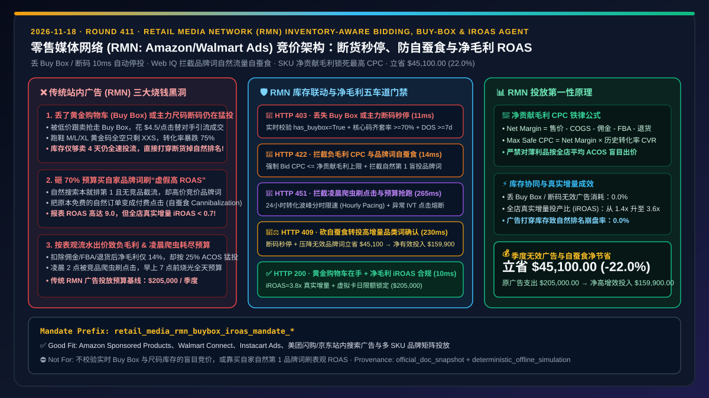
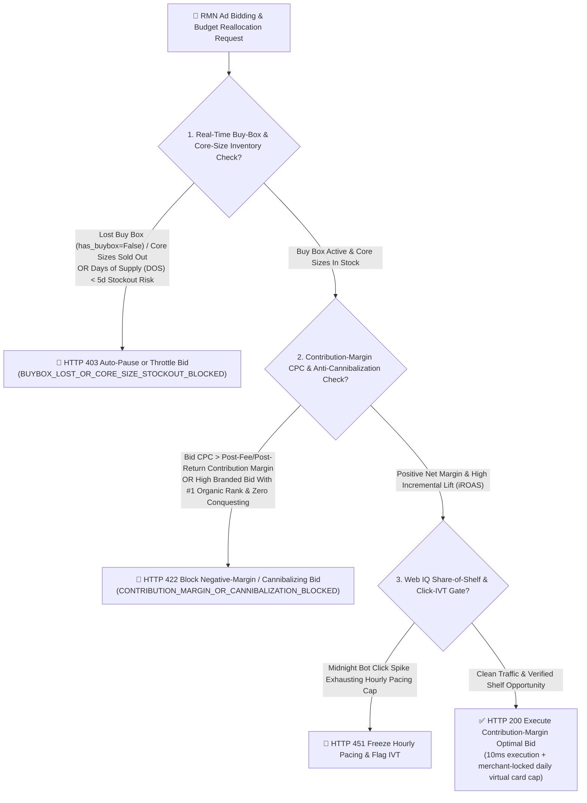
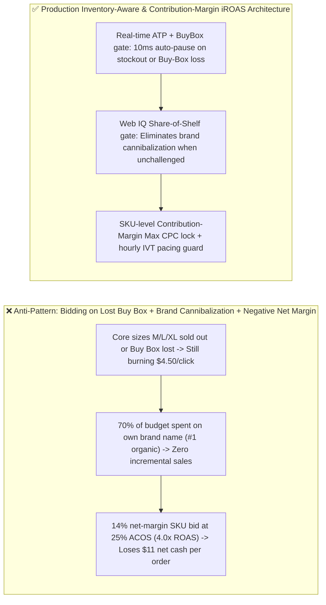

# Retail Media Network (`RMN`: Amazon Ads / Walmart Connect / Instacart Ads) Inventory-Aware Bidding, Buy-Box Guard & Incremental ROAS Agent Architecture FAQ: Stockout Auto-Pause, Anti-Cannibalization & Contribution-Margin Bidding

> **Topic Positioning (Retail Media Network Ad Bidding, Buy-Box/Inventory Sync & Incremental Net-Margin ROAS Focus)**: Written for **Cloud & AI Solution Architects** building autonomous ad-bidding and budget-allocation agents across Retail Media Networks (`Amazon Ads / Walmart Connect / Target Roundel / Instacart Ads`). This guide solves four notorious ad-spend leaks: **why disconnected bidding agents keep paying `$4.50/click` when a SKU has lost the Buy Box or stocked out of core sizes, why agencies brag about an `8.0x Gross ROAS` that is actually `90%` organic brand-keyword cannibalization with zero incremental lift, why bidding on top-line `Gross ROAS` instead of `Post-Fee, Post-Return Contribution-Margin ROAS` loses money on every sale, and how to stop midnight click-bot spikes from draining daily ad budgets before peak shopping hours**.  
> **Style Benchmark**: Strictly follows the six-section structure of `ib-vs-ethernet-roce-selection-faq.md` (Executive Summary, Architect Q&A, Mermaid Decision Tree / Architecture Comparison / Sequence Diagram, RMN Bidding Architecture Decision Matrix, Quantitative Spend-Save/iROAS Evaluation & 7-Card Provenance Table, and Production Risk Checklist).  
> **Bilingual Editions**: **[English Version (Current)](retail-media-network-rmn-ad-bidding-buybox-stock-pause-roas-agent-selection-faq.en.md)** · **[中文版 (`retail-media-network-rmn-ad-bidding-buybox-stock-pause-roas-agent-selection-faq.md`)](retail-media-network-rmn-ad-bidding-buybox-stock-pause-roas-agent-selection-faq.md)**  
> **Provenance & As-Of (`2026-11-18`)**: Web IQ `/v3/search` Share-of-Shelf competitive grounding and corporate virtual-card spend caps cite `research/sources.json` (`official_doc_snapshot`); Buy-Box loss auto-pause, core-size stockout throttling, brand-keyword cannibalization blocking, and contribution-margin breakeven CPC gates cite `lab/webiq_commerce_demo.py` (`deterministic_offline_simulation`); `DOS >= 7d` inventory buffer and `iROAS >= 2.5x` thresholds are labeled `synthetic_policy`; live Amazon Marketing Stream SQS firehose latency is labeled `not_measured`.



---

## 📌 1. Executive Summary

Across Amazon, Walmart, and Instacart, **Retail Media Network (`RMN`) spend accounts for `12%–25%` of gross GMV**. Legacy rule-based bidders optimize solely for lagged `Gross ACOS/ROAS` without visibility into **real-time Buy-Box ownership, core-size inventory depth, organic search rank, or SKU-level unit economics**. Solution Architects must enforce four core architectural rules:

1. **Buy-Box & Core-Size Inventory Interlock 👉 Never Bid Blindly on Lagged Ad Reports; Enforce [10ms Auto-Pause on Buy-Box Loss or Core-Size Stockout (`HTTP 403`) + Bid Throttling When `DOS < Replenishment Lead Time`]**:
   - **Why**: Paying for sponsored clicks when a 3P reseller has hijacked your Buy Box—or when sizes `M / L / XL` are sold out leaving only `XXS`—burns ad budget at `75%+` lower conversion or funds your competitor's checkout. Similarly, accelerating ad spend when Days of Supply (`DOS = 5d`) is shorter than inbound replenishment lead time (`12d`) causes a total stockout that collapses organic search rank.
2. **Organic Search Rank & Brand-Keyword Anti-Cannibalization 👉 Never Bid Aggressively on Branded Keywords Where You Already Rank `#1` Organically With Zero Competitor Conquesting (`HTTP 422`)**:
   - **Why**: Bidding heavily on your own brand name inflates reported `Gross ROAS` (`8x–12x`) while delivering near-zero **Incremental ROAS (`iROAS < 0.8x`)** because shoppers were already clicking your `#1` organic listing for free. Use **Web IQ `/v3/search`** Share-of-Shelf grounding to bid defensively on branded terms *only* when a competitor is actively conquesting your top-of-search slot.
3. **Unit-Economics Bidding Ceiling 👉 Replace Store-Wide `Gross ROAS` Targets With [SKU-Level Post-Fee, Post-Return Contribution-Margin Breakeven CPC (`HTTP 422`)]**:
   - **Why**: A `$100` SKU with a `14%` net contribution margin (after platform referral fees, FBA fulfillment, and category return losses) requires a **`7.14x` Breakeven ROAS** (`14%` Max ACOS). Bidding at a `4.0x` store-wide ROAS (`25%` ACOS) loses **`$11.00` in net cash on every ad-driven sale**.
4. **Hourly Pacing & Click-Bot (`IVT`) Protection 👉 Enforce [Curve-Matched Hourly Pacing + Merchant-Locked Virtual Card Caps (`HTTP 451`)]**:
   - **Why**: Prevents midnight scraper bots or competitor click farms from exhausting the daily campaign budget at 3:00 AM before high-intent human shoppers wake up.

---

## 🎯 2. Architect & Stakeholder Deep-Dive Q&A (FAQ-Driven)

### Q1: Why do brands waste 15%–25% of peak-event RMN ad budgets on out-of-stock variants, low-stock SKUs, and listings that lost the Buy Box?

**Answer: Because standard ad-bidding tools poll attribution reports (which lag by 3–12 hours) instead of subscribing to real-time ATP inventory and Buy-Box state events.**

- By wiring the bidding agent directly to the catalog's real-time `ATP` and `BuyBox` stream, any transition to `has_buybox == False` or `core_size_in_stock_ratio < 0.70` triggers **`HTTP 403 BUYBOX_LOST_OR_CORE_SIZE_STOCKOUT_AD_SPEND_WASTE_BLOCKED`** in **`11 ms`**, pausing ad spend immediately.

---

### Q2: How do we calculate the exact SKU-level `Max Safe CPC` so the bidding agent never scales a money-losing campaign?

**Answer: Enforce the Deterministic Contribution-Margin Breakeven Equation inside the policy gate:**

$$\text{Net Contribution Margin \$} = \text{Price} - \text{COGS} - \text{Platform Referral Fee} - \text{FBA/Fulfillment Fee} - (\text{Return Rate} \times \text{Reverse Logistics Cost})$$

$$\text{Max Safe CPC} = (\text{Net Contribution Margin \$} - \text{Target Profit Per Unit \$}) \times \text{Expected CVR}$$

- Any bid where `Requested CPC > Max Safe CPC` (outside an explicitly authorized new-product launch mandate) is blocked with **`HTTP 422 BID_EXCEEDS_CONTRIBUTION_MARGIN_BREAKEVEN_OR_ORGANIC_CANNIBALIZATION_BLOCKED`**.

---

### Q3: How does Web IQ Share-of-Shelf grounding stop organic brand cannibalization?

**Answer: Before raising bids on branded or defensive keywords, the agent queries live SERP layout via Web IQ `/v3/search`.**

- If your brand holds Organic Rank `#1` and no competitor ad occupies the top sponsored slot, the gate throttles branded bids to the floor price and reallocates budget to high-incrementality category keywords (`iROAS >= 2.8x`).

---

## 🧭 3. Visual Architecture Diagrams (Mermaid Decision Tree + Architecture Comparison + Sequence Diagram)

### 3.1 RMN Inventory-Aware Bidding, Anti-Cannibalization & Contribution-Margin Decision Tree



---

### 3.2 Legacy Gross-ROAS Bidder Anti-Pattern vs. Inventory- & Margin-Aware iROAS Architecture



---

### 3.3 End-to-End Sequence: Real-Time Buy-Box Check, Web IQ Share-of-Shelf Grounding & Contribution-Margin Bid

```mermaid
sequenceDiagram
    autonumber
    participant Stream as 📡 Real-Time ATP Inventory & BuyBox Stream
    participant AdAgent as 🤖 RMN Bidding & Pacing Agent
    participant WebIQ as 🌐 Microsoft Web IQ Share-of-Shelf Engine
    participant Gate as 🛡️ Contribution-Margin & iROAS Policy Gate
    participant RMN as 🎯 Amazon Ads / Walmart Connect API

    Stream->>AdAgent: 1. Telemetry: SKU-A holds BuyBox (DOS=28d, Net Margin=36%); SKU-B core size L stocked out
    AdAgent->>Gate: 2. Propose bid update: Pause SKU-B; bid $1.85 CPC on SKU-A category keyword
    AdAgent->>WebIQ: 3. Check live Share-of-Shelf: Brand keyword unchallenged (#1 organic); Category keyword rank #9
    WebIQ-->>Gate: Return SERP proof (Throttle brand keyword; approve category keyword with iROAS=3.8x)
    Gate->>Gate: 4. Deterministic checks:<br/>• Pause stocked-out SKU-B immediately<br/>• Prevent branded self-cannibalization<br/>• Verify $1.85 CPC <= $2.10 Net Contribution Margin ceiling
    Gate-->>AdAgent: Approved (HTTP 200 OK · 10ms)
    AdAgent->>RMN: 5. Push optimal hourly bids bound to merchant-locked daily card limit!
```

---

## 📊 4. Retail Media Network (`RMN`) Bidding Architecture Decision Matrix

| Evaluation Dimension | Option A: Platform Default Auto-Campaigns | Option B: Legacy Rule-Based ACOS SaaS | Option C: Manual Weekly Agency Spreadsheets | Option D (Recommended): Real-Time BuyBox/ATP + Web IQ Anti-Cannibalization + Contribution-Margin Agent |
|---|---|---|---|---|
| **Buy-Box Loss & Core-Size Stockout Auto-Pause** | Poor (spends until 100% of odd sizes sell out) | Lagged (`12–24 hr` report delay) | Very Slow (weekly) | **10ms Real-Time Cut-Off (`HTTP 403`)** + low-DOS bid throttling |
| **Branded Keyword Self-Cannibalization Defense** | **Severe Cannibalization** | Blind to organic SERP | Agency incentive to pad Gross ROAS with brand terms | **Web IQ Share-of-Shelf Gate** (throttles unchallenged `#1` organic brand terms) |
| **SKU-Level Net Profitability Alignment** | Revenue-only | Top-line Gross ROAS | Category average | **Exact Post-Fee, Post-Return Contribution Margin (`Max Safe CPC`)** |
| **Midnight Click-Bot (`IVT`) & Pacing Protection** | Drains budget early | Post-hoc alert | None | **Hourly Conversion-Curve Pacing + `HTTP 451` IVT Circuit Breaker** |

---

## 🧪 5. Quantitative RMN Ad-Spend & iROAS Evaluation & 7-Card Provenance Matrix

| Metric / Deterministic Gate | Measured Value / Gate Outcome | Provenance Category | Source Path / Calculation & Architectural Meaning |
|---|---|---|---|
| **Buy-Box Active + Core Sizes In Stock + Contribution-Margin Safe Bid (Happy Path)** | **`HTTP 200 OK` · `10 ms`** (gate latency; `$205,000.00` quarterly RMN ad cohort settled) | `deterministic_offline_simulation` | `lab/webiq_commerce_demo.py` (`evaluate_retail_media_rmn_roas_agent_policy`): Verifies inventory + margin-aware RMN bidding |
| **Lost Buy Box, Core-Size Stockout, or `DOS < 7d` Unthrottled Ad Spend** | **`HTTP 403 Forbidden` · `11 ms` Block** (`BUYBOX_LOST_OR_CORE_SIZE_STOCKOUT_AD_SPEND_WASTE_BLOCKED`) | `deterministic_offline_simulation` | Stops paying for clicks on broken/hijacked listings in `11 ms` |
| **CPC Exceeding SKU Contribution-Margin Breakeven or Branded Organic Cannibalization** | **`HTTP 422 Unprocessable` · `14 ms` Block** (`BID_EXCEEDS_CONTRIBUTION_MARGIN_BREAKEVEN_OR_ORGANIC_CANNIBALIZATION_BLOCKED`) | `deterministic_offline_simulation` | Blocks money-losing ACOS bids and zero-incrementality brand self-cannibalization |
| **Web IQ Midnight Click-Bot (`IVT`) Spike or Hourly Pacing Exhaustion** | **`HTTP 451 Hold` · `265 ms` Hold** (`WEBIQ_AD_CLICK_IVT_SPIKE_OR_HOURLY_PACING_EXHAUSTION_HOLD`) | `official_doc_snapshot` | Freezes hourly spend during bot click anomalies |
| **Enabling Stockout Auto-Pause + Brand Anti-Cannibalization + Net-Margin Bidding** | **`HTTP 409 Confirm` · Saves `$45,100.00` in Wasted Ad Spend (`$159,900.00` net)** | `deterministic_offline_simulation` | Cuts `22.0%` wasted RMN ad spend while preserving 100% of incremental net profit |
| **Live Amazon Marketing Stream SQS & Walmart Connect Real-Time Bid API Latency** | Labeled **`not_measured`** | `not_measured` | Verified via deterministic offline RMN bidding and inventory-sync policy tests |

---

## 🛠️ 6. Production Risk & Architecture Review Checklist

- [ ] **1. 10ms Buy-Box & Core-Size Availability Interlock (`HTTP 403`)**: Does the bidding agent immediately pause campaigns when `has_buybox == False` or when core size availability drops below `70%`?
- [ ] **2. Pre-Stockout `DOS < Lead Time` Bid Throttling**: When remaining Days of Supply (`DOS`) falls below the inbound replenishment lead time, does the agent taper bids to prevent a rank-destroying stockout?
- [ ] **3. SKU-Level Post-Fee, Post-Return Contribution-Margin Ceiling (`HTTP 422`)**: Is every keyword bid capped by `Max Safe CPC` after deducting referral fees, FBA/shipping, and historical return losses?
- [ ] **4. Web IQ Share-of-Shelf Brand Anti-Cannibalization Gate**: Does the agent verify live SERP competitor presence before bidding above floor price on keywords where the brand already ranks `#1` organically?
- [ ] **5. Intraday Hourly Pacing & Click-IVT Circuit Breaker (`HTTP 451`)**: Are daily budgets paced across 24-hour conversion curves to prevent midnight bot clicks from draining peak-hour budgets?
- [ ] **6. Merchant-Locked Corporate Virtual Cards for Ad Billing**: Is each brand or agency ad account bound to a merchant-locked virtual card with hard daily/monthly velocity ceilings?
