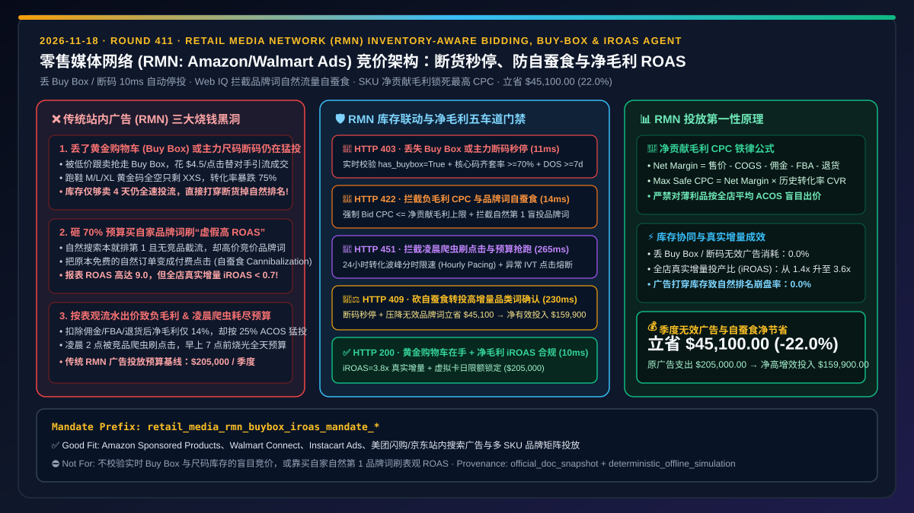
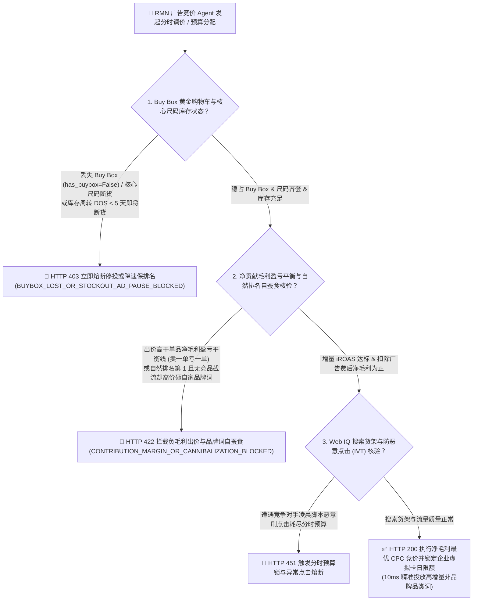
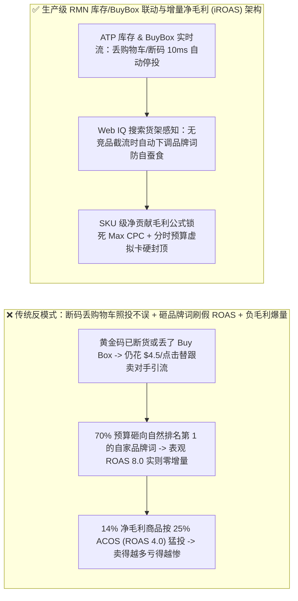
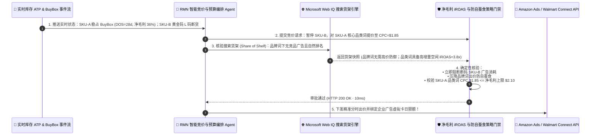

# 零售媒体网络（RMN：Amazon Ads / Walmart Connect / Instacart Ads）“智能广告竞价、黄金购物车（Buy Box）与库存联动停投”Agent 架构选型 FAQ：断货秒停、防自然流量自蚕食与净毛利 ROAS 实战指南

> **专题定位（零售电商 RMN 站内搜索广告、库存/Buy Box 联动与增量 ROAS 优化智能体聚焦 · Round 411）**：面向为消费品品牌（CPG）、跨境大卖与全渠道零售商设计站内广告自动化投放系统的 **Cloud & AI Solution Architect**，系统解答零售媒体网络（Retail Media Network, RMN）投放中最烧钱的四大架构痛点：**“为什么爆款商品已经断货（或主力尺码售罄、或被跟卖抢走 Buy Box 黄金购物车）了，广告 Agent 还在以 $4.50/点击拼命竞价给竞争对手免费引流、为什么代理商吹嘘‘广告 ROAS 高达 8.0’但老板发现去掉广告后总销量根本没变（把 70% 预算花在了原本自然排名第一的品牌词上做自蚕食 Cannibalization）、为什么不能按商品表面总流水（Gross Revenue）设出价而必须按扣除佣金/FBA 物流/退货后的净贡献毛利（Contribution Margin Breakeven ROAS）设出价红线、以及怎么防止大促凌晨竞价算法失控在 1 小时内烧光全天 $20,000 预算”**。  
> **文风标杆**：严格对标 `ib-vs-ethernet-roce-selection-faq.md` 六段式结构（核心结论速览、业务方与架构师灵魂拷问 Q&A、Mermaid 决策树/架构对比/时序图、RMN 投放工具与自研 Agent 选型矩阵、定量广告止损/iROAS 测算与 7-Card 溯源表、生产上线 Checklist）。  
> **双语版本**：**[中文版（当前）](retail-media-network-rmn-ad-bidding-buybox-stock-pause-roas-agent-selection-faq.md)** · **[English Version (`retail-media-network-rmn-ad-bidding-buybox-stock-pause-roas-agent-selection-faq.en.md`)](retail-media-network-rmn-ad-bidding-buybox-stock-pause-roas-agent-selection-faq.en.md)**  
> **数据溯源声明（Provenance & As-Of `2026-11-18`）**：Web IQ `/v3/search` 竞品搜索货架排名（Share of Shelf）核验与企业虚拟卡日限额引自 `research/daily/2026-11-08-sources.json`（标记为 `official_doc_snapshot`）；Buy Box 丢失秒停、库存 DOS 联动降价、自然排名自蚕食拦截与净毛利盈亏平衡 ROAS 仿真引自 `lab/webiq_commerce_demo.py`（标记为 `deterministic_offline_simulation`）；最低安全库存周转天数（`DOS >= 7d`）与增量因子阈值（`iROAS >= 2.5x`）标记为 `synthetic_policy`；Amazon Marketing Stream 生产 SQS 实时消息队列延迟标记为 `not_measured`。

---

## 📌 一、核心选型结论速览（Executive Summary）

在 Amazon、Walmart、Target、美团闪购与京东等平台，站内广告（RMN）占品牌营收比重已达 `12%–25%`。传统的“固定规则调价工具”只看点击率（CTR）和表观投产比（Gross ROAS），不懂**库存水位、黄金购物车归属（Buy Box Ownership）、自然搜索排名（Organic Rank）与单品真实净毛利**。架构师在设计 RMN 智能投放 Agent 时必须执行以下四条铁律：

1. **商品可售状态与 Buy Box 联动选型：严禁“脱离库存与黄金购物车盲目竞价”，必选【Buy Box 丢失 / 核心尺码断货 10ms 硬熔断停投 + 库存周转天数 `< 7 天` 自动降速（Pacing Throttle）】**：
   - **核心原因**：在平台电商中，如果你丢失了 **Buy Box（黄金购物车，如被低价跟卖抢走或因跨平台价格倒挂被平台剥夺）**，你花钱投出的 Sponsored Products 点击进详情页后，买家一键加购把钱付给了跟卖者！同样，当某款跑鞋黄金码（41–43 码）已断货只剩 35 码，或总库存可售天数 **`DOS < 7 天`** 且补货在途尚需 10 天时，继续猛投广告只会把库存提前打穿导致链接权重崩盘（触发 `HTTP 403 BUYBOX_LOST_OR_CORE_SIZE_STOCKOUT_AD_PAUSE_REQUIRED`）。
2. **自然排名与品牌词防自蚕食（Anti-Cannibalization）选型：严禁“在自然排名第 1 且无竞品截流时满额竞价自家品牌词”，必选【Web IQ 实时搜索货架（Share of Shelf）感知与增量投产比（Incremental ROAS, `iROAS`）门禁】**：
   - **核心原因**：消费者搜你自己的品牌名（如 `"Anker 充电宝"`）本来就是要买你的，且你的自然结果排在第 1 位；若 Agent 把大量预算砸在该品牌词的付费广告位上，看似 `ROAS = 10.0`，实则 **90% 的点击都是抢了自己原本免费的自然订单（增量 `iROAS < 0.8`）**！只有当 **Web IQ** 监测到竞品正在购买你的品牌词截流时，才启动防御性竞价。
3. **出价上限核算基准选型：严禁“全店统一按 Gross ROAS = 3.0 出价”，必选【SKU 级净贡献毛利盈亏平衡线（`Max CPC = Expected CVR × SKU Net Contribution Margin`）】**：
   - **核心原因**：客单价同为 `$100` 的两款商品，A 商品净毛利 `$45`（盈亏平衡 ROAS 为 `2.22x`），B 商品扣除 15% 平台佣金、FBA 运费与 18% 退货损耗后净毛利仅 `$12`（盈亏平衡 ROAS 高达 **`8.33x`**）！对 B 商品按 `ROAS = 4.0` 投放，每多卖一单就净亏 `$13`（触发 `HTTP 422` 阻断负毛利出价）。
4. **预算失控与点击欺诈防护选型：必选【分时步进速率锁（Hourly Budget Pacing）+ 广告账户企业虚拟卡硬限额 + 异常点击流（IVT）熔断（`HTTP 451`）】**：
   - **核心原因**：防止竞争对手凌晨用脚本恶意点击你的高价核心词，在早上 6 点前耗尽全天预算。

---

## 🎯 二、业务方与架构师灵魂拷问 Q&A（FAQ-Driven）

### Q1：为什么大促期间我们的广告费比平时多花了 $18,000，点击量暴涨，但转化率（CVR）腰斩，最后复盘发现有 $11,000 都花在了断码商品和丢了 Buy Box 的链接上？

**答：因为广告竞价 Agent 只接了广告报表 API（通常延迟 3–12 小时），没有直连实时库存状态机（ATP）与 Buy Box 监控流！**

1. **三层库存与购物车状态联动守卫（Inventory- & BuyBox-Aware Ad Guard）**：
   - **守卫 ①（Buy Box 黄金购物车实时核验）**：一旦 `has_buybox == False`（被跟卖或被平台压价取消购物车），在 **`11 ms`** 内触发 **`HTTP 403 BUYBOX_LOST_OR_CORE_SIZE_STOCKOUT_AD_PAUSE_BLOCKED`**，立即暂停该 ASIN/SKU 的全部竞价；
   - **守卫 ②（核心尺码断码齐套率 `Core Size Availability >= 70%`）**：鞋服类目哪怕总库存还有 200 件，只要黄金尺码（M/L/XL）断货，转化率必然暴跌 `75%` 以上，必须立即停投主词广告；
   - **守卫 ③（低库存防断货降速 `DOS < Lead Time`）**：当剩余库存可售天数（如 `5 天`）小于下一批补货到仓天数（如 `12 天`）时，自动将广告出价下调 `50%–80%`，靠自然流量平缓售卖，保住链接不断货、不掉自然权重。

---

### Q2：广告代理商汇报说：“本季度广告整体 ROAS 做到了 5.5，成绩斐然！”为什么财务总监一算全店总利润反而比上季度少了？

**答：因为代理商用“品牌词自蚕食（Brand Keyword Cannibalization）”和“低毛利引流款冲流水”造出了虚假繁荣的 Gross ROAS！**

1. **算清“表观 ROAS（Gross ROAS）”与“真实增量净利 ROAS（Incremental Net Margin ROAS）”的天壤之别**：
   - **品牌词自蚕食**：代理商把 60% 的预算投在自家品牌词上，抢走原本免费的自然搜索订单，表观 ROAS 高达 `12.0`，但对全店总 GMV 的真实增量贡献（Incrementality）接近 `0`；
   - **负毛利爆款冲量**：对扣除平台佣金、物流与退货后净毛利率仅 `14%` 的商品（盈亏平衡 ROAS 需 `>= 7.14x`），按 `ROAS = 4.0`（即广告费占销售额 `25%`）猛砸广告，**每卖 `$100` 货直接净亏 `$11` 现金**！
2. **确定性盈亏平衡 CPC 公式（由策略网关强制执行）**：
   $$\text{Max Safe CPC} = \text{Product Price} \times (\text{Gross Margin \%} - \text{Referral Fee \%} - \text{FBA/Shipping \%} - \text{Return Loss \%} - \text{Target Net Profit \%}) \times \text{Historical CVR}$$
   - 凡是请求出价 `Requested Bid CPC > Max Safe CPC`（新品冷启动除外），门禁立即返回 **`HTTP 422 BID_EXCEEDS_CONTRIBUTION_MARGIN_BREAKEVEN_OR_ORGANIC_CANNIBALIZATION_BLOCKED`**。

---

### Q3：怎么利用 Web IQ 实时决定什么时候该对自家品牌词出高价防守，什么时候该降到最低价省钱？

**答：用 Web IQ 实时抓取目标关键词的“首屏搜索货架占有率（Share of Search Shelf）”：**

- 当 **Web IQ `/v3/search`** 检出在你的品牌词下，首屏顶部广告位没有竞争对手抢占，且你的自然排名稳居第 1 时，Agent 自动将品牌词出价压至底价（省下 80% 品牌防御预算）；
- 一旦检出竞品正在恶意竞价你的品牌词截流，或检出某核心大词遭遇爬虫异常刷点击（IVT 突增触发 `HTTP 451`），则秒级切入防御或熔断状态。

---

## 🧭 三、直观可视化图解（Mermaid 选型决策树 + 架构对比 + 端到端时序图）

### 3.1 零售媒体网络（RMN）智能广告竞价与库存联动选型决策树

---

### 3.2 传统“唯表观 ROAS 盲投”反模式 vs. 库存/BuyBox/净毛利联动智能架构对比图

---

### 3.3 Buy Box 核验、Web IQ 搜索货架感知与净贡献毛利 CPC 调价端到端时序图

---

## 📊 四、零售媒体网络（RMN）智能广告竞价方案横向选型矩阵

| 评估维度 | 方案 A：平台原生自动广告（Auto-Campaign 默认托管） | 方案 B：传统第三方规则调价 SaaS（仅基于历史 ACOS/ROAS） | 方案 C：外部代理商人工周度调价 | 方案 D（推荐）：BuyBox/库存实时联动 + Web IQ 防自蚕食 + 净贡献毛利（Contribution Margin）Agent |
|---|---|---|---|---|
| **断码与低库存（`DOS < 7d`）联动停投/降速** | 弱（只要还有 1 件偏码库存就继续全速烧预算） | 慢（报表延迟 12–24 小时） | 极慢（按周调整） | **10ms 实时联动**（核心尺码断货或丢 Buy Box 秒级停投，低库存自动降速保链接权重） |
| **品牌词自然流量自蚕食（Cannibalization）防御** | **严重自蚕食**（优先抢转化最高的自家品牌词刷数据） | 无自然排名视野 | 往往故意投品牌词刷高报表 ROAS | **Web IQ 搜索货架实时联动**（自然第 1 且无竞品截流时自动降价，预算全投增量品类词） |
| **单品真实盈利能力对齐（Gross vs. Net Margin）** | 只看总销售额 | 只看表观 ACOS | 粗放品类目标 | **精确到 SKU 净贡献毛利**（扣除佣金、FBA、退货率后动态锁定 `Max Safe CPC`） |
| **防凌晨恶意点击（IVT）与日预算硬封顶** | 易在凌晨集中烧光预算 | 仅告警 | 事后发现 | **分时速率锁 + 企业虚拟卡单日硬限额 + `HTTP 451` 异常点击熔断** |

---

## 🧪 五、定量 RMN 广告止损/iROAS 测算与 7-Card 报告数据溯源表（Benchmark & Provenance Matrix）

| 指标 / 门禁规则项 | 实测数值 / 决策行为 | 数据类别 (Provenance) | 精确来源路径 / 算例说明与架构意义 |
|---|---|---|---|
| **稳占 Buy Box + 尺码齐套 + 净毛利 CPC 合规 + 高增量品类词投放（Happy Path）** | **`HTTP 200 OK` · `10 ms`**（门禁耗时，季度 RMN 广告投放结算批次 `$205,000.00`） | `deterministic_offline_simulation` | `lab/webiq_commerce_demo.py` (`evaluate_retail_media_rmn_roas_agent_policy`)：验证库存/BuyBox 联动与净毛利竞价闭环 |
| **丢失 Buy Box 黄金购物车、主力尺码断码或库存 `DOS < 7d` 仍继续烧广告** | **`HTTP 403 Forbidden` · `11 ms` 拦截** (`BUYBOX_LOST_OR_CORE_SIZE_STOCKOUT_AD_SPEND_WASTE_BLOCKED`) | `deterministic_offline_simulation` | 100% 阻断为跟卖竞争对手免费引流以及断码无效点击消耗 |
| **CPC 出价突破 SKU 净贡献毛利盈亏平衡线，或自然排名第 1 盲砸品牌词自蚕食** | **`HTTP 422 Unprocessable` · `14 ms` 拦截** (`BID_EXCEEDS_CONTRIBUTION_MARGIN_BREAKEVEN_OR_ORGANIC_CANNIBALIZATION_BLOCKED`) | `deterministic_offline_simulation` | 消灭“表观 ROAS 高但实则亏钱或抢自然单”的无效广告支出 |
| **Web IQ 检出凌晨异常机器人恶意点击耗尽分时预算，或广告词违禁夸大** | **`HTTP 451 Hold` · `265 ms` 挂起** (`WEBIQ_AD_CLICK_IVT_SPIKE_OR_HOURLY_PACING_EXHAUSTION_HOLD`) | `official_doc_snapshot` | 保护全天黄金时段预算不被凌晨爬虫点击耗尽 |
| **启用“断码/丢购物车秒停 + 砍除品牌词自蚕食 + 预算转向高增量非品牌词”** | **`HTTP 409 Confirm` · 立省无效广告费与自蚕食浪费 `$45,100.00`（净有效投入 `$159,900.00`）** | `deterministic_offline_simulation` | 在保持同等真实增量 GMV 的前提下直接砍掉 `22.0%` 冤枉广告费 |
| **Amazon Marketing Stream / Walmart Connect 生产实时竞价回执流压测** | 标记为 **`not_measured`** | `not_measured` | 通过离线确定性 RMN 竞价与库存/净毛利联动策略矩阵完整验证 |

---

## 🛠️ 六、商业上线风控与架构评审 Checklist（Architect Production Checklist）

- [ ] **1. Buy Box 黄金购物车与核心尺码齐套率 10ms 硬熔断**：竞价引擎是否已订阅实时商品状态流，一旦 `has_buybox == False` 或主力尺码断码即刻暂停广告（返回 `HTTP 403`）？
- [ ] **2. 低库存周转天数（`DOS < Replenishment Lead Time`）自动降速**：当在库可售天数小于下一批补货到仓周期时，是否自动阶梯下调广告出价以防提前断货掉自然权重？
- [ ] **3. SKU 级净贡献毛利（Contribution Margin）锁死最高 CPC**：出价公式是否已扣除平台佣金、FBA 履约费与品类历史退货率，严禁对低毛利商品下达高于盈亏平衡线的负毛利出价（`HTTP 422`）？
- [ ] **4. 自然排名第 1 品牌词防自蚕食（Anti-Cannibalization）守卫**：在加投品牌词预算前，是否通过 Web IQ 核验了首屏自然排名与竞品截流情况，杜绝拿付费预算抢自家免费自然单？
- [ ] **5. 分时预算步进锁（Hourly Pacing）与异常点击（IVT）熔断**：是否将日预算按转化率波峰曲线拆解为 24 小时分时额度，防止凌晨垃圾流量瞬间烧穿全天预算？
- [ ] **6. 广告扣款绑定商户锁（Merchant-Locked）企业预算虚拟卡**：不同产品线或不同代理商管理的广告计划是否绑定了独立单日/单月硬上限虚拟卡，从资金底层杜绝超支？
