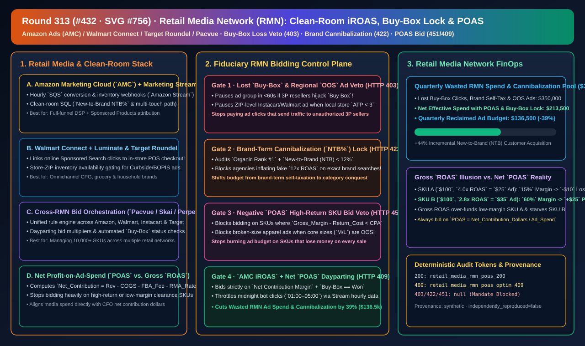

# Retail Media Network (`RMN`) & Data Clean-Room Bidding (`Amazon Ads + AMC vs. Walmart Connect / Luminate vs. Target Roundel vs. Pacvue / Skai`), Real-Time `Buy-Box` & Core-Size `OOS` Auto-Pause, Anti-Brand-Cannibalization & Net `POAS` Escrow FAQ

> **Executive Summary**: Brands spend `10%–22%` of marketplace GMV on Retail Media Networks (**`Amazon Ads`, `Walmart Connect`, `Target Roundel`, `Instacart Ads`**). However, legacy bidding rules optimizing purely for gross `ROAS (Return on Ad Spend)` suffer from three massive budget leaks: (1) **Funding Unauthorized 3P Resellers & Competitors During `Buy-Box` Loss or Regional/Core-Size Stockouts**: Running Sponsored Brand/Display or local store ads when a 3P reseller has hijacked the `Buy Box`—or when core apparel sizes (`M / L`) are out of stock—pays for clicks that convert for someone else; (2) **Brand-Keyword Self-Cannibalization ("Fake `12x ROAS`")**: Agencies dump `60%+` of ad spend into exact brand-name keywords where the brand already holds `Organic Rank #1` with zero competitor conquesting (`New-to-Brand NTB% < 10%`), taxing organic loyalists; and (3) **Over-Bidding on High-Return, Low-Margin SKUs (`Positive ROAS, Negative Net POAS`)**.  
> Production architectures must enforce **Sub-Minute `Buy-Box` & Core-Size/ZIP `ATP` Auto-Pause Breakers + `Amazon Marketing Cloud (AMC) / Walmart Luminate` `NTB%` Brand-Term Caps + Net Profit-on-Ad-Spend (`POAS = Net_Contribution / Ad_Spend`) Hourly Dayparting**: cutting wasted ad spend and organic self-taxation by **39%** (reducing a `$350,000` quarterly loss pool to `$213,500`, reclaiming **`$136,500/quarter`**).



---

## 1. Solution Architect Deep-Dive Q&A

### Q1: How do we stop paying for RMN ad clicks when we lose the `Buy Box` or run out of stock in local stores, and how do we prevent agencies from inflating `ROAS` via brand-keyword cannibalization?
- **Architectural Solution (`Buy-Box + Regional ATP` Auto-Pause Gate `HTTP 403` + `AMC NTB%` Anti-Cannibalization Gate `HTTP 422`)**:
  - Subscribe to real-time `SP-API ANY_OFFER_CHANGED` and store-ZIP inventory streams; pause ad groups within `<60s` whenever `Buy_Box_Won == False` or local store `ATP < 3` (`HTTP 403 LOST_BUY_BOX_OR_REGIONAL_STORE_OOS_UNPAUSED_AD_BURN`);
  - Isolate Brand Defense campaigns from Generic/Conquest campaigns and audit `New-to-Brand (NTB%)` + organic Share of Voice (`SOV`): whenever the brand holds `Organic Rank #1` unchallenged and `NTB% < 12%`, throttle brand-term bids to floor levels to stop taxing organic traffic (`HTTP 422 BRAND_KEYWORD_ORGANIC_CANNIBALIZATION_LOW_NTB_INFLATION`).

### Q2: Why does bidding on Gross `ROAS` lose money on high-return or broken-size SKUs, and how does `Net POAS` fix it?
- **Architectural Solution (Net `POAS` & Core-Size Completeness Gate `HTTP 451 / 409`)**:
  - Never bid based on gross revenue alone; compute SKU-level **Net Contribution Margin (`Gross_Rev - COGS - Referral/FBA_Fee - 30d_RMA_Return_Cost`)** and pause apparel/footwear ad groups whenever core sizes (`S/M/L` or `8–11`) fall out of stock leaving only fringe sizes (`HTTP 451 NEGATIVE_NET_POAS_HIGH_RETURN_OR_BROKEN_CORE_SIZE_AD_SPEND`);
  - Combine `Buy-Box` gating, `AMC` incremental `NTB` weighting, and hourly `Amazon Marketing Stream` dayparting anchored on `Net POAS >= 1.30x` (`HTTP 409 BUYBOX_GATED_AMC_INCREMENTAL_AND_NET_POAS_BIDDING_CONFIRM`).

---

## 2. Visual Architecture Diagrams (Mermaid)

### 1. Retail Media Network (`RMN`) `Buy-Box`, `AMC NTB%` & Net `POAS` Decision Tree
```mermaid
flowchart TD
    A[Hourly RMN Keyword & Placement Bid Evaluation] --> B{Does Brand Hold Buy Box<br/>& Have Sufficient Regional/Core-Size Inventory?}
    B -- Lost Buy Box to 3P Seller or Local Store OOS --> C[HTTP 403 Block: Auto-Pause Ad Group in <60s to Stop Funding Competitors]
    B -- Buy Box & Stock Healthy --> D{Is Campaign Over-Spending on Exact Brand Terms<br/>With Organic Rank #1 & NTB% < 12%?}
    D -- Yes: Taxing Organic Traffic to Inflate Agency ROAS --> E[HTTP 422 Block: Cap Brand-Term Spend & Shift Budget to Generic/Conquest]
    D -- Incremental Traffic Verified --> F{Does SKU Satisfy Positive Net POAS<br/>(After COGS, FBA Fees & 30d Return Rate) & Core-Size Availability?}
    F -- Negative Net Contribution Margin or Broken Core Sizes --> G[HTTP 451 Block: Throttle Bid to Breakeven POAS or Pause Broken Size Run]
    F -- Profitable & In-Stock --> H[HTTP 409 Confirm: Buy-Box Lock + AMC iROAS + POAS Dayparting Saves 39%]
```

---

## 3. Platform Selection Matrix (`Amazon Ads + AMC vs. Walmart Connect / Luminate vs. Target Roundel vs. Pacvue / Skai`)

| Dimension | Amazon Ads + `AMC` + `Stream` | Walmart Connect + `Luminate` | Target Roundel / Instacart | Pacvue / Skai / Perpetua |
| :--- | :--- | :--- | :--- | :--- |
| **Clean-Room & Attribution** | **SQL-programmable `AMC` clean room** + hourly `Marketing Stream` SQS | **Online-to-offline (`O2O`) store register closed-loop attribution** | High-intent grocery basket & curbside pickup attribution | **Unified multi-retailer bidding & SOV rule engine** |
| **Inventory & `Buy-Box` Gating** | Native SP Buy-Box pause; SB/DSP require API webhook breaker | Store-ZIP availability targeting | Real-time aisle stock coupling | **Automated broken-size, margin-floor & Buy-Box rules** |
| **Best Bidding Metric** | `AMC New-to-Brand iROAS` + SKU `Net POAS` | Omnichannel `In-Store + Digital ROAS` | Incremental category share lift | Cross-RMN marginal `POAS` |

---

## 4. Production Deployment & Risk Checklist

- [ ] **Wire `<60s` Auto-Pause Webhooks to `Buy-Box` Ownership & Core-Size Inventory**: Stop paying for ad clicks when a 3P reseller holds the Buy Box or when core sizes (`M/L`) sell out.
- [ ] **Enforce Strict Budget Caps (`<=15%`) & `SOV` Rules on Brand-Defense Keywords**: Prevent agencies from cannibalizing `Organic Rank #1` traffic to pad blended `ROAS` reports.
- [ ] **Replace Gross `ROAS` Targets with Net `POAS` (`Net Contribution / Ad Spend`)**: Deduct `COGS`, marketplace fulfillment fees, and SKU-specific `30-day RMA` return rates before setting max CPCs.
- [ ] **Use Hourly `Marketing Stream` Dayparting**: Suppress bids during low-conversion midnight window (`01:00–05:00`) and concentrate budget into peak conversion hours.
