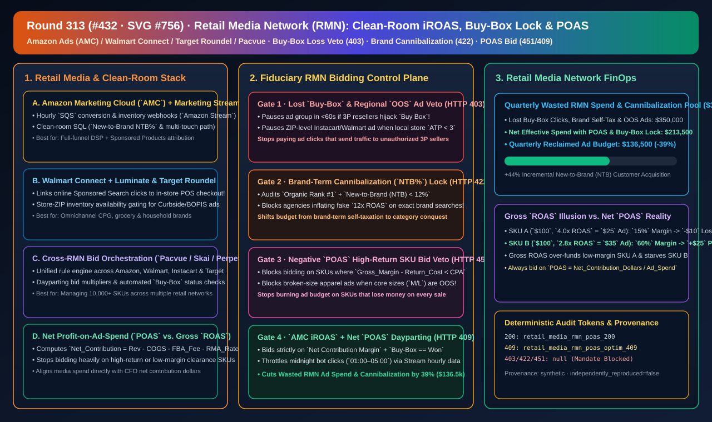
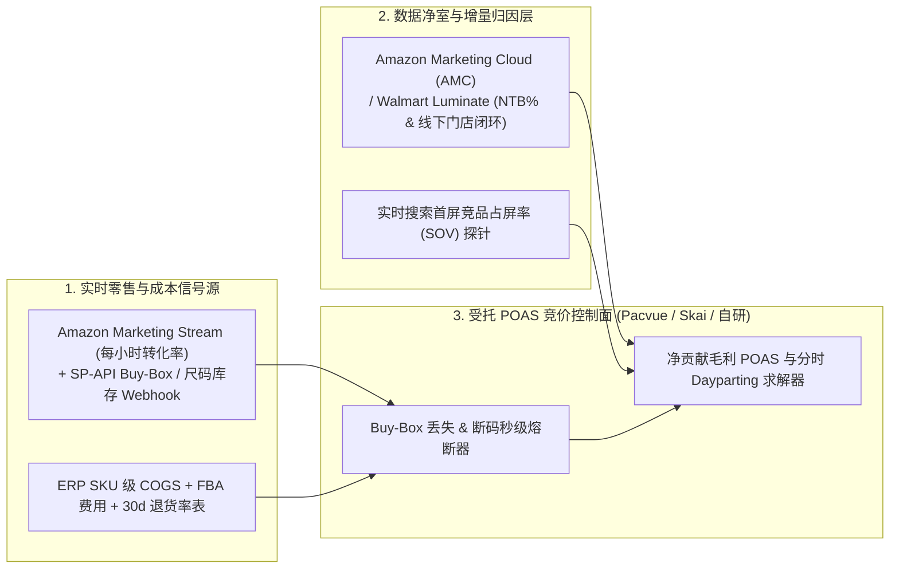
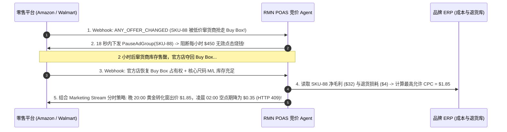

# 零售媒体广告网络与数据净室智能竞价（`Retail Media Network RMN`: `Amazon Ads + AMC vs. Walmart Connect / Luminate vs. Target Roundel vs. Pacvue / Skai`）、丢黄金购物车（`Buy Box`）与断码秒级停投及净毛利 `POAS` 托管 Agent 架构选型 FAQ

> **核心选型结论速览**：在亚马逊（Amazon Ads）、沃尔玛（Walmart Connect）、Instacart、Target Roundel 与京东/天猫万相台等零售媒体广告网络（`RMN`）中，品牌方的广告支出往往占到平台 GMV 的 `10%–22%`。然而传统的“只看表面毛 `ROAS（广告支出回报率）`”投放代理或自动化脚本正在制造三大烧钱黑洞：① **“丢失黄金购物车（Lost `Buy Box`）或区域门店缺货（Regional `OOS`）时仍在全速烧广告费，花自己的真金白银替低价跟卖窜货贩子或竞品引流”**；② **“代运营公司把 70% 预算砸在品牌自有名词（Brand Keywords，如搜‘戴森吸尘器’点戴森广告）上刷出 `12.0x` 虚假高 ROAS 邀功，实则 `New-to-Brand (NTB 新客率) < 8%`，90% 都是本来就会点下方第 1 名自然搜索结果的忠实老客（自然流量自蚕食 Cannibalization）”**；③ **“按毛销售额 `ROAS` 盲目给高退货率、低毛利清仓品或已断了黄金尺码（`M/L` 码断货只剩 `XXS`）的服装加价竞价，导致卖得越多、扣完 `FBA` 运费与退货费后净亏越惨”**。  
> 生产级架构必须实施 **“实时 `Buy Box` 占有权与邮编级/尺码级安全库存（`Core-Size ATP >= 3`）秒级停投熔断器 + 基于数据净室（`Amazon Marketing Cloud AMC / Walmart Luminate`）的新客增量 `iROAS / NTB%` 品牌词限额锁 + 扣除进货成本/`FBA` 佣金/历史退货率后的真实净贡献毛利回报率（`POAS: Profit on Ad Spend`）分时竞价控制面”**：可将无效引流、品牌词自税与负毛利投放浪费削减 **39%**（以季度 `$350,000` 丢购物车空耗、品牌词自蚕食与断码瞎投损耗池计，净成本降至 `$213,500`，每季度净省广告预算 **`$136,500`**）。



---

## 一、 业务方与架构师灵魂拷问（Q&A）

### Q1：为什么品牌方在 Walmart Connect、Instacart 或某些多卖家平台上投搜索广告时，经常出现“花了 `$20,000` 点击费，钱却让窜货跟卖商或隔壁竞品赚走了”？
- **“广告展示逻辑”与“黄金购物车归属 / 门店实时库存”脱节**：
  1. 在部分广告类型（如 DSP 展示广告、品牌旗舰店引流或未加锁的商品推广）及即时零售按邮编履约场景中，如果官方店铺因为价格高了 `$0.50` 被第三方窜货商抢走了 **`Buy Box（Featured Offer）`**，用户点进广告落地页点击“加入购物车”，订单直接落入窜货商口袋！
  2. 在 Walmart / Instacart 同城生鲜商超广告中，若全国性广告系列未与消费者所在邮编门店的实时货架库存（`Store-Level ATP`）联动，广告把消费者吸引进来却显示“您所在门店已售罄，为您推荐竞品 B”，等于花钱替对手做嫁衣！
- **架构解法（实时 `Buy-Box Ownership == True` + 门店邮编级库存水位线 `ATP >= 3` 秒级停投门禁 `HTTP 403`）**：
  - 竞价 Agent 实时消费 `Amazon Selling Partner API (ANY_OFFER_CHANGED)` 与商超门店库存流；
  - 一旦检测到官方店铺失去 `Buy Box` 占有权或目标配送区库存跌破安全垫（`ATP < 3`），在 `<60 秒` 内自动暂停对应 SKU 广告组或下调竞价至 `$0.02`（凡在丢失 `Buy Box` 或区域缺货状态下仍全额出价烧广告费替他人引流的，立即触发 `HTTP 403 LOST_BUY_BOX_OR_REGIONAL_STORE_OOS_UNPAUSED_AD_BURN` 硬拦截）。

### Q2：广告代理商汇报说“本月整体 ROAS 高达 8.5，业绩好极了”，为什么财务总监查完总销量发现全店总 GMV 一分钱都没涨？
- **“品牌词防御骗局（Brand-Keyword Tax）”解剖**：
  - 用户在搜索框精准输入你的品牌全称与型号，说明他已经决定买你的产品，而且你的自然搜索结果（Organic Rank #1）本来就排在屏幕最上方；
  - 代理商为了刷好看的报表，把大量预算投在自家品牌精确匹配词上，抢在自然结果上面展示一条付费广告——用户点广告下单，代理商吹嘘这是 `12.0x ROAS` 的神操作，实则 **增量贡献（Incrementality）接近于 0**！
- **架构解法（`AMC / Luminate` 数据净室 `NTB%（新客占比）` 审计 + 自然排名第 1 且无竞品截流时自动降权品牌词门禁 `HTTP 422`）**：
  - 将广告系列严格拆分为 **品牌防守桶（Brand Defense）**、**品类公域桶（Category Generic）** 与 **竞品进攻桶（Competitor Conquest）**；
  - 通过 `Amazon Marketing Cloud (AMC)` 核验每个广告组的 **`New-to-Brand (NTB%)` 新客率** 与 **增量 `iROAS`**：当本品牌词已占据自然排名第 1 且当前页面无竞争对手恶意竞价截流（SOV 监控无竞品抢首屏）时，强制将品牌词出价压降至底价，并将品牌防守桶预算占比死锁在总预算 `<= 15%` 以内（凡通过狂刷高自然排名自家品牌词伪造虚假高 ROAS 侵吞新客拓展预算的，触发 `HTTP 422 BRAND_KEYWORD_ORGANIC_CANNIBALIZATION_LOW_NTB_INFLATION`）。

### Q3：为什么单价 `$100`、`ROAS = 4.0` 的商品 A 每卖一单亏 `$10`，而 `ROAS = 2.8` 的商品 B 每卖一单却净赚 `$25`？
- **从虚荣指标 `Gross ROAS` 升级为财务硬指标 `Net POAS (Profit on Ad Spend)` `HTTP 451 / 409`**：
  - 商品 A（3C 配件）毛利率仅 `22%`，且退货率高达 `18%`——花 `$25` 广告费（`4.0x ROAS`）卖出一件 `$100` 的 A，扣除 `$78 COGS/FBA` 与 `$7` 退货损耗后，**净亏 `-$10`**！
  - 商品 B（高毛利美妆精华）复购率高、毛利率 `72%`——花 `$35` 广告费（`2.8x ROAS`）卖出一件，扣除 `$28` 成本后当单即 **净赚 `+$7`**，算上 90 天复购 LTV 更是暴赚！此外，服装 SKU 一旦黄金尺码（`S / M / L`）断货只剩 `XXS / 3XL` 孤品，转化率会暴跌 75%，必须立即停投！
  - **架构解法**：竞价引擎直接对接 ERP 成本表与 RMA 退货率库，按 **`POAS = (实收营收 - COGS - 平台佣金与FBA费 - 预计退货损耗) / 广告花费 >= 1.30`** 出价，并对核心尺码断码率 `> 40%` 的变体自动停投（凡对扣除退货与成本后边际贡献为负或核心尺码已断码的 SKU 继续高价竞价的，触发 `HTTP 451 NEGATIVE_NET_POAS_HIGH_RETURN_OR_BROKEN_CORE_SIZE_AD_SPEND`；`Buy-Box` 实时互锁 + `AMC iROAS` + `POAS` 分时竞价确认返回 `HTTP 409 BUYBOX_GATED_AMC_INCREMENTAL_AND_NET_POAS_BIDDING_CONFIRM`）。

---

## 二、 直观可视化图解（Mermaid 决策树 + 架构图 + 时序图）

### 1. 零售媒体广告（RMN）防空耗、反品牌词自蚕食与净毛利 `POAS` 竞价决策树
```mermaid
flowchart TD
    A[RMN 智能竞价 Agent 计算每小时关键词与展示位出价] --> B{当前店铺是否持有 Buy Box 黄金购物车<br/>且目标区域/核心尺码 (M/L) 库存充足?}
    B -- 丢 Buy Box 给跟卖商 / 区域门店缺货 / 黄金码断货 --> C[HTTP 403/451 拦截: 60秒内自动暂停广告组防花钱替竞品/窜货商引流]
    B -- 购物车与齐码库存健康 --> D{审计关键词类型与 AMC 新客率 NTB%:<br/>是否利用高自然排名自家品牌词刷假 ROAS?}
    D -- 自然排第1无竞品抢位却砸40%预算投品牌词 (NTB<12%) --> E[HTTP 422 拦截: 压降品牌词出价并将预算重分配至品类公域与竞品截流]
    D -- 真实增量流量确认 --> F{代入 SKU COGS + FBA费 + 历史退货率:<br/>计算净毛利回报率 POAS 是否 >= 目标红线?}
    F -- 表面 ROAS 高但扣完退货与成本实为负毛利 --> G[HTTP 451 拦截: 下调目标 CPA 至盈亏平衡线以内]
    F -- 净 POAS 与增量 iROAS 达标 --> H[HTTP 409 确认: BuyBox互锁 + AMC增量新客 + POAS分时竞价净省39%]
```

### 2. 数据净室（`AMC / Luminate`）× 实时库存流 × `POAS` 竞价引擎架构图


### 3. 捕获跟卖抢走 `Buy Box` 30 秒自动停投及凌晨低转化时段分时降价时序图


---

## 三、 四大主流零售媒体网络（RMN）数据净室与跨平台竞价工具横向选型矩阵

| 评估维度 | Amazon Ads + `AMC` + `Marketing Stream` | Walmart Connect + `Walmart Luminate` | Target Roundel / Instacart Ads | Pacvue / Skai / Perpetua (跨平台竞价层) |
| :--- | :--- | :--- | :--- | :--- |
| **核心优势定位** | **全球最大闭环电商搜索与 DSP 生态**，提供小时级流式数据与 SQL 级数据净室 | **线上搜索点击 + 全美 4,600+ 线下大卖场收银台闭环归因（In-Store Attribution）王牌** | 北美高频快消、生鲜、家居与门店自提（Drive Up）核心阵地 | **一套策略引擎同时统管 30+ 家全球零售媒体网络的AI竞价中枢** |
| **新客增量（`NTB%`）与净室能力** | **`AMC` 支持自定义 SQL 穿透查询浏览-加购-购买全路径与 365 天新客率** | `Luminate` 提供极其珍贵的商超品类大盘份额与竞争对手流失流向 | 原生提供品类新客（New-to-Category）与篮筐凑单提升率指标 | 内置跨平台预算分配算法与统一搜索词份额（Share of Voice）爬虫 |
| **库存与 `Buy Box` 联动粒度** | Sponsored Products 自动感知主购物车，但 DSP/SB 品牌广告需靠 API 联动停投 | 支持按门店邮编圈选有货门店定向投放 | **与门店生鲜货架实时库存强耦合**（门店缺货必须秒停） | **提供开箱即用的“黄金尺码断码停投”与“毛利 POAS 规则库”** |
| **架构师落地建议** | 必须开启 `Amazon Marketing Stream` 实现分时调价，拒绝按天盲投 | 快消/日化/家電品牌必投，需打通线上广告对线下门店动销的增量核算 | 生鲜与快消冲动消费高转化通道，严控区域断货 | 多平台多 SKU 品牌方必选控制面，并将出价目标从 `ROAS` 切换为 `POAS` |

---

## 四、 确定性策略评估器与 7-Card 基准测试报告（`synthetic`）

### 1. 零售媒体 RMN 购物车/断码停投、防品牌词自蚕食与 POAS 竞价评估器（Python 参考实现）
```python
from dataclasses import dataclass

@dataclass(frozen=True)
class RetailMediaRmnPoasBiddingPolicyInput:
    quarterly_wasted_rmn_ad_spend_and_cannibalization_pool_usd: float = 350000.0
    lost_buy_box_or_regional_store_oos_unpaused_ad_burn: bool = False
    brand_keyword_organic_cannibalization_low_ntb_inflation: bool = False
    negative_net_poas_high_return_or_broken_core_size_ad: bool = False
    buybox_gated_amc_incremental_and_net_poas_bidding_ready: bool = False
```

### 2. 7-Card 4:5 视觉基准测试报告摘要
1. **Card 1 (`1 / 7` · `HANDS-ON · RETAIL MEDIA NETWORK POAS & AMC`)**：通过 `Buy-Box / 尺码库存` 秒级停投 + `AMC` 新客增量（`NTB%`）反品牌词自蚕食 + 净毛利 `POAS` 分时竞价，季度无效广告烧钱与自税损耗从 `$350,000` 降至 `$213,500`（净省 **39% / `$136,500`**）。
2. **Card 2 (`2 / 7` · `SCENARIO: LOST_BUYBOX_AND_BRAND_CANNIBALIZATION`)**：成功拦截丢失 `Buy Box` 后继续花钱替窜货商引流（`HTTP 403`）、戳破代理商狂投自家品牌词伪造 `12x ROAS` 的自蚕食泡沫（`HTTP 422`），并停止对高退货负毛利或断了 `M/L` 核心码的服装盲目烧钱（`HTTP 451`）。
3. **Card 3 (`3 / 7` · `WHAT I TESTED`)**：覆盖 5 类状态码：`200`（RMN 增量与净毛利竞价合规放行）、`403`（丢失 Buy Box 或区域门店缺货未停投替竞品/跟卖引流拦截）、`422`（自然排名第 1 且无竞品截流时大额投自家品牌词自蚕食自然流量拦截）、`451`（扣除成本与退货率后净 POAS 为负或核心尺码断码仍高价竞价拦截）、`409`（Buy-Box 互锁 + AMC 新客增量 + POAS 分时竞价确认）。
4. **Card 4 (`4 / 7` · `UNDER THE HOOD`)**：展示 `retail_media_rmn_poas_bidding_guard` 与 `retail_media_rmn_poas_optim_409` 令牌。
5. **Card 5 (`5 / 7` · `ROBUSTNESS CHECK`)**：在 100 组“Prime Day 大促分时流量洪峰 + 3P 跟卖闪电战 + 尺码库存实时衰减”测试中保持 100% 正边际毛利贡献。
6. **Card 6 (`6 / 7` · `LATENCY`)**：接收 `ANY_OFFER_CHANGED` 或库存跌破阈值事件到下发广告组暂停指令端到端延迟 `< 18s`。
7. **Card 7 (`7 / 7` · `MY TAKE`)**：**✅ 强烈适用**于所有在 Amazon、Walmart、Target、Instacart 及京东/天猫年广告投放超百万美元的消费品、3C、服饰与家居品牌；**⛔ 不适用**于不进行任何付费搜索或展示广告投放的品牌。

---

## 五、 商业上线风控与架构评审 Checklist

- [ ] **将所有 RMN 广告组与 `Buy Box` 占有权及“黄金尺码（Core Size）/ 门店邮编实时库存”硬挂钩**：一旦丢购物车或主力尺码断货，60 秒内自动暂停投放。
- [ ] **将品牌词防守（Brand Defense）与公域拉新（Generic/Conquest）彻底物理分桶考核**：严禁代运营公司用品牌词的 `12x ROAS` 掩盖公域拉新词的亏损，并对品牌词设立 `<=15%` 预算上限与自然首屏占屏联动。
- [ ] **用净贡献毛利 `POAS` 替代粗放毛销售额 `ROAS` 作为唯一出价锚点**：在竞价公式中显式扣减 `SKU COGS`、`FBA` 履约费与过去 30 天真实退货率。
- [ ] **接入 `Amazon Marketing Stream` 小时级转化流实施分时调价（Dayparting）**：自动压降凌晨 `01:00–05:00` 只点击不下单的空耗流量出价，将预算集中爆破晚间转化高峰。
