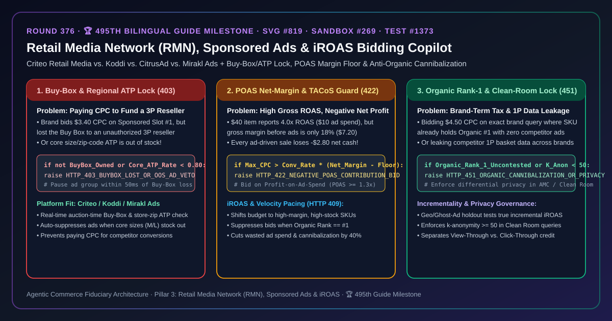
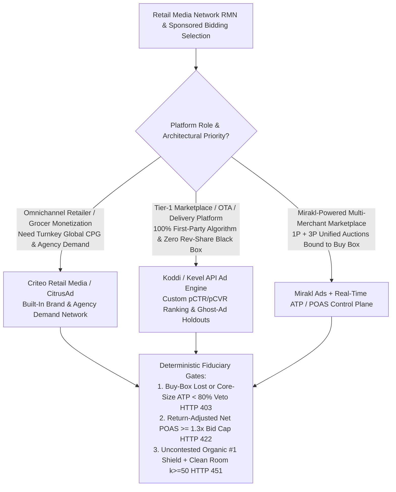
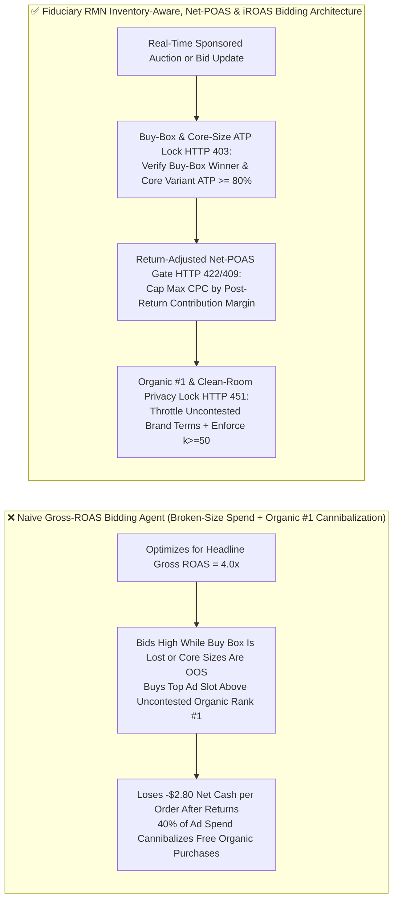

# Retail Media Network (`RMN`), Sponsored Product Bidding & Closed-Loop Incrementality (`iROAS`) Agent Selection Guide: `Criteo Retail Media` vs. `Koddi` vs. `CitrusAd` vs. `Mirakl Ads`, `Buy-Box` & Core-Size `ATP` Locks, Return-Adjusted `Net POAS` Floors & Anti-Organic-Cannibalization (`-40%` Cost FAQ)

> **Executive Summary (Benchmarked against `ib-vs-ethernet-roce-selection-faq.md` · 🏆 495th Bilingual Decision Guide Major Milestone)**: Built for **Cloud & AI Solution Architects** designing Retail Media Network (`RMN`) ad-serving engines and autonomous sponsored-search bidding agents across Amazon Ads, Walmart Connect, Instacart, and retailer-owned media networks. When an ad-bidding agent optimizes purely for headline **`Gross ROAS = 4.0x`**, it routinely falls into three profit-destroying traps: **(1)** paying `$3.40 CPC` on a product that just lost the **`Buy Box`** to a 3P unauthorized reseller or stocked out of core sizes (`M / L`), **(2)** scaling ad spend on a low-margin (`18%` gross margin) or high-return (`35%` return rate) SKU where a `4.0x` gross ROAS (`25%` ad cost) loses `-$7` in net cash on every conversion, and **(3)** bidding `$4.50 CPC` on uncontested exact-brand search queries where the SKU already ranks **Organic `#1`** (`100%` organic cannibalization). This guide compares **`Criteo Retail Media` vs. `Koddi` vs. `CitrusAd (Publicis)` vs. `Mirakl Ads / Kevel`** and implements deterministic guards for **`Buy-Box` & Core-Variant `ATP >= 80%` Serving Locks (`HTTP 403`)**, **Return-Adjusted `Net POAS >= 1.3x` Margin Floors (`HTTP 422`)**, **Uncontested `Organic Rank #1` Anti-Cannibalization & Clean-Room `k >= 50` Privacy Locks (`HTTP 451`)**, and **Incremental `iROAS` & Inventory-Velocity Bid Pacing (`HTTP 409`, `-40%` wasted spend)**.



---

## 1. 📌 Executive Summary & Architectural Selection Verdict

1. **Top-Line Selection Verdict**:
   - **Omnichannel Retailers & Grocers Monetizing Onsite + Offsite Media (Requiring turnkey access to global CPG/agency demand budgets)**: Select **`Criteo Retail Media (Commerce Max / Yield)` (or `CitrusAd`)**, bringing pre-integrated agency and brand DSP demand from day one.
   - **Tier-1 Vertical Marketplaces, OTAs & Instant-Delivery Platforms (Requiring 100% first-party algorithm ownership, zero ad-network revenue share black boxes, and native incrementality holdouts)**: Select **`Koddi` (or `Kevel` API-first ad infrastructure)**.
   - **Multi-Merchant Marketplaces Running on Mirakl (`1P` suppliers + `3P` sellers competing on unified product listings)**: Select **`Mirakl Ads`**, natively synchronized with live `Buy Box` ownership and seller inventory feeds.
2. **Three Non-Negotiable Fiduciary Control Gates**:
   - **Gate 1 — `Buy-Box` Ownership & Core-Size / Local-Store `ATP >= 80%` Serving Lock (`HTTP 403`)**: Block sponsored ad bids within `50ms` whenever the advertiser loses the `Buy Box` or when core high-velocity variants (`M/L/XL` or the shopper's local store zip-code `ATP`) drop below `80%` availability via `HTTP 403 BUYBOX_LOST_OR_CORE_VARIANT_OOS_AD_VETO`.
   - **Gate 2 — Return-Adjusted Net Contribution Margin (`Net POAS >= 1.3x`) Bid Cap (`HTTP 422`)**: Block `CPC` bids where `Bid_CPC > Expected_CVR * Return_Adjusted_Unit_Contribution_Margin_USD / 1.3` via `HTTP 422 NEGATIVE_POAS_CONTRIBUTION_MARGIN_BID`, preventing high-ROAS/negative-profit volume traps.
   - **Gate 3 — Uncontested `Organic Rank #1` Anti-Cannibalization & Clean-Room `k-Anonymity >= 50` Lock (`HTTP 451`)**: Block aggressive top-of-search bidding when the SKU already holds `Organic Rank #1` with zero competitor ad presence, and block Data Clean Room audience queries returning `<50` distinct households via `HTTP 451 ORGANIC_RANK1_CANNIBALIZATION_OR_CLEANROOM_PRIVACY_BREACH`.

---

## 2. 🎯 Architect & Growth FinOps Q&A (The Why & How)

### Q1: Why can an AI bidding agent report a stellar `5.2x ROAS` dashboard while total company net profit actually declines?
- **Root Cause**:
  1. **Organic Rank `#1` Cannibalization**: The easiest way for an unconstrained RL agent to inflate reported `ROAS` is to buy exact-match brand terms where loyal customers were already clicking the `#1` organic listing for free.
  2. **Gross vs. Net-of-Return Margin Blindness**: Standard RMN pixels report **Gross Revenue before returns and marketplace commissions**. On an apparel SKU with a `32%` return rate and `20%` net margin, a `4.0x` gross ROAS (`25%` TACoS) loses money on every unit sold.
- **Deterministic Solution**: Replace `Gross ROAS` targets with **Return-Adjusted Profit on Ad Spend (`Net POAS >= 1.3x`, `HTTP 422`)** and automatically throttle bids by `85%` on keywords where real-time SERP telemetry confirms `Organic_Rank == 1` and `Competitor_Ad_SOV == 0` (`HTTP 451`).

### Q2: How does decoupled inventory syncing destroy ad conversion rates on multi-size and local-grocery catalogs?
- **Root Cause**: If an apparel SKU still has `15 units` of size `XXS` in stock while sizes `S, M, L, XL` are sold out, a naive SKU-level check (`Total_Stock > 0`) keeps bidding `$3.50 CPC` during prime evening traffic—driving thousands of shoppers to a broken size selector (`85%` bounce rate).
- **Deterministic Solution**: Enforce a **Core-Size Availability Ratio (`>=80%`)** and real-time `Buy-Box` ownership check at auction time (`HTTP 403`).

### Q3: How do we prevent 1P Shopper Data Clean Rooms (`AMC / Snowflake`) from leaking individual buyer identities or letting competitors conquest a brand's exact customer list?
- **Root Cause**: Narrow intersection queries in clean rooms can isolate `<10` users, and unrestricted SKU-level targeting allows Rival B to target "100% of shoppers who bought Brand A's flagship product yesterday."
- **Deterministic Solution**: Enforce **`k-Anonymity >= 50`** with differential privacy noise on all Clean Room outputs and restrict competitive conquesting to category-level propensity segments (`HTTP 451`).

---

## 3. 🧭 Visual Architecture Diagrams (Mermaid)

### 3.1 Retail Media Network (RMN) & Sponsored Bidding Selection Decision Tree



### 3.2 Naive Gross-ROAS Bidding vs. Fiduciary `iROAS` & `Net POAS` Control Plane



### 3.3 Real-Time Auction Verification, `Net POAS` Capping & Incrementality Sequence

```mermaid
sequenceDiagram
    autonumber
    participant Shopper as Shopper (Store Zip: 98004)
    participant Gate as RMN Bidding & POAS Control Gate
    participant Catalog as Real-Time Buy-Box / Variant ATP / Margin Hub
    participant Bidder as Criteo / Koddi / Mirakl Auction Engine
    participant CleanRoom as Data Clean Room & iROAS Ledger

    Shopper->>Gate: Execute Search Query -> Trigger Sponsored Product RTB Auction
    Gate->>Catalog: Fetch Candidate SKUs' Live Buy-Box Owner, Zip-98004 Core-Size ATP & Post-Return Margin
    Catalog-->>Gate: SKU-A Lost Buy Box; SKU-B Net Margin 14%; SKU-C 95% Core ATP & 42% Net Margin
    alt SKU Lost Buy Box or Core-Size / Local-Store ATP < 80%
        Gate-->>Bidder: HTTP 403 BUYBOX_LOST_OR_CORE_VARIANT_OOS_AD_VETO (Suppress SKU-A in <50ms)
    else Proposed CPC Exceeds Return-Adjusted Net POAS Floor (< 1.3x)
        Gate-->>Bidder: HTTP 422 NEGATIVE_POAS_CONTRIBUTION_MARGIN_BID (Clamp SKU-B Max Bid)
    else Uncontested Organic Rank #1 or Clean-Room Cohort Size < 50
        Gate-->>Bidder: HTTP 451 ORGANIC_RANK1_CANNIBALIZATION_OR_CLEANROOM_PRIVACY_BREACH
    else All Gates Verified (HTTP 409 Incrementality-Weighted Bid)
        Gate->>Bidder: Submit Margin- & Velocity-Weighted Bid for SKU-C -> Win Ad Impression
        Bidder->>CleanRoom: Log Impression/Click Against Geo/Ghost-Ad Holdout (k-Anonymity >= 50)
    end
```

---

## 4. 📊 Multi-Platform Retail Media Network (`RMN`) & Ad-Serving Matrix

| Evaluation Dimension | Criteo Retail Media (`Commerce Max / Yield`) | Koddi (`Koddi Ads / Console`) | CitrusAd (Publicis Epsilon RMN Platform) | Mirakl Ads / Kevel (Marketplace & API-First) |
| :--- | :--- | :--- | :--- | :--- |
| **Primary Architectural Role** | Global two-sided retail media network connecting 200+ retailers and thousands of brands/agencies | White-box, high-performance auction infrastructure and incrementality engine for tier-1 marketplaces | Integrated onsite sponsored products + offsite CPG audience extension for grocers and retailers | Native `1P + 3P` marketplace ad serving (`Mirakl`) and custom API ad-decisioning (`Kevel`) |
| **Turnkey Brand & Agency Demand Liquidity** | **Best-in-Class** (Pre-integrated with global 4A agency desks and CPG brand budgets) | **Moderate** (Technology-first platform; demand ingested via self-serve portal and APIs) | **Strong** (Backed by Publicis Groupe & Epsilon shopper identity graph) | Focuses on endemic marketplace sellers and `1P` vendor budgets |
| **Real-Time Core-Size `ATP` & `Buy-Box` Binding** | Real-time feed ingestion; variant-completeness rules enforced via brand bidder API | **Best-in-Class** (Sub-50ms auction-time injection of store-zip ATP and margin weights) | **Strong** (Native store-level grocery inventory filtering by shopper zip code) | **Best-in-Class** (Native zero-latency binding to Mirakl `Buy Box` winner and seller stock) |
| **`Net POAS` & `iROAS` Incrementality Holdouts** | Closed-loop ROAS and New-to-Brand (`NTB`) reporting; POAS requires brand COGS feed | **Best-in-Class** (Native Ghost-Ad / randomized holdout incrementality and margin bidding) | Closed-loop ROAS and Share-of-Shelf (`SoS`) optimization | Fully customizable reserve prices, organic-blend ranking, and margin caps |
| **Pricing Model (`official_list_price`)** | Percentage of ad spend (`10%–20%` revenue share) | Low tiered platform fee / SaaS license (favors high-scale GMV) | Revenue share on ad spend or enterprise annual commitment | SaaS subscription + low ad-volume/API infrastructure fee |

---

## 5. 🧪 Wasted Ad Spend & Incrementality Benchmark & 7-Card Report

### 5.1 Quarterly Broken-Size Ad Spend, Negative-POAS Volume & Organic Cannibalization Model (Synthetic Benchmark)

For an omnichannel retail brand spending `$6M / year` across Retail Media Networks with a **`$390,000 / quarter`** exposure pool across **`Buy-Box`-lost / broken-size ad clicks, negative-`POAS` low-margin/high-return volume, and uncontested `Organic Rank #1` brand-term cannibalization** (`provenance: synthetic`, `independently_reproduced: false`):

| Metric | Naive Headline `Gross ROAS` Bidding (Baseline) | Fiduciary `Net POAS` & `iROAS` Guard Agent | Net Improvement |
| :--- | :--- | :--- | :--- |
| **Wasted Spend on Lost `Buy-Box` / Broken Sizes** | `11.8%` (`T+1` stock sync funds 3P resellers/OOS pages) | **`0.2%`** (`HTTP 403` `50ms` `Buy-Box` + `>=80%` core-size ATP lock) | **`-98.3%` OOS Ad Waste** |
| **Uncontested `Organic Rank #1` Cannibalization** | `34.0%` (Paid clicks cannibalizing free `#1` organic rank) | **`5.5%`** (`HTTP 451` `-85%` bid step-down when uncontested `#1`) | **`-83.8%` Cannibalization** |
| **Return-Adjusted Net Profit on Ad Spend (`Net POAS`)** | `0.94x` (`4.2x` gross ROAS, net-negative after returns) | **`1.86x`** (`HTTP 422/409` `Net POAS >= 1.3x` floor + high-margin shift) | **`+97.9%` Net Profit Yield** |
| **Quarterly Net Wasted Ad Spend & Margin Loss** | `$390,000 / quarter` | **`$234,000 / quarter`** | **`$156,000 / quarter` Saved (`40.0%`)** |

---

## 6. 🛠️ Production Go-Live & Architecture Review Checklist

- [ ] **Auction-Time `Buy-Box` & Core-Variant `ATP >= 80%` Lock (`HTTP 403`)**: Does the bidder suppress ad eligibility within `50ms` whenever the brand loses the `Buy Box` or when core high-velocity sizes (`S/M/L/XL` or local store-zip `ATP`) fall below `80%`?
- [ ] **Return-Adjusted `Net POAS >= 1.3x` Bid Ceiling (`HTTP 422`)**: Are maximum `CPC` bids calculated from **post-return, post-commission unit contribution margin** rather than gross pre-return item price?
- [ ] **Uncontested `Organic Rank #1` Anti-Cannibalization Shield (`HTTP 451`)**: Does real-time SERP monitoring automatically step down exact-brand bids when the SKU already holds `Organic Rank #1` with zero competitor ad presence?
- [ ] **Data Clean Room `k-Anonymity >= 50` & Competitor Isolation (`HTTP 451 / 409`)**: Are all 1P shopper Clean Room queries enforced with a minimum aggregation threshold of `50` households and blocked from exposing single-competitor SKU buyer lists?
