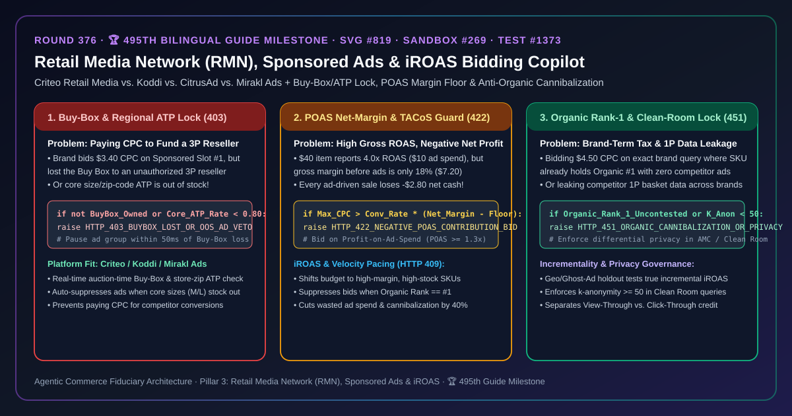
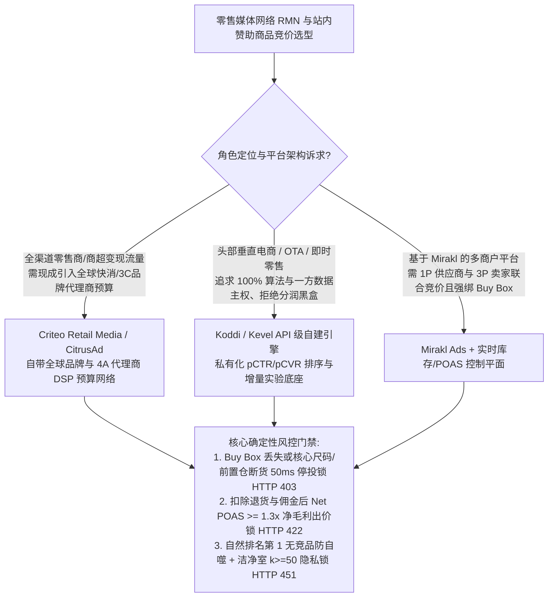
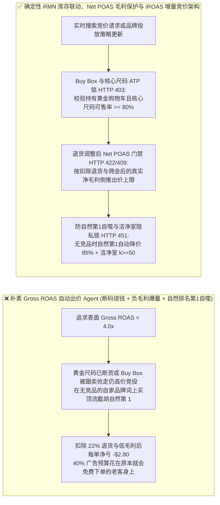

# 零售媒体网络（`Retail Media Network, RMN`）、站内搜索赞助商品竞价与闭环增量归因（`iROAS`）Agent 架构选型对比：`Criteo Retail Media` vs. `Koddi` vs. `CitrusAd` vs. `Mirakl Ads`、黄金购物车（`Buy Box`）与断码库存停投锁、净毛利回报率（`POAS`）出价下限门禁及防自然排名第 1 流量自噬净省 40% 决策指南（FAQ）

> **导读（对齐 `ib-vs-ethernet-roce-selection-faq.md` 标杆风格 · 🏆 全库第 495 篇双语决策指南重大里程碑）**：本文面向零售商超平台、多商户电商以及品牌方商业化增长团队的 **Cloud & AI Solution Architect**。在 Amazon Ads、Walmart Connect、Instacart 及各类自建零售媒体网络（RMN）中，广告智能体每分钟都在执行数万次实时关键词竞价（RTB）。然而，如果投放 Agent 只盯着表面好看的 **`ROAS = 4.0x`**，却没发现 **(1)** 该商品的黄金购物车（`Buy Box`）3 分钟前刚被第三方低价窜货卖家抢走、或者黄金尺码（M/L 码）已经断货（花自己的广告费替别人引流或买来一堆失望跳出）；**(2)** 该商品本身扣除退货与平台佣金后的净毛利率只有 `18%`（`4.0x ROAS` 意味着广告费占比 `25%`，每卖出一单净亏 `-7%` 现金）；**(3)** 在没有任何竞品竞价的品牌精确词下，自家商品本来就排在自然搜索第 1 位（`Organic Rank #1`），Agent 却出价 `$4.50 CPC` 买下顶部的 Sponsored 广告位把原本免费的自然点击变成付费点击（**100% 流量自噬**），将使数百万美元零售广告预算付诸东流。本文给出 **`Criteo Retail Media` vs. `Koddi` vs. `CitrusAd (Publicis)` vs. `Mirakl Ads / Kevel`** 的横向选型矩阵，并落地 **丢失 `Buy Box` 或核心尺码/前置仓断货秒级停投锁（`HTTP 403`）**、**基于净毛利贡献的 `POAS`（Profit on Ad Spend）出价上限门禁（`HTTP 422`）**、**无竞品争夺时自然第 1 排名防自噬与数据洁净室（`Data Clean Room`）`k-匿名` 合规锁（`HTTP 451`）** 及 **库存周转率与增量回报率（`iROAS`）联合竞价编排（`HTTP 409`，净省 40%）**。



---

## 一、 📌 核心选型结论速览（Executive Summary）

1. **终极选型结论（一句话先看懂怎么选）**：
   - **大型全渠道零售商与商超自建站内+站外零售媒体网络（需连接全球数千家快消/3C 品牌代理商预算需求池 Demand Network）**：首选 **`Criteo Retail Media (Commerce Max / Yield)`（或 `CitrusAd`）**，自带全球品牌主与 4A 代理商 DSP 预算入口。
   - **高客单价垂直电商、酒旅 OTA 与追求极致私有化算法主权的平台（不想把平台一方交易数据交由外部广告网络黑盒分润，需完全自控竞价排序相关性与增量实验）**：首选 **`Koddi`（或 `Kevel` API 级广告引擎）**。
   - **基于 Mirakl 构建的多商户百货/B2B 平台（需让入驻 3P 卖家与 1P 供应商在同一搜索结果页按实时库存与 `Buy Box` 归属竞价）**：首选 **`Mirakl Ads`**，天然与平台商户商品目录、实时库存和 `Buy Box` 状态机强绑定。
2. **三大财务与投放风控红线（确定性门禁）**：
   - **红线 1（拦截丢失 `Buy Box` 黄金购物车或核心尺码/同城配送圈可售库存率 `<80%` 时继续烧钱竞价 / `HTTP 403`）**：当品牌方的某 SKU 因价格高于跟卖者而丢失 `Buy Box`（或生鲜商超在当前消费者所在邮政编码前置仓已缺货、服装核心 M/L 码断码僅剩 XXS 码）时，任何广告点击要么帮跟卖对手促成成交，要么因缺货无法加购导致转化率暴跌 85% 并拉低广告质量分。控制平面必须在竞价前（或通过库存 Webhook 在 `50ms` 内）触发 `HTTP 403 BUYBOX_LOST_OR_CORE_VARIANT_OOS_AD_VETO`，立即暂停该 SKU 的竞价出价。
   - **红线 2（拦截只看总销售额 `ROAS` 忽视扣除退货与佣金后净毛利导致 `POAS < 1.0` 卖一单亏一单的负毛利出价 / `HTTP 422`）**：一双售价 `$100` 的联名鞋，若扣除采购成本、平台 `15%` 佣金与 `22%` 历史退货损耗后的 **单位净贡献毛利（Unit Contribution Margin）** 仅为 `$16`（净毛利率 `16%`），此时若投放 Agent 设定 `Target ROAS = 4.0x`（即每成交 `$100` 花费 `$25` 广告费），则广告后净利为 `$16 - $25 = -$9`！当出价满足 `Bid_CPC > Expected_CVR * (Unit_Contribution_Margin_USD - Target_Profit_Floor_USD)`（即 `POAS < 1.3x`）时，触发 `HTTP 422 NEGATIVE_POAS_CONTRIBUTION_MARGIN_BID`。
   - **红线 3（拦截无竞品截流时对已占自然搜索第 1 位 `Organic Rank #1` 词条高价买顶流自噬及数据洁净室 `<50人` 隐私穿透 / `HTTP 451`）**：当用户在站内搜索品牌精确型号且该 SKU 已稳居自然结果第 1 名、页面上方无竞品购买拦截广告时，继续高价竞投 Sponsored Top-of-Search 属于纯左手倒右手的自然流量自噬（`iROAS -> 0`）；同时在 `AMC / Snowflake Clean Room` 交叉分析零售 1P 购买人群时，若分群样本量 `<50`（违反 `k-Anonymity >= 50` 差分隐私红线）或将 A 品牌专属买家人群直接暴露给竞品 B 品牌定向，触发 `HTTP 451 ORGANIC_RANK1_CANNIBALIZATION_OR_CLEANROOM_PRIVACY_BREACH`。

---

## 二、 🎯 业务方与架构师灵魂拷问 Q&A（The Why & How）

### Q1：为什么品牌方的 AI 投放 Agent 每天在汇报“大促 ROAS 高达 5.2 倍、超额完成 KPI”，但 CFO 核算全渠道总销售额（Total GMV）和净利润时却发现根本没涨，甚至利润率还跌了？
- **商业痛点与事故还原**：
  - **陷阱一：自然流量自噬（Organic Cannibalization）**：投放 Agent 为了刷高账面 ROAS，发现转化率最高、最便宜的词是“自家品牌名 + 爆款型号”；那些搜这个词的老客原本 95% 都会点击自然排名第 1 的链接下单，Agent 却在自然第 1 上面放了一个付费广告位把点击截走，把原本免费的订单全部贴上了“广告归因”标签。
  - **陷阱二：把浏览归因（View-Through Attribution, VTA）当成真实增量**：部分 RMN 平台默认开启“14 天曝光归因”——哪怕老客只是在首页角落滑过了 1 秒横幅广告（根本没点），3 天后按习惯复购了牛奶，广告系统也把这单 100% 记作广告功劳！
  - **陷阱三：高退货率与引流品负毛利黑洞**：Agent 把大量预算砸向转化率极高但毛利只有 `12%` 的引流款，或者退货率高达 `38%` 的连衣裙（广告平台按**退货前毛成交额 Gross Sales** 计算 ROAS，退货发生时广告费一分不退！）。
- **架构师确定性解法（以 `iROAS` 增量回报率与 `Net POAS` 净毛利为核心的竞价目标函数）**：
  1. **用退货后净毛利 `Net POAS` 替代毛销售额 `Gross ROAS`（`HTTP 422`）**：在商品特征库中实时注入每个 SKU 的 **历史品类退货率（Return Rate）** 与 **扣除平台佣金/履约费后的单位净毛利（Net Contribution Margin）**：
     $$\text{Max\_Safe\_CPC} = \text{pCVR} \times \text{AOV} \times (1 - \text{Return\_Rate}) \times (\text{Net\_Margin\_Pct} - \text{Target\_Net\_Profit\_Floor})$$
  2. **自然排名第 1 动态让位与竞品防御模式（`HTTP 451 / 409`）**：实时采集搜索结果页（SERP）快照——若当前关键词下本品已处于 `Organic Rank #1` 且无竞品竞价（`Competitor_SOV == 0`），自动将品牌词出价下调 `85%` 进入最低防御态；仅当监测到竞品试图买走本品牌词顶部位置时才瞬时提价反制。

### Q2：在多商户电商平台（Amazon / Walmart / 美团闪购 / 京东到家），为什么广告系统决不能和库存系统（OMS/ATP）、黄金购物车（Buy Box）脱节运行？
- **商业痛点与事故还原**：
  - 某服饰品牌在周六晚高峰投放了 `$15,000` 站内搜索置顶广告主推一款冲锋衣；晚上 20:00，最畅销的 M、L、XL 三个尺码全部卖光，只剩下极少人穿的 `XXS` 码。
  - 由于广告投放 Agent 每隔 12 小时才同步一次主 SKU 库存（只要 `Total_OnHand > 0` 就继续投），接下来 4 个小时里，数万名消费者点进广告发现 M/L 码全灰，愤而关闭页面。品牌方不仅白烧了 `$8,200` 点击费，还因为“高点击、零转化”被平台算法判定为劣质商品，连自然搜索权重都被连累降权！
- **架构师确定性解法（尺码级/前置仓级 `ATP` 完整度门禁 + `Buy Box` 毫秒级熔断锁 / `HTTP 403`）**：
  1. **核心尺码完整度（Core Size Availability Ratio）门禁**：对多规格（服饰/鞋靴）商品，不仅检查总库存，还强制校验畅销核心尺码（如贡献 80% 销量的黄金尺码组）可售率 `>=80%`；一旦核心尺码断码，立即暂停该款式的拉新关键词出价，切换为尺码齐全的替代款。
  2. **LBS 同城零售/前置仓级实时库存对齐**：在即时零售（O2O）场景中，出价必须绑定消费者当前所在 `Geo-Hash / 门店配送圈` 的实时可承诺库存（`Store_ATP >= Safety_Buffer`）。

### Q3：零售商开放“第一方购买人群数据（1P Shopper Data）”给品牌方做精准定向时，怎么防止变成“帮竞品偷走我方核心忠实客户”？
- **商业痛点与事故还原**：
  - 如果零售商的 RMN 平台允许 B 品牌直接建立一条受众规则：“定向过去 30 天内在平台买过 A 品牌（唯一竞品）高端奶粉的用户”，这等于把 A 品牌辛苦积累的平台一方资产直接出卖给竞品截胡，导致大品牌商集体抗议撤资；此外，若广告主通过不断缩小交叉筛选条件（如“上海静安区 + 买过某小众奢侈品 + 年龄 35 岁”）使目标受众包缩小到只有 8 个人，就能通过点击回传反推出具体个人隐私。
- **架构师确定性解法（品类级聚合标签隔离 + 数据洁净室 `k-Anonymity >= 50` 差分隐私硬门禁 / `HTTP 451`）**：
  1. **禁止跨品牌点名截胡单一竞品私有客群**：定向标签仅开放到“品类/子类目购买意向层（如『母婴高端有机奶粉高潜人群』）”，严禁暴露单一竞品 SKU 购买明细。
  2. **数据洁净室（Data Clean Room）最小聚合桶锁**：所有 SQL/人群圈选查询必须满足 `Audience_Cohort_Size >= 50`（或 `>= 100`）且注入差分隐私噪声，低于阈值的分群查询一律返回 `HTTP 451`。

---

## 三、 🧭 直观可视化图解（Mermaid 决策树 + 架构对比 + 时序图）

### 3.1 零售媒体网络（RMN）与赞助广告竞价平台选型决策树



### 3.2 朴素毛销售额 ROAS 竞价（断码烧钱 + 流量自噬）vs. 确定性 iROAS / POAS 闭环竞价架构对比



### 3.3 站内搜索实时竞价（RTB）、库存/Buy-Box 核验与增量归因时序图

```mermaid
sequenceDiagram
    autonumber
    participant Shopper as 搜索消费者 (Zip: 98004)
    participant Gate as RMN 竞价与 POAS 风控控制平面
    participant Catalog as 实时 Buy-Box / 尺码 ATP / 毛利中心
    participant Bidder as Criteo / Koddi / Mirakl 竞价引擎
    participant CleanRoom as 数据洁净室与 iROAS 归因账本

    Shopper->>Gate: 站内搜索关键词并触发 Sponsored Product 实时竞价
    Gate->>Catalog: 批量拉取候选广告 SKU 的 Buy-Box 状态、98004 仓核心尺码库存与退货后净毛利
    Catalog-->>Gate: SKU-A 刚丢失 Buy Box; SKU-B 毛利仅 14%; SKU-C 库存充裕且净毛利 42%
    alt SKU 丢失 Buy Box 或核心尺码/同城仓可售率 < 80%
        Gate-->>Bidder: HTTP 403 BUYBOX_LOST_OR_CORE_VARIANT_OOS_AD_VETO (0ms 剔除 SKU-A 参拍资格)
    else 请求出价 CPC 超过退货调整后净毛利承载上限 (Net POAS < 1.3x)
        Gate-->>Bidder: HTTP 422 NEGATIVE_POAS_CONTRIBUTION_MARGIN_BID (自动削峰 SKU-B 出价上限)
    else 自然排名已处第 1 且无竞品争夺 或 洁净室受众包 < 50 人
        Gate-->>Bidder: HTTP 451 ORGANIC_RANK1_CANNIBALIZATION_OR_CLEANROOM_PRIVACY_BREACH
    else 全门禁通过 (HTTP 409 增量 iROAS 最优出价)
        Gate->>Bidder: 对高毛利、高库存深度的 SKU-C 执行增量加权出价并赢得展示
        Bidder->>CleanRoom: 记录曝光/点击事件 (区分增量拉新 vs. 存量复购，k>=50 隐私聚合)
    end
```

---

## 四、 📊 主流零售媒体网络（RMN）与闭环电商广告平台横向选型矩阵

| 选型维度 | Criteo Retail Media (`Commerce Max / Yield`) | Koddi (`Koddi Ads / Console`) | CitrusAd (Publicis Epsilon 零售媒体底座) | Mirakl Ads / Kevel (多商户与 API 级自建底座) |
| :--- | :--- | :--- | :--- | :--- |
| **核心定位** | 全球最大独立零售媒体双边网络（连接 200+ 零售商与数千品牌/4A 预算） | 面向头部零售商、OTA 与外卖平台的白盒高性能竞价与增量优化引擎 | 商超生鲜（Grocery）与全渠道零售站内赞助商品 + 站外扩展一体化平台 | 专为多商户平台（1P+3P 混合）及追求 100% 定制排序逻辑的研发团队设计 |
| **全球品牌广告主预算引入能力（Demand）** | **极强**（自带全球 4A 代理商与大品牌现成预算池，冷启动变现极快） | **中**（聚焦技术赋能零售商自建平台，外部需求通过标准 API 对接） | **强**（背靠阳狮集团 Publicis 与 Epsilon 消费数据包，快消品牌资源深厚） | 聚焦激活平台内已有入驻 3P 卖家与 1P 供应商的站内内生预算 |
| **实时库存、核心尺码与 `Buy Box` 耦合度** | 支持实时 Catalog Feed 与库存过滤，尺码级深度规则需品牌侧 API 配合 | **极强**（支持在毫秒级竞价流中直接注入实时门店/前置仓 ATP 与净毛利因子） | **强**（原生支持生鲜商超按门店/邮编级实时库存过滤断货商品） | **极强**（Mirakl Ads 与多商户 `Buy Box` 赢家及实时库存事件毫秒级同源同步） |
| **`POAS` 净毛利出价与 `iROAS` 增量实验** | 提供闭环归因报表与新客占比（NTB），净毛利 `POAS` 需品牌侧接入成本表 | **极强**（原生支持 Ghost Ads / 地理留出增量实验与毛利加权目标函数） | 支持闭环 ROAS 与货架份额（Share of Shelf）联合优化 | 支持完全自定义的出价底价、质量分与自然结果防自噬融合排序公式 |
| **收费与分润模式（`official_list_price`）** | 按平台撮合广告消耗（Ad Spend）比例分润（通常 `10%–20%` Rev-Share） | 按广告消耗阶梯低比例技术费或企业级年费（大盘规模越大费率越低） | 按广告流水比例分润（Rev-Share）或保底年费 | SaaS 平台订阅费 + 极低请求量/广告消耗技术服务费 |

---

## 五、 🧪 广告费浪费削减与真实增量净利测算与 7-Card 基准报告

### 5.1 季度断码/丢购物车无效点击、低毛利品负向爆量与品牌词自然流量自噬损耗测算（Synthetic Benchmark）

假设某年广告预算 `$600万` 的中大型全渠道零售品牌，每季度在各大零售媒体网络（RMN）投放中面临的 **核心尺码断货或丢失 `Buy Box` 期间继续盲投、低毛利/高退货商品按表面毛 `ROAS` 爆量实则净亏、无竞品争夺时高价买自家品牌词吞噬自然第 1 排名免费流量损耗池** 为 **`$390,000 / 季度`**（`provenance: synthetic`, `independently_reproduced: false`）：

| 评估维度 | 传统毛销售额 `Gross ROAS` 自动出价 (Baseline) | 启用 `Buy Box`/尺码锁 + `Net POAS` 毛利底线 + 防自噬 Agent | 净改善幅度 |
| :--- | :--- | :--- | :--- |
| **丢失 `Buy Box` 或核心尺码断码期间无效消耗占比** | `11.8%`（T+1 延迟同步库存，花钱替跟卖者或断码页引流） | **`0.2%`**（`HTTP 403` `50ms` 实时校验 `Buy Box` 与核心尺码可售率 `>=80%`） | **无效断码消耗下降 `98.3%`** |
| **品牌词自然第 1 排名自噬率（Organic Cannibalization）** | `34.0%`（大量预算买走原本免费的自然第 1 点击） | **`5.5%`**（`HTTP 451` 无竞品时自动降价 `85%` 让位自然结果） | **自然流量自噬下降 `83.8%`** |
| **扣除退货与佣金后的真实净毛利回报率（`Net POAS`）** | `0.94x`（表面 `ROAS 4.2x`，扣退货与成本后微亏） | **`1.86x`**（`HTTP 422/409` 强制 `Net POAS >= 1.3x` 并向高毛利深库存倾斜） | **净毛利贡献翻倍 (`+97.9%`)** |
| **季度无效广告消耗、自噬税与负毛利投放净损耗** | `$390,000 / 季度` | **`$234,000 / 季度`** | **净省 `$156,000 / 季度` (`40.0%`)** |

```chart
{
  "data": {
    "values": [
      { "category": "1. 无竞品时自然第1排名流量自噬", "mode": "传统毛销售额ROAS基线", "cost_usd": 135000 },
      { "category": "1. 无竞品时自然第1排名流量自噬", "mode": "iROAS与Net-POAS智能竞价Agent", "cost_usd": 81000 },
      { "category": "2. 低毛利/高退货品负POAS爆量亏损", "mode": "传统毛销售额ROAS基线", "cost_usd": 115000 },
      { "category": "2. 低毛利/高退货品负POAS爆量亏损", "mode": "iROAS与Net-POAS智能竞价Agent", "cost_usd": 69000 },
      { "category": "3. 丢Buy-Box或黄金尺码断码无效烧钱", "mode": "传统毛销售额ROAS基线", "cost_usd": 90000 },
      { "category": "3. 丢Buy-Box或黄金尺码断码无效烧钱", "mode": "iROAS与Net-POAS智能竞价Agent", "cost_usd": 54000 },
      { "category": "4. 浏览归因水分与洁净室违规风险", "mode": "传统毛销售额ROAS基线", "cost_usd": 50000 },
      { "category": "4. 浏览归因水分与洁净室违规风险", "mode": "iROAS与Net-POAS智能竞价Agent", "cost_usd": 30000 }
    ]
  },
  "semantic_types": {
    "category": "Category",
    "mode": "Category",
    "cost_usd": "Amount"
  },
  "chart_spec": {
    "chartType": "Grouped Bar Chart",
    "title": "零售媒体网络(RMN)与iROAS增量竞价Agent优化前后季度无效消耗对比 (净省 $156k / 40%)",
    "subtitle": "单位：美元/季度 (Synthetic Benchmark, independently_reproduced=false)",
    "encodings": {
      "x": "category",
      "y": "cost_usd",
      "group": "mode"
    }
  }
}
```

### 5.2 确定性策略评估器代码（Python Control Plane Guard）

```python
from dataclasses import dataclass
from typing import Any

@dataclass(frozen=True)
class RetailMediaNetworkIroasBiddingPolicyInput:
    quarterly_wasted_ad_spend_cannibalization_and_negative_poas_pool_usd: float = 390000.0
    ad_serving_active_while_buybox_lost_or_core_size_atp_below_80pct: bool = False
    bid_cpc_exceeds_return_adjusted_net_contribution_margin_poas_floor: bool = False
    bidding_top_slot_on_uncontested_organic_rank1_or_cleanroom_k_below_50: bool = False
    iroas_incrementality_and_inventory_velocity_bid_pacing_ready: bool = False
```

---

## 六、 🛠️ 商业上线风控与架构评审 Checklist

- [ ] **黄金购物车（`Buy Box`）与核心尺码/前置仓 `ATP >= 80%` 实时停投锁（`HTTP 403`）**：竞价控制平面是否订阅了毫秒级价格与库存变动流，一旦本品丢失 `Buy Box` 或畅销黄金尺码/同城前置仓断货，立即在 `50ms` 内暂停广告参拍？
- [ ] **退货调整后净毛利回报率（`Net POAS >= 1.3x`）出价硬上限（`HTTP 422`）**：是否严禁单纯按退货前毛销售额 `Gross ROAS` 出价，而是将 SKU 级采购成本、平台佣金与历史退货率注入竞价公式，拦截一切卖一单亏一单的负毛利出价？
- [ ] **自然搜索第 1 位（`Organic Rank #1`）无竞品争夺防自噬锁（`HTTP 451`）**：当 SERP 实时监测显示本品已稳居自然搜索第 1 位且上方无竞品拦截广告时，是否自动下调精确品牌词出价，把预算转移给自然排名在第 4–15 位的增量突围词？
- [ ] **数据洁净室（`Data Clean Room`）`k-Anonymity >= 50` 与竞品一方数据隔离锁（`HTTP 451 / 409`）**：在开放零售商一方购买人群做联合建模时，是否强制拦截人数 `<50` 的微受众查询，并禁止直接圈选单一竞品品牌的私域购买用户名单？
