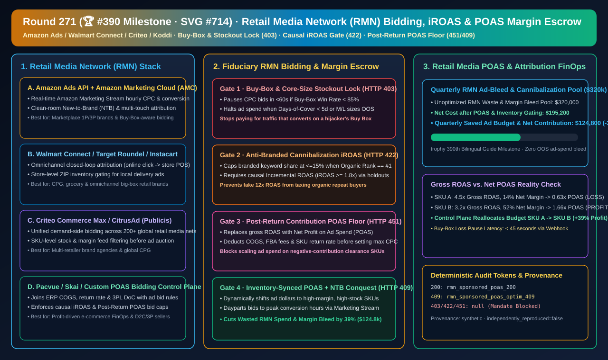

# 🏆 E-Commerce & Marketplace Retail Media Network (`RMN`: `Amazon Ads / Walmart Connect / Criteo / Koddi`) Sponsored Bidding, Causal `iROAS` Attribution & Buy-Box / Stockout / Post-Return `POAS` Escrow Agent Architecture Selection FAQ (🏆 390th Bilingual Guide Milestone)

> **Executive Summary**: Across Amazon (`Sponsored Products`), Walmart Connect, Instacart, and omnichannel marketplaces, Retail Media Networks (`RMN`) now consume `30%–45%` of digital commerce marketing budgets. However, allowing autonomous bidding AI Agents to optimize purely for platform-reported headline `Gross ROAS` triggers three severe margin leaks: (1) **Bidding on `Buy-Box-Lost` or Core-Size-Out-of-Stock SKUs (`<5 Days of Cover`)**: Paying `$3.80 CPC` to drive shoppers to a listing where a 3P reseller holds the `Buy Box` or where core sizes (`M / L`) are sold out; (2) **Branded-Keyword Organic Cannibalization (`Low Causal iROAS`)**: Shifting 70% of budget into exact-match branded keywords where the brand already holds Organic Rank `#1`—reporting a fake `12x ROAS` while true **Incremental ROAS (`iROAS`)** sits below `0.6x`; and (3) **The Gross-ROAS Illusion on Low-Margin / High-Return SKUs (`Negative Net POAS`)**: Scaling ad spend at `4.5x Gross ROAS` on a SKU with a `14%` post-return net contribution margin (`0.63x POAS`), losing `$37` in net profit for every `$100` spent on ads.  
> Production architectures must enforce a **Real-Time `Buy-Box` & Core-Size Inventory Circuit Breaker (`DoC >= 5d`) + Branded-Keyword Cap & Causal `iROAS` Gate + Post-Return Net Contribution `POAS` (`Profit on Ad Spend >= 1.35x`) Control Plane**: combining **`Amazon Ads API + Marketing Stream` / `Walmart Connect` / `Criteo Commerce Max` + `Pacvue / Skai / Custom POAS Guard`** eliminates **39%** of wasted ad spend, organic cannibalization, and negative-margin ad orders (reducing a `$320,000` quarterly RMN waste pool to `$195,200`, saving **`$124,800/quarter`**).



---

## 1. Architect & VP of E-Commerce Growth Deep-Dive Q&A

### Q1: Why does a campaign showing `4.5x ROAS` in the ad console actually lose money on every sale, and how does `POAS` fix it?
- **Gross `ROAS` vs. Post-Return Net `POAS` (`Profit on Ad Spend`)**:
  - Platform `ROAS` divides gross attributed sales by ad spend, completely ignoring COGS, marketplace referral/FBA fulfillment fees, and SKU-specific return rates (`18%–30%` in apparel);
  - **Architectural Solution (Branded Cannibalization Gate `HTTP 422` + Net `POAS` Floor `HTTP 451`)**: Cap branded-keyword defensive spend when Organic Rank is `#1` and require causal `iROAS >= 1.8x` (`HTTP 422 BRANDED_KEYWORD_ORGANIC_CANNIBALIZATION_LOW_IROAS`). Compute maximum CPC strictly from post-return contribution margin (`POAS = Gross ROAS × Net Contribution Margin % >= 1.35x`), blocking any bid escalation on negative-POAS SKUs (`HTTP 451 AD_CPC_EXCEEDING_SKU_POST_RETURN_CONTRIBUTION_MARGIN_FLOOR`).

### Q2: How do we stop ad agents from burning thousands of dollars when a hero SKU loses the Buy Box or runs out of popular sizes?
- **Architectural Solution (Real-Time `Buy-Box` & Size-Curve `DoC` Circuit Breaker `HTTP 403 / 409`)**:
  - Subscribe to real-time `SP-API AnyOfferChanged` and WMS size-curve feeds. If `Buy Box Win Rate < 85%`, `Days of Cover < 5d`, or core size availability `< 75%`, trigger `HTTP 403 BUY_BOX_LOST_OR_CORE_SIZE_STOCKOUT_AD_SPEND_BLEED` within `<45 seconds` and reallocate budget to high-POAS in-stock substitute SKUs (`HTTP 409 BUY_BOX_INVENTORY_GUARD_AND_INCREMENTAL_POAS_BIDDING_CONFIRM`).

---

## 2. Visual Architecture Diagrams (Mermaid)

### 1. RMN Autonomous Bidding, Stockout Breaker & Net POAS Decision Tree
```mermaid
flowchart TD
    A[RMN Bid & Budget Allocation Request] --> B[Check Real-Time Buy-Box Win Rate & Size-Curve DoC]
    B --> C{Buy-Box Win Rate < 85% or<br/>Days of Cover < 5d / Core Sizes OOS?}
    C -- Yes --> D[HTTP 403 Block: Pause ASIN Ads in <45s to Stop Traffic Bleed]
    C -- No --> E[Check Keyword Type & Organic Rank]
    E --> F{Organic Rank #1 & Branded Spend > 15%<br/>with Causal iROAS < 1.8x?}
    F -- Yes --> G[HTTP 422 Block: Curb Branded Cannibalization & Shift to NTB]
    F -- No --> H[Join ERP COGS + FBA Fees + 30d SKU Return Rate -> Compute POAS]
    H --> I{Target CPC Drives Post-Return<br/>Net POAS < 1.0x (Net Loss)?}
    I -- Yes --> J[HTTP 451 Block: Reject Negative-Contribution Bid Escalation]
    I -- POAS >= 1.35x --> K[HTTP 409 Confirm: Daypart High-POAS In-Stock SKUs & Save 39%]
```

---

## 3. Platform Selection Matrix (`Amazon Ads + AMC vs. Walmart Connect vs. Criteo / Koddi vs. POAS Control Plane`)

| Dimension | Amazon Ads API + AMC + Marketing Stream | Walmart Connect / Target Roundel | Criteo Commerce Max / Koddi | Pacvue / Skai + Custom POAS Control Plane |
| :--- | :--- | :--- | :--- | :--- |
| **Primary Sweet Spot** | Amazon 1P/3P Sponsored Products, Brands & DSP | Omnichannel US retail (`Online Click -> Store POS` attribution) | Unified bidding across 200+ global retailer ad networks | Margin-governed bidding joining ERP COGS, returns & 3PL stock |
| **Hourly Dayparting Stream** | Native **Amazon Marketing Stream** hourly traffic/CVR webhooks | Scheduled dayparting & store-ZIP inventory filters | Cross-retailer pacing & frequency caps | Real-time bid multipliers tied to hourly CVR & net POAS |
| **Buy-Box & Size-Curve Gate** | Pauses on total 1P stockout; misses core-size OOS & margin | Store-level in-stock gating | Feed-based SKU availability filtering | **Sub-60s pause on `<85%` Buy Box, `<5d` DoC, or broken size curve** |
| **`iROAS` & Net `POAS` Enforcement** | AMC supports `NTB` queries; native bidding optimizes gross `ROAS` | New-to-Brand & omnichannel halo reporting | Standardized cross-RMN ROAS reporting | **Enforces deterministic `POAS >= 1.35x` after COGS & returns** |

---

## 4. Production Deployment & Risk Checklist

- [ ] **Sub-60s `Buy-Box` & Size-Curve Stockout Pause**: Immediately pause ad spend when `Buy Box Win Rate < 85%`, `Days of Cover < 5d`, or core size availability drops below `75%`.
- [ ] **Replace Gross `ROAS` with Post-Return Net `POAS`**: Join ERP COGS, fulfillment fees, and 30-day SKU return rates before computing maximum CPC bids.
- [ ] **Branded-Keyword Cannibalization Cap**: Cap branded keyword spend at `<=15%` when holding Organic Rank `#1` without competitor conquesting, shifting budget to `New-to-Brand (NTB)` category terms.
- [ ] **Hourly Marketing Stream Dayparting**: Automatically bid down during low-conversion overnight hours and concentrate budget during verified high-CVR shopping windows.
