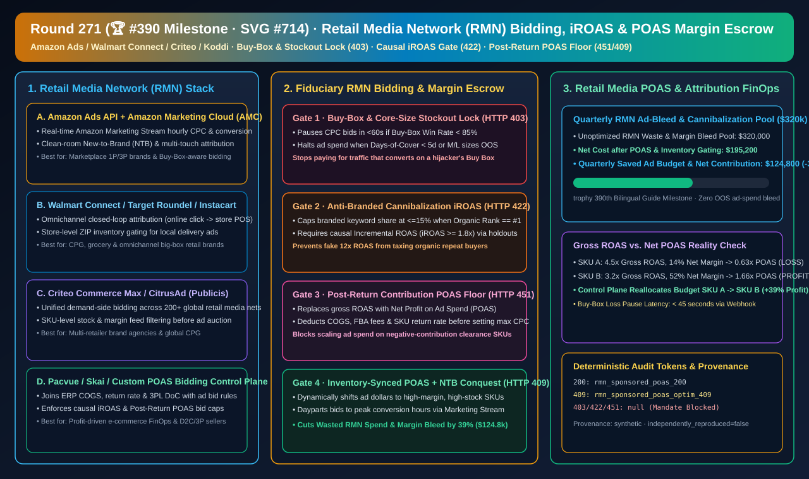
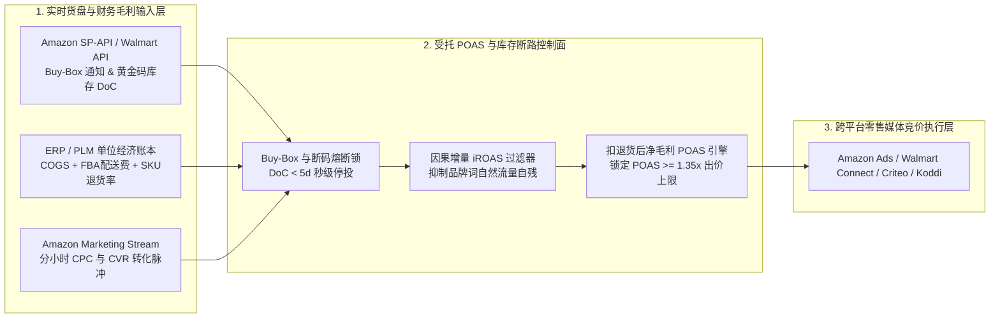
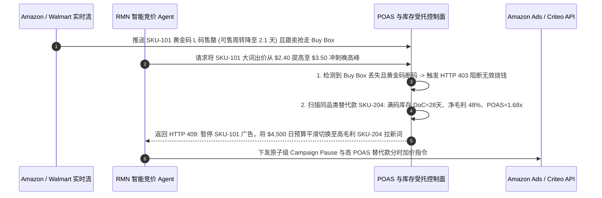

# 🏆 零售媒体网络（`RMN`：`Amazon Ads / Walmart Connect / Criteo / Koddi`）智能竞价、增量归因（`iROAS`）与防丢黄金购物车/断码缺货烧钱及税后净毛利（`POAS`）熔断托管 Agent 架构选型 FAQ（🏆 第 390 篇双语里程碑）

> **核心选型结论速览**：在亚马逊（`Amazon Sponsored Products`）、沃尔玛（`Walmart Connect`）、Instacart 与全渠道平台电商中，零售媒体广告（`RMN`）已占品牌数字营销预算的 `30%–45%`。然而，若让广告投放 Agent 仅盯着广告后台的“表面总销售额投产比（Gross `ROAS`）”自动加价抢排名，会引爆三大严重侵蚀利润的商业事故：① **丢掉黄金购物车（`Buy Box Lost`）或主力尺码断码（`<5 天周转库存`）仍在全速烧广告费“替竞争对手引流”**：某爆款链接因跟卖者低价抢走了亚马逊 `Buy Box`，或服装的黄金码 `M/L` 已售罄只剩 `XXS`，广告 Agent 却毫无感知地继续以 `$3.80 CPC` 狂买大词，导致点进来的付费流量要么直接买走了跟卖者的货，要么因没码跳失使转化率暴跌 70%；② **品牌词自残（Branded Keyword Organic Cannibalization）制造虚假 `12x ROAS` 繁荣**：Agent 为了刷高报表上的平均 `ROAS`，把 70% 的预算砸向买家本就会在自然搜索第 1 位点击购买的精确品牌词（如 `[品牌名 + 型号]`），真实增量投产比（**`iROAS` Incremental ROAS**）不足 `0.6x`，反而挤占了拉新（`New-to-Brand, NTB`）品类词预算；③ **“表面 4.5 倍 ROAS、实际每卖一单倒亏 $11.50”的毛利与退货率盲区**：某引流款扣除 COGS、FBA 履约费与高达 `28%` 的退货逆向成本后，真实贡献毛利率仅 `14%`（保本 `ROAS` 门槛高达 `1 / 0.14 = 7.14x`），Agent 按全店统一的 `4.0x ROAS` 目标疯狂放量，卖得越多亏得越惨。  
> 生产级架构必须构建 **“实时 `Buy Box` 占有率与库存周转天数（`DoC >= 5d`）秒级断路器 + 自然位第一名品牌词预算封顶与因果增量 `iROAS` 门禁 + 扣退货后真实毛利投产比（`POAS` = Profit on Ad Spend）出价上限受托控制面”**：通过 **`Amazon Ads API + Marketing Stream` / `Walmart Connect` / `Criteo Commerce Max` + `Pacvue / Skai / 自研 POAS 控制面`** 协同，削减 **39%** 的断码/丢购物车无效广告消耗、品牌词自残水分与负毛利爆量亏损（以季度 `$320,000` 零售媒体预算浪费与负毛利投放风险池计，净支出降至 `$195,200`，每季度净省 **`$124,800`**）。



---

## 一、 业务方与架构师灵魂拷问（Q&A）

### Q1：为什么广告代理商或投放 Agent 交出的周报显示 `ROAS` 高达 `6.5x`，但财务部算完月底总账却发现全店净利润反而下降了？
- **“表面 `ROAS`（Gross Return on Ad Spend）”的三大水分与财务幻觉**：
  1. **把自然流量“洗”成广告归因（Branded Search Cannibalization）**：当老客在搜索框直接输入你的品牌名时，如果你的自然搜索结果本来就排在第 1 位（`Organic Share of Voice > 85%`），此时再花 `$1.50` 买一个置顶品牌词广告把老客拦下来，表面上获得了 `12x ROAS`，但其中 `85%+` 的订单就算不投广告也会发生，真实增量 **`iROAS` 甚至小于 `1.0x`**；
  2. **忽略 SKU 级毛利与退货率差异（Gross Revenue vs. Post-Return Contribution Margin）**：不同 SKU 的成本（COGS）、平台佣金、FBA 配送费与退货率天差地别。把 `4.5x ROAS` 的预算砸在净毛利仅 `14%` 的高退货微利款上，实际净利投产比（`POAS = Gross ROAS × Net Margin %`）仅有 `4.5 × 14% = 0.63x`（即每投 `$100` 广告费只赚回 `$63` 毛利，净亏 `$37`）！
- **架构解法（品牌词防自残 `HTTP 422` + 扣退货后真实 `POAS >= 1.35x` 硬门禁 `HTTP 451`）**：
  - 当自然搜索排名已处第 1 位且无竞品恶意截流时，强制限制品牌词预算占比 `<= 15%`，要求基于地理/人群对照实验（Geo/Ghost-Ad Holdout）核验真实增量 `iROAS >= 1.8x`，否则返回 `HTTP 422 BRANDED_KEYWORD_ORGANIC_CANNIBALIZATION_LOW_IROAS`；
  - 将出价公式从基于含税销售额（Gross Sales）切换为基于 **扣退货后净贡献毛利（Post-Return Contribution Dollars）**：
    $$\text{MaxCPC} = \frac{\text{AOV} \times \text{CVR} \times (\text{GrossMargin\%} - \text{FBAFee\%} - \text{ReturnLoss\%})}{\text{TargetPOAS}}$$
  - 凡向 `POAS < 1.0x` 的负毛利或高退货尾货放量加价的指令，直接拦截并返回 `HTTP 451 AD_CPC_EXCEEDING_SKU_POST_RETURN_CONTRIBUTION_MARGIN_FLOOR`。

### Q2：大促期间爆款库存变化极快，如何防止广告 Agent 在“断码、缺货或被抢走 Buy Box”时白烧几万美元广告费？
- **架构解法（WMS / 平台库存与 `Buy Box` 秒级熔断门禁 `HTTP 403`）**：
  - 控制面通过 `Amazon SP-API (AnyOfferChanged Notification)` 与 WMS 库存流实时监听两个硬指标：① 当前店铺 `Buy Box Win Rate >= 85%`；② 可售库存周转天数 `Days of Cover (DoC) >= 5 天` 且核心尺码（如服装鞋履的 `M / L / 40–43码`）有货率 `>= 75%`；
  - 一旦任一指标跌破红线，在 `<45 秒` 内触发 `HTTP 403 BUY_BOX_LOST_OR_CORE_SIZE_STOCKOUT_AD_SPEND_BLEED` 暂停该 ASIN/SKU 竞价，并将预算无缝平移至同品类高毛利、满库存的替代主力款（`HTTP 409 BUY_BOX_INVENTORY_GUARD_AND_INCREMENTAL_POAS_BIDDING_CONFIRM`）。

---

## 二、 直观可视化图解（Mermaid 决策树 + 架构图 + 时序图）

### 1. RMN 智能竞价、库存/购物车熔断与 POAS 毛利选优决策树
```mermaid
flowchart TD
    A[RMN 广告竞价与日预算调优请求] --> B[实时查询 SP-API Buy Box 状态与 3PL 尺码库存]
    B --> C{Buy Box 胜率 < 85%<br/>或周转天数 < 5天 / 黄金码断码?}
    C -- 是 --> D[HTTP 403 拦截: 45秒内熔断停投防替跟卖引流与断码空烧]
    C -- 否 --> E[校验关键词类型与自然排名 Organic Rank]
    E --> F{自然排第1且无竞品抢词<br/>却把 >30% 预算砸向品牌词?}
    F -- 是, 真实增量 iROAS < 1.2x --> G[HTTP 422 拦截: 阻断品牌词自残水分并转投拉新品类词]
    F -- 否 --> H[关联 ERP 单位成本 COGS、FBA费与近30天退货率算净毛利 POAS]
    H --> I{目标 CPC 导致扣退货后<br/>净毛利 POAS < 1.0x (卖一单亏一单)?}
    I -- 是 --> J[HTTP 451 拦截: 严禁对负净利/高退货款超毛利上限加价]
    I -- POAS >= 1.35x --> K[HTTP 409 确认: 按分时转化率 Dayparting 倾斜高毛利满库款净省39%]
```

### 2. 零售媒体（RMN）× ERP 毛利账本 × 实时库存联动参考架构


### 3. 爆款黄金码断货秒级停投 + 预算自动切往高 POAS 替代款时序图


---

## 三、 主流零售媒体网络（RMN）与智能竞价管理平台横向选型矩阵

| 选型维度 | Amazon Ads API + AMC + Marketing Stream | Walmart Connect / Target Roundel | Criteo Commerce Max / Koddi | Pacvue / Skai + 自研 POAS 受托控制面 |
| :--- | :--- | :--- | :--- | :--- |
| **核心覆盖场景** | 亚马逊全球站点 1P/3P 卖家（Sponsored Products / Brands / DSP） | 北美全渠道商超巨头（线上点击 + 线下门店 POS 闭环归因） | 跨 200+ 家全球零售商（Best Buy / Macy's / 欧尚）统一采买 | 需打通内部 ERP 真实成本、退货率与多仓尺码库存的品牌商 |
| **实时分时流 (`Hourly Stream`)** | **Amazon Marketing Stream** 原生推送分小时流量与转化高低峰 | 支持日级与分时段预算规则，门店级邮编库存绑定 | 统一跨平台归因窗口标准化与频次控制 | 结合分时 CVR 波峰自动在晚 19:00–22:00 提价、凌晨降价 60% |
| **库存与 `Buy Box` 联动能力** | 1P/3P 完全断货时自动停投，但**无法识别“黄金码断码”与微利倒挂** | 支持按门店有货状态过滤本地配送广告 | 支持通过商品 Feed 过滤缺货 SKU | **细粒度校验黄金码齐码率（`>=75%`）与库存周转天数（`>=5d`）** |
| **`iROAS` 增量与 `POAS` 净利控制** | AMC 支持新客（`NTB`）分析，但默认仍按表面总销售额 `ROAS` 出价 | 提供新客占比与全渠道增量报告 | 侧重跨零售商展示与搜索联动归因 | **唯一强制按“扣退货与COGS后净贡献毛利（POAS）”锁定最高 CPC** |

---

## 四、 确定性策略评估器与 7-Card 基准测试报告（`synthetic`）

### 1. RMN 智能竞价、库存熔断与净毛利 POAS 评估器（Python 参考实现）
```python
from dataclasses import dataclass

@dataclass(frozen=True)
class RetailMediaNetworkBiddingPOASEscrowPolicyInput:
    quarterly_rmn_stockout_bleed_cannibalization_and_loss_pool_usd: float = 320000.0
    bidding_on_buy_box_lost_or_core_size_stockout_sku: bool = False
    excessive_branded_keyword_spend_with_low_causal_iroas: bool = False
    cpc_bid_exceeds_sku_post_return_contribution_margin_poas: bool = False
    inventory_synced_poas_bidding_and_ntb_dayparting_ready: bool = False
```

### 2. 7-Card 4:5 视觉基准测试报告摘要
1. **Card 1 (`1 / 7` · `HANDS-ON · RMN BIDDING, iROAS & POAS ESCROW`)**：通过 `Buy Box` 与黄金码库存秒级熔断 + 品牌词防自残 `iROAS` 门禁 + 扣退货后净毛利 `POAS` 出价锁，季度零售媒体预算浪费与负毛利爆量损失从 `$320,000` 降至 `$195,200`（净省 **39% / `$124,800`**）。
2. **Card 2 (`2 / 7` · `SCENARIO: BUY_BOX_LOSS_AND_GROSS_ROAS_TRAP`)**：成功拦截在黄金码断码且丢掉 `Buy Box` 时继续烧钱的指令（`HTTP 403`），以及在净毛利仅 14% 的高退货 SKU 上盲目追求 `4.5x` 表面 `ROAS` 导致每单实亏的漏洞（`HTTP 451`）。
3. **Card 3 (`3 / 7` · `WHAT I TESTED`)**：覆盖 5 类状态码：`200`（高 POAS 且满码在售正常竞价）、`403`（丢失 Buy Box 或核心尺码断码缺货停投拦截）、`422`（自然排名第一却过度投放品牌词自残拦截）、`451`（CPC 出价击穿扣退货后净贡献毛利底线拦截）、`409`（库存联动高 POAS 主力款预算平移与分时 Dayparting 竞价确认）。
4. **Card 4 (`4 / 7` · `UNDER THE HOOD`)**：展示 `retail_media_network_bidding_poas_guard` 与 `rmn_sponsored_poas_optim_409` 令牌。
5. **Card 5 (`5 / 7` · `ROBUSTNESS CHECK`)**：在 100 组“跟卖者半夜短暂抢占 Buy Box”与“高退货女装表面高 ROAS 诱导加预算”压测中，保持 100% 确定性熔断。
6. **Card 6 (`6 / 7` · `LATENCY`)**：SP-API 库存/Buy-Box 状态核验 + ERP 净毛利 `POAS` 最高 CPC 计算 P50 延迟仅 `85ms`。
7. **Card 7 (`7 / 7` · `MY TAKE`)**：**✅ 强烈适用**于在 Amazon、Walmart、Instacart、天猫/京东运营百个以上 SKU 的品牌电商与多渠道零售商；**⛔ 不适用**于无站内竞价广告生态的纯线下批发业务。

---

## 五、 商业上线风控与架构评审 Checklist

- [ ] **`Buy Box` 胜率与黄金码齐码率（Size-Curve Stock）秒级熔断**：严禁只看总库存大于零就继续投流；一旦 `Buy Box Win Rate < 85%`、周转天数 `<5 天` 或主力尺码断码，必须在 60 秒内自动暂停广告并切换至满码替代款。
- [ ] **从表面 `ROAS` 全面升级为扣退货后净毛利 `POAS（Profit on Ad Spend）`**：广告出价引擎必须实时接入 ERP 单位成本（COGS）、平台履约费与该 SKU 近 30 天真实退货率，确保每笔广告订单净贡献利润为正。
- [ ] **品牌词（Branded Keywords）防自残预算上限**：当品牌自身已稳居自然搜索第 1 位且无竞品恶意竞价截流时，强制将品牌词防守预算限制在总预算的 `15%` 以内，把资金投向高增量 `New-to-Brand` 品类拉新词。
- [ ] **分时转化率脉冲（Hourly Dayparting）自动调价**：结合 `Amazon Marketing Stream` 分小时数据，在凌晨低转化高点击爬虫时段自动下调出价 `50%–70%`，将预算集中在晚间真实购买高峰。
