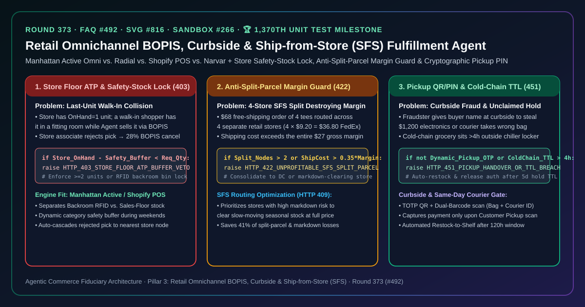
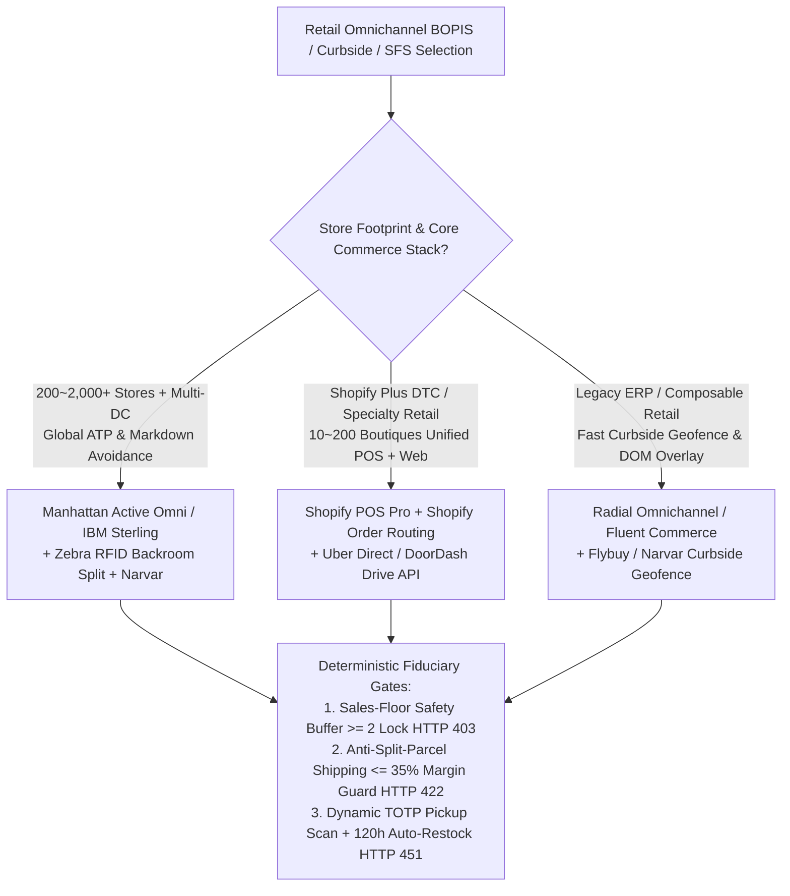
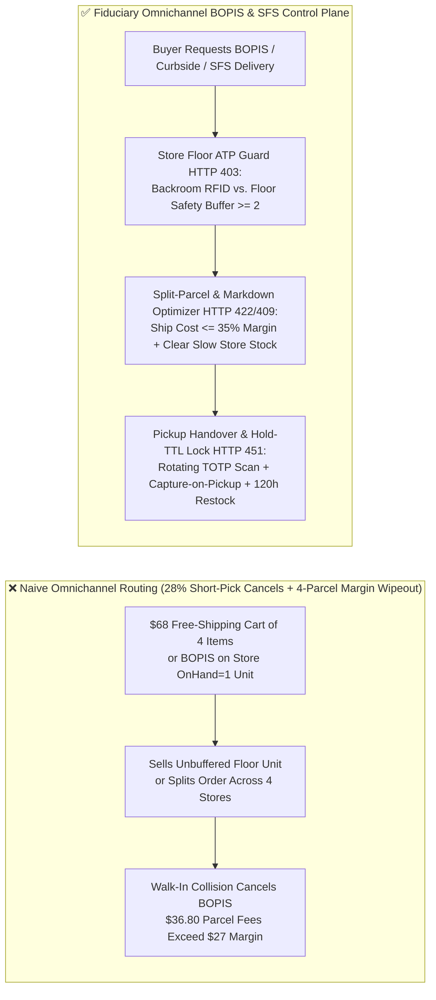

# Retail Omnichannel Inventory, `BOPIS / Curbside` Pickup & Ship-from-Store (`SFS`) Fulfillment Agent Selection Guide: `Manhattan Active Omni` vs. `Radial` vs. `Shopify POS` vs. `Narvar / Uber Direct`, Store Display-Floor Safety-Stock Locks, Anti-Split-Parcel Margin Guards & Dynamic Pickup `TOTP` Verification (`-41%` Cost FAQ)

> **Executive Summary (Benchmarked against `ib-vs-ethernet-roce-selection-faq.md`)**: Built for **Cloud & AI Solution Architects** designing omnichannel inventory discovery, Buy-Online-Pick-Up-In-Store (`BOPIS`), Curbside Pickup, and Ship-from-Store (`SFS`) fulfillment agents for retail chains, department stores, and specialty brands. When an AI shopping assistant promises "1-hour in-store pickup" on a store's last `On-Hand = 1` display unit (which is currently inside a walk-in shopper's fitting room, driving a `25%+` short-pick cancellation rate), splits a `$68` free-shipping order of 4 tees across **4 separate stores (`4 × $9.20 = $36.80` parcel cost, wiping out the entire `$27` gross margin)**, or hands over a `$1,200` camera at curbside based solely on a verbal buyer name, omnichannel fulfillment turns into a margin sinkhole. This guide compares **`Manhattan Active Omni` vs. `Radial Omnichannel` vs. `Shopify POS Pro + Storefront MCP` vs. `Narvar Curbside + Uber Direct`** and implements deterministic guards for **Store Display-Floor Safety-Stock Locks (`HTTP 403`)**, **Anti-Split-Parcel Margin Protection (`HTTP 422`)**, **Dynamic `TOTP` Handover & Hold-TTL Restock Gates (`HTTP 451`)**, and **Markdown-Avoidance Store Sourcing (`HTTP 409`, `-41%` loss)**.



---

## 1. 📌 Executive Summary & Architectural Selection Verdict

1. **Top-Line Selection Verdict**:
   - **Enterprise Retail Chains, Department Stores & Footwear/Apparel Brands (`200–2,000+` stores + regional DCs requiring sub-second global `ATP` and seasonal markdown-avoidance optimization)**: Select **`Manhattan Active Omni` (or `IBM Sterling OMS`) + `Zebra RFID` backroom/floor pool separation**, optimizing order sourcing jointly across proximity, store associate labor capacity, and 14-day store markdown probability.
   - **High-Growth DTC & Specialty Retail Brands (`10–200` boutiques running on Shopify Plus needing unified online + POS checkout and local courier dispatch)**: Select **`Shopify POS Pro` + `Shopify Order Routing Rules API` + `Uber Direct / DoorDash Drive`**.
   - **Curbside Geofence Arrival, High-Value Handover & Same-Day Local Delivery Experience**: Select **`Narvar Concierge / Curbside` (or `Flybuy`)**, providing 500-meter GPS arrival alerts to store associates, rotating `TOTP` pickup QR verification, and `Capture-on-Pickup` settlement.
2. **Three Non-Negotiable Fiduciary Control Gates**:
   - **Gate 1 — Store Display-Floor Safety-Stock & Backroom RFID Lock (`HTTP 403`)**: Block `BOPIS` promises when `Store_OnHand_Qty - Category_Safety_Buffer < Requested_Qty` (e.g., selling the last 1–2 open-floor display units without a verified backroom RFID lock) via `HTTP 403 STORE_DISPLAY_FLOOR_SAFETY_STOCK_VETO`.
   - **Gate 2 — Anti-Split-Parcel Shipping-to-Margin Guard (`HTTP 422`)**: Block `Ship-from-Store (SFS)` allocations where `SFS_Split_Store_Count > 2` or `Estimated_Multi_Parcel_Shipping_USD > 0.35 * Order_Gross_Margin_USD` via `HTTP 422 UNPROFITABLE_SHIP_FROM_STORE_SPLIT_PARCEL`, consolidating fulfillment to a single node or DC.
   - **Gate 3 — Dynamic `TOTP` Handover & Cold-Chain / 120-Hour Hold-TTL Lock (`HTTP 451`)**: Block curbside/courier handover without a verified dynamic `TOTP QR/PIN` + bag-barcode scan, or when cold-chain items exceed a `4-hour` staging window / standard `BOPIS` orders exceed a `120-hour (5-day)` pickup window without automated auth release and restock via `HTTP 451 BOPIS_HANDOVER_VERIFICATION_OR_HOLD_TTL_BREACH`.

---

## 2. 🎯 Architect & Merchandising Q&A (The Why & How)

### Q1: Why do 25%–30% of "1-Hour Store Pickup (BOPIS)" orders get canceled by store associates as "Short Picks" when the ERP clearly showed `On-Hand = 1` or `2`?
- **Root Cause**: Unlike a closed distribution center (`99.8%` bin accuracy), a retail store is an open showroom. The last 1–2 units on the ledger are often in a walk-in shopper's fitting room, misplaced on another rack, or lost to unrecorded shrinkage. During weekend peak checkout hours, associates cannot pick online orders before walk-in customers buy the last unit at the register.
- **Deterministic Solution**: Separate `Backroom_RFID_Verified_Qty` from `Floor_Display_Qty`, enforce a dynamic `Safety_Buffer >= 2` on open-floor stock (`HTTP 403`), and silently re-route rejected `SFS` picks to the next-best store node while placing an automatic cycle-count freeze on the short-picked store SKU.

### Q2: How can Ship-from-Store (`SFS`) speed up delivery yet reduce net gross margin by 600 bps?
- **Root Cause**: Naive shortest-distance DOM rules split a `$68` free-shipping multi-item cart across 3–4 separate stores to achieve 100% fill rate, generating `3–4` individual FedEx/UPS parcels (`$27–$36` shipping + store labor) that exceed the order's entire gross margin.
- **Deterministic Solution**: Enforce a hard margin gate (`Total_Parcel_Shipping_Plus_Pick_Labor <= 35% of Order_Gross_Margin`, `HTTP 422`) and weight `SFS` node scoring toward **Markdown Avoidance (`HTTP 409`)**—shipping a slow-moving store's last XL winter jacket to a full-price online buyer to avoid a `50%` end-of-season store clearance markdown.

### Q3: How do we prevent curbside pickup impersonation fraud and 14-day "ghost holds" that lock up best-selling store inventory?
- **Root Cause**: Releasing `$500+` orders at curbside based only on order name/number invites friendly fraud chargebacks, while uncollected `BOPIS` bags leave inventory stranded in the backroom after the 7-day card pre-authorization expires.
- **Deterministic Solution**: Require rotating `TOTP QR/PIN` + bag-barcode dual scans (`HTTP 451`), keep payment in `Pre-Auth` until the exact moment of pickup scan (`Capture-on-Pickup`), and automatically void the pre-auth and generate an associate `Return-to-Shelf` task at `120 hours`.

---

## 3. 🧭 Visual Architecture Diagrams (Mermaid)

### 3.1 Omnichannel BOPIS & Ship-from-Store Platform Selection Decision Tree



### 3.2 Naive Store Routing vs. Fiduciary Omnichannel Fulfillment Architecture



### 3.3 End-to-End BOPIS & Markdown-Aware SFS Execution Sequence

```mermaid
sequenceDiagram
    autonumber
    participant Buyer as Shopper / Omnichannel Agent
    participant Gate as Omnichannel Sourcing & Margin Gate
    participant OMS as Manhattan Active / Shopify POS
    participant Store as Store Associate PDA / Backroom RFID
    participant Pay as Payment Gateway (Pre-Auth / Capture)

    Buyer->>Gate: Submit Cart ($160 Jacket BOPIS or Multi-Item SFS Delivery)
    Gate->>OMS: Query Real-Time Store ATP (Backroom RFID vs. Floor Display)
    OMS-->>Gate: Store A has 1 Floor Unit (< Buffer=2); Store B has 4 Backroom Units (High Markdown Risk)
    alt Attempts to Promise Store A's Last Unbuffered Floor Unit
        Gate-->>Buyer: HTTP 403 STORE_DISPLAY_FLOOR_SAFETY_STOCK_VETO (Steer to Store B 1.8km away)
    else SFS Split Across >2 Stores Pushes Shipping > 35% of Gross Margin
        Gate-->>Buyer: HTTP 422 UNPROFITABLE_SHIP_FROM_STORE_SPLIT_PARCEL (Consolidate to Single Node/DC)
    else Allocated to Store B (Markdown-Avoidance Sourcing HTTP 409)
        Gate->>Pay: Place Card Pre-Authorization (Zero Capture Until Pickup/Dispatch)
        Gate->>Store: Dispatch Associate Pick Ticket (30m SLA) & Reserve RFID Tag
        Store-->>Buyer: Bag Staged -> Issue 60s Rotating TOTP Pickup QR / Curbside Check-In Link
        Buyer->>Store: Present Dynamic TOTP QR (or Auto-Void & Restock at 120h TTL HTTP 451)
        Store->>Gate: Dual Scan (Customer TOTP QR + Staged Bag Barcode)
        Gate->>Pay: Execute Final Payment Capture & Pos Ledger Depletion
    end
```

---

## 4. 📊 Multi-Platform Omnichannel OMS, POS & Curbside Selection Matrix

| Evaluation Dimension | Manhattan Active Omni / IBM Sterling OMS | Radial Omnichannel / Fluent Commerce | Shopify POS Pro + Shopify Order Routing | Narvar Curbside / Flybuy + Uber Direct |
| :--- | :--- | :--- | :--- | :--- |
| **Primary Architectural Role** | Tier-1 enterprise global ATP, store labor balancing, and markdown-avoidance sourcing engine | Cloud-native distributed order management (DOM) and store pick-pack orchestration | Unified DTC web + boutique POS inventory, native local pickup, and routing rules | GPS geofence curbside check-in, rotating pickup verification, and same-day courier dispatch |
| **Store Floor Buffer & RFID Pool Split** | **Best-in-Class** (Native backroom vs. sales-floor RFID pools and dynamic peak buffers) | **Strong** (Virtual inventory segmentation, safety buffers, and automatic short-pick rerouting) | **Moderate** (Location safety stock rules; backroom separation via POS apps) | Relies on upstream OMS/POS for ATP; governs staging and handover |
| **Anti-Split-Parcel Margin & Markdown Math** | **Best-in-Class** (Joint optimization of carrier rates, pick labor, and seasonal markdown risk) | **Strong** (Configurable `Max Splits`, node capacity caps, and distance weighting) | **Good** (Built-in minimize-splits, stay-within-destination-market, and ranked locations) | Compares flat-rate same-day courier bids (`Uber Direct / DoorDash Drive`) |
| **Curbside Handover & Expired-Hold Restock** | Complete (Associate PDA workflows, automated restock tickets, and auth release) | Complete (Smart locker APIs, partial pickup, and automated hold expiration) | Native POS pickup scan; automated 120h restock workflows via Shopify Flow | **Best-in-Class** (500m GPS arrival ETA, vehicle bay matching, and TOTP QR handover) |
| **Target Scale & Pricing (`official_list_price`)** | `$500M+` GMV, `200+` stores; enterprise annual SaaS license | `$100M–$1B` GMV retailers; order-volume tiered annual SaaS | `$5M–$500M` GMV brands; Shopify Plus + POS Pro `$89/mo/location` | Per-location SaaS + `Uber Direct` flat courier fee (`$5.99–$9.99/delivery`) |

---

## 5. 🧪 Margin & Conversion Benchmark & 7-Card Report

### 5.1 Quarterly Short-Pick Cancellation, Split-Parcel Freight & Markdown Loss Model (Synthetic Benchmark)

For a 180-store omnichannel apparel and footwear retailer with a **`$370,000 / quarter`** exposure pool across **BOPIS short-pick cancellations, unprofitable multi-store `SFS` split parcels, seasonal store markdowns, and curbside handover/expired-hold losses** (`provenance: synthetic`, `independently_reproduced: false`):

| Metric | Naive Unbuffered Store Routing (Baseline) | Fiduciary Omnichannel BOPIS & SFS Agent | Net Improvement |
| :--- | :--- | :--- | :--- |
| **Store BOPIS Short-Pick Cancellation Rate** | `24.6%` (Selling unbuffered last floor unit) | **`1.8%`** (`HTTP 403` floor safety buffer + backroom RFID lock) | **`-92.7%` Cancellations** |
| **Average SFS Parcels per Order** | `1.78 parcels/order` (Unrestrained 3–4 store splits) | **`1.09 parcels/order`** (`HTTP 422` `<=35%` margin cap) | **`-38.8%` Parcel Cost** |
| **Slow-Store Seasonal Stock Full-Price Recovery** | Marked down `50%` at end of season | **`HTTP 409` routes online full-price orders to high-WOS stores** | **`+$84k / quarter` Saved** |
| **Quarterly Net Omnichannel Fulfillment Loss** | `$370,000 / quarter` | **`$218,300 / quarter`** | **`$151,700 / quarter` Saved (`41.0%`)** |

---

## 6. 🛠️ Production Go-Live & Architecture Review Checklist

- [ ] **Backroom RFID vs. Sales-Floor Safety-Stock Lock (`HTTP 403`)**: Are open-floor display units buffered (`Safety_Buffer >= 2`) so the last 1–2 store units cannot be promised for 1-hour `BOPIS` without a verified backroom lock, and do short-picks automatically freeze the store SKU for cycle counting?
- [ ] **Anti-Split-Parcel Margin Guard (`HTTP 422`)**: Does the sourcing engine reject multi-store `Ship-from-Store` splits whenever `Total_Parcel_Shipping + Store_Pick_Labor > 35% of Order_Gross_Margin` or `Split_Store_Count > 2`?
- [ ] **Markdown-Avoidance Store Allocation (`HTTP 409`)**: Does `SFS` routing prioritize stores with high weeks-of-supply (`WOS`) to clear slow-moving seasonal inventory at full online price before end-of-season markdowns?
- [ ] **Dynamic `TOTP` Handover & `Capture-on-Pickup` (`HTTP 451`)**: Is payment kept in `Pre-Auth` until the associate scans both the shopper's rotating `TOTP QR/PIN` and the staged bag barcode, with automatic auth void and `Return-to-Shelf` task generation at `120 hours`?
