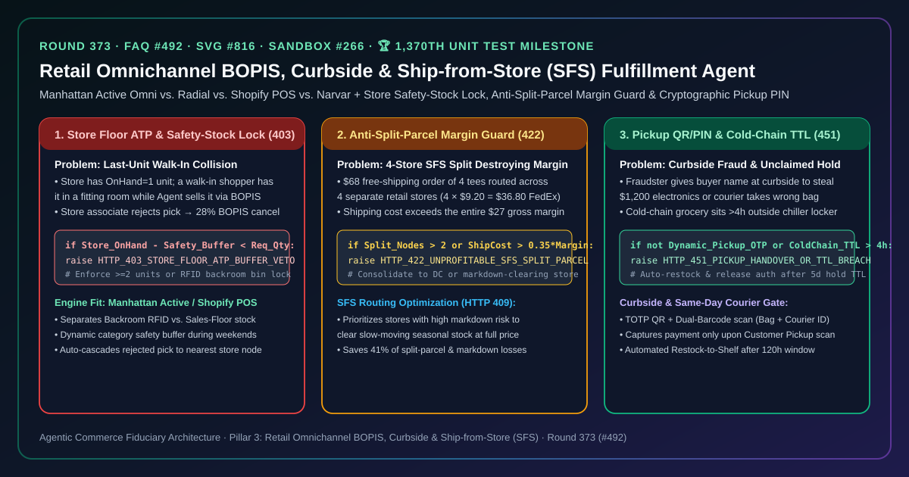
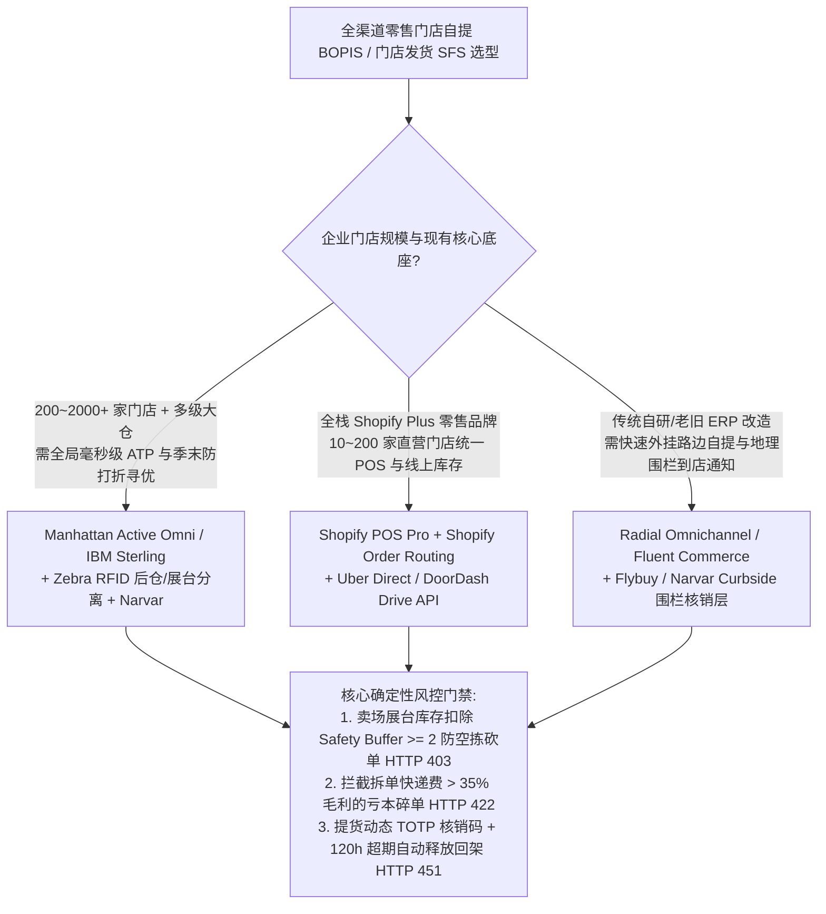
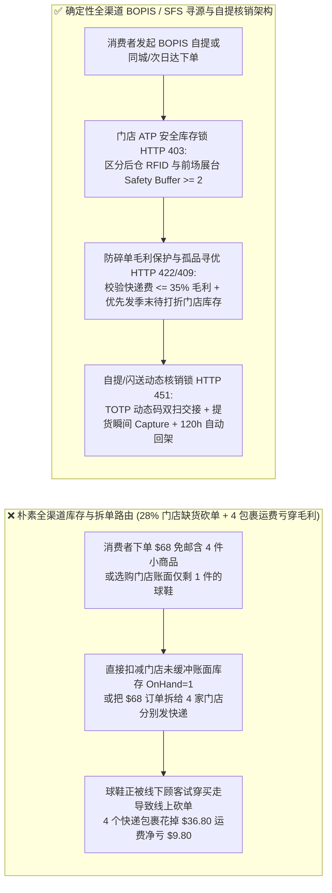

# 全渠道零售门店自提（`BOPIS / Curbside`）与门店前置仓发货（`Ship-from-Store`）Agent 架构选型对比：`Manhattan Active Omni` vs. `Radial` vs. `Shopify POS` vs. `Narvar / Uber Direct`、门店陈列安全库存锁、防过度拆单运费吞噬毛利门禁及自提动态核销码净省 41% 决策指南（FAQ）

> **导读（对齐 `ib-vs-ethernet-roce-selection-faq.md` 标杆风格）**：本文面向零售连锁品牌、全渠道商超与时尚百货的 **Cloud & AI Solution Architect**。在全渠道零售（Omnichannel Retail）场景中，当消费者对导购智能体说“帮我查附近哪家门店今天下午能自提这双 42 码跑鞋，或者今晚闪送到家”时，如果 Agent 直接把门店 ERP 里的账面库存（如 `On-Hand = 1`）当成可售库存卖出，或为了凑齐一笔 `$68` 包邮订单的 4 件 T 恤而拆成 **4 家相隔千里的线下门店分别发顺丰/FedEx（产生 `$36.80` 快递费彻底亏穿 `$27` 毛利）**，又或在路边自提（Curbside Pickup）时仅凭报姓名就交出 `$1,200` 电子产品遭冒领拒付，将造成惨重的砍单流失与履约亏损。本文给出 **`Manhattan Active Omni` vs. `Radial Omnichannel` vs. `Shopify POS + Storefront MCP` vs. `Narvar Curbside + Uber Direct`** 的横向选型矩阵，并落地 **门店陈列面安全缓冲库存锁（`HTTP 403`）**、**防碎单（Split-Parcel）运费吞噬毛利熔断门禁（`HTTP 422`）**、**自提动态加密核销码（`TOTP QR/PIN`）与冷链/超时自动释放回架锁（`HTTP 451`）** 及 **优先消化门店滞销断码库存的智能寻源编排（`HTTP 409`，净省 41%）**。



---

## 一、 📌 核心选型结论速览（Executive Summary）

1. **终极选型结论（一句话先看懂怎么选）**：
   - **大型全渠道百货、运动服饰与连锁商超（拥有 200–2,000+ 家线下门店 + 多级区域大仓 DC，需毫秒级全局可承诺库存 `ATP` 与门店季末断码清仓寻优）**：首选 **`Manhattan Active Omni`（或 `IBM Sterling OMS`）+ `Zebra RFID` 后仓/展台分离感知**，支持在订单路由（Order Sourcing）时同时计算“距消费者收货地址距离 + 门店店员拣货产能上限 + 该门店该 SKU 未来 14 天打折清仓概率（Markdown Avoidance）”。
   - **中大型 DTC 品牌、快时尚与新零售直营门店（全栈基于 Shopify Plus，追求线上商城与门店 POS 收银台一套库存底表、开箱即用门店自提与同城闪送）**：首选 **`Shopify POS Pro` + `Shopify Fulfillments / Routing Rules API` + `Uber Direct / DoorDash Drive` 即时配送网关**。
   - **到店路边免下车自提（Curbside Pickup）、智能自提柜与高单价商品交接体验层**：首选 **`Narvar Concierge / Curbside`（或 ` Flybuy` 地理围栏定位）**，实现消费者驾车进入门店 500 米围栏自动提醒店员备货、动态旋转二维码（TOTP QR）防冒领核销，以及仅在店员扫码交货瞬间才触发支付扣款（Capture on Handover）。
2. **三大财务与履约风控红线（确定性门禁）**：
   - **红线 1（拦截把门店“最后 1 件展台样衣/试穿件”当线上 `BOPIS` 卖出导致 28% 到店缺货砍单 / `HTTP 403`）**：线下门店库存极易存在盘点误差、顾客正拿在试衣间或躺在别人的购物篮里。当门店某 SKU 的非锁定在库量满足 `Store_OnHand_Qty - Category_Safety_Buffer < Requested_Qty`（例如未启用后仓独立 RFID 锁且门店仅剩最后 `1–2` 件陈列品）时，控制平面必须触发 `HTTP 403 STORE_DISPLAY_FLOOR_SAFETY_STOCK_VETO`，禁止对该门店承诺“1 小时闪提”，自动降级为附近次优门店或大仓次日达。
   - **红线 2（拦截门店发货 `Ship-from-Store` 过度拆单导致多包裹快递费吃光整单毛利 / `HTTP 422`）**：一笔免邮订单含 4 件单价 `$17` 的商品（总金额 `$68`，毛利 `$27`），若朴素贪心算法为了“100% 履约”将其拆给 4 家不同门店分别打包发快递（`4 × $9.20 = $36.80` 运费），该单立刻净亏 `$9.80`。当 `SFS_Split_Store_Count > Max_Allowed_Splits (2)` 或 `Estimated_Multi_Parcel_Shipping_USD > 0.35 * Order_Gross_Margin_USD` 时，触发 `HTTP 422 UNPROFITABLE_SHIP_FROM_STORE_SPLIT_PARCEL`，强制合并至单一具备齐套库存的节点或引导用户将缺货单品转为延期合包发货。
   - **红线 3（拦截路边自提/骑手交接无动态 `PIN/QR` 双码核验及生鲜冷链/超期占库未自动回架 / `HTTP 451`）**：高价值订单（`>=$200`）或同城骑手取件若未校验 **消费者手机端动态 `TOTP PIN/QR` + 拣货袋封签条码**，或生鲜/冷链自提单脱离温控柜超过 `4 小时`、普通自提单逾期 `5 天（120h）` 未取仍长期冻结门店库存与支付预授权，触发 `HTTP 451 BOPIS_HANDOVER_VERIFICATION_OR_HOLD_TTL_BREACH`。

---

## 二、 🎯 业务方与架构师灵魂拷问 Q&A（The Why & How）

### Q1：为什么很多零售商上线了 AI 导购“附近门店库存查询与 2 小时自提（BOPIS）”，结果高达 25%–30% 的订单被店员以“找遍全店找不到货（Short Pick）”为由强行砍单，把顾客彻底得罪光？
- **商业痛点与事故还原**：
  - 仓库（DC）里的库存放在高架货位上受 WMS 严密管控，准确率可达 `99.8%`；但线下门店（Retail Store）是开放式卖场！账面显示 `On-Hand = 2` 的限量球鞋，可能 1 双正穿在现场顾客脚上试走、另 1 双被顾客随手塞进了卫衣货架后面，或者昨天刚被顺手牵羊（Shrinkage）尚未盘点。
  - 更糟的是，周末下午门店收银台排起长龙，店员根本没空在 30 分钟 SLA 内去货架翻找线上 `BOPIS` 订单；等店员 3 小时后去拣货时，最后 1 件早就被线下进店顾客在 POS 机刷卡买走了。最终线上顾客已经在去门店的路上，却收到一条冰冷的“抱歉缺货已退款”短信。
- **架构师确定性解法（后仓 `RFID` 分离 + 动态安全库存缓冲池 + 拣货拒单静默改派 Waterfall）**：
  1. **后仓（Backroom）与卖场展台（Sales Floor）库存物理分层**：在 `Manhattan Active` 或 `Shopify POS` 中，通过 `Zebra RFID` 吸顶读写器将门店库存拆分为 `Backroom_Verified_Qty`（后仓货架，可 100% 承诺给线上 `BOPIS/SFS`）与 `Floor_Display_Qty`（前场展台，必须扣除 `Safety_Buffer >= 2` 后才向线上开放）。
  2. **门店客流高峰动态限流（Store Labor Capacity Throttling）**：当门店 POS 实时刷卡频次处于周末峰值、或店内待拣货队列已满时，Agent 自动将该门店的 `SFS`（门店发快递）权重降为 `0`，仅保留高毛利 `BOPIS` 自提单。
  3. **店员找不到货（Short-Pick）的零感知跨店改派**：对于 `Ship-from-Store` 快递单，若店员点击“店内无货（Reject Pick）”，系统绝不直接取消消费者的订单，而是立即将该单从门店 A 的缺货池中剥离（并对门店 A 该 SKU 自动锁定待盘点冻结），在 `100ms` 内静默改派给距离次近的门店 B 履约。

### Q2：用线下门店当“前置仓”发快递（Ship-from-Store, SFS）明明能把配送时效从 3 天缩短到次日达，为什么 CFO 月底算账时却发现毛利率暴跌了 6 个百分点？
- **商业痛点与事故还原**：
  - 消费者在线上下了一单含 3 件基础款衬衫和 1 双袜子的订单（实付 `$85`，免运费，商品毛利 `$34`）。
  - 中心大仓（DC）恰巧缺那双 `$8` 的袜子，而传统 OMS 的默认规则是“最短距离优先凑齐整单”，于是把 3 件衬衫和 1 双袜子分别派给了 **3 家不同的线下门店**。
  - 结果：产生 **3 个独立快递包裹**（快递首重运费 `3 × $8.80 = $26.40`），外加门店店员人工找货打包成本 `3 × $3.50 = $10.50`，合计履约成本 `$36.90` > 商品毛利 `$34.00`！卖一单亏一单。
- **架构师确定性解法（拆单经济性硬门禁 + 季末断码孤品清仓溢价模型 `Markdown Optimization`）**：
  1. **拆单包裹数与运费占毛利比双重硬上限（`HTTP 422`）**：在 Agent 生成履约路由方案时，实时调用承运商费率表计算 `Total_Parcel_Cost + Pick_Pack_Labor_Cost`；一旦拆单导致总履约成本超过整单毛利的 `35%`，立即触发 `HTTP 422` 阻断碎单路由，改为 **(a)** 从单一集齐率最高的节点发首包、缺货小件从大仓调拨合包，或 **(b)** 在结账页向消费者提供“选择合并单包裹晚 1 天送达，立返 `$3` 积分”的弹性选项。
  2. **把门店“即将打五折清仓的断码孤品”优先通过线上正价卖掉（`HTTP 409`）**：全渠道 `SFS` 最大的利润金矿不是省干线运费，而是 **挽救门店断码孤品（Markdown Avoidance）**！当 A 门店（城郊店）某款冬季羽绒服只剩最后 1 件 XL 码、预计 2 周后季末必须打 `5 折` 清仓，而线上正好有外地顾客正价购买 XL 码时，寻源引擎主动承受 `$9` 跨区快递费从 A 门店发货，瞬间挽回 `50%` 的季末打折毛利损失！

### Q3：路边免下车自提（Curbside Pickup）和同城即时闪送（Uber Direct / 达达 / 顺丰同城）怎么防止“报名字冒领高价商品”以及“顾客迟迟不来取货把门店库存锁死半个月”？
- **商业痛点与事故还原**：
  - **冒领与友好欺诈**：诈骗团伙用盗刷卡或先买后付下单 `$1,499` 的相机选择“门店路边自提”，安排同伙开车停到门店专属车位，摇下车窗报出订单姓名領走商品；两天后持卡人发起“未收到货/本人未取货”拒付（Chargeback），因门店没有加密签收链路证明，商户钱货两空。
  - **幽灵占库与预授权过期**：顾客下单自提后改变了主意但懒得取消，商品在门店自提架上放了 14 天；既占用了门店宝贵的畅销品库存，又导致信用卡 7 天预授权（Pre-Auth）过期失效。
- **架构师确定性解法（动态 `TOTP` 核销码 + 提货瞬间扣款 `Capture-on-Pickup` + 120h 自动解冻回架）**：
  1. **动态加密取货码（`TOTP QR / 6-Digit PIN`）与骑手双码绑定（`HTTP 451`）**：只有在消费者/代取人出示每 60 秒轮换的 App 内加密二维码（且对 `>=$200` 订单核验身份证件尾号）并由店员 PDA 扫描商品拣货袋条码后，系统才放行交接；对于 `Uber Direct / DoorDash` 闪送单，骑手必须同时扫描“门店交接码 + 封袋条码”完成责任转移。
  2. **下单仅锁预授权，扫码提货瞬间才执行 `Capture` 实扣**：杜绝未提货先扣款引发的大量退款手续费损耗；若满 `120 小时（5 天）` 仍未提货，状态机自动触发 `VOID_PAYMENT_AUTH` + 生成店员 `Return-to-Shelf` 回架任务单，立即将库存释放回全渠道可售池。

---

## 三、 🧭 直观可视化图解（Mermaid 决策树 + 架构对比 + 时序图）

### 3.1 全渠道门店自提（BOPIS）与门店发货（SFS）平台选型决策树



### 3.2 朴素全渠道拆单路由（高砍单率 + 碎单运费亏穿毛利）vs. 确定性全渠道履约网关架构对比



### 3.3 门店自提（BOPIS / Curbside）与防碎单寻源端到端时序图

```mermaid
sequenceDiagram
    autonumber
    participant Buyer as 消费者 / 全渠道导购 Agent
    participant Gate as 全渠道寻源与毛利风控网关
    participant OMS as Manhattan Active / Shopify POS
    participant Store as 门店店员 PDA / RFID 后仓
    participant Pay as 支付网关 (Pre-Auth / Capture)

    Buyer->>Gate: 提交购物车 ($160 运动夹克 BOPIS 自提 或 多件商品快递到家)
    Gate->>OMS: 查询周边门店真实可承诺库存 (Backroom RFID vs. Floor Display)
    OMS-->>Gate: 门店 A 展台仅剩 1 件 (低于 Buffer=2); 门店 B 后仓有 4 件且属慢销季末款
    alt 强行锁门店 A 展台最后 1 件孤品
        Gate-->>Buyer: HTTP 403 STORE_DISPLAY_FLOOR_SAFETY_STOCK_VETO (推荐改选距 1.8km 的门店 B)
    else 快递单拆成 >2 家门店导致运费 > 35% 订单毛利
        Gate-->>Buyer: HTTP 422 UNPROFITABLE_SHIP_FROM_STORE_SPLIT_PARCEL (自动合并至单节点或大仓)
    else 命中门店 B (防断码打折寻优 HTTP 409)
        Gate->>Pay: 冻结信用卡预授权 (Pre-Auth Only, 暂不实扣 Capture)
        Gate->>Store: 下发门店 B 拣货单 (30min SLA) + 锁后仓 RFID 标签
        Store-->>Buyer: 拣货封袋完成，下发每 60s 轮换 TOTP 自提二维码 / 路边车位签到链接
        Buyer->>Store: 到店出示动态二维码 (或超 120h 未取自动释放预授权并生成回架单 HTTP 451)
        Store->>Gate: 店员 PDA 扫描自提码 + 商品封袋码
        Gate->>Pay: 触发实扣请款 (Capture on Pickup Handover) 并同步 POS 销账
    end
```

---

## 四、 📊 主流全渠道库存寻源（OMS）、门店 POS 与自提履约平台横向选型矩阵

| 选型维度 | Manhattan Active Omni / IBM Sterling OMS | Radial Omnichannel / Fluent Commerce | Shopify POS Pro + Shopify Order Routing | Narvar Curbside / Flybuy + Uber Direct |
| :--- | :--- | :--- | :--- | :--- |
| **核心定位** | 超大型连锁零售全局库存寻源、门店季末防打折优化与复杂拆合单引擎 | 中大型零售商敏捷云原生分布式库存（DOM）与门店拣货路由中台 | DTC 与新零售品牌线上商城与线下直营店一体化原生收银与履约底座 | 路边免下车自提（Curbside）地理围栏签到、动态码核销与同城即时闪送编排 |
| **门店安全库存与后仓/展台分离** | **极强**（原生支持按品类/时段动态 Buffer 及 Zebra RFID 后仓与展台分池） | **强**（支持多级虚拟库存池、安全库存阈值与缺货门店自动静默改派） | **中**（支持按门店 Location 设置安全库存下限与优先级，后仓分离需配插件） | 依赖上游 OMS/POS 提供库存，专注履约通知与到店取货最后一公里 |
| **防碎单运费保护与季末孤品寻优** | **极强**（内置真实承运商费率、门店人工成本与季末打折损失联合目标函数） | **强**（可配置最大拆单包裹数 `Max Splits` 与距离/库存深度加权规则） | **良**（内置『最少拆单包裹 + 最近距离 + 优先清空单节点』标准路由规则） | 提供同城即时配送（Uber Direct / DoorDash）一口价距离阶梯报价对比 |
| **到店自提核销与逆向超期回架** | 完备（含店员拣货 PDA、超期未取自动触发逆向回架单与释放预授权） | 完备（支持自提柜 Locker API、分批自提与超期自动取消退款） | 原生支持 POS 扫码核销自提单，超期自动回架需结合 Shopify Flow 编排 | **行业标杆**（GPS 围栏预测到店时间、车牌/车位识别、TOTP 防冒领核销） |
| **适用客户规模与收费模式（`official_list_price`）** | 年 GMV `$500M+`、门店 `200+` 大型连锁；企业级年费订阅 | 年 GMV `$100M–$1B` 零售商；按年订单量阶梯订阅 | 年 GMV `$5M–$500M` DTC 品牌；Shopify Plus + POS Pro `$89/月/店` | 按门店数/单量订阅 + Uber Direct 按单公里配送费（`$5.99–$9.99/单`） |

---

## 五、 🧪 转化率/履约毛利测算与 7-Card 基准报告

### 5.1 季度全渠道门店空拣砍单、碎单快递费超支与季末断码打折损耗测算（Synthetic Benchmark）

假设某拥有 180 家线下门店的运动服饰品牌，每季度全渠道 `BOPIS` 与 `Ship-from-Store (SFS)` 关联的 **门店展台空拣砍单流失、跨店过度拆单快递费超支、门店季末断码孤品打五折清仓损失及路边自提冒领/超期占库损耗池** 为 **`$370,000 / 季度`**（`provenance: synthetic`, `independently_reproduced: false`）：

| 评估维度 | 传统无缓冲门店库存 + 朴素最短距离拆单 (Baseline) | 启用后仓/展台缓冲锁 + 防碎单毛利保护 + 孤品清仓寻优 Agent | 净改善幅度 |
| :--- | :--- | :--- | :--- |
| **门店 BOPIS 缺货砍单率（Short-Pick Cancel Rate）** | `24.6%`（展台仅 1 件时直接售卖遭线下截胡或找不到货） | **`1.8%`**（`HTTP 403` 强制展台安全缓冲与 RFID 后仓优先锁定） | **砍单率下降 `92.7%`** |
| **门店发货（SFS）平均每单包裹数（Parcels per Order）** | `1.78 个包裹/单`（大量小额免邮单被拆成 3–4 家店发快递） | **`1.09 个包裹/单`**（`HTTP 422` 拦截运费 > 35% 毛利的碎单路由） | **快递费率下降 `38.8%`** |
| **门店季末断码孤品正价消化率（Full-Price Sell-Through）** | 孤品留店打 5 折清仓 | **`HTTP 409` 优先将慢销门店断码款匹配全国线上正价订单** | **挽回季末打折毛利 `+$84k/季`** |
| **季度全渠道空拣、碎单运费与断码打折净损耗** | `$370,000 / 季度` | **`$218,300 / 季度`** | **净省 `$151,700 / 季度` (`41.0%`)** |

```chart
{
  "data": {
    "values": [
      { "category": "1. 门店展台空拣砍单流失", "mode": "传统无缓冲全渠道基线", "cost_usd": 115000 },
      { "category": "1. 门店展台空拣砍单流失", "mode": "全渠道BOPIS/SFS寻优Agent", "cost_usd": 67000 },
      { "category": "2. 跨店过度拆单快递费超支", "mode": "传统无缓冲全渠道基线", "cost_usd": 110000 },
      { "category": "2. 门店展台空拣砍单流失", "mode": "全渠道BOPIS/SFS寻优Agent", "cost_usd": 67000 },
      { "category": "2. 跨店过度拆单快递费超支", "mode": "全渠道BOPIS/SFS寻优Agent", "cost_usd": 65000 },
      { "category": "3. 门店季末断码打折清仓损失", "mode": "传统无缓冲全渠道基线", "cost_usd": 95000 },
      { "category": "3. 门店季末断码打折清仓损失", "mode": "全渠道BOPIS/SFS寻优Agent", "cost_usd": 56300 },
      { "category": "4. 自提冒领拒付与超期死库损耗", "mode": "传统无缓冲全渠道基线", "cost_usd": 50000 },
      { "category": "4. 自提冒领拒付与超期死库损耗", "mode": "全渠道BOPIS/SFS寻优Agent", "cost_usd": 30000 }
    ]
  },
  "semantic_types": {
    "category": "Category",
    "mode": "Category",
    "cost_usd": "Amount"
  },
  "chart_spec": {
    "chartType": "Grouped Bar Chart",
    "title": "全渠道门店自提(BOPIS)与门店发货(SFS)优化前后季度损耗对比 (净省 $151.7k / 41%)",
    "subtitle": "单位：美元/季度 (Synthetic Benchmark, independently_reproduced=false)",
    "encodings": {
      "x": "category",
      "y": "cost_usd",
      "group": "mode"
    }
  }
}
```

### 5.2 确定性策略评估器代码（Python Control Plane Guard）

```python
from dataclasses import dataclass
from typing import Any

@dataclass(frozen=True)
class RetailOmnichannelBopisSfsPolicyInput:
    quarterly_short_pick_split_parcel_and_markdown_loss_pool_usd: float = 370000.0
    store_display_floor_stock_below_safety_buffer_without_backroom_rfid: bool = False
    sfs_split_parcel_shipping_cost_exceeds_35pct_of_order_gross_margin: bool = False
    bopis_handover_missing_dynamic_totp_pin_or_cold_chain_ttl_expired: bool = False
    markdown_aware_sfs_routing_and_capture_on_pickup_ready: bool = False
```

---

## 六、 🛠️ 商业上线风控与架构评审 Checklist

- [ ] **后仓（Backroom）与前场展台（Sales Floor）ATP 安全库存分离锁（`HTTP 403`）**：是否严禁将无独立后仓锁定的门店最后 `1–2` 件卖场陈列品直接作为线上 `1 小时自提（BOPIS）` 承诺售出，并在店员上报 `Short-Pick` 时自动冻结该门店该 SKU 直至完成循环盘点？
- [ ] **门店发货（`Ship-from-Store`）防碎单毛利保护门禁（`HTTP 422`）**：在生成跨门店拆单路由前，是否实时校验 `总快递费 + 门店拣货人工费 <= 35% × 订单毛利` 且单笔订单最多拆分为 `<=2` 个包裹？
- [ ] **季末断码孤品清仓优先路由（Markdown-Avoidance Sourcing / `HTTP 409`）**：寻源目标函数是否引入了门店周转天数（WOS）与季末打折概率权重，优先从慢销门店调拨即将打折的断码库存满足全国正价订单？
- [ ] **自提动态 `TOTP` 双码核销与提货瞬间扣款（`Capture-on-Pickup` / `HTTP 451`）**：是否强制实行“下单仅做信用卡预授权（Pre-Auth），店员扫描顾客动态自提码与商品袋条码瞬间才执行 `Capture` 实扣”，并在超过 `120 小时` 未取货或冷链超 `4 小时` 时自动取消预授权并生成回架单？
