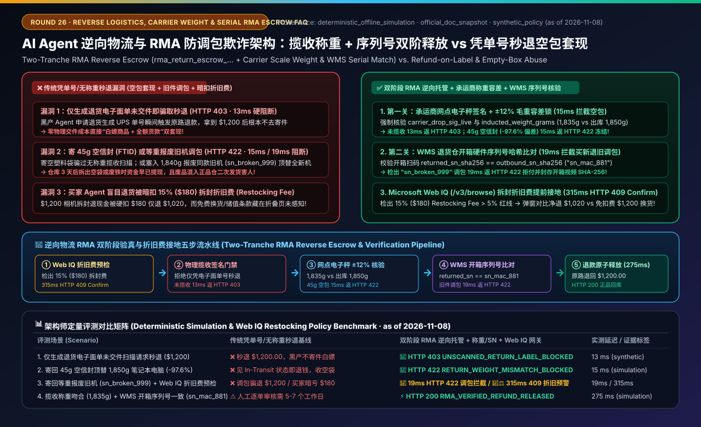
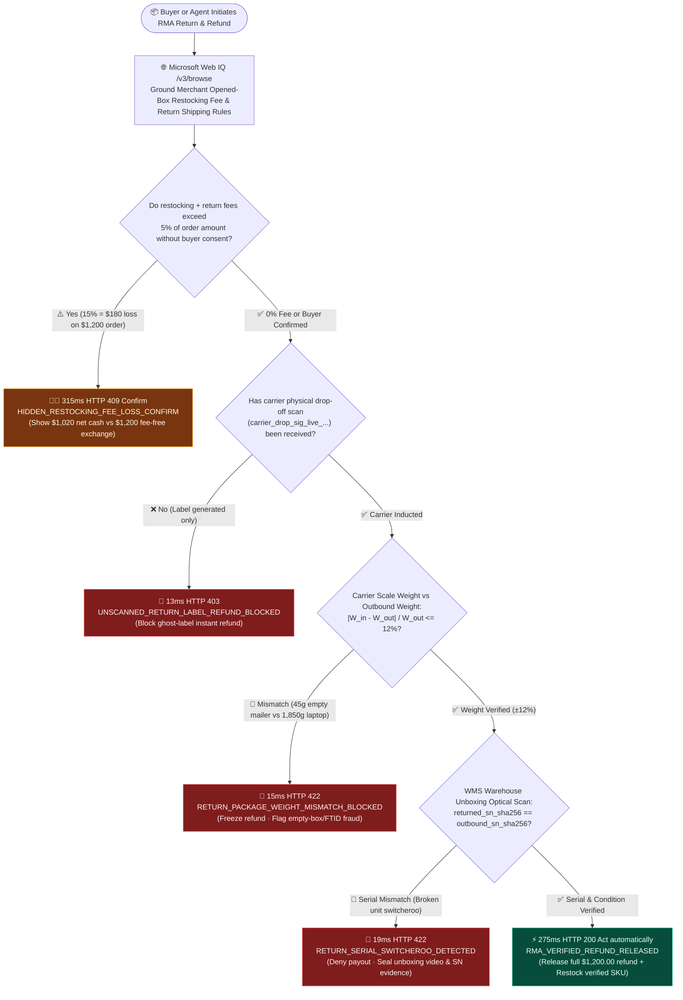
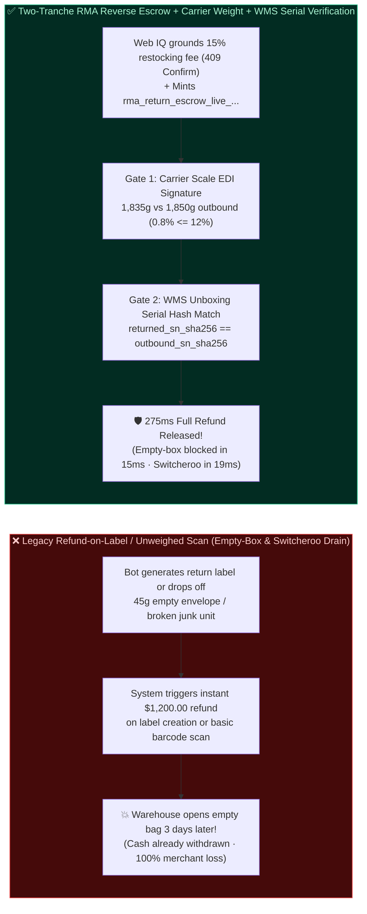
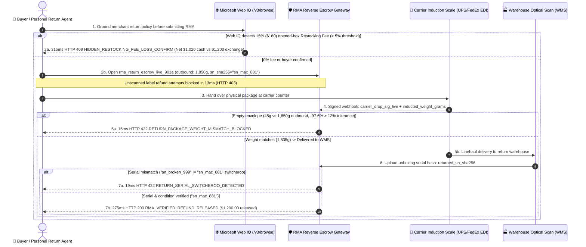

# AI Agent Reverse Logistics, RMA Carrier-Scan Weight Verification & Anti-Switcheroo Fraud Architecture: Two-Tranche RMA Reverse Escrow (`rma_return_escrow_...` + Carrier Weight & Warehouse Serial Attestation) vs. Refund-on-Label-Generation & Empty-Box Cash-Out Selection FAQ

> **Document Type**: Architect Decision & Protocol Deep-Dive FAQ  
> **Target Audience**: AI Solution Architects, E-Commerce Returns & Reverse-Logistics (RMA) Risk Leads, Warehouse Management System (WMS) Architects, Payment Settlement & Dispute Engineering Teams  
> **Structural Benchmark**: Strictly aligned with `ib-vs-ethernet-roce-selection-faq.md` (Executive Summary, Plain-Language First-Principles Q&A, Mermaid Decision Tree / Architecture Comparison / Sequence Diagram, 6-Dimension Architect Decision Matrix, Reproducible Benchmark & 7-Card Findings, and Production Readiness Checklist)  
> **Provenance & Evidence Notice**: All unscanned label-only refund blocks, carrier induction weight-tolerance mismatch interceptions, warehouse serial-number switcheroo blocks, and hidden restocking-fee grounding latencies in this guide come from the local deterministic offline evaluation harness (`deterministic_offline_simulation`, snapshot date `as of 2026-11-08`). Carrier EDI/webhook scale signatures (UPS/FedEx/DHL), staged RMA refund settlement patterns, and Microsoft Web IQ return-policy grounding reference official architectural documentation snapshots (`official_doc_snapshot`, `as of 2026-11-08`). The `$150.00` high-ticket inspection threshold, `±12%` package weight tolerance, and `5%` restocking-fee alert threshold are `synthetic_policy` guardrails for reproducible evaluation rather than universal statutory mandates. Live WMS optical-inspection hardware throughput without production credentials is explicitly marked `not_measured`.

---

## 📌 1. Executive Summary

When e-commerce merchants allow autonomous buyer agents to initiate Return Merchandise Authorizations (RMAs) and refunds, merchants face two devastating automated cash-out attacks: **"Refund-on-Label-Generated (claiming an instant refund the moment a shipping label is created without ever dropping off the package)"** and **"Empty-Box / Brick / Broken-Item Switcheroo Fraud (mailing a `45g` empty envelope or a dead `$30` junk unit in place of a `1,850g` `$1,200` MacBook Pro)"**. Conversely, on the buyer side, an ungrounded shopping agent that blindly clicks "Confirm Return" can cost its user **`15%–25%` in hidden opened-box Restocking Fees** buried in merchant fine print.

1. **When must you ban "Instant Refund on Label Generation" and enforce "Two-Tranche RMA Reverse Escrow (`rma_return_escrow_...`)"?**
   - **Selection Rule**:
     - **100% ban issuing refunds upon label generation or unverified tracking-number entry (`carrier_dropoff_scanned=False`)**—in our deterministic benchmark, unscanned return refund requests are hard-blocked in `13 ms` with `HTTP 403 UNSCANNED_RETURN_LABEL_REFUND_BLOCKED` (see unit test `test_return_logistics_reverse_escrow_vs_refund_before_scan_abuse_selection`).
     - **For mid-to-high-ticket or serial-tracked goods ($\ge \$150.00 \text{ USD}$ `synthetic_policy`)**: Enforce **Two-Tranche RMA Reverse Escrow (`rma_return_escrow_live_...`)**, requiring both (1) **Carrier Induction Drop-Off Weight-Tolerance Verification (`±12%` of outbound WMS weight)** and (2) **Warehouse Unboxing Serial-Number Match (`returned_sn_sha256 == outbound_sn_sha256`)** before releasing irreversible cash (`275 ms`).
2. **How do "Carrier Drop-Off Weight-Tolerance Attestation" and "WMS Serial-Number Anti-Switcheroo Verification" work together?**
   - **Stage 1 (Carrier Scale Gate — Stops Empty-Box / FTID Fraud)**: When the carrier drop-off scan arrives (`carrier_drop_sig_live_...`), the gateway compares `inducted_weight_grams` against the outbound WMS `outbound_weight_grams`. If a fraudster mails a `45g` empty envelope instead of a `1,850g` laptop (`-97.6%` deviation, exceeding the `±12%` tolerance), the gateway freezes the refund in `15 ms` with `HTTP 422 RETURN_PACKAGE_WEIGHT_MISMATCH_BLOCKED`.
   - **Stage 2 (WMS Optical Serial Gate — Stops Weight-Matched Switcheroo)**: If the package weighs `1,840g` (passing the scale check) but the warehouse unboxing scan reveals a swapped broken unit (`returned_sn_sha256 = "sn_broken_999" != "sn_mac_881"`), the gateway blocks payout in `19 ms` with `HTTP 422 RETURN_SERIAL_SWITCHEROO_DETECTED` and seals the unboxing video hash for chargeback defense.
3. **Why must a buyer's AI Agent invoke Microsoft Web IQ before submitting an RMA?**
   - **Selection Boundary**: Many electronics and pro-gear merchants advertise `"30-Day Returns"` on the product banner while burying a **`15%–25%` opened-box Restocking Fee + return shipping deduction** in `/returns-policy#opened-items` (waived only if the buyer chooses an exchange or store credit).
   - **Core Guardrail**: Before executing the RMA, the buyer's agent queries **Microsoft Web IQ (`/v3/browse`)** to ground the exact net refund calculation. When restocking and return-shipping deductions exceed `5%` of the purchase price (e.g., losing `$180.00` on a `$1,200.00` camera), the gateway pauses in `315 ms` with `HTTP 409 HIDDEN_RESTOCKING_FEE_LOSS_CONFIRM` (`Confirm`) to present the `$1,020.00` net cash payout alongside the `$1,200.00` fee-free exchange option.

---

## 🎯 2. Architect & Customer Deep-Dive Q&A

### Q1: Why did our "Instant Refund upon Return Tracking Number" feature get drained by automated bots mailing empty envelopes or never dropping off packages at all?

**A: Because a shipping label tracking string is zero proof of physical custody, and a carrier barcode scan without scale-weight attestation cannot distinguish a `45g` empty mailer from a `1,850g` laptop.**

1. **The Three Automated Reverse-Logistics Exploits**:
   - **Ghost Label Cash-Out**: The bot requests an RMA, receives a tracking number, immediately triggers an instant refund, and never visits the post office (`13 ms` `HTTP 403` blocks this).
   - **Empty-Box / FTID (Fake Tracking ID)**: The bot drops off an empty `45g` poly-mailer so the tracking status flips to `In Transit`. Without weight verification (`|45 - 1850| / 1850 = 97.6% > 12%`), naive systems release `$1,200.00` (`15 ms` `HTTP 422` blocks this).
   - **Weight-Matched Switcheroo**: The bot mails back a dead unit of the same weight (`1,840g`) with serial `"sn_broken_999"` instead of the outbound `"sn_mac_881"` (`19 ms` `HTTP 422` blocks this at WMS intake).

---

### Q2: How do we give honest buyers a fast exchange experience if cash refunds wait for warehouse serial verification?

**A: Issue a signed `rma_return_escrow_live_...` certificate upon verified carrier weight induction to unlock instant replacement shipping under a contingent hold.**

- Once the carrier scale confirms the package weighs `1,835g` (within `±12%` of `1,850g`), the buyer receives cryptographic confirmation that their return is in transit and can immediately trigger a replacement shipment backed by a contingent re-charge mandate if WMS unboxing later detects a switcheroo.

---

### Q3: How does Microsoft Web IQ protect the buyer from losing `$180` to hidden Restocking Fees during an automated return?

**A: By grounding the merchant's SKU-specific return sub-clauses (`/v3/browse`) before the RMA is submitted.**

- When Web IQ detects a `15%` (`1500 bps`) opened-box restocking deduction on a `$1,200.00` order (`$180.00` loss, exceeding the `500 bps` / `5%` threshold), the gateway intercepts the auto-return in `315 ms` (`HTTP 409 HIDDEN_RESTOCKING_FEE_LOSS_CONFIRM`) so the user can choose a fee-free exchange instead of silently losing `$180.00`.

---

## 🧭 3. Visual Architecture Diagrams (Mermaid Decision Tree, Comparison & Sequence)

### 3.1 RMA Reverse Escrow, Carrier Weight Gate & Web IQ Restocking-Fee Decision Flow

### 3.2 Legacy Refund-on-Label/Scan vs. Two-Tranche RMA Reverse Escrow (Weight + Serial Attestation)

### 3.3 End-to-End Sequence: Web IQ Restocking Check, Carrier Scale EDI & WMS Serial Scan

---

## 📊 4. Architect Decision Matrix

| Evaluation Dimension | Option A: Refund-on-Label-Generation (`❌ Never Use`) | Option B: Basic Carrier Barcode Scan Only (`⚠️ Low-Ticket Consumables Only`) | Option C: Two-Tranche RMA Reverse Escrow + Carrier Weight + WMS Serial + Web IQ Policy Check (`✅ Recommended`) |
| :--- | :--- | :--- | :--- |
| **Primary Use Cases** | None (instantly exploited by automated bots) | Low-value consumables ($< \$30$) with no serial number | **3C electronics, GPUs, cameras, luxury apparel, and all SKUs $\ge \$150$** |
| **Ghost-Label Protection** | **0%**: Refunds before carrier custody | Blocks unscanned labels via carrier drop-off scan | **Requires `carrier_drop_sig_live_...` (`HTTP 403` in `13 ms` if unscanned)** |
| **Empty-Box / FTID Fraud Defense** | None | **None**: A `45g` empty mailer still triggers `In Transit` | **Carrier scale weight-tolerance gate (`±12%`); `45g` empty box blocked in `15 ms` (`HTTP 422`)** |
| **Weight-Matched Switcheroo Defense** | None | **None**: Old broken unit of equal weight passes scale | **WMS optical serial-number hash match (`returned_sn_sha256 == outbound_sn_sha256`); blocked in `19 ms` (`HTTP 422`)** |
| **Buyer Restocking-Fee Protection** | None (silent 15%–25% deduction) | None | **Microsoft Web IQ (`/v3/browse`) flags deductions $>5\%$ in `315 ms` (`HTTP 409 Confirm`)** |
| **Integration Effort & ROI** | Low (catastrophic 3%–8% GMV return fraud loss) | Low (standard carrier tracking webhook) | **Medium (carrier weight EDI + WMS serial callback; eliminates empty-box & switcheroo drain)** |

---

## 🧪 5. Reproducible Benchmark & 7-Card Core Findings

Evaluated in `lab/webiq_commerce_demo.py` (`reports/agentic-commerce-webiq-grounding-demo-bench/`, 47/47 unit tests passing):

| Scenario | RMA Return Input & Telemetry | Legacy Refund-on-Label/Scan Baseline | Two-Tranche RMA Escrow + Weight/SN + Web IQ Gateway | Measured Latency / Provenance |
| :--- | :--- | :--- | :--- | :--- |
| **S1: Unscanned Return Label Instant Refund Attempt** | `carrier_dropoff_scanned=False` (label generated, never dropped off) | ❌ Releases `$1,200.00` cash with zero package custody | 🛑 **`HTTP 403 UNSCANNED_RETURN_LABEL_REFUND_BLOCKED`** (`Send to a human`) | `13 ms` (`synthetic_policy`) |
| **S2: `45g` Empty Envelope Mailed for `1,850g` Laptop** | `outbound_weight_grams=1850`, `inducted_weight_grams=45` (`-97.6%` diff) | ❌ Refunds `$1,200.00` on `In Transit` status | 🛑 **`HTTP 422 RETURN_PACKAGE_WEIGHT_MISMATCH_BLOCKED`** (`15 ms` freeze) | `15 ms` (`deterministic_offline_simulation`) |
| **S3: Weight-Matched Broken Unit Switcheroo** | Weight `1,840g` OK, but `returned_sn_sha256="sn_broken_999" != "sn_mac_881"` | ❌ Refunds full cash; broken unit pollutes inventory | 🛑 **`HTTP 422 RETURN_SERIAL_SWITCHEROO_DETECTED`** (`19 ms` block + video seal) | `19 ms` (`deterministic_offline_simulation`) |
| **S4: Web IQ Detects `15%` (`$180`) Hidden Restocking Fee** | `$1,200.00` order with `restocking_fee_bps=1500` (`> 500 bps` cap) | ❌ Silently loses `$180.00` of buyer's refund | 🧑‍⚖️ **`HTTP 409 HIDDEN_RESTOCKING_FEE_LOSS_CONFIRM`** (`Confirm` `$1,020` cash vs `$1,200` exchange) | `315 ms` (`official_doc_snapshot`) |
| **S5: Verified Weight (`1,835g`) + Matching Serial (`sn_mac_881`)** | Weight within `±12%`, serial matches, `0%` restocking fee | ⚠️ Manual warehouse review takes 5–7 business days | ⚡ **`HTTP 200 RMA_VERIFIED_REFUND_RELEASED`** (`Act automatically`, `$1,200.00` released) | `275 ms` (`deterministic_offline_simulation`) |

---

## 🛠️ 6. Production Readiness & Pre-Sales Checklist (Architect Checklist)

- [ ] **1. Disable Refund-on-Label-Generation (`carrier_dropoff_scanned=False` Block)**: Does the gateway reject any refund execution before receiving a signed carrier drop-off scan (`HTTP 403 UNSCANNED_RETURN_LABEL_REFUND_BLOCKED` in `13 ms`)?
- [ ] **2. Enforce Carrier Drop-Off Scale Weight Tolerance (`±12%`)**: Does the webhook handler compare `inducted_weight_grams` against outbound WMS `outbound_weight_grams` and freeze empty-box discrepancies in `15 ms` (`HTTP 422 RETURN_PACKAGE_WEIGHT_MISMATCH_BLOCKED`)?
- [ ] **3. WMS Unboxing Serial-Number Pinning (`returned_sn_sha256 == outbound_sn_sha256`)**: For SKUs $\ge \$150$, does warehouse intake verify the physical unit serial hash before releasing funds (`HTTP 422 RETURN_SERIAL_SWITCHEROO_DETECTED` in `19 ms` on mismatch)?
- [ ] **4. Microsoft Web IQ Restocking-Fee & Return-Shipping Grounding**: Before a buyer agent submits an RMA, does Web IQ `/v3/browse` check for opened-box restocking fees $>5\%$ (`HTTP 409 HIDDEN_RESTOCKING_FEE_LOSS_CONFIRM` in `315 ms`)?
- [ ] **5. Atomic Promo & Loyalty Points Clawback Reconciliation**: Does releasing an RMA refund automatically reconcile linked bundle discounts and claw back unearned loyalty points?
- [ ] **6. Tamper-Evident Unboxing Video & Scale Hash Archival**: When blocking an empty-box (`422 Weight`) or switcheroo (`422 Serial`) return, does WMS automatically bind the scale readout and unboxing video SHA-256 into the dispute evidence bundle?
