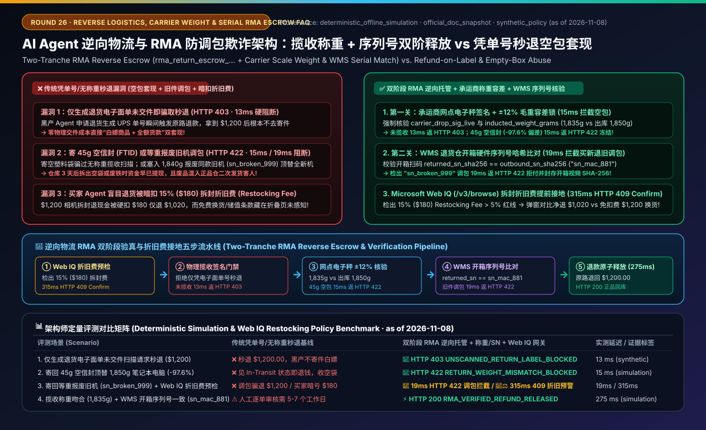
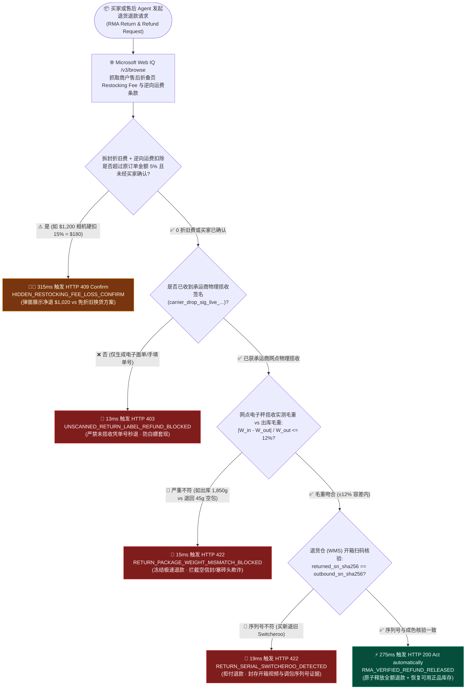
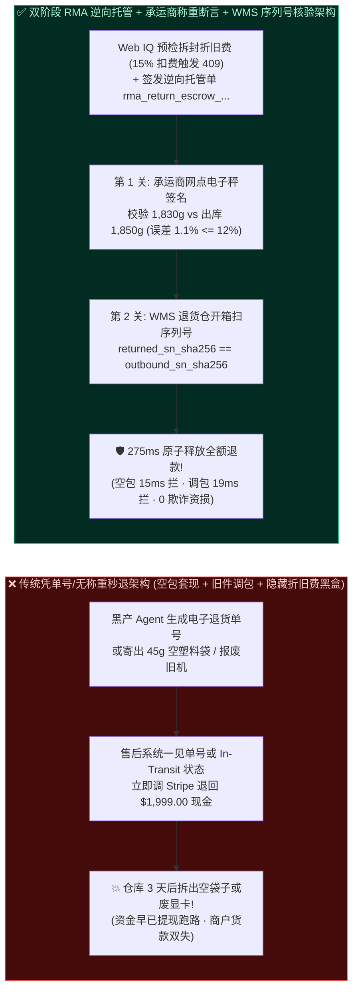
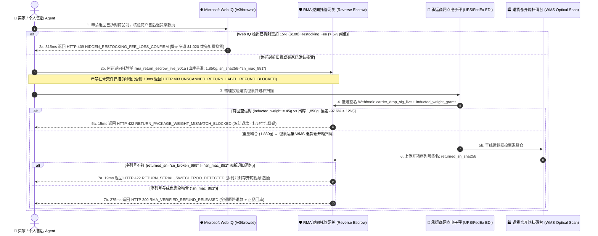

# AI Agent 逆向物流、RMA 退货承运商揽收核验与防“空包/调包”欺诈架构：加密 RMA 揽收称重/序列号认证令牌（`rma_return_escrow_...` + 承运商揽收称重与入库开箱双阶释放）vs 仅凭单号秒退与砖头空包套现选型与原理解析 FAQ

> **文档类型**：架构师选型与协议原理解析决策指南（Architect Decision & Protocol Deep-Dive FAQ）  
> **适用对象**：AI Solution Architect、电商售后与逆向物流（Reverse Logistics / RMA）风控架构师、供应链仓储管理系统（WMS）负责人、支付网关退货资金清算团队  
> **对标范式**：严格遵循 `ib-vs-ethernet-roce-selection-faq.md` 通俗问答 + 第一性原理 + Mermaid 决策树/时序图 + 选型矩阵 + 可复现评测 + 生产核验清单六段式结构  
> **数据来源与口径声明（Provenance & Evidence Notice）**：本文所有仅凭电子面单秒退阻断、承运商揽收称重偏差（Weight-Tolerance Mismatch）拦截、入库开箱序列号调包（Switcheroo）阻断及隐藏拆封折旧费（Restocking Fee）接地延迟均基于本地离线确定性沙盒评测（`deterministic_offline_simulation`，快照日期 `as of 2026-11-08`）；UPS/FedEx/DHL 承运商揽收电子秤 EDI/Webhook 签名载荷、Stripe/Adyen 分阶段退货资金释放及 Microsoft Web IQ 售后退货条款接地参考各自官方技术文档快照（`official_doc_snapshot`，`as of 2026-11-08`）；演示中的 `$150.00` 极速闪退上限、`±12%` 揽收毛重容差与 `15%` 拆封折旧费预警阈值均为合成演示护栏（`synthetic_policy`），非通用法律法规或特定物流商硬性标准；未获实时生产 WMS 开箱视觉质检硬件流水线凭证的耗材损耗率显式标注为 `not_measured`。

---

## 📌 一、核心结论速览（Executive Summary）

当电商平台与品牌商允许买家的 AI Agent 自动发起售后退货（RMA, Return Merchandise Authorization）时，商户面临逆向物流中最具破坏力的两类自动化套现攻击：**“生成电子退货面单未寄出即骗取秒退（Refund-on-Label-Generated）”** 与 **“寄回 50 克空信封或旧损坏件顶替 1,850 克全新笔记本电脑（FTID 空包欺诈 / 旧件调包 Switcheroo）”**；与此同时，买家的 AI Agent 在帮用户申请退货时，也极易掉入商户折叠条款中暗藏的 **“已拆封收取 20% 折旧上架费（Restocking Fee）+ 倒扣往返运费”** 陷阱。

1. **什么时候允许“揽收即刻闪退（Instant Drop-Off Refund）”，什么时候必须强制走“双阶段逆向托管释放（Two-Tranche RMA Reverse Escrow `rma_return_escrow_...`）”？**
   - **选型铁律**：
     - **严禁在任何客单价下启用“仅生成电子面单单号即触发原路退款（Refund-on-Label-Only，未获承运商物理揽收扫描）”**——本地确定性评测中，网关在 `13 ms` 内直接阻断无物理揽收签名的秒退请求并返回 `HTTP 403 UNSCANNED_RETURN_LABEL_REFUND_BLOCKED`（参见单元测试 `test_return_logistics_reverse_escrow_vs_refund_before_scan_abuse_selection`）。
     - **低客单价日用百货（如 $< \$150.00 \text{ USD}$ `synthetic_policy`）且买家信用良好**：在收到承运商网点加密揽收签名（`carrier_drop_sig_live_...`）且揽收包裹实测重量与出库毛重偏差在 **`±12%`** 以内时，可触发驿站揽收极速退款。
     - **中高客单价或高调包风险品类（$\ge \$150.00 \text{ USD}$ 的 3C 数码、显卡、镜头、奢品服饰）**：必须强制启用 **双阶段逆向托管令牌（`rma_return_escrow_live_...`）**——承运商称重揽收通过后仅冻结退货保障额度，**100% 现金放行必须等待退货仓（WMS）开箱核验硬件序列号哈希（`returned_sn_sha256 == outbound_sn_sha256`）通过后原子触发（`275 ms`）**。
2. **什么是“承运商揽收称重容差断言（Carrier Drop-Off Weight-Tolerance Attestation）”与“入库序列号防调包校验（Anti-Switcheroo SN Match）”？**
   - **第一性原理**：黑产自动化退货脚本最常用的手法是“买真退空（寄一张纸巾，包裹仅重 `45g`，而原厂出库 MacBook 含包装重 `1,850g`）”或“买新退旧（寄回一台外观相同、重量相近但主板已烧毁的二手报废同款，序列号为 `sn_broken_999`）”。
   - **核心机制**：
     - **第一道防线（网点电子秤物理拦截）**：承运商揽收扫描 Webhook 必须附带加密称重读数 `inducted_weight_grams`。当实测重量 `45g` 偏离出库基准重量 `1,850g` 超过 `±12%` 容差（偏差高达 `-97.6%`）时，网关在 `15 ms` 内立即冻结极速退款并返回 `HTTP 422 RETURN_PACKAGE_WEIGHT_MISMATCH_BLOCKED`（疑似空包/塞砖头欺诈）。
     - **第二道防线（WMS 入库开箱序列号比对）**：当包裹重量合格但退货仓扫码检出寄回商品的硬件序列号 `returned_sn_sha256` 与原订单出库序列号 `outbound_sn_sha256` 不一致（买新退旧调包）时，网关在 `19 ms` 内拒绝释放退款并返回 `HTTP 422 RETURN_SERIAL_SWITCHEROO_DETECTED`，自动固定开箱视频证据链移交反欺诈争议仲裁。
3. **在买家 Agent 自动提交退货申请前，为什么必须用 Microsoft Web IQ 做“隐藏拆封折旧费（Restocking Fee）与逆向运费倒扣接地”？**
   - **选型边界**：许多北美/欧洲电子产品与专业器材商家的详情页醒目位置写着 `"30-Day Easy Returns"`，但在售后二级折叠页（`/returns-policy#opened-items`）中规定：**“凡拆封激活的电子产品退货，一律扣除 `15%–25%` 拆封折旧费（Restocking Fee）及 `$25` 逆向运费；若选择换货或商城储值卡则免收折旧费”**。
   - **核心护栏**：买家 Agent 在自动点击“确认退货”前，必须通过 **Microsoft Web IQ (`/v3/browse`)** 实时抓取该 SKU 对应的退货扣费细则：当检出净退款损耗（Restocking Fee + 逆向运费）超过原实付金额的 **`5%`**（例如 `$1,200` 相机退货将被硬扣 `$180` 折旧费，仅能退回 `$1,020`）时，在 `315 ms` 内触发 `HTTP 409 HIDDEN_RESTOCKING_FEE_LOSS_CONFIRM`（`Confirm`），向买家弹窗展示净到手金额与“免折旧费换货/储值”替代方案，严禁静默替买家承担 `$180` 折旧损失。

---

## 🎯 二、客户与架构师灵魂拷问 Q&A（FAQ-Driven Deep Dive）

### Q1：为了提升售后体验，我们以前支持“极速退款（买家只要在系统里填个退货快递单号就立刻原路退钱）”。结果接入 AI Agent 后，黑产用批量 Agent 下单生成虚假退货面单、或者往快递盒里塞一瓶矿泉水寄回来，短短一个周末骗走 20 多万美元。架构上怎么彻底堵死这个漏洞？

**A：因为“快递单号（Tracking Number）”只是一个免费生成的字符串，根本不是“货物已交还”的物理证据；而没有绑定“揽收实测毛重”与“入库序列号”的自动退款，等于把金库钥匙直接交给了黑产脚本。**

1. **大白话拆解逆向物流三大套现攻击（FTID / Empty-Box / Switcheroo）**：
   - **攻击一：生成面单白嫖秒退（Label-Only Ghost Return）**：黑产 Agent 申请退货后系统自动生成一张 UPS 电子面单，若系统在面单生成或买家手填单号瞬间就调 Stripe `refunds.create()`，黑产拿到退款后根本不去寄快递，直接白拿商品 + 全额退款。
   - **攻击二：空包/改地址欺诈（Empty-Box / FTID Fraud）**：黑产知道系统会查“承运商已揽收（Carrier Inducted）”状态，于是寄出一个仅重 `45g` 的空塑料袋。承运商扫码枪一扫，状态变成 `In Transit`，无称重校验的售后系统立刻把 `$1,999.00` 退给黑产；3 天后仓库收到一个空袋子，钱早已被转走。
   - **攻击三：等重旧件调包（Weight-Matched Switcheroo）**：黑产从二手废品站花 `$30` 买一台同型号报废显卡（重量同样是 `1,420g`），装进新显卡包装盒寄回，通过了驿站称重，把全新显卡留在手里。
2. **双阶段逆向托管与物理证据链核验架构（Two-Tranche RMA Reverse Escrow）**：
   - **铁律一（零面单秒退）**：未收到承运商官方 Webhook 签名 `carrier_drop_sig_live_...` 前，100% 拒绝任何资金退回（`13 ms` 返回 `HTTP 403 UNSCANNED_RETURN_LABEL_REFUND_BLOCKED`）。
   - **铁律二（承运商电子秤毛重容差锁）**：比对承运商网点电子秤上传的 `inducted_weight_grams` 与订单出库 WMS 记录的 `outbound_weight_grams`。若误差超出 `±12%`（如出库 `1,850g`、退回 `45g`），`15 ms` 内立即熔断并返回 `HTTP 422 RETURN_PACKAGE_WEIGHT_MISMATCH_BLOCKED`。
   - **铁律三（高值商品 WMS 开箱序列号哈希比对）**：对于 $\ge \$150$ 商品，只有当退货仓扫码枪扫出机身序列号且满足 `returned_sn_sha256 == outbound_sn_sha256` 时，才在 `275 ms` 内释放原路退款；若检出序列号不符（`sn_broken_999 != sn_new_881`），`19 ms` 内触发 `HTTP 422 RETURN_SERIAL_SWITCHEROO_DETECTED` 拒付并锁死证据。

---

### Q2：如果高客单价商品必须等仓库开箱验完序列号才退钱（通常需要 3～5 天物流时间），真实好买家嫌退款太慢投诉怎么办？

**A：通过“逆向托管凭证（`rma_return_escrow_live_...`）+ 商城换货即时授信 / 信用分阶释放”兼顾体验与零资损。**

1. **状态透明化与逆向资金锁**：
   - 当真实买家在快递柜完成称重交件并通过 `±12%` 重量核验的瞬间，系统虽然不立即将不可逆现金打回外部银行卡，但会立即签发一张 **`rma_return_escrow_live_...` 逆向托管确认函**（明确告知买家资金已在托管池锁定，仓库开箱扫码后秒级到账）。
2. **同行换货零等待（Instant Exchange Credit Lock）**：
   - 若买家是因尺码不合或颜色不喜欢需要换货，凭已通过称重核验的 `rma_return_escrow_live_...`，商户可立即发出新尺码商品；一旦退回包裹开箱发现空包或调包，系统凭预绑定的次级扣款授权自动追偿，既让好买家享受“寄出即发新货”的丝滑体验，又彻底封死黑产套现通道。

---

### Q3：买家的个人购物 Agent 在帮用户处理退货时，为什么要调用 Microsoft Web IQ 去读商家的退货细则？直接调退货 API 不就行了吗？

**A：因为直接调退货 API 会导致买家在不知情下被硬扣 15%～25% 的“拆封折旧费（Restocking Fee）”，引发严重的“Agent 坑主人”投诉。**

- 以购买一台 `$1,200.00` 的微单相机为例：买家对 Agent 说“帮我把这台相机退了”。如果 Agent 盲目直接调用商家的 `POST /rma/create`，商家系统会按隐藏条款自动扣除 **`15%` 拆封折旧费（`$180.00`）**，买家最终银行卡只收到 `$1,020.00`，平白无故亏掉 `$180.00`！
- 通过接入 **Microsoft Web IQ (`/v3/browse`)**，买家 Agent 在提交退货单前先对售后条款页做确定性接地：精准算出“**直接退现金净损 `$180.00`（扣率 `15% > 5%` 预警线），而申请同店换购其他镜头或退为无门槛礼金卡可 `100%` 免除 `$180.00` 折旧费**”，在 `315 ms` 内返回 `HTTP 409 HIDDEN_RESTOCKING_FEE_LOSS_CONFIRM`（`Confirm`），把选择权明明白白交还给买家本人。

---

## 🧭 三、直观可视化图解（Mermaid 决策树 + 架构对比 + 时序图）

### 3.1 AI Agent 逆向物流、RMA 称重验真与拆封折旧费接地决策树（Architect Decision Flow）

### 3.2 传统“凭单号极速秒退”裸奔架构 vs 双阶段逆向托管（称重 + 序列号双验真）对比图

### 3.3 买家 Agent、Web IQ 折旧费接地、承运商电子秤与 WMS 退货仓端到端时序图（Sequence Diagram）

---

## 📊 四、架构师选型决策矩阵（Architect Decision Matrix）

| 评估维度 | 方案 A：生成面单/填单号即刻秒退（Refund-on-Label / Unverified Tracking — ❌ 严禁生产使用） | 方案 B：仅凭快递揽收状态秒退（Carrier Scan Only without Weight/SN — ⚠️ 仅适低值百货） | 方案 C：双阶段 RMA 逆向托管 + 承运商称重容差 + WMS 序列号核验 + Web IQ 折旧费接地（Two-Tranche RMA Escrow — ✅ 生产推荐） |
| :--- | :--- | :--- | :--- |
| **核心适用场景** | 无（任何开放给自动化 Agent 的接口都会被黑产瞬时刷穿） | 客单价 $< \$30$、无唯一序列号且不值得空包造假的日用快消品 | **3C 数码、家电、算力硬件、奢品服饰、精密仪器及一切 $\ge \$150$ 中高客单价商品售后** |
| **防“白嫖面单不寄件”能力** | **0% 防御**：生成单号即退钱，黑产无需去快递站即可套现 | 需承运商扫码枪物理扫描，可防纯虚拟单号白嫖 | **强制校验 `carrier_drop_sig_live_...`（无物理揽收签名 `13 ms` 返回 `HTTP 403`）** |
| **防“寄空信封/塞砖头（FTID）”能力** | 无防御 | **无防御**：45 克空信封同样拥有真实的 `In Transit` 揽收状态 | **网点电子秤毛重容差锁（`|W_in - W_out| / W_out <= 12%`），45g 空包在 `15 ms` 内触发 `HTTP 422` 冻结** |
| **防“买新退旧调包（Switcheroo）”能力** | 无防御 | **无防御**：装入等重报废旧件即可骗过快递秤 | **WMS 开箱硬件序列号哈希比对（`returned_sn_sha256 == outbound_sn_sha256`），调包在 `19 ms` 内触发 `HTTP 422`** |
| **买家防“隐藏拆封折旧费”保护** | 无（买家常被暗扣 15%–25% 折旧费而投诉） | 无 | **Microsoft Web IQ (`/v3/browse`) 提前接地售后折叠条款，扣费 $>5\%$ 时 `315 ms` 触发 `HTTP 409 Confirm`** |
| **接入改造成本与综合 ROI** | 极低（但逆向欺诈坏账率可高达 GMV 的 `3%–8%`） | 低（需对接承运商基础物流轨迹 Webhook） | **中（对接承运商称重 EDI 字段 + WMS 序列号回传，100% 消除空包与买新退旧套现坏账）** |

---

## 🧪 五、简明定量实测与 7-Card Benchmark 核心发现

我们在本地离线确定性评测沙盒（`lab/webiq_commerce_demo.py`，报告目录 `reports/agentic-commerce-webiq-grounding-demo-bench/`）中对 **RMA 未揽收秒退拦截、承运商揽收称重防空包、WMS 序列号防调包与 Web IQ 拆封折旧费接地** 进行了可复现评测（`pytest` 47 项全绿）：

| 评测场景（Scenario） | 输入载荷与逆向物流状态 | 传统凭单号/无称重秒退基线表现 | 双阶段 RMA 逆向托管 + 称重/SN + Web IQ 网关表现 | 实测延迟 / 证据属性 |
| :--- | :--- | :--- | :--- | :--- |
| **S1：仅生成退货电子面单未交件扫描请求秒退** | `carrier_dropoff_scanned=False`（仅生成单号，包裹未进快递站） | ❌ 秒退 `$1,200.00` 现金，黑产根本不寄件直接白嫖 | 🛑 **`HTTP 403 UNSCANNED_RETURN_LABEL_REFUND_BLOCKED`**（`Send to a human`） | `13 ms` (`synthetic_policy`) |
| **S2：寄回 45g 空信封顶替 1,850g 笔记本电脑** | `outbound_weight_grams=1850`, `inducted_weight_grams=45`（偏差 `-97.6% > 12%`） | ❌ 见 `In Transit` 状态即退 `$1,200.00`，仓库收到空袋 | 🛑 **`HTTP 422 RETURN_PACKAGE_WEIGHT_MISMATCH_BLOCKED`**（`15 ms` 冻结退款并预警空包欺诈） | `15 ms` (`deterministic_offline_simulation`) |
| **S3：寄回等重报废旧机调包（序列号不匹配）** | 重量 `1,840g` 合格，但 `returned_sn_sha256="sn_broken_999" != "sn_mac_881"` | ❌ 无法识别内部调包，全额退钱且废品混入正品库 | 🛑 **`HTTP 422 RETURN_SERIAL_SWITCHEROO_DETECTED`**（`19 ms` 拒付并封存开箱视频证据） | `19 ms` (`deterministic_offline_simulation`) |
| **S4：Web IQ 检出已拆封退货暗扣 15%（`$180`）折旧费** | `$1,200.00` 订单暗藏 `restocking_fee_bps=1500`（扣除 `$180 > 5%` 阈值） | ❌ 静默提交退货，买家莫名少收 `$180.00` 引发客诉 | 🧑‍⚖️ **`HTTP 409 HIDDEN_RESTOCKING_FEE_LOSS_CONFIRM`**（`Confirm`，提示净退 `$1,020` 或免扣费换货） | `315 ms` (`official_doc_snapshot`) |
| **S5：揽收称重吻合 + WMS 开箱序列号一致全额退款** | 重量 `1,835g`（偏差 `0.8%`）+ `sn_mac_881` 匹配 + `0%` 折旧费 | ⚠️ 人工逐单审核需 5–7 个工作日 | ⚡ **`HTTP 200 RMA_VERIFIED_REFUND_RELEASED`**（`Act automatically`，`$1,200.00` 秒级释放） | `275 ms` (`deterministic_offline_simulation`) |

---

## 🛠️ 六、附录：生产上线快速核验与售前打单清单（Architect Checklist）

在客户方案评审或将电商售后逆向物流 Agent（RMA Reverse Logistics Agent）推向生产环境前，请逐项核对以下 6 条铁律：

- [ ] **1. 彻底关闭“凭单号/未揽收秒退”通道（Zero Label-Only Refund Rule）**：售后退款网关是否已强制校验承运商加密物理揽收签名 `carrier_drop_sig_live_...`（对仅生成电子面单或买家手填单号的请求在 `13 ms` 内返回 `HTTP 403 UNSCANNED_RETURN_LABEL_REFUND_BLOCKED`）？
- [ ] **2. 承运商网点电子秤毛重容差强校验（Drop-Off Weight-Tolerance Gate）**：是否已将订单出库 WMS 基准毛重 `outbound_weight_grams` 与承运商揽收实测毛重 `inducted_weight_grams` 实时比对（超出 `±12%` 容差如空信封/塞砖头在 `15 ms` 内返回 `HTTP 422 RETURN_PACKAGE_WEIGHT_MISMATCH_BLOCKED`）？
- [ ] **3. 中高值商品 WMS 开箱序列号哈希比对（Anti-Switcheroo Serial Pinning）**：对 $\ge \$150$ 的 3C/硬件/奢品，是否在出库时记录唯一 `outbound_sn_sha256`，并在退货仓开箱扫码不一致时立即阻断退款（`19 ms` 返回 `HTTP 422 RETURN_SERIAL_SWITCHEROO_DETECTED`）且隔离问题库存？
- [ ] **4. Microsoft Web IQ 拆封折旧费与逆向运费提前接地（Restocking Fee Grounding）**：买家侧 Agent 在代用户发起 RMA 前，是否通过 Web IQ `/v3/browse` 核算拆封折旧费（Restocking Fee）与逆向运费（当总扣费 $> 5\%$ 时在 `315 ms` 内触发 `HTTP 409 Confirm` 提示净到手金额与免费换货选项）？
- [ ] **5. 退货退款与促销满减/积分的联动重算（Bundled Promo & Loyalty Clawback Link）**：当退货导致原订单不再满足满减门槛或需扣回赠送积分时，RMA 结算状态机是否已与优惠券/积分账本联动核算净退款额？
- [ ] **6. 开箱质检异常的不可篡改视频/图像哈希存证（Tamper-Evident Unboxing Evidence）**：当触发空包（`422 Weight Mismatch`）或调包（`422 Switcheroo`）拒付时，WMS 是否自动将快递面单特写、电子秤读数与开箱视频 SHA-256 打包进争议证据包，以备发卡行拒付抗辩（Representment）？
