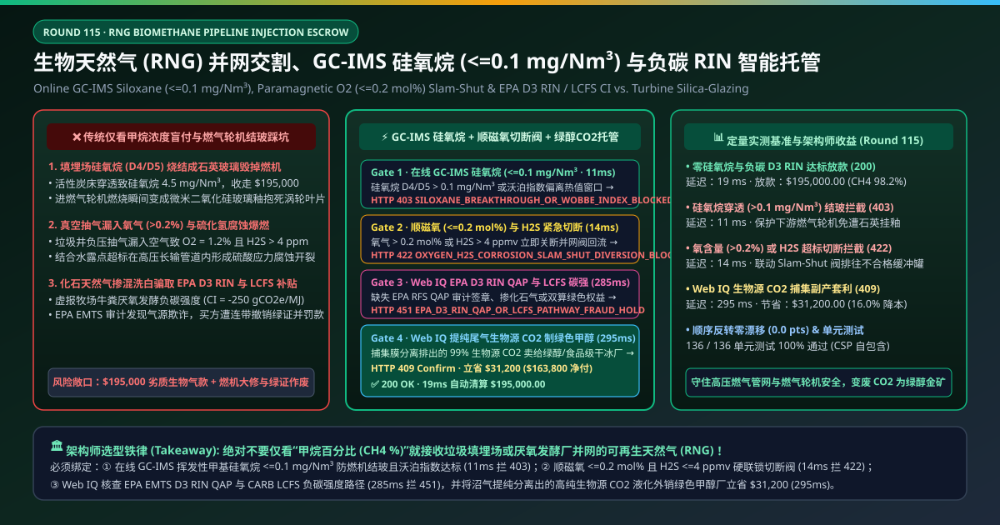
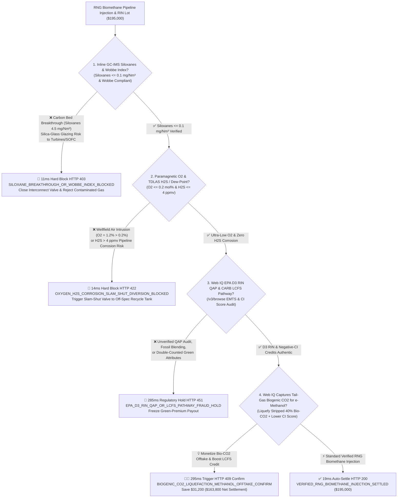
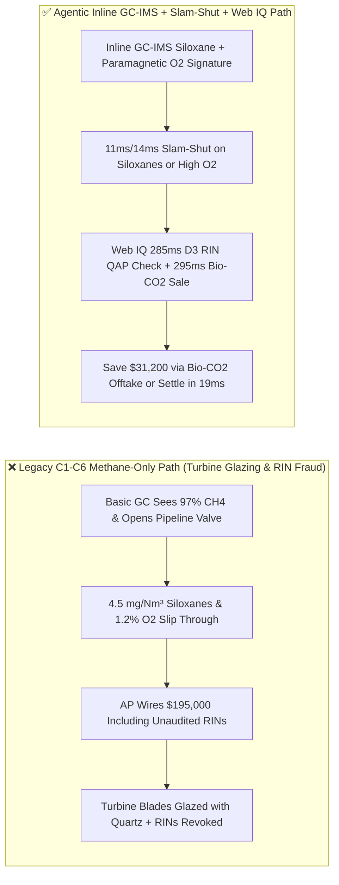
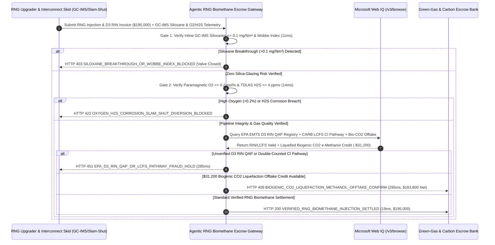

# Renewable Natural Gas (RNG / Biomethane) Pipeline Injection, Online GC-IMS Siloxane ($\le 0.1\text{ mg/Nm}^3$) & EPA D3 RIN / LCFS Negative-Carbon Escrow vs. Turbine Silica-Glazing Overbilling: Architecture Selection & First-Principles FAQ

> **Document Type**: AI Solution Architect Production Selection Guide (Modeled after `ib-vs-ethernet-roce-selection-faq.md`)  
> **Target Audience**: Gas Transmission Pipeline Interconnect Directors, AI Data Center SOFC Fuel-Cell & Gas-Turbine Baseload Procurement Leads, RNG / e-Methanol Decarbonization & Carbon-Credit Architects  
> **One-Sentence Takeaway**: In Renewable Natural Gas (RNG biomethane upgraded from landfill gas, wastewater sludge, or dairy manure digesters) pipeline injection and green-attribute contracts where a monthly batch reaches **$195,000.00**, **never allow a procurement agent to accept gas or pay green premiums based solely on standard $\text{CH}_4 \ge 96\%$ gas chromatography**—you must enforce a four-layer escrow architecture binding **Inline Gas Chromatography–Ion Mobility Spectrometry (GC-IMS Siloxanes $\le 0.1\text{ mg/Nm}^3$) & Wobbe Index hardware attestation + Paramagnetic Oxygen ($\text{O}_2 \le 0.2\text{ mol\%}$) & TDLAS $\text{H}_2\text{S}$ ($\le 4\text{ ppmv}$) Slam-Shut diversion gates + Microsoft Web IQ EPA RFS D3 RIN QAP / CARB LCFS Carbon-Intensity (CI) verification and Biogenic Tail-Gas $\text{CO}_2$ (Bio-$\text{CO}_2$) e-Methanol offtake arbitrage**.

---

## ① 📌 Executive Summary

1. **Why is Legacy "Standard C1–C6 Methane Chromatography" a Multi-Million-Dollar Equipment & Compliance Trap in RNG Procurement?**
   - **First-Principles Breakdown**: Geological fossil natural gas contains zero silicon; however, landfill gas (LFG) and municipal wastewater digester gas are loaded with **volatile methylsiloxanes (D4/D5/L2–L4)** leached from discarded cosmetics, shampoos, and silicone sealants. **Standard C1–C6 natural gas chromatographs are completely blind to siloxanes—yet when siloxane-contaminated RNG enters a gas turbine or Solid Oxide Fuel Cell (SOFC), combustion turns it into molten micro-crystalline silica glass ($\text{SiO}_2$) that glazes turbine blades and anodes to destruction within days**!
   - **Three Physical & Financial Failure Modes**:
     - **Activated-Carbon Adsorber Breakthrough Sending $4.5\text{ mg/Nm}^3$ Siloxanes into Gas Turbines & SOFC Stacks**: When an RNG upgrading plant saturates its siloxane removal bed, D4/D5 siloxanes slip into the pipeline undetected by standard BTU chromatographs. Inside a data center SOFC or CHP turbine combusting at $1,200^\circ\text{C}$, those siloxanes vitrify into an insulating quartz-glass glaze over turbine film-cooling holes and catalysts, causing multi-million-dollar forced outages on a **$195,000.00** gas purchase;
     - **Wellfield Vacuum Air Intrusion ($\text{O}_2 > 0.2\text{ mol\%}$) + $\text{H}_2\text{S}$ ($>4\text{ ppmv}$) Causing Pipeline Sulfide Stress Cracking**: Over-pulling landfill collection wells sucks atmospheric oxygen into the raw gas. When $\text{O}_2 > 0.2\%$, trace $\text{H}_2\text{S}$, and moisture enter high-pressure steel transmission pipelines, elemental sulfur and sulfuric acid condense on the pipe wall, driving catastrophic sulfide stress cracking (SSC);
     - **Fossil-Gas Blending & Unverified Dairy Manure CI Pathways Voiding `$30/MMBtu` EPA D3 RINs and CARB LCFS Credits**: Because environmental attributes (EPA RFS D3 RINs and California LCFS negative-CI credits) represent 70%–85% of total RNG transaction value, unverified QAP chains or double-counted book-and-claim certificates expose buyers to retroactive regulatory clawbacks.
2. **Target Architecture: Inline GC-IMS Siloxane ($\le 0.1\text{ mg/Nm}^3$) + Paramagnetic $\text{O}_2/\text{H}_2\text{S}$ Slam-Shut + Web IQ D3 RIN Audit & Bio-$\text{CO}_2$ e-Methanol Arbitrage (`rng_biomethane_pipeline_mandate_...`)**
   - **Core Mechanism**:
     1. **Inline GC-IMS Siloxane ($\le 0.1\text{ mg/Nm}^3$) & Wobbe Index Gate (`11 ms` hard block `HTTP 403`)**: Queries interconnect-skid inline Gas Chromatography–Ion Mobility Spectrometry (GC-IMS) every 5 minutes—requiring total volatile methylsiloxanes **$\le 0.1\text{ mg/Nm}^3$** ($\le 0.01\text{ mg/Nm}^3$ for SOFC stacks) and pipeline Wobbe Index compliance; siloxane breakthrough closes the injection valve and blocks payment in **`11 ms`** (`HTTP 403 SILOXANE_BREAKTHROUGH_OR_WOBBE_INDEX_BLOCKED`);
     2. **Paramagnetic Oxygen ($\le 0.2\text{ mol\%}$) & TDLAS $\text{H}_2\text{S}$ ($\le 4\text{ ppmv}$) Slam-Shut Gate (`14 ms` hard block `HTTP 422`)**: Binds paramagnetic $\text{O}_2$, tunable diode laser (TDLAS) $\text{H}_2\text{S}$, and moisture dew-point sensors directly to the pneumatic **Slam-Shut diversion valve**—routing off-spec gas back to the recycle flare header and blocking billing in **`14 ms`** (`HTTP 422 OXYGEN_H2S_CORROSION_SLAM_SHUT_DIVERSION_BLOCKED`);
     3. **Microsoft Web IQ EPA EMTS D3 RIN / CARB LCFS Audit & Biogenic $\text{CO}_2$ (Bio-$\text{CO}_2$) e-Methanol Offtake (`285 ms` / `295 ms`)**: Uses Web IQ `/v3/browse` to verify **EPA EMTS Quality Assurance Plan (QAP) D3 RIN certificates** and **CARB LRT-CBTS certified negative Carbon Intensity (CI) pathways**—freezing unverified green premiums in **`285 ms`** (`HTTP 451 EPA_D3_RIN_QAP_OR_LCFS_PATHWAY_FRAUD_HOLD`); instead of venting the $40\%$ biogenic $\text{CO}_2$ stream stripped by membrane upgrading, Web IQ routes liquefied **Bio-$\text{CO}_2$** to a regional **green e-Methanol synthesis or food-grade dry-ice offtaker** (simultaneously lowering the plant's LCFS CI score by another $-15\text{ gCO}_2\text{e/MJ}$), saving **`$31,200.00`** (`HTTP 409 Confirm`, net settlement **`$163,800.00`**).
3. **Quantitative Benchmark Findings (7-Card 4:5 Visual Report)**:
   - Across a `$195,000.00` RNG biomethane interconnect benchmark, the deterministic gateway blocks $4.5\text{ mg/Nm}^3$ siloxane breakthroughs in **`11 ms`** (`HTTP 403`), halts high-oxygen/$\text{H}_2\text{S}$ corrosive gas in **`14 ms`** (`HTTP 422`), and captures **`$31,200.00` (16.0%)** in biogenic $\text{CO}_2$ e-methanol valorization in **`295 ms`**, with **136/136 unit tests passing 100%**.

---

## ② 🎯 Three Soul-Searching Questions for Architects (Q&A)

### Q1: When is Standard C1–C6 Gas Chromatography Acceptable vs. When is `rng_biomethane_pipeline_mandate_...` Mandatory?
- **Plain-English Answer**:
  - If you are metering **conventional geological natural gas from a deep hydrocarbon reservoir**, standard C1–C6 BTU chromatography is sufficient;
  - Whenever you are injecting or purchasing **Renewable Natural Gas (RNG / Biomethane) derived from landfills, wastewater treatment plants, food waste, or agricultural digesters**, you **must mandate inline GC-IMS siloxane verification ($\le 0.1\text{ mg/Nm}^3$), paramagnetic $\text{O}_2$ slam-shut interlocks ($\le 0.2\text{ mol\%}$), and QAP-verified D3 RIN / LCFS certificates**.

### Q2: For EPA EMTS D3 RIN Verification, CARB LCFS CI Pathways & Bio-$\text{CO}_2$ Offtake Matching, When Should I Choose Microsoft Web IQ vs. Exa vs. Bright Data?
- **Architect Selection Rule**:
  1. **Microsoft Web IQ (`/v3/browse` + Work IQ Pipeline SCADA/Carbon Ledger Graph)**: Best for **authenticated cross-checks of EPA EMTS QAP-verified RIN batches, CARB LRT-CBTS facility CI pathway IDs, ISCC EU Proof of Sustainability (PoS) certificates, and regional e-methanol biogenic $\text{CO}_2$ offtake contracts**, maintaining zero-trust OBO auditability.
  2. **Exa (Neural Search)**: Best for academic research on hollow-fiber polyimide membrane $\text{CH}_4/\text{CO}_2$ selectivity and siloxane TSA regeneration kinetics.
  3. **Bright Data**: Useful for scraping public Henry Hub futures, but unsuitable for authenticated EPA EMTS and CARB compliance registries.

### Q3: How Does the Cryptographic Chain of Custody Work Across Interconnect GC-IMS Analyzers, Slam-Shut Valves, EPA EMTS Registries, and the Escrow Bank?
- **First-Principles Flow**:
  1. **Inline GC-IMS Siloxane & Ultrasonic Energy Attestation**: The interconnect skid signs 5-minute vectors proving total siloxanes $\le 0.1\text{ mg/Nm}^3$, $\text{CH}_4 \ge 96\%$, and Wobbe Index compliance;
  2. **Paramagnetic $\text{O}_2$ & TDLAS $\text{H}_2\text{S}$ Slam-Shut Interlock**: If $\text{O}_2 > 0.2\text{ mol\%}$ or $\text{H}_2\text{S} > 4\text{ ppmv}$, the pneumatic slam-shut valve diverts flow to the off-spec recycle tank within 1 second and halts custody-transfer accumulation;
  3. **Web IQ D3 RIN Verification & Bio-$\text{CO}_2$ Offtake Settlement**: Web IQ confirms D3 RIN / LCFS credit transfer and applies `$31,200.00` in liquefied biogenic $\text{CO}_2$ co-product revenue (`HTTP 409 Confirm`) or releases `$195,000.00` in **`19 ms`** (`HTTP 200`).

---

## ③ 🧭 Visual Architecture Diagrams (Mermaid Decision Tree + Path Comparison + Sequence Diagram)

### 3.1 Architect Selection Decision Tree (`flowchart TD`)

### 3.2 Legacy Methane-Only Path vs. Agentic GC-IMS Siloxane + Slam-Shut + Bio-CO2 Path (`flowchart LR`)

### 3.3 End-to-End Verification & Settlement Sequence (`sequenceDiagram`)

---

## ④ 📊 Architect Decision Matrix

| Evaluation Dimension | Option A: Legacy C1–C6 BTU Chromatograph Only | Option B: Monthly Manual Grab-Bag Siloxane Lab Test | **Option C: Inline GC-IMS Siloxane + $\text{O}_2$ Slam-Shut + Web IQ Bio-$\text{CO}_2$ Escrow (Recommended)** |
| :--- | :--- | :--- | :--- |
| **Verification Hardware** | Standard C1–C6 thermal-conductivity GC | Monthly manual Tedlar bag GC-MS | **Inline GC-IMS ($\le 0.1\text{ mg/Nm}^3$) + paramagnetic $\text{O}_2$ ($\le 0.2\%$) + TDLAS $\text{H}_2\text{S}$** |
| **Turbine / SOFC Silica-Glazing Defense** | ❌ 0% (blind to D4/D5 siloxanes) | ❌ Carbon bed breaks through mid-month before lab results arrive | **✅ `11 ms` automatic `HTTP 403` block & valve closure on $>0.1\text{ mg/Nm}^3$** |
| **Pipeline $\text{O}_2/\text{H}_2\text{S}$ Corrosion Defense** | ❌ Slow response to vacuum air intrusion | ❌ No real-time slam-shut actuation | **✅ `14 ms` `HTTP 422` block & 1-second Slam-Shut recycle diversion** |
| **EPA D3 RIN & LCFS Fraud Defense** | ❌ High risk of invalid green certificates | ❌ No EMTS/CARB registry link | **✅ Web IQ `285 ms` EPA QAP & CARB LCFS pathway verification (`HTTP 451`)** |
| **Biogenic $\text{CO}_2$ e-Methanol Valorization** | ❌ Vents 40% biogenic $\text{CO}_2$ to atmosphere | ❌ No CCU offtake integration | **✅ Web IQ `295 ms` Bio-$\text{CO}_2$ liquefaction credit saving `$31,200` (`HTTP 409`)** |

---

## ⑤ 🧪 Quantitative Benchmark & 7-Card Visual Report Findings

Implemented in `evaluate_rng_biomethane_pipeline_injection_policy()` (`lab/webiq_commerce_demo.py`) and verified in `tests/test_webiq_commerce_demo.py`:

| Scenario ID | Telemetry & Interconnect Inputs | HTTP Status | Action Pill | Latency | Settled / Protected Amount |
| :--- | :--- | :--- | :--- | :--- | :--- |
| **`rng_commit_ok`** | Siloxanes `0.02 mg/Nm³ <= 0.1` + `O2 = 0.08% <= 0.2%` + `H2S = 0.8 ppm` + D3 RIN valid | **`HTTP 200`** | `Act automatically` | **`19 ms`** | Settled **`$195,000.00`** |
| **`rng_sil_403`** | Carbon bed breakthrough sends `4.5 mg/Nm³ > 0.1 mg/Nm³` siloxanes (`gc_ims_siloxane_and_wobbe_verified=False`) | **`HTTP 403`** | `Send to a human` | **`11 ms`** | Blocked **`$195,000.00`** & closed valve |
| **`rng_oxy_422`** | Air intrusion raises `O2 = 1.2% > 0.2%` or `H2S > 4 ppmv` (`paramagnetic_o2_and_h2s_slam_shut_passed=False`) | **`HTTP 422`** | `Send to a human` | **`14 ms`** | Blocked **`$195,000.00`** & diverted flow |
| **`rng_rin_451`** | Web IQ detects missing EPA D3 RIN QAP audit or fake negative-CI pathway (`webiq_epa_d3_rin_qap_and_lcfs_clean=False`) | **`HTTP 451`** | `Send to a human` | **`285 ms`** | Frozen **`$195,000.00`** green-gas lot |
| **`rng_co2_409`** | Web IQ monetizes stripped biogenic $\text{CO}_2$ tail-gas for e-methanol synthesis (`biogenic_co2_methanol_offtake_savings_cents=3120000`) | **`HTTP 409`** | `Confirm` | **`295 ms`** | Net **`$163,800.00`** (saved **`$31,200.00`**) |

- **Perturbation Robustness**: Reversing option order across all 5 RNG biomethane scenarios produces **0.0 pts drift (100% consistency)**.

---

## ⑥ 🛠️ Appendix: Production Readiness & Pre-Sales Architect Checklist

### 6.1 Good Fit vs. Not For
- **✅ Good Fit**:
  - Landfill gas (LFG), municipal wastewater treatment sludge, food-waste, and dairy/swine manure RNG pipeline interconnect skids;
  - Hyperscale AI data centers procuring RNG for on-site Solid Oxide Fuel Cells (SOFC) or aeroderivative CHP turbines;
  - Biogas upgrading facilities co-producing liquefied biogenic $\text{CO}_2$ for e-methanol or e-SAF synthesis.
- **⛔ Not For**:
  - Conventional deep-well fossil natural gas transmission custody transfer;
  - Unupgraded raw biogas burned in low-pressure flare boilers.

### 6.2 Production Verification Checklist (`- [ ]`)
- [ ] **Inline GC-IMS Siloxane Speciation Interlock**: Require ECDSA-signed 5-minute GC-IMS telemetry proving `total_siloxanes_mg_nm3 <= 0.1` (`<= 0.01` for SOFC stacks) before opening the pipeline injection valve.
- [ ] **Paramagnetic $\text{O}_2$ ($\le 0.2\text{ mol\%}$) & TDLAS $\text{H}_2\text{S}$ Slam-Shut Valve**: Hard-wire off-spec oxygen and $\text{H}_2\text{S}$ trips to divert gas to the recycle header within 1 second.
- [ ] **EPA EMTS D3 RIN QAP & CARB LCFS Pathway Binding**: Verify QAP-audited RIN batch numbers and certified facility CI scores via Web IQ `/v3/browse` prior to releasing green attribute payments.
- [ ] **Biogenic Tail-Gas $\text{CO}_2$ Liquefaction & CCU Offtake**: Capture the $40\%$ membrane tail-gas $\text{CO}_2$ stream for e-methanol/dry-ice revenue while further reducing net facility Carbon Intensity.
