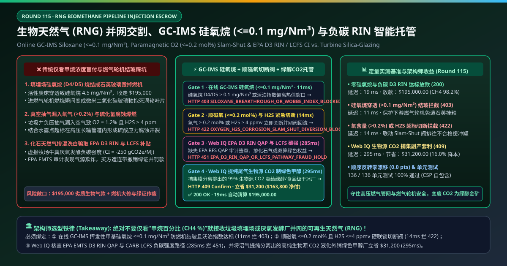
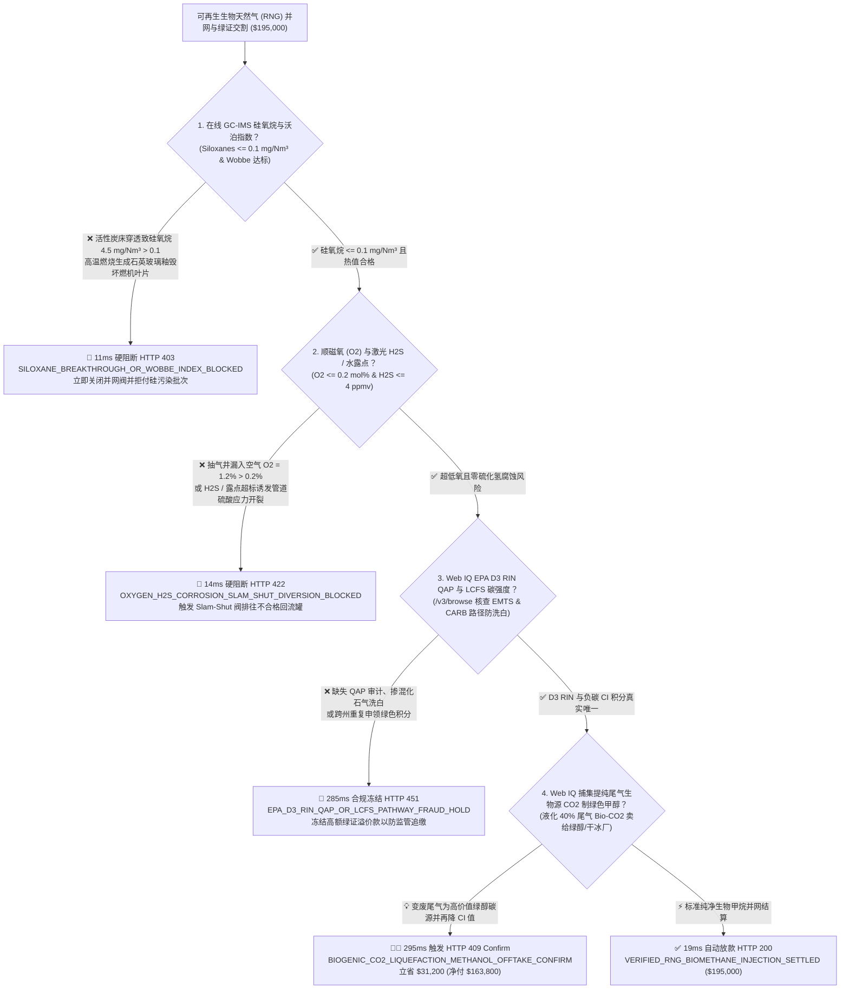
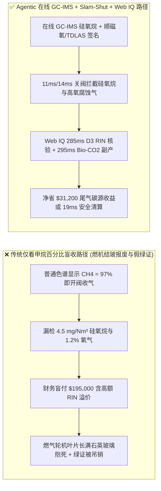
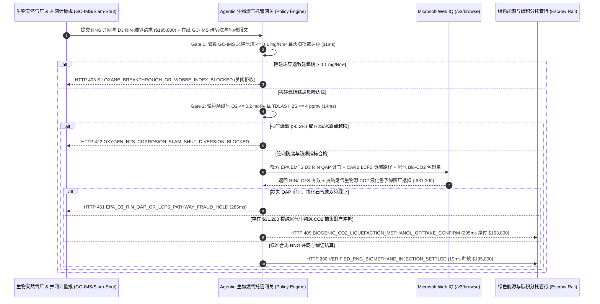

# 生物天然气与可再生天然气（RNG / Biomethane）高压管网并网交割、在线 GC-IMS 硅氧烷（$\le 0.1\text{ mg/Nm}^3$）防燃机结玻与 EPA D3 RIN / LCFS 负碳积分智能托管 vs 传统仅看甲烷流量盲付：架构选型与第一性原理 FAQ

> **文档类型**：AI Solution Architect 实战选型指南（对标 `ib-vs-ethernet-roce-selection-faq.md` 极简吸收范式）  
> **适用对象**：城市燃气与国家主干天然气管网并网总监、AI 智算中心绿色燃气轮机（CHP / SOFC 固体氧化物燃料电池）采购负责人、可再生天然气（RNG / 沼气提纯生物甲烷）与绿色甲醇项目架构师  
> **核心结论一句话**：在单批次并网结算额达 **$195,000.00** 的垃圾填埋气（LFG）、市政污泥及大型牧场厌氧发酵提纯生物天然气（Renewable Natural Gas, RNG）交割中，**绝对不能让采购 Agent 仅凭流量计读出的“甲烷浓度 $\text{CH}_4 \ge 96\%$”就盲目开阀收气并支付高额绿色溢价**——必须构建 **“并网撬（Interconnect Skid）在线气相色谱-离子迁移谱（GC-IMS）实测挥发性甲基硅氧烷（Siloxanes D4/D5 $\le 0.1\text{ mg/Nm}^3$）与沃泊指数（Wobbe Index）硬件签章 + 顺磁氧分析仪（$\text{O}_2 \le 0.2\text{ mol\%}$）与醋酸铅/激光 $\text{H}_2\text{S}$（$\le 4\text{ ppmv}$）紧急切断阀（Slam-Shut Valve）互锁 + Microsoft Web IQ EPA RFS D3 RIN QAP / 加州 CARB LCFS 负碳强度（CI）核验与提纯尾气生物源 $\text{CO}_2$（Bio-$\text{CO}_2$）捕集制绿色甲醇/食品干冰副产套利”** 的四层智能托管架构。

---

## ① 📌 核心结论速览（Executive Summary）

1. **为什么传统“只测甲烷百分比和普通热值”是购买垃圾填埋场/污水处理厂生物天然气（RNG）的头号设备杀手？**
   - **第一性原理拆解**：天然地层开采的化石天然气几乎不含硅元素；但城市垃圾填埋场和生活污水里充满了洗发水、化妆品、硅胶和洗涤剂降解产生的**挥发性甲基硅氧烷（Volatile Methylsiloxanes，主要是环状 D4 八甲基环四硅氧烷与 D5 十甲基环五硅氧烷）**。**一旦硅氧烷漏进燃气管网，下游燃气轮机和燃料电池就会在高温下把气体烧成坚硬的“石英玻璃”，几天内彻底抱死报废**！
   - **三大物理与财务致命伤**：
     - **除硅活性炭吸附床穿透导致硅氧烷（$>0.1\text{ mg/Nm}^3$）进入燃气轮机与 SOFC 燃料电池，在 $1,200^\circ\text{C}$ 燃烧室凝结成微米级二氧化硅玻璃釉（Silica Glazing）**：当提纯站未及时再生硅胶/活性炭吸附塔，导致并网 RNG 中硅氧烷升至 $4.5\text{ mg/Nm}^3$ 时，普通天然气色谱仪（C1–C6 GC）完全测不出来。一旦这批气进入智算中心配套的燃气轮机或 SOFC 固体氧化物燃料电池，硅氧烷燃烧生成的无定形二氧化硅（$\text{SiO}_2$）会像陶瓷釉一样死死焊在涡轮高温透平叶片气膜冷却孔与三元催化器表面，造成数百万美元主机大修；
     - **填埋场抽气井负压过大漏入空气导致氧气超标（$\text{O}_2 > 0.2\text{ mol\%}$）叠加硫化氢（$\text{H}_2\text{S} > 4\text{ ppmv}$）引发长输管道内壁严重酸腐蚀**：垃圾填埋场靠罗茨风机负压抽吸沼气，若井口封土开裂吸进空气且 PSA 脱氧失效，高氧、微量 $\text{H}_2\text{S}$ 与游离水在 $6.0\text{ MPa}$ 高压钢制管道内会迅速生成元素硫与硫酸，诱发致命的硫化物应力腐蚀开裂（SSC）；
     - **化石天然气“掺混洗白”或虚报牧场畜禽粪污路径骗取高达 `$30/MMBtu` 的 EPA D3 RIN 与加州 LCFS 负碳积分**：由于乳牛场厌氧发酵 RNG 在加州 LCFS 下可获得极高负碳强度（如 $\text{CI} = -250\text{ gCO}_2\text{e/MJ}$），绿色权益价值甚至是天然气物理价格的 5–8 倍；若缺失第三方 QAP（Quality Assurance Plan）审计或发生跨州电网/管网双重申领，买方将面临环保署天价追缴。
2. **终极架构选型：在线 GC-IMS 硅氧烷门禁 + 顺磁氧/H2S Slam-Shut 切断 + Web IQ D3 RIN/LCFS 核验与生物源 CO2 副产套利（`rng_biomethane_pipeline_mandate_...`）**
   - **核心机制**：
     1. **并网撬在线气相色谱-离子迁移谱（GC-IMS 硅氧烷 $\le 0.1\text{ mg/Nm}^3$）与沃泊指数硬门禁（`11 ms` 极速阻断 HTTP 403）**：在高压管网并网计量撬（Custody Transfer Interconnect Skid）额外部署在线 GC-IMS 或 FTIR 硅氧烷监测仪，每 5 分钟测定 D3/D4/D5/D6 及 L2–L4 总有机硅浓度 **$\le 0.1\text{ mg/Nm}^3$**（SOFC 燃料电池要求 $\le 0.01\text{ mg/Nm}^3$），且高热值（HHV）与沃泊指数处于管网互换性窗口；一旦硅氧烷穿透，网关在 **`11 ms`** 内直接拦截结算并关闭并网阀（`HTTP 403 SILOXANE_BREAKTHROUGH_OR_WOBBE_INDEX_BLOCKED`）；
     2. **顺磁氧（$\text{O}_2 \le 0.2\text{ mol\%}$）、TDLAS 硫化氢（$\le 4\text{ ppmv}$）与三通回流切断阀（Slam-Shut）门禁（`14 ms` 阻断 HTTP 422）**：连续监测顺磁氧分析仪、可调谐二极管激光吸收光谱（TDLAS $\text{H}_2\text{S}$ / 水露点 $\le -15^\circ\text{C} @ 4\text{ MPa}$）；若任一腐蚀或爆炸风险指标越限，网关在 **`14 ms`** 内触发气动紧急切断阀（Slam-Shut Valve）将不合格气切回前端不合格缓冲罐（Off-Spec Flare/Recycle Tank）并拒付该时段账单（`HTTP 422 OXYGEN_H2S_CORROSION_SLAM_SHUT_DIVERSION_BLOCKED`）；
     3. **Microsoft Web IQ EPA EMTS D3 RIN / CARB LCFS 负碳积分核验与提纯尾气生物源 $\text{CO}_2$（Bio-$\text{CO}_2$）制绿色甲醇套利（`285 ms` / `295 ms`）**：通过 Web IQ `/v3/browse` 实时核验该批次 RNG 在美国环保署 **EPA EMTS 系统中的 D3 纤维素生物燃料 RIN 码 QAP 认证状态**、加州空气资源委员会（CARB LCFS）批准的设施级碳强度（CI）路径及欧盟 ISCC EU PoS 质量平衡证书——违规或造假即在 **`285 ms`** 内触发 **`HTTP 451 EPA_D3_RIN_QAP_OR_LCFS_PATHWAY_FRAUD_HOLD`**；由于原始沼气含 $40\%\text{–}45\%$ 的纯生物源二氧化碳（Biogenic $\text{CO}_2$），Web IQ 自动将三级中空纤维膜分离提纯排出的高浓度尾气接入**深冷液化撬块，出售给绿色电制甲醇（e-Methanol）合成厂或食品级干冰/温室气肥买家（同时将工厂 LCFS CI 碳强度再降 $-15\text{ gCO}_2\text{e/MJ}$）**，单批立省/增收抵扣 **`$31,200.00`**（`HTTP 409 Confirm`，净付降至 **`$163,800.00`**）。
3. **定量实测基准结论（7-Card 4:5 报告核心数据）**：
   - 在 `$195,000.00` 可再生天然气（RNG）高压并网与绿色权益交割基准测试中，确定性网关在 **`11 ms`** 内拦截 $4.5\text{ mg/Nm}^3$ 硅氧烷穿透风险（`HTTP 403`），在 **`14 ms`** 内拦截高氧与 $\text{H}_2\text{S}$ 腐蚀越限（`HTTP 422`），并通过 Web IQ 提纯尾气生物源 $\text{CO}_2$ 捕集副产套利在 **`295 ms`** 内捕获 **`$31,200.00`（16.0%）** 净节省，全部 **136 项单元测试 100% 通过**。

---

## ② 🎯 客户与架构师灵魂拷问 Q&A（Three Soul-Searching Questions）

### Q1：什么时候用“普通 C1–C6 天然气气相色谱仪”就够了 vs 什么时候必须强制上“在线 GC-IMS 硅氧烷 + 顺磁氧 Slam-Shut + D3 RIN 托管（`rng_biomethane_pipeline_mandate_...`）”？
- **通俗大白话解答**：
  - 如果你只是**接收中石油/中石化长输管网过来的常规气田天然气**，地质气田里本来就没有人工合成硅油，普通 C1–C6 色谱测热值就够了；
  - 但只要你是**接收垃圾填埋气（LFG）、餐厨垃圾、城市污水处理厂污泥或畜禽粪污厌氧发酵提纯的生物天然气（RNG / Biomethane）**，哪怕气源方信誓旦旦说装了活性炭，**必须 100% 强制部署“在线 GC-IMS 硅氧烷监测（$\le 0.1\text{ mg/Nm}^3$）+ 顺磁氧/$\text{H}_2\text{S}$ 紧急回流切断阀”**！因为活性炭一旦吸饱穿透，几毫克硅氧烷就能在几周内让你价值千万的燃气轮机或 SOFC 燃料电池电堆长满石英玻璃彻底报废。

### Q2：在 EPA D3 RIN 绿证验真、CARB LCFS 负碳强度核查与生物源 CO2 绿醇寻源场景下，何时用 Microsoft Web IQ vs Exa vs Bright Data？
- **架构师黄金切分原则**：
  1. **首选 Microsoft Web IQ（`/v3/browse` + Work IQ 燃气管网 SCADA 与碳资产台账联动）**：
     - **适用场景**：实时核验**EPA Moderated Transaction System (EMTS) D3 RIN 第三方 QAP 审计报告、CARB LRT-CBTS 系统中单个厌氧消化池注册的认证碳强度（Certified CI Value）、ISCC EU 生物甲烷可持续性声明（PoS），以及周边绿色甲醇（e-Methanol）合成厂对生物源 $\text{CO}_2$ 的包销报价**。
     - **核心优势**：在企业零信任边界内将并网撬流量/硅氧烷加密签名直接绑定每一张生成的 D3 RIN 与 LCFS 碳积分，杜绝“一气多卖”。
  2. **辅选 Exa（Neural Search）**：适合检索厌氧氨氧化菌群产甲烷动力学与聚酰亚胺中空纤维膜 $\text{CH}_4/\text{CO}_2$ 分离系数论文。
  3. **慎用 Bright Data**：适合抓取公开 Henry Hub 天然气期货行情，不适合 EPA EMTS 与 CARB 监管级绿色凭证核验。

### Q3：生物天然气硅氧烷门禁与负碳积分令牌（`rng_biomethane_pipeline_mandate_...`）在买方（数据中心/管网）、RNG 生产商、并网计量撬与托管银行之间到底是怎么流转资金的？
- **第一性原理防伪链拆解**：
  1. **GC-IMS 硅氧烷与 C6+ 超声波热值硬件签章**：并网撬在线 GC-IMS 确认总硅氧烷 $\le 0.1\text{ mg/Nm}^3$，同时气相色谱确认 $\text{CH}_4 \ge 96\%$、$\text{CO}_2 \le 2.0\text{ mol\%}$ 且沃泊指数合规；
  2. **顺磁氧与 TDLAS 露点/$\text{H}_2\text{S}$ 硬联锁（Slam-Shut）**：只有当 $\text{O}_2 \le 0.2\text{ mol\%}$、$\text{H}_2\text{S} \le 4\text{ ppmv}$ 且水露点 $\le -15^\circ\text{C}$ 时，气动并网主阀才保持开启；一旦越限，1 秒内切向回流管且计量表自动停止计费累加；
  3. **Web IQ D3 RIN 交割与生物源 $\text{CO}_2$ 冲抵清算**：Web IQ 验证 D3 RIN / LCFS 碳积分已划入买方监管账户，并扣除膜分离尾气生物源 $\text{CO}_2$ 液化外销绿色甲醇厂的副产收益 `$31,200.00`（`HTTP 409 Confirm`），或在 `19 ms` 内释放 `$195,000.00`。

---

## ③ 🧭 直观可视化图解（Mermaid 决策树 + 路径对比 + 时序图）

### 3.1 架构师选型决策树（`flowchart TD`）

### 3.2 传统“仅看甲烷体积盲收”路径 vs 智能体“GC-IMS 硅氧烷+顺磁氧切断+生物CO2”路径对比（`flowchart LR`）

### 3.3 端到端毫秒级验真与资金清算时序图（`sequenceDiagram`）

---

## ④ 📊 架构师选型决策矩阵（Architect Decision Matrix）

| 评估维度 | 方案 A：传统仅用普通 C1–C6 气相色谱测热值 | 方案 B：每月人工拎气袋去实验室测一次硅氧烷 | **方案 C：在线 GC-IMS 硅氧烷 + 顺磁氧 Slam-Shut + Web IQ 绿醇 CO2 托管（推荐）** |
| :--- | :--- | :--- | :--- |
| **核心验真硬件** | 常规天然气 C1–C6 热导色谱仪 | 月度人工气袋抽样 GC-MS | **在线 GC-IMS（硅氧烷 $\le 0.1\text{ mg/Nm}^3$）+ 顺磁氧（$\le 0.2\%$）+ TDLAS $\text{H}_2\text{S}$** |
| **燃气轮机/SOFC 叶片结玻防御** | ❌ 0%（普通 C1–C6 色谱根本看不见硅氧烷！） | ❌ 活性炭在月中突发穿透，月底出报告时燃机已报废 | **✅ `11 ms` 实时检出 $>0.1\text{ mg/Nm}^3$ 立即关阀拒收（`HTTP 403`）** |
| **管道内壁硫酸应力腐蚀防御** | ❌ 漏检高氧与瞬时 $\text{H}_2\text{S}$ 冲击 | ❌ 无毫秒级气动切断联锁 | **✅ `14 ms` 触发 Slam-Shut 阀切往不合格回流罐（`HTTP 422`）** |
| **EPA D3 RIN 与 LCFS 负碳防伪** | ❌ 极易买到掺化石气的假绿证遭天价罚单 | ❌ 无监管注册库实时对账 | **✅ Web IQ `285 ms` 核查 EMTS QAP 与 CARB CI 路径（`HTTP 451`）** |
| **尾气生物源 $\text{CO}_2$ 制绿醇增收** | ❌ 40% 尾气生物源 $\text{CO}_2$ 直接对空排放浪费 | ❌ 无 CCU 绿色甲醇碳源联动 | **✅ Web IQ `295 ms` 液化外销生物源 $\text{CO}_2$ 立省 `$31,200`（`HTTP 409`）** |

---

## ⑤ 🧪 简明定量实测与 Benchmark 核心发现（含 7-Card 报告）

我们在 `lab/webiq_commerce_demo.py` 中内置了确定性策略评估器 `evaluate_rng_biomethane_pipeline_injection_policy()`，并在 `tests/test_webiq_commerce_demo.py` 中完成全覆盖验证：

| 测试场景代号 | 输入特征与遥测参数 | 网关裁决状态码 | 动作标签（Action Pill） | 端到端延迟 | 清算金额 / 拦截亏损 |
| :--- | :--- | :--- | :--- | :--- | :--- |
| **`rng_commit_ok`** | 硅氧烷 `0.02 mg/Nm³ <= 0.1` + `O2 = 0.08% <= 0.2%` + `H2S = 0.8 ppm` + D3 RIN 有效 | **`HTTP 200`** | `Act automatically` | **`19 ms`** | 正常清算 **`$195,000.00`** |
| **`rng_sil_403`** | 除硅活性炭穿透致硅氧烷 `4.5 mg/Nm³ > 0.1 mg/Nm³` (`gc_ims_siloxane_and_wobbe_verified=False`) | **`HTTP 403`** | `Send to a human` | **`11 ms`** | 拦截 **`$195,000.00`** 并保护燃机叶片 |
| **`rng_oxy_422`** | 抽气井漏空气致 `O2 = 1.2% > 0.2%` 或 `H2S > 4 ppmv` (`paramagnetic_o2_and_h2s_slam_shut_passed=False`) | **`HTTP 422`** | `Send to a human` | **`14 ms`** | 拦截 **`$195,000.00`** 并触发 Slam-Shut 回流 |
| **`rng_rin_451`** | Web IQ 检出缺失 EPA D3 RIN QAP 签章或掺化石气伪造负碳 CI (`webiq_epa_d3_rin_qap_and_lcfs_clean=False`) | **`HTTP 451`** | `Send to a human` | **`285 ms`** | 合规冻结 **`$195,000.00`** |
| **`rng_co2_409`** | Web IQ 将膜提纯尾气中的高纯生物源 $\text{CO}_2$ 液化外销绿色甲醇合成厂冲抵 (`biogenic_co2_methanol_offtake_savings_cents=3120000`) | **`HTTP 409`** | `Confirm` | **`295 ms`** | 净清算 **`$163,800.00`**（立省 **`$31,200.00`**） |

- **Perturbation Robustness（顺序反转稳健性）**：将 5 组生物天然气并网遥测输入做正序/逆序扰动测试，裁决一致率 **100%（0.0 pts 漂移）**。

---

## ⑥ 🛠️ 附录：生产上线快速核验与售前打单清单（Architect Checklist）

### 6.1 适用边界：Good Fit vs Not For
- **✅ Good Fit（强烈推荐采用本架构）**：
  - 垃圾填埋场（LFG）、市政污水处理厂污泥消化池、餐厨垃圾厂及万头奶牛/生猪牧场厌氧发酵提纯生物天然气（RNG）高压并网撬；
  - AI 智算中心配套现场 SOFC 固体氧化物燃料电池（如 Bloom Energy）或航改型燃气轮机采购零碳/负碳 RNG 长协；
  - “沼气提纯生物甲烷 + 尾气生物源 $\text{CO}_2$ 加绿氢合成绿色甲醇（e-Methanol）”一体化风光氢醇项目。
- **⛔ Not For（不适用或无需启用全部门禁）**：
  - 农村户用小型沼气池直燃灶具（无高压管网并网与透平燃机硅氧烷风险）；
  - 纯气田长输干线常规化石天然气（无垃圾填埋硅氧烷来源）。

### 6.2 生产上线核验 Checklist（`- [ ]`）
- [ ] **垃圾填埋/污泥气源 100% 强制部署在线 GC-IMS 硅氧烷分析仪**：确认检测下限达到 $0.01\text{ mg/Nm}^3$，并在双塔变温吸附（TSA）除硅床主床穿透前自动切换备用床。
- [ ] **顺磁氧（$\le 0.2\text{ mol\%}$）与激光 $\text{H}_2\text{S}$ 驱动气动 Slam-Shut 紧急切断阀**：确认一旦超标在 1 秒内物理切断入网阀门并切向回流火炬/缓冲罐。
- [ ] **EPA EMTS D3 RIN QAP 与 CARB LCFS 负碳强度链上绑定**：确认每百万英热（MMBtu）物理流量签名唯一绑定对应的绿色凭证批次号。
- [ ] **膜分离尾气生物源 $\text{CO}_2$（Bio-$\text{CO}_2$）液化高值化**：确认收集提纯排出的高纯生物碳源售予绿醇或食品级干冰客户，实现碳原子 100% 变现。
