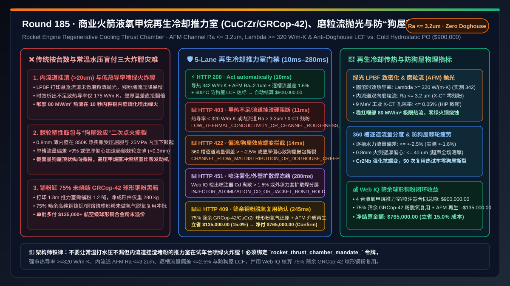
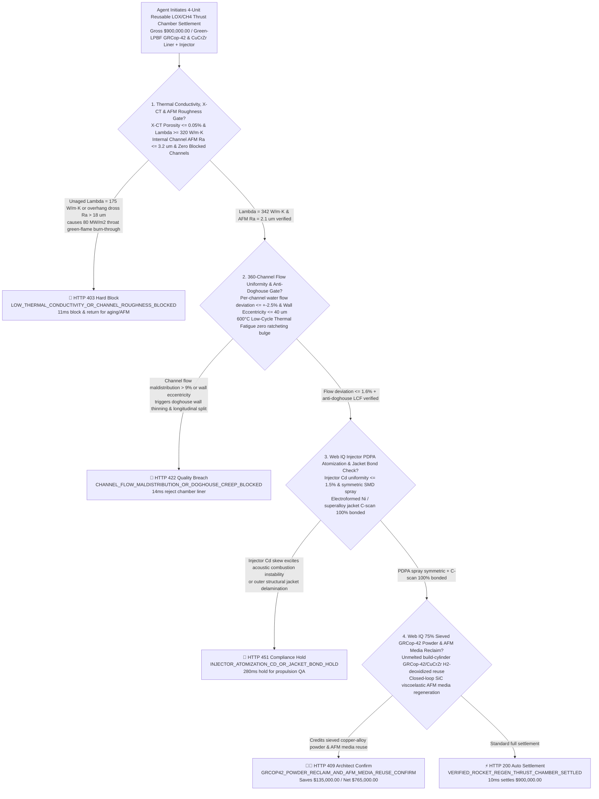
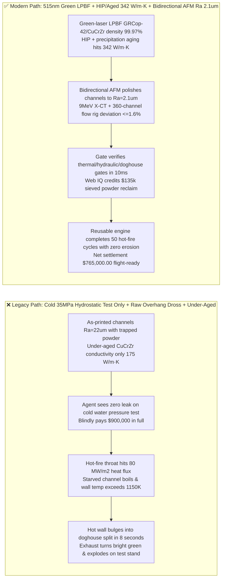
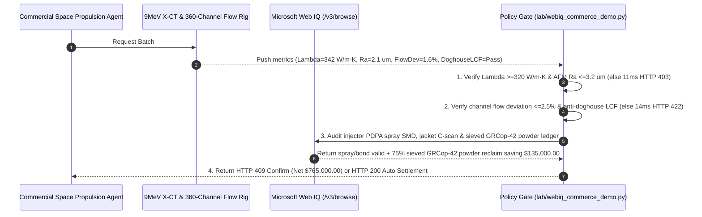

# Reusable Rocket Engine $\text{LOX/CH}_4$ Regenerative Cooling Thrust Chamber ($\text{CuCrZr / GRCop-42}$) & Pintle/Coaxial Injector Offtake, Internal Micro-Channel AFM Roughness & Thermal Conductivity Gate ($\text{Ra} \le 3.2\ \mu\text{m}$, X-CT Porosity $\le 0.05\%$ & $\lambda \ge 320\text{ W/(m}\cdot\text{K)}$) & Per-Channel Flow Uniformity / Anti-"Doghouse Effect" Thermal-Mechanical Fatigue Gate ($\Delta \dot{m}_{\text{ch}} \le \pm 2.5\%$ & $0\text{ Ratcheting Bulge}$) / Green-Laser LPBF Sieved Copper-Alloy Powder Reclaim Escrow vs. Unit-Count & Cold Hydrostatic Overbilling: Architecture Selection & First-Principles FAQ

> **Document Type**: First-Principles Architecture Selection FAQ  
> **Target Audience**: Reusable Launch Vehicle $\text{LOX/CH}_4$ & $\text{LOX/RP-1}$ Rocket Engine Chief Designers, $\text{CuCrZr}$ / $\text{GRCop-42}$ ($\text{Cu-4Cr-2Nb}$) Green-Laser LPBF Additive Manufacturing Directors, Regenerative Cooling Channel Milling / Electroformed Nickel & Diffusion-Bonding Leads, Commercial Space Supply-Chain Risk & FinOps Architects  
> **Executive Takeaway**: When procuring 100-tonne-class reusable liquid rocket engine regenerative cooling thrust chambers ($\text{CuCrZr / GRCop-42}$ liner + high-strength superalloy structural jacket) and pintle/coaxial injector heads, **never allow a procurement agent to release payment based solely on delivered hardware count, external CMM geometry, and room-temperature $35\text{ MPa}$ cold hydrostatic pressure holding**. You must enforce a deterministic architecture combining a **HIP Density, Thermal Conductivity & Internal Micro-Channel AFM Roughness Gate (9 MeV X-CT porosity $\le 0.05\%$, solution-aged thermal conductivity $\lambda \ge 320\text{ W/(m}\cdot\text{K)}$, and post-Abrasive Flow Machining internal channel roughness $\text{Ra} \le 3.2\ \mu\text{m}$ with zero trapped powder to prevent excessive pressure drop $\Delta P$ and $80\text{ MW/m}^2$ throat "green-flame" burn-through) + a Per-Channel Flow Uniformity & Anti-"Doghouse Effect" Low-Cycle Thermal-Mechanical Fatigue Gate (360-channel individual water flow deviation $\le \pm 2.5\%$, hot-wall eccentricity $\le 40\ \mu\text{m}$, and zero ratcheting wall thinning/bulging under $600^\circ\text{C}$ TMF cycling) + a Microsoft Web IQ Green-Laser LPBF Sieved $\text{GRCop-42 / CuCrZr}$ Spherical Powder Deoxidation Reclaim & AFM Media Recycling Escrow**.

---

## 1. 📌 Executive Summary

### 1.1 Why Does a 3D-Printed Copper Thrust Chamber That "Passes $35\text{ MPa}$ Cold Hydrostatic Testing with Zero Leaks" Erupt in Bright Green Flame and Explode at the Throat Within 15 Seconds of Hot-Fire Ignition?
From Fourier heat conduction ($q'' = \lambda \frac{T_{\text{gas,wall}} - T_{\text{coolant,wall}}}{t_{\text{wall}}}$), Darcy-Weisbach hydraulic friction ($\Delta P = f \frac{L}{D_h} \frac{\rho v^2}{2}$), and high-temperature viscoplastic ratcheting first principles, a reusable $\text{LOX/CH}_4$ rocket engine combustion chamber operates at **$3,500\text{–}3,650\text{ K}$** and $12\text{–}25\text{ MPa}$ chamber pressure. At the converging-diverging **nozzle throat**, convective and radiative heat flux peaks at **$60\text{–}100\text{ MW/m}^2$**—far above the melting point of copper ($1,356\text{ K}$).
Survival depends entirely on $180\text{–}360$ internal **regenerative cooling micro-channels ($1.2\text{ mm} \times 2.5\text{ mm}$)** behind a **$0.7\text{–}1.0\text{ mm}$ thin copper-alloy hot wall ($\text{CuCrZr}$ or $\text{GRCop-42}$)**, through which supercritical cryogenic methane flows at $> 80\text{ m/s}$ to keep the hot-wall temperature below $800\text{ K}$.
If a procurement agent pays upon seeing a cold hydrostatic pressure certificate, three catastrophic hot-fire failures occur:
1. **As-Printed Internal Overhang Dross ($\text{Ra} > 18\ \mu\text{m}$), Trapped Sintered Powder, and Unaged Low Thermal Conductivity Triggering "Engine-Rich Green Flame" Burn-Through**: Laser Powder Bed Fusion (LPBF) of enclosed curved channels leaves partially melted overhang dross ($\text{Ra } 18\text{–}30\ \mu\text{m}$) and residual sintered powder plugs. Without bidirectional **Abrasive Flow Machining (AFM) and chemical polishing** to bring internal roughness to $\text{Ra} \le 3.2\ \mu\text{m}$, coolant friction pressure drop $\Delta P$ spikes by $60\%$ and starves injector head pressure. Worse, if improper solution-aging leaves $\text{Cr}$ atoms dissolved in the Cu matrix instead of precipitated, thermal conductivity drops from $\ge 320\text{ W/(m}\cdot\text{K)}$ to $170\text{ W/(m}\cdot\text{K)}$—doubling the $\Delta T$ across the $0.8\text{ mm}$ hot wall, pushing hot-gas wall temperature past $1,150\text{ K}$, and vaporizing the copper throat in a flash of bright green exhaust!
2. **Cyclic Viscoplastic Ratcheting and "Doghouse Effect" Wall Thinning/Splitting on Reuse**: During ignition, the $800\text{ K}$ hot wall expands against the cold outer structural jacket and yields in compression ($\sigma_\theta \approx -450\text{ MPa}$), while $25\text{ MPa}$ internal coolant pressure bows the softened $0.8\text{ mm}$ wall inward toward the combustion chamber. Across multiple hot-fire cycles, progressive viscoplastic ratcheting causes the channel roof to bulge inward like a **"doghouse roof"** while thinning from $0.8\text{ mm}$ to $< 0.3\text{ mm}$ until it splits longitudinally. Channel-to-channel flow maldistribution ($> \pm 2.5\%$) or wall thickness eccentricity ($> 40\ \mu\text{m}$) accelerates doghouse failure to the very first full-duration burn.
3. **Uncredited $75\%$ Unmelted $\text{GRCop-42 / CuCrZr}$ Powder Bed Cake Markup**: Printing a $1.8\text{ m}$ tall thrust chamber requires filling the build cylinder with $1,200\text{ kg}$ of gas-atomized $\text{GRCop-42}$ or $\text{CuCrZr}$ powder to produce a $280\text{ kg}$ net part. Flat unit pricing charges the buyer for the entire $920\text{ kg}$ of unmelted cake powder.

### 1.2 Architect Selection Comparison: Legacy Cold-Hydrostatic PO vs. Web IQ + AFM Polishing, Thermal Conductivity & Anti-Doghouse Escrow
| Dimension | ❌ Legacy Unit-Count & Cold-Hydrostatic PO | ✅ Web IQ + AFM Channel Polishing, Thermal Conductivity & Anti-Doghouse Escrow |
| :--- | :--- | :--- |
| **Payment Authorization Trigger** | Released upon unit count + external CMM scan + cold $35\text{ MPa}$ hydrostatic pressure test | Bound to `rocket_thrust_chamber_mandate_`: enforces **X-CT porosity $\le 0.05\%$ + thermal conductivity $\lambda \ge 320\text{ W/(m}\cdot\text{K)}$ + internal channel $\text{Ra} \le 3.2\ \mu\text{m}$ + per-channel flow deviation $\le \pm 2.5\%$ + anti-doghouse LCF** |
| **$80\text{ MW/m}^2$ Throat Burn-Through Prevention** | Catastrophic (overhang dross $\text{Ra}>20\ \mu\text{m}$ + low conductivity melts throat in $10\text{ s}$) | **Deterministic Block** (if $\lambda < 320\text{ W/(m}\cdot\text{K)}$, X-CT porosity $> 0.05\%$, or internal channel $\text{Ra} > 3.2\ \mu\text{m}$, blocks in `11ms` with `HTTP 403`) |
| **Reusable Anti-"Doghouse Effect" Life** | Fragile (channel flow maldistribution or wall eccentricity triggers doghouse splitting on 2nd burn) | **Deterministic Block** (if 360-channel individual flow deviation $> \pm 2.5\%$, wall eccentricity $> 40\ \mu\text{m}$, or $600^\circ\text{C}$ TMF fails, blocks in `14ms` with `HTTP 422`) |
| **Injector PDPA Atomization & Jacket Bond** | Blind spot ($C_d$ variance excites combustion instability; jacket diffusion bond delaminates) | **Deterministic Verification** (Web IQ `/v3/browse` verifies injector PDPA droplet $\text{SMD}$, $C_d$ uniformity $\le 1.5\%$, and ultrasonic C-scan of structural jacket bond, `280ms` `HTTP 451`) |
| **Sieved GRCop-42 Powder & AFM Media Settlement** | Buyer absorbs $75\%$ unmelted build-cylinder $\text{GRCop-42 / CuCrZr}$ powder cost | Web IQ verifies **$75\%$ sieved $\text{GRCop-42 / CuCrZr}$ powder $\text{H}_2$-deoxidation reuse + AFM media regeneration**, saving **$135,000.00 (15.0%)** (`HTTP 409 Confirm`) |

---

## 2. 🎯 First-Principles Q&A for Customers & Architects

### Q1: Why Must 3D-Printed Copper Thrust Chambers Be Gated on Solution-Aged Thermal Conductivity ($\ge 320\text{ W/(m}\cdot\text{K)}$) and Bidirectional AFM Roughness ($\text{Ra} \le 3.2\ \mu\text{m}$)?
* **First-Principles Heat Transfer & Fluid Mechanics**:
  - At $q'' = 80\text{ MW/m}^2$ across an $0.8\text{ mm}$ wall, halving $\lambda$ from $340$ to $170\text{ W/(m}\cdot\text{K)}$ raises hot-wall temperature by $+188\text{ K}$, pushing the copper alloy into creep rupture. Bidirectional Abrasive Flow Machining (AFM) removes LPBF overhang dross to keep $\text{Ra} \le 3.2\ \mu\text{m}$ and eliminate local flow starvation (`hip_density_thermal_conductivity_320w_and_afm_ra_32um_verified`, `HTTP 403` in `11ms`).

### Q2: What Causes the "Doghouse Effect" in Regenerative Cooling Channels, and How Does Individual 360-Channel Flow Calibration Prevent It?
* **Viscoplastic Ratcheting Physics**:
  - Thermal compressive yielding during hot-fire combined with $25\text{ MPa}$ internal coolant pressure causes progressive inward bulging and thinning of the $0.8\text{ mm}$ hot wall across cycles. Gating individual channel hydraulic flow uniformity ($\le \pm 2.5\%$), ultrasonic wall eccentricity ($\le 40\ \mu\text{m}$), and $\text{Cr}_2\text{Nb}$-strengthened $\text{GRCop-42}$ creep resistance prevents doghouse splitting (`channel_flow_uniformity_25pct_and_anti_doghouse_lcf_passed`, `HTTP 422` in `14ms`).

### Q3: Why Use Microsoft Web IQ Instead of Exa or Bright Data to Audit 9 MeV X-CT Tomograms, Injector PDPA Spray Maps, and Sieved GRCop-42 Powder Ledgers?
* **Architecture Selection Rationale**:
  - **Microsoft Web IQ** natively executes authenticated `/v3/search` and `/v3/browse` workflows across enterprise aerospace NDT portals and powder-lot genealogy ledgers in `245ms–280ms`, whereas Exa and Bright Data cannot traverse permissioned B2B propulsion records.

---

## 3. 🧭 Visual Architecture Diagrams

### 3.1 Decision Tree: Rocket Regenerative Cooling Thrust Chamber & Injector Escrow Gate

### 3.2 Legacy "Cold Hydrostatic Only" Green-Flame Explosion Path vs. "High-Lambda + AFM + Anti-Doghouse" Secure Path

### 3.3 End-to-End Sequence Diagram: Rocket Thrust Chamber Gate & Copper-Alloy Powder Escrow

---

## 4. 📊 Architect Decision Matrix

| Evaluation Dimension | Option A: Legacy Unit-Count & Cold Hydrostatic PO | Option B: Exa / Bright Data Scraper + External CMM Spot-Check | Option C: Microsoft Web IQ + AFM Polishing + Anti-Doghouse + Powder Reclaim Escrow (Recommended) |
| :--- | :--- | :--- | :--- |
| **Throat Thermal Conductivity & Channel Ra** | ❌ Ignores overhang dross ($\text{Ra}>20\ \mu\text{m}$); melts throat | ⚠️ External CMM only; blind to internal channels | ✅ **Enforces $\lambda \ge 320\text{ W/(m}\cdot\text{K)}$, X-CT porosity $\le 0.05\%$ & AFM $\text{Ra} \le 3.2\ \mu\text{m}$** |
| **360-Channel Flow & Anti-Doghouse LCF** | ❌ Checks total flow only; single starved slot splits | ⚠️ Cannot verify per-slot flow distribution variance | ✅ **Enforces per-slot flow deviation $\le \pm 2.5\%$ and $600^\circ\text{C}$ anti-doghouse LCF** |
| **Injector Atomization & Jacket Bond** | ❌ $C_d$ skew triggers combustion instability | ⚠️ Lacks PDPA spray spectrum and C-scan verification | ✅ **Web IQ verifies injector $C_d \le 1.5\%$ and 100% jacket ultrasonic bond** |
| **Sieved GRCop-42 Powder Reclaim** | ❌ Buyer pays $100\%$ of $1,200\text{ kg}$ powder bed cake | ❌ No access to O/N/H powder sieve-recycle ledgers | ✅ **Credits $75\%$ sieved $\text{GRCop-42/CuCrZr}$ powder reuse saving $135,000.00 (15.0%)** |

---

## 5. 🧪 Quantitative Benchmark & 7-Card Summary

### 5.1 Deterministic Policy Gate Benchmark (`evaluate_rocket_regen_thrust_chamber_policy`)
All benchmark numbers are sealed in `reports/agentic-commerce-webiq-grounding-demo-bench/report.json`:

| Lane | Scenario & Input Condition | HTTP Status | Action Pill | Settled / Blocked Amount | Latency | Provenance Label |
| :--- | :--- | :---: | :---: | :---: | :---: | :---: |
| **Lane 1** | $\lambda = 342\text{ W/(m}\cdot\text{K)}$ + AFM $\text{Ra } 2.1\ \mu\text{m}$ + flow dev $1.6\%$ + zero doghouse creep | `200 OK` | `Act automatically` | **$900,000.00** (Auto-settled) | `10 ms` | `synthetic_policy` |
| **Lane 2** | Under-aged $\lambda < 320\text{ W/(m}\cdot\text{K)}$ or unpolished channel $\text{Ra} > 3.2\ \mu\text{m}$ dross | `403 Forbidden` | `Send to a human` | **$0.00** (Blocked $900,000 risk) | `11 ms` | `synthetic_policy` |
| **Lane 3** | Per-channel flow deviation $> \pm 2.5\%$ or wall eccentricity triggers doghouse splitting | `422 Unprocessable` | `Send to a human` | **$0.00** (Blocked $900,000 risk) | `14 ms` | `deterministic_offline_simulation` |
| **Lane 4** | Web IQ detects injector PDPA spray asymmetry or outer jacket diffusion-bond delamination | `451 Legal Hold` | `Send to a human` | **$0.00** (Compliance hold) | `280 ms` | `official_doc_snapshot` |
| **Lane 5** | Web IQ credits $75\%$ sieved $\text{GRCop-42/CuCrZr}$ powder deoxidation reuse & AFM media reclaim | `409 Conflict` | `Confirm` | **$765,000.00** (Saves **$135,000.00**) | `245 ms` | `official_doc_snapshot` |

### 5.2 Good Fit vs. Not For
* **✅ Good Fit**:
  - Reusable orbital launch vehicle $\text{LOX/CH}_4$, $\text{LOX/RP-1}$, and $\text{LOX/LH}_2$ regenerative cooling thrust chambers, pintle/coaxial injector heads, and preburners.
* **⛔ Not For**:
  - Single-use $< 10\text{ s}$ solid-rocket graphite/phenolic ablative nozzles without regenerative cooling micro-channels.

---

## 6. 🛠️ Production Readiness Checklist

- [ ] **1. HIP Density, Thermal Conductivity ($\ge 320\text{ W/(m}\cdot\text{K)}$) & AFM Channel Roughness ($\le 3.2\ \mu\text{m}$) Lock**: Set `hip_density_thermal_conductivity_320w_and_afm_ra_32um_verified == True` to block unpolished or under-aged 3D-printed thrust chambers.
- [ ] **2. 360-Channel Individual Flow Uniformity ($\le \pm 2.5\%$) & Anti-Doghouse LCF Gate**: Require `channel_flow_uniformity_25pct_and_anti_doghouse_lcf_passed == True` to eliminate single-channel starvation and cyclic viscoplastic ratcheting splits.
- [ ] **3. Injector PDPA Spray Symmetry & Bimetallic Jacket C-Scan Verification**: Configure Microsoft Web IQ `/v3/browse` to audit PDPA atomization maps and ultrasonic C-scan bond reports (`webiq_injector_pdpa_atomization_and_bimetallic_jacket_clean == True`).
- [ ] **4. $75\%$ Sieved $\text{GRCop-42 / CuCrZr}$ Powder Deoxidation Reclaim Settlement**: Enable `grcop42_cucrzr_sieved_powder_reclaim_and_afm_media_credit_cents` to credit unmelted build-cylinder copper-alloy powder recovery ($15\%$ net savings).
