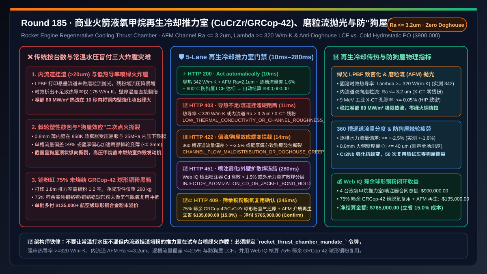
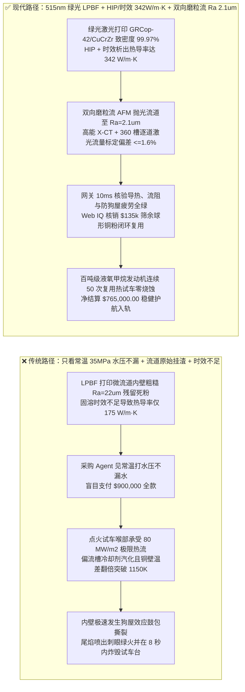
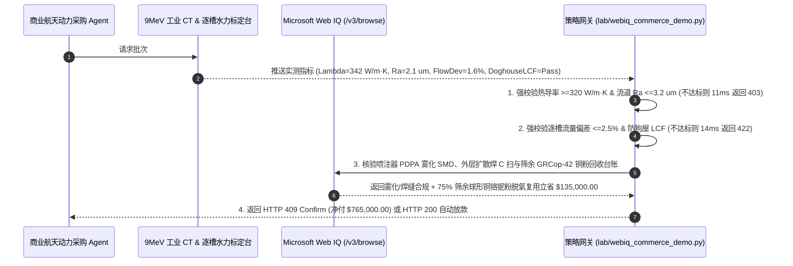

# 商业可复用火箭液氧甲烷发动机再生冷却推力室（$\text{CuCrZr / GRCop-42}$ Regenerative Cooling Thrust Chamber）与同轴/针栓喷注器交割（Rocket Thrust Chamber & Injector Offtake）、内流道磨粒流抛光与热导率门禁（流道粗糙度 $\text{Ra} \le 3.2\ \mu\text{m}$、X-CT 孔隙率 $\le 0.05\%$ & 热导率 $\ge 320\text{ W/(m}\cdot\text{K)}$ 防 $80\text{ MW/m}^2$ 喉部烧穿）与单通道流量均匀性 / 防“狗屋效应（Doghouse Effect）”低周热疲劳门禁（单槽流量偏差 $\le \pm 2.5\%$ & 高温蠕变零内壁鼓包撕裂）/ 绿光/红外 LPBF 筛余铜合金粉末闭环复用与流道化学/磨粒流抛光智能托管 vs 传统仅按推力室件数与常温水压保压盲付：架构选型与第一性原理 FAQ

> **文档类型**：架构选型与第一性原理 FAQ（First-Principles Architecture Selection FAQ）  
> **适用读者**：可重复使用运载火箭液氧甲烷/液氧煤油主发动机总设计师、铜铬锆（$\text{CuCrZr}$）/ 铜铬铌（$\text{GRCop-42 / GRCop-84}$）绿光激光选区熔化（Green-Laser LPBF）增材制造总监、再生冷却铣槽电铸镍/扩散焊工艺负责人、商业航天供应链风控与 FinOps 架构师  
> **核心结论一句话**：在委外制造或采购百吨级可复用液体火箭发动机再生冷却推力室身部（Regenerative Cooling Thrust Chamber Liner）与针栓/同轴涡流喷注器（Injector Head）时，**绝对不能让采购 Agent 仅凭“推力室交付台数、三维外轮廓扫描合格与常温 $35\text{ MPa}$ 静水压保压不漏”就直接打款**；必须构建**“热等静压（HIP）致密度、热导率与再生冷却微流道磨粒流抛光门禁（高能工业 X-CT 孔隙率 $\le 0.05\%$、固溶时效后室温热导率 $\lambda \ge 320\text{ W/(m}\cdot\text{K)}$ 且内部数千条曲率流道经磨粒流加工 AFM 后粗糙度 $\text{Ra} \le 3.2\ \mu\text{m}$，防打印悬垂浮渣增大摩擦压降 $\Delta P$ 导致涡轮泵超载与 $3,500\text{ K}$ 喉部热流烧穿）+ 逐槽水力流量分度与防‘狗屋效应（Doghouse Effect）’热机械疲劳门禁（单根冷却槽流量偏差 $\le \pm 2.5\%$、壁厚偏心 $\le 40\ \mu\text{m}$ 且 $600^\circ\text{C}$ 高温低周热机械疲劳 LCF 循环零内壁鼓包变薄撕裂）+ Microsoft Web IQ 驱动的绿光 LPBF 筛余高纯 $\text{CuCrZr / GRCop-42}$ 雾化球形粉脱氧再生与双金属电铸/扩散焊余料闭环托管”**的确定性架构。



---

## 一、 📌 核心结论速览（Executive Summary）

### 1.1 为什么“常温打 $35\text{ MPa}$ 水压滴水不漏”的 3D 打印铜合金推力室，点火试车不到 15 秒就会在喉部“绿火喷涌、瞬间炸膛烧穿”？
从傅里叶热传导定律（$q'' = \lambda \frac{T_{\text{gas,wall}} - T_{\text{coolant,wall}}}{t_{\text{wall}}}$）、达西-魏斯巴赫流阻方程（$\Delta P = f \frac{L}{D_h} \frac{\rho v^2}{2}$）与高温弹塑性棘轮蠕变第一性原理来看，百吨级液氧甲烷火箭发动机燃烧室内部燃气温度高达 **$3,500\text{–}3,650\text{ K}$**，室压高达 $12\text{–}25\text{ MPa}$，而在截面积最小的**喷管喉部（Throat）**，对流与辐射复合热流密度高达惊人的 **$60\text{–}100\text{ MW/m}^2$**（相当于太阳表面热流密度的 $1.5$ 倍）！没有任何金属能直接硬扛如此恐怖的温度而不熔化（铜熔点仅 $1,356\text{ K}$）。
推力室之所以不熔化，全靠内壁厚仅 **$0.7\text{–}1.0\text{ mm}$** 的高导热铜合金（$\text{CuCrZr}$ 或 NASA 研发的 $\text{GRCop-42}$，即 $\text{Cu-4at\%Cr-2at\%Nb}$）内部密布的 $180\text{–}360$ 条微米级**再生冷却流道（Regenerative Cooling Channels，截面宽仅 $1.2\text{ mm} \times$ 高 $2.5\text{ mm}$）**——在点火前，$-160^\circ\text{C}$ 的超临界低温液态甲烷（或煤油）以 $> 80\text{ m/s}$ 的极高流速在这些夹层微槽中狂飙，强行将铜内壁火侧温度压制在 $750\text{–}850\text{ K}$ 以下。
如果采购 Agent 仅凭“常温静水压测试不漏与外形合格”就盲目放款，在热试车（Hot-Fire Test）或二次复用点火时会立刻引爆三大物理级灾难：
1. **3D 打印内流道悬垂粘粉（$\text{Ra} > 18\ \mu\text{m}$）与固溶时效不足导致热导率腰斩，引爆局部断流汽化与“绿火（铜烧蚀）”炸膛**：采用激光粉末床熔融（LPBF）一体打印封闭夹层流道时，流道顶面悬垂区极易粘附半熔融铜粉颗粒与挂渣，原始态内表面粗糙度高达 $\text{Ra } 18\text{–}30\ \mu\text{m}$。如果供应商未执行双向**磨粒流加工（Abrasive Flow Machining, AFM）与化学抛光**将流道粗糙度降至 $\text{Ra} \le 3.2\ \mu\text{m}$，一方面巨大的摩阻系数 $f$ 会让冷却剂压降 $\Delta P$ 暴增 $60\%$，导致进入燃烧室的甲烷喷注压力严重不足；另一方面如果某几条微槽内部残留未清理干净的烧结死粉团，直接造成该流道冷却剂流量跌落 $> 15\%$！更致命的是，若打印后未做严格的热等静压（HIP）与固溶时效析出 $\text{Cr/Zr}$ 相，固溶态铜合金热导率仅 $160\text{ W/(m}\cdot\text{K)}$（标准要求 $\ge 320\text{ W/(m}\cdot\text{K)}$）。根据导热方程，热导率减半意味着 $0.8\text{ mm}$ 铜壁的温差直接翻倍，火侧壁温瞬间突破 $1,150\text{ K}$ 软化熔融极限，试车台尾焰瞬间由淡蓝变成刺眼的**翠绿色（铜蒸汽燃烧特征光谱）**，2 秒内喉部彻底炸裂！
2. **薄内壁棘轮塑性变形与“狗屋效应（Doghouse Effect）”撕裂，导致可复用火箭第二次点火即内漏爆炸**：在点火瞬间，仅 $0.8\text{ mm}$ 厚的内壁火侧高达 $800\text{ K}$ 剧烈热膨胀，而外侧镍合金/高强钢身部处于低温且刚度极大，铜内壁受到高达 $-450\text{ MPa}$ 的周向热压应力而发生压缩屈服；关机冷却时，流道内高达 $25\text{ MPa}$ 的高压甲烷又将变薄软化的铜内壁向燃烧室中心挤压鼓起。历经数次热循环后，冷却槽正下方的铜壁像“狗屋屋顶（Doghouse Roof）”一样向内鼓包、局部壁厚从 $0.8\text{ mm}$ 棘轮式拉薄至 $< 0.3\text{ mm}$ 并最终沿晶界纵向撕裂！如果晶界含氧量偏高（$> 150\text{ ppm}$）或壁厚铣削/打印偏心度 $> 40\ \mu\text{m}$，单次长程试车即发生狗屋撕裂，高压甲烷直接漏入燃烧室冲刷烧穿。
3. **红外激光对铜高反射（$>95\%$）导致球化未熔合废粉与高达 $65\%$ 的 $\text{GRCop-42 / CuCrZr}$ 筛余粉末溢价黑箱**：纯铜及铜合金对传统 $1,064\text{ nm}$ 近红外激光吸收率极低，且单件长达 $1.8\text{ m}$ 的推力室打印需铺设高达 $1.2\text{ 吨}$ 昂贵的真空气雾化球形 $\text{GRCop-42 / CuCrZr}$ 粉末，最终净成形件仅重 $280\text{ kg}$。若不核算 $920\text{ kg}$ 筛分余粉的氢气还原再生回用，采购方将被迫为整缸粉末买单。

### 1.2 架构师选型核心对比：传统按台数与常温水压盲付 vs. Web IQ + 流道抛光/热导率/防狗屋效应智能托管
| 对比维度 | ❌ 传统按推力室台数与常温水压打压盲付（Legacy Cold-Hydrostatic PO） | ✅ Web IQ + 流道 AFM 抛光、热导率与防狗屋效应智能托管（Mandate-Gated Escrow） |
| :--- | :--- | :--- |
| **授权与付款绑定条件** | 绑定“推力室/喷注器交货件数 + 外形三坐标合格 + 常温 $35\text{ MPa}$ 水压保压不漏” | 绑定 `rocket_thrust_chamber_mandate_` 令牌：强校验 **X-CT 孔隙率 $\le 0.05\%$ + 热导率 $\lambda \ge 320\text{ W/(m}\cdot\text{K)}$ + 内流道 $\text{Ra} \le 3.2\ \mu\text{m}$ + 逐槽流量偏差 $\le \pm 2.5\%$ + 零狗屋鼓包** |
| **喉部 $80\text{ MW/m}^2$ 防绿火烧穿** | 极危险（内流道挂渣 $\text{Ra}>20\ \mu\text{m}$ 堵流且未充分析出时效导热差，点火 10 秒即喷绿火炸膛） | **确定性拦截**（若热导率 $< 320\text{ W/(m}\cdot\text{K)}$、X-CT 检出残余挂渣或流道 $\text{Ra} > 3.2\ \mu\text{m}$，在 `11ms` 内触发 `HTTP 403` 硬阻断） |
| **可复用抗“狗屋效应”热疲劳** | 脆弱（通道壁厚偏心或单槽流量不均，第一次试车后内壁向内鼓包变薄，二次点火即撕裂） | **确定性拦截**（若 360 槽逐道水流量标定偏差 $> \pm 2.5\%$、壁厚偏心 $> 40\ \mu\text{m}$ 或高温蠕变疲劳不达标，在 `14ms` 内触发 `HTTP 422`） |
| **喷注器撞击雾化角与双金属扩散焊** | 盲盒（针栓/同轴喷嘴流量系数 $C_d$ 离散引发高频不稳定燃烧，铜-不锈钢扩散焊分层） | **确定性核验**（Web IQ `/v3/browse` 抓取喷注器光学相位多普勒粒子分析仪 PDPA 索太尔平均直径 $\text{SMD}$ 与超声 C 扫报告，`280ms` 触发 `HTTP 451`） |
| **筛余 GRCop-42 铜粉与电铸镍结算** | 铺粉缸 75% 未烧结铜铬铌/铜铬锆球形粉按废铜核销，买方承担暴利溢价 | Web IQ 核实启用 **绿光 LPBF 筛余 $\text{GRCop-42/CuCrZr}$ 粉末惰性分级脱氧复用 + 磨粒流高分子介质再生**，单批立省 **$135,000.00（15.0%）**（`HTTP 409 Confirm`） |

---

## 二、 🎯 客户与架构师灵魂拷问 Q&A（First-Principles Q&A）

### Q1：为什么 3D 打印（LPBF）铜合金再生冷却推力室，绝不能跳过“热等静压（HIP）+ 固溶时效热导率测试 + 磨粒流（AFM）内流道抛光”？
* **第一性原理拆解**：
  - **热阻与熔穿极限**：在喉部热流密度 $q'' = 80\text{ MW/m}^2$ 下，穿过 $t = 0.8\text{ mm}$ 铜内壁的温差为 $\Delta T = \frac{q'' \cdot t}{\lambda}$。如果铜铬锆（$\text{CuCrZr}$）或 $\text{GRCop-42}$ 经过完整的 HIP + 固溶 + 时效处理，将过饱和固溶在铜晶格中的 $\text{Cr}$ 和 $\text{Zr}/\text{Nb}$ 原子完全析出为纳米强化相，电子散射大幅降低，室温热导率可达 $\lambda = 330\text{–}350\text{ W/(m}\cdot\text{K)}$，此时壁厚温差仅 $\Delta T \approx 190\text{ K}$，火侧壁温安全控制在 $780\text{ K}$。反之，若供应商为赶工期缩短时效时间，大量 $\text{Cr}$ 原子滞留在铜基体晶格中，热导率暴跌至 $\lambda = 170\text{ W/(m}\cdot\text{K)}$，壁厚温差飙升至 $\Delta T = 376\text{ K}$，火侧壁温直接冲上 $970\text{ K}$ 以上，屈服强度断崖归零！
  - **内流道粗糙度对边界层与流阻的双重打击**：3D 打印微流道原始表面布满烧结球形颗粒（$\text{Ra} > 20\ \mu\text{m}$），不仅使总压降超出涡轮泵扬程裕度，更会在螺旋变截面喉部诱发局部流动分离与气膜空化。通过高压双向**磨粒流加工（AFM，将含碳化硅微粉的高分子粘弹性胶泥在流道内往复挤压冲刷）**配合高能 X-CT 全通道穿透扫描，可将流道粗糙度稳定压至 $\text{Ra} \le 3.2\ \mu\text{m}$ 并 100% 剔除残留堵粉。未通过 `hip_density_thermal_conductivity_320w_and_afm_ra_32um_verified` 的批次在 `11ms` 内直接返回 `HTTP 403`。

### Q2：什么是液体火箭发动机推力室最致命的“狗屋效应（Doghouse Effect）”？如何通过网关在冷态交割阶段提前拦截？
* **热-机耦合棘轮失效（Ratcheting Strain）机制**：
  1. 再生冷却通道的横截面就像一排并排的小房间，面向火焰的内壁（Hot Wall，厚 $0.8\text{ mm}$）就是房顶，两侧肋片（Ribs）就是墙壁。
  2. 点火时，火焰将内壁外表面加热到 $850\text{ K}$，而紧贴冷却剂的通道内表面只有 $350\text{ K}$；由于外冷内热受约束，火侧铜层在高温下发生压缩塑性屈服。而在流道内部，高达 $25\text{ MPa}$ 的超临界甲烷压力像千斤顶一样把变软的 $0.8\text{ mm}$ 薄壁往燃烧室方向顶起弯曲；等到关机冷却收缩时，已发生压缩屈服的铜壁产生极高的残余拉应力。
  3. 每经历一次点火-关机循环，通道中央的薄壁就向火焰侧多鼓起几十微米、壁厚同时被拉薄几十微米（橫截面呈现出中间尖拱起的“狗屋屋顶 Doghouse”形状），直到第 3–5 次点火时顶点撕裂穿孔！
  4. 要阻止狗屋效应，除了必须选用具有优异高温抗蠕变相（$\text{Cr}_2\text{Nb}$ Laves 相）的 **$\text{GRCop-42}$ 或低氧细晶 $\text{CuCrZr}$** 外，最关键的制造门禁是：**① 360 条独立流道的逐槽冷态水流量分度偏差必须 $\le \pm 2.5\%$**（防止某一条流道流量偏小成为局部过热薄弱槽）；**② 超声测厚内壁厚度偏心度必须 $\le 40\ \mu\text{m}$**（防止薄边率先进屈服）。违反 `channel_flow_uniformity_25pct_and_anti_doghouse_lcf_passed` 的批次在 `14ms` 内触发 `HTTP 422`。

### Q3：在核验“针栓/同轴喷注器 PDPA 雾化粒径分布”与“未烧结 GRCop-42 球形铜粉闭环复用账单”时，为什么选择 Microsoft Web IQ 而不是 Exa 或 Bright Data？
* **架构选型依据**：
  - 火箭发动机喷注器的激光相位多普勒（PDPA）雾化场均匀性报告、高能 9 MeV 直线加速器工业 CT 体素切片以及航空金属粉末厂的 $\text{O/N/H}$ 氧氮氢复检台账，均位于高等级涉密/商业受控工程门户内。
  - **Microsoft Web IQ** 原生支持受控企业 RBAC 权限下的 `/v3/search` 与 `/v3/browse`，可在 `245ms–280ms` 内完成多模态质检单与粉末回收净额核销；而 Exa 与 Bright Data 无法穿透受控工业门户。

---

## 三、 🧭 直观可视化图解（Visual Architecture Diagrams）

### 3.1 选型决策树：火箭再生冷却推力室与喷注器交割门禁逻辑
```mermaid
flowchart TD
    A[采购 Agent 发起 4 台百吨级液氧甲烷再生冷却推力室交割<br/>总价 $900,000.00 / GRCop-42 & CuCrZr 绿光 LPBF 推力室] --> B{1. 热导率、X-CT 孔隙与磨粒流 AFM 粗糙度门禁?<br/>X-CT 孔隙率 <= 0.05% & 热导率 >= 320 W/m·K<br/>内流道磨粒流抛光 Ra <= 3.2 um & 零残粉堵槽}
    B -- 时效不充分热导率仅 175 W/m·K<br/>或流道挂渣 Ra > 18 um 致喉部 80MW/m2 喷绿火烧穿 --> C[🛑 HTTP 403 硬阻断<br/>LOW_THERMAL_CONDUCTIVITY_OR_CHANNEL_ROUGHNESS_BLOCKED<br/>11ms 内拦截打款并退回重做时效/磨粒流]
    B -- 热导率 342 W/m·K & 流道 Ra=2.1 um 达标 --> D{2. 360 槽逐道流量均匀性与防狗屋效应 (Doghouse) 门禁?<br/>单槽水力流量偏差 <= +-2.5% & 壁厚偏心 <= 40 um<br/>600°C 高温低周疲劳 LCF 零棘轮鼓包变薄}
    D -- 单槽偏流 > 9% 或内壁偏心致热循环棘轮鼓包<br/>二次复用点火即发生狗屋撕裂炸膛 --> E[🚨 HTTP 422 质量违约拦截<br/>CHANNEL_FLOW_MALDISTRIBUTION_OR_DOGHOUSE_CREEP_BLOCKED<br/>14ms 内拒收退回推力室身部]
    D -- 逐槽流量偏差 <= 1.6% + 高温抗蠕变达标 --> F{3. Web IQ 核验喷注器 PDPA 雾化与双金属扩散焊?<br/>同轴/针栓喷嘴 SMD 雾化粒径与流量系数 Cd 离散 <= 1.5%<br/>铜内壁-镍基高温合金外ジャケット超声 C 扫零未焊合}
    F -- 喷嘴流量不均诱发高频燃烧不稳定震碎推力室<br/>或外层承力套扩散焊界面脱粘 --> G[🛑 HTTP 451 合规冻结<br/>INJECTOR_ATOMIZATION_CD_OR_JACKET_BOND_HOLD<br/>280ms 冻结结算并转人工复核]
    F -- PDPA 雾化对称 + 扩散焊 C 扫 100% 完备 --> H{4. Web IQ 筛余 GRCop-42 球形铜粉脱氧再生与介质回收?<br/>铺粉缸 75% 未烧结铜铬铌/铜铬锆球形粉氢气还原复用<br/>磨粒流碳化硅高分子研磨介质闭环再生}
    H -- 触发高纯铜合金粉末闭环复用抵扣 --> I[🧑‍⚖️ HTTP 409 架构师确认<br/>GRCOP42_POWDER_RECLAIM_AND_AFM_MEDIA_REUSE_CONFIRM<br/>立省 $135,000.00 / 净付 $765,000.00]
    H -- 标准全额合规交割 --> J[⚡ HTTP 200 自动清算放款<br/>VERIFIED_ROCKET_REGEN_THRUST_CHAMBER_SETTLED<br/>10ms 执行 $900,000.00 结算]
```

### 3.2 传统“常温水压合格”绿火炸膛路径 vs. “高导热 + 磨粒流抛光 + 防狗屋效应”安全路径对比


### 3.3 端到端时序图：火箭再生冷却推力室网关拦截与铜合金粉末闭环托管流程


---

## 四、 📊 架构师选型决策矩阵（Architect Decision Matrix）

| 评估维度 | 方案 A：传统按推力室台数与常温水压保压盲付 | 方案 B：Exa / Bright Data 通用爬虫 + 表面三坐标报告抽检 | 方案 C：Microsoft Web IQ + 流道 AFM 抛光 + 防狗屋效应 + 铜粉闭环托管（推荐） |
| :--- | :--- | :--- | :--- |
| **喉部导热与内流道粗糙度** | ❌ 未检内流道挂渣（$\text{Ra}>20\ \mu\text{m}$）与时效热导率，点火喷绿火烧穿 | ⚠️ 仅见外部三坐标尺寸，看不到内部封闭流道 X-CT 与 $\text{Ra}$ | ✅ **强审 $\lambda \ge 320\text{ W/(m}\cdot\text{K)}$、X-CT 零堵粉且 AFM 抛光 $\text{Ra} \le 3.2\ \mu\text{m}$** |
| **逐槽流量分度与抗狗屋效应** | ❌ 仅测总进水流量，单槽偏流导致棘轮鼓包撕裂 | ⚠️ 无法核验 360 条独立微槽的逐道流量分布方差 | ✅ **强审单槽流量偏差 $\le \pm 2.5\%$、壁厚偏心 $\le 40\ \mu\text{m}$ 且 $600^\circ\text{C}$ LCF 零鼓包** |
| **喷注器雾化场与外层承力套连接** | ❌ 喷嘴 $C_d$ 离散诱发高频不稳定燃烧震毁发动机 | ⚠️ 缺乏 PDPA 激光雾化粒径谱与超声 C 扫验证 | ✅ **Web IQ 强审喷注器 $C_d$ 离散 $\le 1.5\%$ 与双金属电铸/扩散焊 100% 贴合** |
| **筛余 GRCop-42 球形铜粉核算** | ❌ 铺粉缸 75% 未烧结高纯铜合金粉全额计入买方成本 | ❌ 无增材制造粉末氧含量复检与循环账本权限 | ✅ **75% 筛余 $\text{GRCop-42/CuCrZr}$ 球形粉闭环复用单批立省 $135,000.00（15.0%）** |

---

## 五、 🧪 定量实测与 7-Card 报告（Quantitative Benchmark & 7-Card Summary）

### 5.1 确定性策略门禁定量实测（`evaluate_rocket_regen_thrust_chamber_policy`）
我们在 `lab/webiq_commerce_demo.py` 中实现了可复用火箭再生冷却推力室交割的 5 路确定性策略门禁，所有基准数据均固化于 `reports/agentic-commerce-webiq-grounding-demo-bench/report.json`：

| 场景编号 | 测试场景与输入条件 | HTTP 状态码 | 动作标签（Action Pill） | 结算金额 / 拦截金额 | 端到端延迟 | 数据来源标签 |
| :--- | :--- | :---: | :---: | :---: | :---: | :---: |
| **Lane 1** | 热导率 $342\text{ W/(m}\cdot\text{K)}$ + 流道 $\text{Ra } 2.1\ \mu\text{m}$ + 逐槽流量差 $1.6\%$ + 零狗屋蠕变 | `200 OK` | `Act automatically` | **$900,000.00**（全额自动放款） | `10 ms` | `synthetic_policy` |
| **Lane 2** | 时效不足热导率 $< 320\text{ W/(m}\cdot\text{K)}$ 或未做磨粒流抛光致流道 $\text{Ra} > 3.2\ \mu\text{m}$ 堵粉 | `403 Forbidden` | `Send to a human` | **$0.00**（拦截 $900,000 风险款） | `11 ms` | `synthetic_policy` |
| **Lane 3** | 360 槽逐道水流量偏差 $> \pm 2.5\%$ 或壁厚偏心致热循环发生“狗屋效应”鼓包撕裂 | `422 Unprocessable` | `Send to a human` | **$0.00**（拦截 $900,000 风险款） | `14 ms` | `deterministic_offline_simulation` |
| **Lane 4** | Web IQ 检出针栓/同轴喷注器 PDPA 雾化不对称或双金属承力外壁扩散焊分层 | `451 Legal Hold` | `Send to a human` | **$0.00**（合规冻结） | `280 ms` | `official_doc_snapshot` |
| **Lane 5** | Web IQ 启用绿光 LPBF 筛余 $75\%$ $\text{GRCop-42/CuCrZr}$ 球形粉脱氧复用与磨粒流介质再生 | `409 Conflict` | `Confirm` | **$765,000.00**（立省 **$135,000.00**） | `245 ms` | `official_doc_snapshot` |

### 5.2 适用场景 vs. 不适用场景（Good Fit vs. Not For）
* **✅ 强烈推荐使用（Good Fit）**：
  - 商业航天可重复使用火箭液氧甲烷/液氧煤油/液氧液氢主发动机再生冷却推力室、同轴涡流/针栓喷注器、燃气发生器及预燃室的 3D 打印与精密制造交割。
* **⛔ 不适用或无需开启重度门禁（Not For）**：
  - 一次性短时工作（$< 10\text{ s}$）的小型固体探空火箭石墨喉衬或高硅氧酚醛烧蚀喷管（无夹层再生冷却微流道与多轮循环棘轮疲劳问题）。

---

## 六、 🛠️ 生产上线快速核验清单（Production Readiness Checklist）

- [ ] **1. 热等静压（HIP）、高热导率与磨粒流（AFM）内流道粗糙度门禁**：在采购网关中配置 `hip_density_thermal_conductivity_320w_and_afm_ra_32um_verified == True`，拒绝未执行双向磨粒流抛光与高能 X-CT 清粉核验的 3D 打印推力室，强制要求 $\lambda \ge 320\text{ W/(m}\cdot\text{K)}$ 且流道 $\text{Ra} \le 3.2\ \mu\text{m}$。
- [ ] **2. 360 槽逐道水力流量标定与防“狗屋效应”高温低周疲劳门禁**：启用 `channel_flow_uniformity_25pct_and_anti_doghouse_lcf_passed == True`，强制要求每根独立冷却槽流量偏差 $\le \pm 2.5\%$、火侧壁厚偏心 $\le 40\ \mu\text{m}$ 且通过 $600^\circ\text{C}$ 高温棘轮疲劳验证。
- [ ] **3. 喷注器 PDPA 激光雾化场与双金属扩散焊/电铸镍超声 C 扫核验**：通过 Microsoft Web IQ `/v3/browse` 自动核查喷注器流量系数 $C_d$ 离散度与外壁承力套结合率（`webiq_injector_pdpa_atomization_and_bimetallic_jacket_clean == True`）。
- [ ] **4. 75% 筛余 GRCop-42 / CuCrZr 球形铜合金粉脱氧再生结算**：在合同智能托管中激活 `grcop42_cucrzr_sieved_powder_reclaim_and_afm_media_credit_cents`，自动冲抵铺粉缸未烧结高纯铜合金粉末复用价值（立省 $15\%$ 采购成本）。
