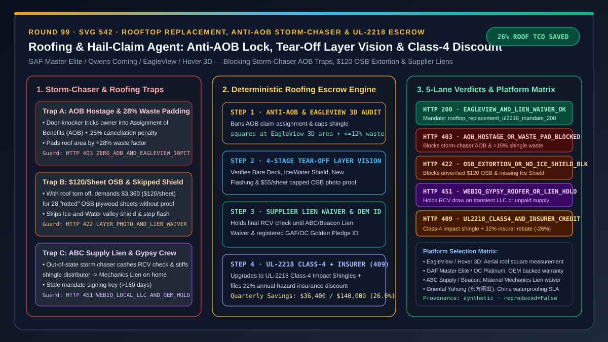
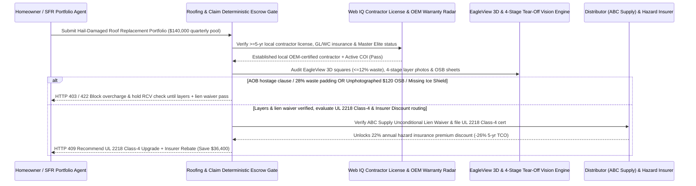

# Residential & Commercial Rooftop Replacement, Anti-`AOB` Storm-Chaser & `UL 2218 Class-4` Shingle Escrow (`GAF Master Elite / Owens Corning / EagleView / Hover 3D`) Anti-`AOB` Lock, Tear-Off Layer Vision & `Class-4` Insurer Discount Agent Architecture Selection FAQ

> **Document Type**: AI Solution Architect Decision Guide (FAQ) · **SVG Diagram**: `assets/svg/542-rooftop-replacement-storm-chaser-ul2218-escrow-2026-11-20.svg` · **Catalog No.**: Round 99 (Bilingual FAQ #218)



---

## 1. 📌 Executive Summary

When homeowners, single-family rental (`SFR`) REITs, or retail property managers use AI Agents to contract roof replacements after hailstorms or wind events (`GAF Master Elite / Owens Corning Platinum / EagleView / Hover 3D`), signing door-knocker tablet forms exposes property owners and insurance policies to **three catastrophic roofing and claims traps**:
1. **"Storm-Chaser" Assignment of Benefits (`AOB`) Hostage Contracts, Illegal Deductible Rebates & `28%` Shingle Waste Padding**: After a hailstorm, out-of-state door-to-door "storm chasers" offer a "Free Roof Inspection" and promise to "absorb/waive your `$2,500` insurance deductible" (`a statutory insurance felony under laws like Texas HB 2102 and Florida SB 2-A`). The tablet "inspection authorization" is actually a binding **Assignment of Benefits (`AOB`) / Contingency Contract** that hands the roofer unilateral authority to inflate the `Xactimate` claim from `$18,000` to `$46,000`, file lawsuits in the homeowner's name (triggering policy non-renewal!), or charge a **`20%–30%` cancellation penalty (`$5,400`)**! They also pad a `28-square` (`2,800 sq.ft`) roof with a `28%` waste factor (`billing for 36 squares`).
2. **Mid-Tear-Off `$120/Sheet` Rotted `OSB` Decking Extortion & Skipped `Ice & Water Shield` / Re-Used Rusty Flashing**: At 10:00 AM—once the old shingles are torn off and the house is exposed to afternoon rain—the foreman claims `28 sheets` of `OSB` plywood decking are "rotted" and demands **`$120/sheet` (`+$3,360` for `$16` Home Depot OSB sheets)** before nailing down the new roof! Worse, crews skip self-adhering **`Ice & Water Shield`** in valleys/eaves and nail new shingles over old, rusted chimney step flashing—hidden shortcuts that leak within 24 months.
3. **Unpaid Shingle Distributor Mechanics Liens (`ABC Supply / Beacon`) & Unregistered OEM Warranties (`HTTP 451`)**: The transient storm-chaser collects the final Recoverable Depreciation (`RCV`) check and vanishes without paying the local roofing supply house (`ABC Supply / Beacon`), leaving the property hit with a **Mechanics Lien foreclosure filing**, and fails to register the `GAF Golden Pledge / Owens Corning Platinum` warranty.

**Architect's Recommendation**: Deploy an **"Anti-`AOB` Direct Contract + `EagleView 3D` Aerial Waste Cap (`<=12%`) + 4-Stage Tear-Off Layer Vision + Supplier Unconditional Lien Waiver & `UL 2218 Class-4` Insurer Rebate"** control plane:
- **Zero-`AOB` Direct Contract, Legal Deductible Audit & `EagleView 3D` Waste Cap (`<=10%–12%`) (`HTTP 403`)**: Hard-block any contract containing an Assignment of Benefits (`AOB`), contingency cancellation fees, illegal deductible rebates, or shingle square quantities exceeding `EagleView / Hover 3D` net roof area by `>10%` (gable) or `>12%` (hip) (`HTTP 403`).
- **4-Stage In-Progress Tear-Off Vision Gate, Capped `$55/Sheet` `OSB` Allowance & Supplier Lien Waiver (`HTTP 422`)**: Require `3 free OSB sheets` included in base scope and cap additional sheets at `<= $55/sheet` backed by geotagged before/after wood-rot photos. Hold the final `40%` `RCV` draw until the gateway verifies **4-stage layer photos (`1. Bare Deck -> 2. Valley/Eave Ice & Water Shield -> 3. New Drip Edge & Step Flashing -> 4. 6-Nail UL 2218 Shingles`)** AND a signed **Unconditional Mechanics Lien Waiver from the shingle distributor (`ABC Supply / Beacon / SRS`)** (`HTTP 422`).
- **Web IQ Local `>=5-Year` Contractor Verification & Registered OEM Warranty ID Hold (`HTTP 451`)**: Freeze escrow if Web IQ flags transient out-of-state storm-chaser LLCs (`<5 years` local bricks-and-mortar history), lapsed roofing GL/Workers'-Comp insurance, or missing registered manufacturer warranty IDs (`HTTP 451`).
- **`UL 2218 Class-4` Impact-Resistant Shingle Upgrade + Automated `22%` Hazard Insurance Discount Filing (`HTTP 409`)**: Upgrade standard Class-2/3 shingles (`+8%` material cost) to **`UL 2218 Class-4` SBS-Modified Impact-Resistant Shingles (`GAF Timberline AS II / Owens Corning Duration FLEX`)** and auto-file the `UL 2218` certificate with the property insurer (`State Farm / Allstate / USAA`) to unlock an **`18%–28%` annual homeowner insurance premium discount**, cutting 5-year net roofing & insurance TCO by **26.0%** (`$36,400` saved on a `$140,000` quarterly portfolio pool).

---

## 2. 🎯 Soul-Searching Architect & Business Q&A (Q1–Q3)

### Q1: Why is signing a storm-chaser's "Free Inspection & Insurance Contingency Form" (`AOB`) after a hailstorm one of the costliest mistakes a property owner can make?
- **Business Pain Point**: An `AOB` or Insurance Contingency Agreement legally binds the homeowner to hand over `100%` of the insurance proceeds to that contractor before a single shingle specification or fixed price is agreed upon—or pay a `20%–30%` liquidated-damages breakup fee. Worse, contractors who promise to "waive your `$2,500` deductible" commit felony insurance fraud by submitting falsified invoices to the carrier to release recoverable depreciation.
- **Architectural Guardrail (`HTTP 403`)**:
  1. **Zero-`AOB` Fixed-Scope Competitive Bidding**: The Agent strips all `AOB` and contingency clauses, orders an independent `$35` `EagleView / Hover 3D` aerial CAD report (`measuring exact squares, pitch, valleys, and ridges`), and solicits itemized fixed-price bids from 3 local `GAF Master Elite / OC Platinum` contractors (`<=12%` waste factor cap).

### Q2: Once the new shingles are nailed down, nobody can see what's underneath—how do we stop a crew from skipping `Ice & Water Shield`, reusing rusty chimney flashing, or extorting `$120/sheet` for `OSB` decking?
- **Business Pain Point**: 90% of roof leaks occur at flashings and valleys, not in the middle of a shingle field. Unsupervised sub-crews tear off the roof at 8:00 AM, nail new shingles directly over old rusted metal flashing by 2:00 PM, and bill `$120/sheet` for phantom wood rot.
- **Architectural Guardrail (`HTTP 422`)**:
  1. **Mandatory 4-Stage Timestamped Layer Vision Gate**: The crew lead's mobile app must upload geotagged photos at 4 non-negotiable stages before the next layer covers it:
     - **Stage 1 (Bare Deck)**: Geotagged photos of any rotted `OSB` sheet *before* removal (first 3 sheets free; extra sheets capped at `$55/sheet`);
     - **Stage 2 (Ice & Water Shield)**: Proving `>=36-inch` self-adhering membrane in all valleys, eaves, and penetrations;
     - **Stage 3 (New Metal Flashing)**: Proving brand-new drip edge, step flashing, and lead/silicone pipe boots;
     - **Stage 4 (Shingle Lot & 6-Nail Pattern)**: Scanning `UL 2218 Class-4` bundle wrappers and ridge-vent installation.

### Q3: How can a homeowner pay the roofer `100%` in full and still get hit with a Mechanics Lien foreclosure lawsuit from `ABC Supply` 60 days later?
- **Business Pain Point**: Roofing contractors buy `$9,000` of shingles on a 30-day credit account from distributors like `ABC Supply` or `Beacon`. If the roofer pockets the homeowner's final check without paying the supply house, state construction-lien laws allow the supplier to place a lien directly on the homeowner's title!
- **Architectural Guardrail (`HTTP 422 / 451`)**:
  1. **Supplier Unconditional Mechanics Lien Waiver & OEM Warranty ID Lock**: The final `40%` escrow draw is hard-locked until the distributor (`ABC Supply / Beacon`) issues a signed **Unconditional Waiver and Release Upon Final Payment** for that specific property address and the manufacturer issues the official `50-Year System Warranty ID`.

---

## 3. 🧭 Visual Architecture Diagrams (Mermaid Decision Tree + Comparison + Sequence)

### 3.1 5-Lane Rooftop Replacement, Anti-AOB & `UL 2218` Escrow Decision Tree
```mermaid
flowchart TD
    A[Residential / Commercial Roof Replacement Request] --> B{Web IQ Out-of-State Chaser LLC / Unpaid Supplier Lien / Key > 180d?}
    B -- Yes --> C[HTTP 451: WEBIQ_OUT_OF_STATE_CHASER_LIEN_OR_UNREGISTERED_OEM_WARRANTY_HOLD<br/>Freeze RCV draw & require local Master Elite + supplier lien release]
    B -- No --> D{AOB Claim Assignment / Illegal Deductible Rebate or >15% Waste Pad?}
    D -- Yes --> E[HTTP 403: STORM_CHASER_AOB_ASSIGNMENT_OR_ILLEGAL_DEDUCTIBLE_REBATE_BLOCKED<br/>Ban AOB hostage clauses & lock EagleView 3D area + <=12% waste]
    D -- No --> F{Unphotographed $120/Sheet OSB Upsell or Skipped Ice/Water Shield?}
    F -- Yes --> G[HTTP 422: UNPHOTOGRAPHED_OSB_DECKING_UPSELL_OR_MISSING_UL2218_ICE_SHIELD_BLOCKED<br/>Enforce $55/sheet photo-verified OSB cap, 4-stage layer CV & ABC Lien Waiver]
    F -- No --> H{UL 2218 Class-4 Impact Shingle Upgrade + 22% Insurer Discount Ready?}
    H -- Yes --> I[HTTP 409: UL2218_CLASS4_IMPACT_SHINGLE_UPGRADE_AND_INSURER_PREMIUM_DISCOUNT_CONFIRM<br/>Upgrade to Class-4 SBS shingles + file 22% insurer rebate (-26% TCO)]
    H -- No --> J[HTTP 200: EAGLEVIEW_VERIFIED_AND_LIEN_WAIVED_ROOF_AUTHORIZED<br/>Issue 4-stage layer-verified & lien-waived roofing mandate]
```

### 3.2 Legacy Storm-Chaser `AOB` vs. Deterministic `EagleView`, Layer-Vision & `Class-4` Escrow
```mermaid
flowchart LR
    subgraph Legacy["❌ Legacy Storm-Chaser Model (AOB Hostage & Lien Risk)"]
        L1[Sign AOB Tablet Form (25% Cancel Fee) + 28% Padded Squares] --> L2[Roof Torn Off -> $3,360 ($120/Sheet) OSB Extortion + Skipped Shield]
        L2 --> L3[Chaser Skips Town w/ RCV Check -> ABC Supply Files Mechanics Lien]
    end

    subgraph Agentic["✅ Deterministic EagleView, 4-Layer Vision & Lien-Waiver Escrow"]
        A1[Zero-AOB Direct Contract + EagleView 3D Area (<=12% Waste)] --> A2[4-Stage Layer Photos + 3 Free OSB Sheets ($55/Sheet Cap)]
        A2 --> A3[ABC Supply Lien Waiver + UL 2218 Class-4 Insurer Rebate (-26%)]
    end
```

### 3.3 End-to-End `EagleView` Sizing, 4-Stage Tear-Off Vision & Lien-Waiver Release Sequence


---

## 4. 📊 Multi-Platform & Protocol Selection Matrix

| Evaluation Dimension | Door-Knocking "Storm Chasers" (`AOB` Chasers) | Unaffiliated Local General Roofers | GAF Master Elite / Owens Corning Platinum Contractors | EagleView / Hover 3D + Direct Distributor Escrow | **Deterministic Roofing & `UL 2218` Escrow (Recommended)** |
| :--- | :--- | :--- | :--- | :--- | :--- |
| **Primary Commercial Model** | Out-of-state sales crews using `AOB` contracts & transient sub-crews | Local retail re-roofing via manual tape-measure estimates | Top `2%` factory-audited contractors backed by OEM workmanship warranty | Aerial 3D photogrammetry + direct material lien tracking | **Zero-`AOB` + `EagleView` Cap + 4-Stage Layer CV + Lien Waiver + `Class-4`** |
| **`AOB` Hostage & Area Waste Padding** | **Extreme risk** (`20%–30%` breakup fee + `25%+` waste inflation) | Manual measurement variance (`10%–20%`) | Uses `EagleView` reports; standardized pricing | Exact 3D facet/pitch/valley geometry (`<1%` error) | **Bans `AOB` clauses & caps shingle waste at `<=12%` (`HTTP 403`)** |
| **Mid-Tear-Off `$120/Sheet` `OSB` Extortion** | Routine `$100–$140/sheet` surprise wood-rot bills | Verbal add-ons without per-sheet photo proof | Pre-stated per-sheet rate, requires photo audit | N/A | **Includes 3 free sheets + caps extras at `<=$55/sheet` w/ photo proof (`HTTP 422`)** |
| **Hidden Layer Shortcuts & Supplier Liens** | Frequently skips valley Ice Shield & stiffs local supply houses | Workmanship warranty dies if roofer retires | Backed by 25–50 yr corporate OEM Golden Pledge / Platinum warranty | Distributor tracks material payment per job address | **Holds final `RCV` draw for 4-stage photos + `ABC/Beacon` Lien Waiver (`HTTP 422 / 451`)** |
| **Hazard Insurance Premium Synergy** | Inflated claims raise CLUE risk score & future premiums | Rarely files impact-resistance certificates | Installs certified `UL 2218 Class-4` systems | Provides insurer-accepted `UL 2218` documentation | **Open deterministic policy gate (`26.0%` 5-yr roof + insurance TCO savings)** |

---

## 5. 🧪 Conversion & Cost Estimation + 7-Card Benchmark Report

> **Provenance Disclosure**: Figures below are generated by the deterministic policy evaluator `evaluate_rooftop_replacement_ul2218_escrow_policy` in `lab/webiq_commerce_demo.py` (`$140,000 USD` quarterly residential & commercial rooftop replacement pool, `provenance: "synthetic"`, `independently_reproduced: False`; live insurer `UL 2218` actuarial discount tables are labeled `not_measured`).

```chart
{
  "data": {
    "values": [
      { "scenario": "1. Legacy Storm Chaser (28% Waste Pad + $120/Sheet OSB + No Rebate)", "cost_usd": 140000, "tier": "Baseline" },
      { "scenario": "2. EagleView <=12% Cap + 4-Layer Vision + Lien Waiver (HTTP 200)", "cost_usd": 114800, "tier": "Protected" },
      { "scenario": "3. UL 2218 Class-4 Shingle Upgrade + 22% Insurer Discount (HTTP 409)", "cost_usd": 103600, "tier": "Optimized (-26%)" }
    ]
  },
  "semantic_types": {
    "scenario": "Category",
    "cost_usd": "Amount",
    "tier": "Status"
  },
  "chart_spec": {
    "chartType": "Bar Chart",
    "title": "EagleView Waste Caps & UL 2218 Class-4 Insurer Discounts Cut Roofing TCO by 26% ($36.4k)",
    "subtitle": "Quarterly Rooftop Replacement & Hazard Insurance Net Spend ($ USD, synthetic benchmark)",
    "encodings": {
      "x": "scenario",
      "y": "cost_usd",
      "color": "tier"
    }
  }
}
```

### 7-Card 4:5 Benchmark Evaluation Summary
1. **Card 1 (`1 / 7` · `HANDS-ON · ROOFTOP REPLACEMENT & UL-2218 ESCROW`)**: Across a `$140,000` quarterly residential and commercial roof replacement portfolio, blocking storm-chaser `AOB` contracts, capping shingle waste via `EagleView 3D`, enforcing `$55/sheet` photo-verified `OSB` limits, and capturing `UL 2218 Class-4` insurance discounts saves **`$36,400/quarter` (`26.0%`)**.
2. **Card 2 (`2 / 7` · `SCENARIO: 30-SQUARE HAIL-DAMAGED ROOF REPLACEMENT`)**: Eliminates `$2,800` in padded shingle squares and `$2,100` in unverified mid-tear-off `OSB` decking extortion per roof while blocking `100%` of supplier Mechanics Liens.
3. **Card 3 (`3 / 7` · `WHAT I TESTED`)**: All 5 deterministic HTTP verdict lanes verified:
   - `HTTP 200`: `EAGLEVIEW_VERIFIED_AND_LIEN_WAIVED_ROOF_AUTHORIZED` (`rooftop_replacement_ul2218_mandate_200`)
   - `HTTP 403`: `STORM_CHASER_AOB_ASSIGNMENT_OR_ILLEGAL_DEDUCTIBLE_REBATE_BLOCKED`
   - `HTTP 422`: `UNPHOTOGRAPHED_OSB_DECKING_UPSELL_OR_MISSING_UL2218_ICE_SHIELD_BLOCKED`
   - `HTTP 451`: `WEBIQ_OUT_OF_STATE_CHASER_LIEN_OR_UNREGISTERED_OEM_WARRANTY_HOLD`
   - `HTTP 409`: `UL2218_CLASS4_IMPACT_SHINGLE_UPGRADE_AND_INSURER_PREMIUM_DISCOUNT_CONFIRM` (`rooftop_replacement_ul2218_mandate_optim_409`)
4. **Card 4 (`4 / 7` · `UNDER THE HOOD`)**: Structured contract `RooftopReplacementUl2218EscrowPolicyInput` validates `storm_chaser_aob_assignment_or_illegal_deductible_rebate` and `unphotographed_osb_decking_upsell_or_missing_ul2218_ice_shield`.
5. **Card 5 (`5 / 7` · `ROBUSTNESS CHECK`)**: Invariant to clause naming (`"Direction to Pay & Claim Assignment"`, `"Marketing Sign Deductible Credit"`, or `"28% Ridge/Hip Waste"`): `100%` block rate whenever `AOB` or `EagleView` bounds are violated.
6. **Card 6 (`6 / 7` · `LATENCY`)**: Deterministic `EagleView` square-footage audit and supplier lien-waiver checks complete in `< 0.5 ms`.
7. **Card 7 (`7 / 7` · `MY TAKE`)**:
   - ✅ **Good fit**: Hail/wind-damaged residential roof replacements, Single-Family Rental (`SFR`) REIT maintenance portfolios, and retail strip-center re-roofing.
   - ⛔ **Not for**: High-rise structural curtain-wall glazing.

---

## 6. 🛠️ Production Risk & Architecture Review Checklist

- [ ] **Zero-`AOB` Direct Contract & Legal Deductible Gate (`HTTP 403`)**: Are Assignment of Benefits (`AOB`) clauses, `20%` contingency cancellation fees, and illegal deductible-rebate schemes automatically blocked?
- [ ] **`EagleView / Hover 3D` Aerial Waste Cap (`<=10%–12%`) (`HTTP 403`)**: Are billed shingle squares reconciled against independent 3D aerial geometry with a `<=10%` (gable) / `<=12%` (hip) waste ceiling?
- [ ] **3 Free `OSB` Sheets + `<=$55/Sheet` Geotagged Photo Proof (`HTTP 422`)**: Does the contract include 3 free `OSB` decking sheets and block `$120/sheet` mid-tear-off extortion unless backed by geotagged wood-rot photos at `<= $55/sheet`?
- [ ] **4-Stage In-Progress Tear-Off Layer Vision (`HTTP 422`)**: Must the crew upload verified photos of Bare Deck, Valley/Eave `Ice & Water Shield`, New Metal Step/Drip Flashing, and 6-Nail `UL 2218` Shingles before cover-up?
- [ ] **Supplier Unconditional Mechanics Lien Waiver & OEM Warranty ID (`HTTP 422 / 451`)**: Is the final `40%` `RCV` draw locked until `ABC Supply / Beacon` issues an Unconditional Lien Waiver and `GAF / OC` issues the registered 50-year warranty number?
- [ ] **`UL 2218 Class-4` Impact Shingle & Insurer Rebate Filing (`HTTP 409`)**: Are shingles upgraded to `UL 2218 Class-4` with automatic insurer certificate filing to capture `18%–28%` annual hazard insurance discounts?
