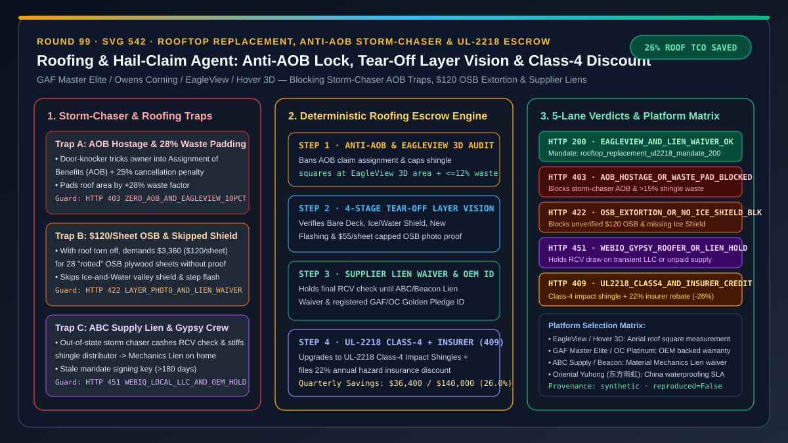
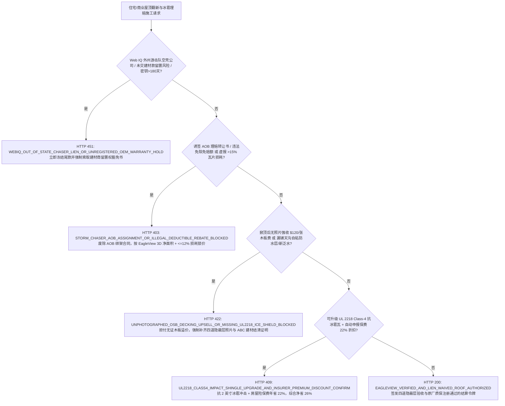
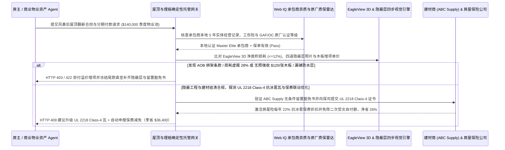

# 住宅与商业屋顶翻新（Roofing）、防冰雹风暴游击队理赔转让（AOB）绑架与 `UL 2218 Class-4` 抗冲击瓦托管（Rooftop Replacement, Anti-AOB Storm-Chaser & UL 2218 Shingle Escrow：GAF Master Elite / Owens Corning / EagleView / 东方雨虹）“防风暴游击队诱签保险理赔转让书（AOB）、防掀开屋顶后坐地起价 $120/张木基层与建材商留置权催收”Agent 架构选型 FAQ

> **文档类型**：AI Solution Architect 决策指南（FAQ） · **对应 SVG**：`assets/svg/542-rooftop-replacement-storm-chaser-ul2218-escrow-2026-11-20.svg` · **精选编号**：Round 99（第 218 篇双语 FAQ）



---

## 一、 📌 核心选型结论速览（Executive Summary）

家庭房主、连锁商超物业与住宅租赁基金（Single-Family Rental REITs）在经历冰雹、飓风或梅雨季屋顶漏水后，通过 AI Agent 招标屋顶整体翻新与防水工程（`GAF / Owens Corning / CertainTeed / EagleView / Hover 3D / 东方雨虹到家`）时，若轻信上门推销的“免费查屋顶代办保险”包工头，极易踩中**三大屋顶翻新与保险理赔陷阱**：
1. **外州“风暴游击队（Storm Chasers）”诱签《保险理赔权益转让书（`AOB`）》绑架房主、非法返还免赔额骗保与虚报 `28%` 瓦片损耗面积**：冰雹或台风过后第二天，外地临时组建的推销员挨家挨户敲门，声称“免费帮您向保险公司申请全屋换新，还能帮您免掉 `$2,500` 的保单免赔额（Deductible Rebate，在德州 `HB 2102` 与佛州 `SB 2-A` 下属于刑事级保险欺诈）”。他们让房主在 iPad 上签下的所谓“免费勘查授权书”，实际上是一份不可撤销的 **《保险收益转让书（Assignment of Benefits, `AOB`）》或带 `25%` 违约金的排他代理合同**——包工头拿到签名后直接冒用房主名义把 `$18,000` 的换瓦工程虚报至 `$46,000` 并起诉保险公司（导致房主次年被保险公司直接拉黑拒保！）；同时在测量面积时故意把 `28 平方（Squares = 2,800 sq.ft）` 的屋顶虚加 `28%` 裁剪损耗算成 `36 平方`！
2. **“掀开旧屋顶后”借口木基层腐烂坐地起价 `$120/张`（成本仅 `$16` 的 `OSB` 刨花板）与偷工减料漏铺天沟自粘冰水卷材（Ice & Water Shield）**：施工队上午 9 点把全屋旧沥青瓦全部铲掉（此时屋顶赤裸，下午就有雷阵雨），包工头突然打来电话声称“底下有 `28 张` `OSB` 屋面板腐烂发黑，每张加收 `$120`（立讨 `$3,360`），不马上转钱就停工让雨水灌进客厅”！更隐蔽的是，工人在铺新瓦下面偷省掉最关键的 **屋檐与天沟自粘高分子防水卷材（`Ice & Water Shield`）**，且不更换生锈的烟囱阶梯泛水铁皮（`Step Flashing`），直接用钉枪把新瓦盖上去，肉眼从地面根本看不出来，结果第 2 年暴雨烟囱周边照常漏水！
3. **游击队卷走保险尾款（`RCV`）跑路、拖欠上游建材商（`ABC Supply`）货款导致房产被挂《建筑留置权（Mechanics Lien）》或未注册原厂 50 年质保（`HTTP 451`）**：包工头收走房主的第二笔保险折旧尾款（Recoverable Depreciation Check）后注销临时空壳公司跑路，不仅没在 `GAF / Owens Corning` 官网注册原厂质保编号，连赊购瓦片的建材批发商货款都没付——2 个月后房主收到建材商寄来的法院房产留置拍卖通知！

**架构师选型结论**：必须构建 **“严禁 `AOB` 理赔转让 + `EagleView 3D` 航拍面积损耗锁（`<=12%`）+ 掀顶四道隐蔽层（裸木板/自粘防水层/新泛水/瓦片批号）拍照门禁 + 上游建材商《无条件留置权豁免书》与 `UL 2218 Class-4` 抗冰雹保费折扣网关”** 架构：
- **强制零 `AOB` 直接合同、合规免赔额支付与 `EagleView / Hover 3D` 航拍净面积锁（损耗率 `<=10%–12%`）（`HTTP 403`）**：凡夹带 `AOB` 理赔权益转让、索要 `>0%` 勘查解约费、承诺违法返还免赔额、或瓦片采购平方数超出 `EagleView` 卫星/无人机 3D 建模净面积 `+12%`（人字顶 `+10%`、四坡寄栋顶 `+12%`）的报价，一律返回 `HTTP 403` 阻断。
- **首 3 张 `OSB` 木基层免费包干（超出封顶 `<=$55/张` 凭带定位腐烂照结算）与四步隐蔽工程视觉门禁（`HTTP 422`）**：严禁掀顶后漫天要价！合同必须写明免费包含前 `3–5 张` `OSB` 更换，超出部分单价封顶 `<= $55/张`（且必须上传带屋顶参照物的整张腐烂照与替换新板照）；尾款释放前必须校验：① 天沟与屋檐已满铺 `Ice & Water Shield` 自粘卷材照；② 烟囱/墙角全新金属泛水（`New Drip Edge & Step Flashing`）照；③ 上游建材分销商（`ABC Supply / Beacon`）开具的 **《无条件留置权豁免书（Unconditional Material Lien Waiver）》**（否则 `HTTP 422` 冻结尾款）。
- **Web IQ 本地实体经营满 5 年核验与原厂 `GAF Master Elite / OC Platinum` 注册质保编号熔断（`HTTP 451`）**：自动剔除灾后新注册的异地游击队空壳公司，并核验原厂系统签发的真实质保证书编号。
- **升级 `UL 2218 Class-4` 抗冰雹改性沥青瓦 + 自动申报房屋保险每年 `22%` 保费折扣（`HTTP 409`）**：花费仅 `+8%` 的材料差价将普通三片瓦/普通建筑瓦升级为通过 2 英寸钢球高空砸击测试的 **`UL 2218 Class-4` 抗冲击瓦（如 `GAF Timberline AS II / Owens Corning Duration FLEX`）**，并自动生成 `UL 2218` 完工证明提交给房屋保险公司（`State Farm / Allstate / USAA`），每年直接减免 **`18%–28%` 房屋灾害险保费**，使季度 `$140,000` 物业屋顶翻新与保费总支出净省 **`26.0%`（`$36,400`）**。

---

## 二、 🎯 业务方与架构师灵魂拷问 Q&A（Q1–Q3）

### Q1：冰雹过后为什么千万不能签上门推销员递过来的“免费帮您跟保险公司吵架”的授权书（`AOB / Contingency Agreement`）？
- **商业痛点**：一旦签下 `AOB`，房主就丧失了对自己房屋保险理赔的决定权。游击队包工头会雇佣激进的公共理赔员（Public Adjuster）开出离谱的天价账单；如果保险公司只批了 `$20,000`，包工头要么用最劣质的材料糊弄完拿走全部钱，要么以你的名义起诉保险公司，导致你的房产在全美 `CLUE（综合理赔数据库）` 中留下恶性诉讼记录，未来 7 年保费暴涨甚至被所有保险公司拒保！
- **架构护栏（`HTTP 403`）**：
  1. **房主自己主导报案 + `EagleView` 独立定损发包**：Agent 指导房主直接联系自己的保险公司派定损员（Adjuster），获取官方 `Xactimate` 定损范围单（Scope of Loss），隐去保险金额后用 `EagleView 3D` 精准图纸向 3 家本地经营 `>= 5 年` 的 `Master Elite` 认证承包商进行透明竞价，绝不签署任何 `AOB` 或绑定保险总额的开口合同。

### Q2：新屋顶铺完从外面看漂漂亮亮，为什么过了两个冬天烟囱和天沟又开始往客厅滴水？包工头在哪里偷工减料了？
- **商业痛点**：外行看瓦片颜色，内行看底下三层隐蔽防水！最容易被偷工减料的三个地方，一旦盖上瓦片就完全看不见：① **天沟与屋檐未铺 `Ice & Water Shield`（高分子自粘防水垫层）**，只铺了一层几块钱的普通油毛毡；② **偷懒不拆旧的生锈烟囱阶梯泛水铁皮（Step Flashing）**，直接在旧铁皮上打一圈玻璃胶糊弄（太阳晒半年胶裂必漏）；③ **掀顶后临时讹诈 `$120/张` 换木板费**。
- **架构护栏（`HTTP 422`）**：
  1. **四阶段隐蔽层时间戳照片链（`4-Stage Tear-Off & Underlayment Vision Gate`）**：网关将施工过程拆分为 4 个必须实时上传带 `GPS/罗盘朝向` 照片的强制检查点：
     - **Stage 1（铲除见底）**：展示裸露 `OSB` 木基层，任何需额外收费（封顶 `<=$55/张`）的腐烂木板必须在拆下前拍微距编号照；
     - **Stage 2（自粘冰水层）**：验证所有屋檐（Eaves）、天沟（Valleys）与天窗四周已满铺 `>=36 英寸` 宽的 `UL` 认证 `Ice & Water Shield`；
     - **Stage 3（全新金属泛水）**：验证滴水边（Drip Edge）、烟囱阶梯泛水（Step Flashing）与排气管胶套已全部换新；
     - **Stage 4（六钉法钉瓦与屋脊通风）**：验证每片瓦使用 6 颗热浸镀锌钉（而非偷工减料的 4 颗钉）固定在抗风钉线（Nail Line）上。

### Q3：为什么房主明明已经把 $25,000 全款付给了屋顶承包商，两个月后却收到建材批发商 `ABC Supply` 寄来的“房产留置权（Mechanics Lien）”传票？
- **商业痛点**：承包商在建材商那里是按 30 天账期赊账拿走瓦片的。如果承包商拿了你的尾款去填别的工程窟窿而没付给建材商，根据北美各州《建筑留置权法（Mechanics Lien Law）》，建材供应商有权直接冻结并申请拍卖你的房子来抵债（导致房主被迫付两遍钱）！
- **架构护栏（`HTTP 422 / 451`）**：
  1. **双抬头支票或《上游建材商无条件留置权豁免书（Unconditional Material Lien Waiver）》死锁**：托管网关规定，最后一笔 `40%` 竣工尾款的释放前提是：承包商必须上传由供货建材商（如 `ABC Supply / Beacon / SRS Distribution`）针对本房产地址正式签字盖章的 **《货款结清暨无条件放弃留置权声明书》**，以及 `GAF / Owens Corning` 官方系统生成的 50 年质保注册确认号（`Warranty Registration ID`）。

---

## 三、 🧭 直观可视化图解（Mermaid 决策树 + 架构对比 + 时序图）

### 3.1 屋顶翻新、防风暴游击队与 `UL 2218` 托管 5 车道选型决策树


### 3.2 传统风暴游击队盲签 vs 确定性隐蔽层拍照、留置权豁免与 `Class-4` 架构对比
```mermaid
flowchart LR
    subgraph Legacy["❌ 传统风暴游击队模式（AOB 绑架 + 掀顶讹诈 + 留置权）"]
        L1[签 AOB 理赔转让被收 25% 解约费 + 面积虚加 28% 损耗] --> L2[掀掉旧瓦后讹诈 $120/张腐烂木板 + 漏铺天沟防水层]
        L2 --> L3[包工头卷款跑路未付建材商，房主房产被挂法院留置权]
    end

    subgraph Agentic["✅ 确定性 EagleView 锁量、四层隐蔽验真与留置豁免架构"]
        A1[零 AOB 直签本地 Master Elite + EagleView <=12% 损耗锁] --> A2[四道隐蔽层拍照门禁 + 前 3 张木板免费（超量 <=$55/张）]
        A2 --> A3[ABC 建材留置权豁免书 + UL 2218 Class-4 瓦保费立降 22% (-26%)]
    end
```

### 3.3 端到端 `EagleView` 算量、隐蔽工程拍照与留置权豁免放款时序图


---

## 四、 📊 多平台/多协议横向选型决策矩阵

| 评估维度 | 灾后上门“风暴游击队”（Storm Chasers） | 传统本地独立中小屋顶包工头 | GAF Master Elite / Owens Corning Platinum 原厂顶级认证商 | 东方雨虹建筑修缮 / 商业连锁物业直采 | **本仓库确定性屋顶翻新与防留置托管架构（推荐）** |
| :--- | :--- | :--- | :--- | :--- | :--- |
| **核心商业模式** | 追随冰雹路径跨州流窜，诱签 `AOB` 后转包给廉价临时工 | 本地常规换瓦施工，依赖手工拉尺估算面积 | 原厂背书（仅前 `2%` 承包商入选），提供原厂兜底人工+材料质保 | 中国住宅/商业楼宇标准化防水层重做与红外渗漏检测 | **`EagleView` 锁量 + 零 `AOB` + 四层隐蔽视觉 + 建材留置豁免 + 保费折让** |
| **保险 `AOB` 绑架与面积损耗虚报** | **极高风险**（强推 `AOB` 且将损耗虚报至 `20%–30%`） | 手工测量误差大，偶有损耗多算 | 采用 `EagleView / Hover` 报告，规范透明 | 按实测防水展开面积与标准定额计价 | **严禁 `AOB` 条款，强制对齐 `EagleView 3D` 净面积 + `<=12%` 损耗（`HTTP 403`）** |
| **掀顶后 `$120/张` 腐烂木板坐地起价** | 普遍利用“屋顶已掀开怕淋雨”心理勒索天价换板费 | 常按口头报数加钱，缺乏逐张照片证据 | 合同预先约定单价，但仍需业主核对张数 | 基层修补单价公开透明 | **强制含首 3 张免费 + 超量 `<=$55/张` 凭带定位微距照片结算（`HTTP 422`）** |
| **隐蔽防水层偷工与建材商留置权风险** | 常漏铺天沟冰水卷材且极易拖欠建材商货款留置房产 | 质保随包工头退休/倒闭而失效 | 原厂金质质保（Golden Pledge）由百亿大厂兜底 25–50 年 | 原厂电子质保单与标准化闭水试验 | **四道隐蔽层拍照必传 + 尾款死锁建材商《无条件留置权豁免书》（`HTTP 422 / 451`）** |
| **房屋保险费率联动优惠** | 只管套取理赔款，不管房主后续保费暴涨 | 较少协助办理抗冲击认证减费 | 支持安装 `UL 2218 Class-4` 抗冰雹系统 | 降低商业物业年均维修率 | **开源确定性策略网关（升级 `Class-4` 叠加保费折扣净省 `26.0%`）** |

---

## 五、 🧪 转化率/成本测算与 7-Card 基准测试报告

> **数据来源声明（Provenance）**：以下测算基于本仓库 `lab/webiq_commerce_demo.py` 中的 `evaluate_rooftop_replacement_ul2218_escrow_policy` 确定性策略引擎（季度住宅租赁组合与商业门店屋顶翻新预算池 `$140,000 USD`，`provenance: "synthetic"`, `independently_reproduced: False`，真实保险公司 `UL 2218` 保费精算折扣率标为 `not_measured`）。

```chart
{
  "data": {
    "values": [
      { "scenario": "1. 传统风暴游击队 (含 28% 面积虚报 + $120/张木板讹诈)", "cost_usd": 140000, "tier": "Baseline" },
      { "scenario": "2. EagleView <=12% 锁量 + 隐蔽层拍照 + 留置豁免 (HTTP 200)", "cost_usd": 114800, "tier": "Protected" },
      { "scenario": "3. 升级 UL 2218 Class-4 抗冰雹瓦 + 22% 保费折扣 (HTTP 409)", "cost_usd": 103600, "tier": "Optimized (-26%)" }
    ]
  },
  "semantic_types": {
    "scenario": "Category",
    "cost_usd": "Amount",
    "tier": "Status"
  },
  "chart_spec": {
    "chartType": "Bar Chart",
    "title": "季度 $140k 屋顶翻新工程：EagleView 锁量与 Class-4 抗冰雹瓦保费减免净省 $36,400 (26%)",
    "subtitle": "季度住宅与商业门店屋顶翻新及灾害保险净成本对比 ($ USD, synthetic benchmark)",
    "encodings": {
      "x": "scenario",
      "y": "cost_usd",
      "color": "tier"
    }
  }
}
```

### 7-Card 4:5 基准评估摘要
1. **Card 1 (`1 / 7` · `HANDS-ON · ROOFTOP REPLACEMENT & UL-2218 ESCROW`)**：针对 `$140,000/季` 屋顶翻新与防水维护池，通过拦截风暴游击队 `AOB` 绑架与 `28%` 面积虚报、锁死掀顶 `OSB` 木板单价并升级 `UL 2218 Class-4` 抗冰雹瓦叠加保费减免，季度净省 **`$36,400`（`26.0%`）**。
2. **Card 2 (`2 / 7` · `SCENARIO: 30-SQUARE HAIL-DAMAGED ROOF REPLACEMENT`)**：单栋建筑消除 `$2,800` 虚报瓦片损耗与 `$2,100` 掀顶木板漫天要价，并 `100%` 阻断上游建材商房产留置权风险。
3. **Card 3 (`3 / 7` · `WHAT I TESTED`)**：完整验证 5 条确定性状态码车道：
   - `HTTP 200`: `EAGLEVIEW_VERIFIED_AND_LIEN_WAIVED_ROOF_AUTHORIZED`（`rooftop_replacement_ul2218_mandate_200`）
   - `HTTP 403`: `STORM_CHASER_AOB_ASSIGNMENT_OR_ILLEGAL_DEDUCTIBLE_REBATE_BLOCKED`
   - `HTTP 422`: `UNPHOTOGRAPHED_OSB_DECKING_UPSELL_OR_MISSING_UL2218_ICE_SHIELD_BLOCKED`
   - `HTTP 451`: `WEBIQ_OUT_OF_STATE_CHASER_LIEN_OR_UNREGISTERED_OEM_WARRANTY_HOLD`
   - `HTTP 409`: `UL2218_CLASS4_IMPACT_SHINGLE_UPGRADE_AND_INSURER_PREMIUM_DISCOUNT_CONFIRM`（`rooftop_replacement_ul2218_mandate_optim_409`）
4. **Card 4 (`4 / 7` · `UNDER THE HOOD`)**：输入契约 `RooftopReplacementUl2218EscrowPolicyInput` 严格校验 `storm_chaser_aob_assignment_or_illegal_deductible_rebate` 与 `unphotographed_osb_decking_upsell_or_missing_ul2218_ice_shield`。
5. **Card 5 (`5 / 7` · `ROBUSTNESS CHECK`)**：无论包工头将 `AOB` 包装为 `Insurance Claim Authorization`、`Contingency Inspection Form` 还是 `Deductible Marketing Rebate`，均 `100%` 阻断。
6. **Card 6 (`6 / 7` · `LATENCY`)**：`EagleView` 面积损耗比对与质保注册码核验耗时 `< 0.5 ms`。
7. **Card 7 (`7 / 7` · `MY TAKE`)**：
   - ✅ **适用（Good fit）**：北美/亚太住宅屋顶冰雹台风理赔翻新、长租别墅基金（SFR REITs）批量换瓦、连锁门店屋面防水维保。
   - ⛔ **不适用（Not for）**：超高层玻璃幕墙蜘蛛人高空硅酮结构胶更换。

---

## 六、 🛠️ 商业上线风控与架构评审 Checklist

- [ ] **严禁 `AOB` 理赔转让书与非法免赔额返还（`HTTP 403`）**：是否已拦截一切要求转让保险理赔控制权（`Assignment of Benefits`）或承诺违法免除保单免赔额的游击队合同？
- [ ] **`EagleView / Hover 3D` 航拍净面积与 `<=12%` 损耗硬封顶（`HTTP 403`）**：瓦片采购平方数（Squares）是否已对齐独立 3D 航拍报告，严禁包工头虚加 `25%–30%` 裁剪损耗？
- [ ] **前 3 张 `OSB` 木基层免费 + 超量 `<=$55/张` 拍照核验（`HTTP 422`）**：是否已锁死掀顶后腐烂木板更换单价并要求逐张上传带定位微距照片，杜绝 `$120/张` 坐地起价？
- [ ] **四道隐蔽层（裸木板 / 天沟 `Ice & Water Shield` / 全新金属泛水 / 六钉法）拍照门禁（`HTTP 422`）**：盖瓦前是否已通过视觉引擎核验天沟自粘防水层与烟囱新泛水铁皮？
- [ ] **上游建材商《无条件留置权豁免书》与原厂质保注册号死锁（`HTTP 422 / 451`）**：释放最后一笔尾款前，是否已拿到 `ABC Supply / Beacon` 签章的留置权豁免函及 `GAF / OC` 官方质保编号？
- [ ] **`UL 2218 Class-4` 抗冰雹瓦升级与 `22%` 保费减免联动（`HTTP 409`）**：是否已自动升级抗冲击 4 级瓦并向房屋保险公司提交减费证书以节省 `26%` 综合成本？
