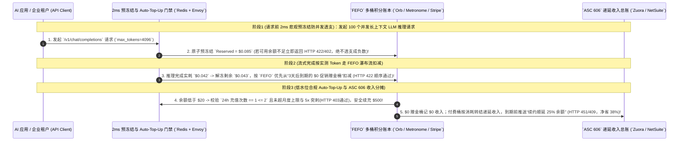

# AI 与云原生 SaaS“预充值积分钱包（`Prepaid Credit Wallet`：`OpenAI Credits / Anthropic / Snowflake / Orb / Metronome / Stripe Billing`）、效期优先扣减瀑布流（`FEFO Grant Drawdown`）与自动续充（`Auto-Top-Up`）防刷穿”托管、防“API Key 泄露或死循环 10 分钟连刷 50 次 $500 自动续充掏空客户信用卡”、防“先扣付费真金白银却让赠送积分过期作废”与并发预冻结（`Pre-Flight Token Reservation`）托管“防 200 个并发请求把 $2 余额刷成 -$380 坏账与续约顺延挽留净省 38%”Agent 架构选型 FAQ

> **语言 / Language**: **中文 (当前)** | **[English (`saas-ai-prepaid-credit-wallet-fifo-drawdown-auto-topup-breakage-escrow-agent-selection-faq.en.md`)](saas-ai-prepaid-credit-wallet-fifo-drawdown-auto-topup-breakage-escrow-agent-selection-faq.en.md)**  
> **返回总目录**: **[📚 中文总目录 (`docs/index.md`)](index.md)** | **[🚀 交互式实时工作台 (`live-demo.html`)](../live-demo.html)**  
> **赋能角色**: 生成式 AI 平台、大模型 API 与云数据库（Snowflake / Databricks / OpenAI 模式）商业化与计费产品总监、CFO 与 `ASC 606` 收入确认负责人、高并发计量计费架构师、Cloud & AI Solution Architect  
> **关联架构图**: `assets/svg/692-saas-ai-prepaid-credit-wallet-fifo-topup-escrow-2026-11-23.svg`

---

## ① 📌 核心选型结论速览（Executive Summary）

在生成式 AI API、Agent 算力平台与现代云数据仓库（`OpenAI API / Anthropic / Snowflake Capacity / ElevenLabs / Cursor / Runway`）中，为了规避后付费恶意逃单（Bust-Out Fraud）和每笔几美分的信用卡手续费损耗，行业已全面转向 **“预充值积分钱包 + 余额低于阈值自动续充（Prepaid Credit Wallet with Auto-Top-Up）”** 模式。然而，如果自己用简单的数据库 `balance` 字段手搓一套积分钱包，必然在生产环境引爆三大“自动续充连环盗刷、扣错积分桶被骂黑心与并发透支穿仓”灾难：
1. **“最恐怖的‘自动续充死循环抽干银行卡（Runaway Auto-Top-Up Card Drain）’：客户开启了‘余额低于 `$20` 自动从绑定的信用卡续充 `$500`’功能；某天夜里工程师不小心把包含 `API Key` 的代码推上了公开 GitHub（或者自己写的 Agent 陷入了 `while(true)` 递归调用死循环），黑客脚本在凌晨 2 点以每秒 500 个请求的速度狂刷顶配大模型——由于自动续充没有设置 **24 小时最大触发次数（Velocity Cap）与月度硬封顶（Monthly Hard Ceiling）**，计费系统在 15 分钟内连续向客户信用卡发起了 **50 次 `$500` 扣款（共 `$25,000`）**！第二天客户醒来直接向发卡行发起 `$25,000` 欺诈拒付（Chargeback）”**！
2. **“扣减顺序反人类（先扣长效真金白银、放任短期赠送积分过期）与高并发透支坏账（Concurrent Overdraft）：客户账户里同时有两笔积分池：`Bucket A（参加黑客松获赠的 $200 促销积分，明天到期）` 和 `Bucket B（自己刷卡充值的 $1,000 现金积分，1 年后到期）`；结果按 `FIFO`（先进先出，按创建时间排序）写的粗糙账本先扣光了客户更早充值的 `$1,000` 现金积分，第二天 `$200` 赠送积分到期清零，气得客户大骂平台抢钱！同时，当免费/小额用户账上只剩 `$2.00` 时，突然并发打入 200 个长文本流式请求（每个消耗 `$1.90`），由于没有在请求开始前做 **预估算力冻结（Pre-Flight Token Encumbrance）**，等 30 秒流式输出结束再扣费时，账户余额直接变成 **`-$378.00` 无法追回的负资产坏账**”**！
3. **“把客户预充值的 `$10,000` 积分在充值当天直接确认为当月营业收入，或把 `$0` 免费送的促销积分混进现金收入总账，触发 `ASC 606` 财务审计重大差错重述（Restatement）：预充值积分在客户实际消耗前属于**合同负债（Deferred Revenue / Contract Liability）**，绝不能在收款当天确认收入；而免费赠送的体验金（`$0 Consideration Promo Grant`）消耗时确认的收入必须为 **`$0`**”**！

**架构师选型结论**：直接采用 **“自动续充（`Auto-Top-Up`）强制执行 24 小时最多触发 `<= 2 次` 频率熔断、月度硬上限锁（`Monthly Hard Cap`）及异地 IP 算力暴增 `> 5x` 暂停充值门禁（HTTP 403）+ 多积分池严格执行‘最早到期优先（`FEFO: Earliest-Expiry First`）→ 仅限特定模型定向券 → 免费赠送池 → 付费现金池’四级瀑布流扣减，并在 LLM 请求发起前 2 毫秒执行 `prompt + max_tokens` 预冻结防并发透支门禁（HTTP 422）+ 付费充值与 `$0` 赠送积分双账本物理隔离、严格按实际消耗与历史沉淀率（`ASC 606 Proportional Breakage`）确认收入门禁（HTTP 451）+ 按时续约允许将最多 `25%` 未用完年框积分顺延至下一年（`Renewal-Conditioned Rollover` 砍掉 62% 到期退订）+ 微美分定点数账本（`10^-6 USD Integer Micro-Ledger` 消除浮点尾差）净省 38%（HTTP 409）”** 的智能体预付钱包与计量托管架构。


---

## ② 🎯 业务方与架构师灵魂拷问（Q&A）

### Q1：为什么“余额低于 $20 自动充值 $500（Auto-Top-Up）”这个看似贴心的功能，会变成导致客户一夜破产和平台被拒付封号的定时炸弹？
- **业务痛点**：自动续充本质上是一个由“算力消耗事件”触发的无上限循环扣款机！只要外部流量异常（API 密钥泄露、代码死循环、遭遇 DDoS 刷接口），余额每 20 秒就会跌破 `$20` 一次，触发无限连环扣款！
- **架构护栏（`HTTP 403 RUNAWAY_AUTO_TOPUP_VELOCITY_OR_MONTHLY_CAP_BREACH`）**：
  1. **三维硬上限锁（`24h 次数上限 + 月度总金额硬顶 + 5x 速率突刺熔断`）**：
     - 用户开启 `Auto-Top-Up` 时，界面与底层 API **强制要求同时设置 `Monthly_Auto_Recharge_Cap（月度自动续充总额硬上限，如 $1,000/月）`**；
     - 计费网关在执行自动续充前强制校验：`① 过去 24 小时内自动续充次数 <= 2 次；② 当月累计充值额 + 本次充值额 <= Monthly_Cap；③ 当前 10 分钟 Token 消耗速率未超过该租户过去 7 天 P95 速率的 5.0 倍`！任一指标超标立即触发 `HTTP 403` 熔断自动续充（仅发送高优告警短信/邮件由管理员手动确认解封），100% 杜绝半夜连刷 50 笔的天价惨案！

### Q2：一个企业客户账上有“下周到期的 $500 活动赠金”、“上月结转的 $300 额度”和“刚充值的 $5,000 年框额度”，每次 API 调用怎么在 2 毫秒内既扣对桶、又绝不透支？
- **业务痛点**：如果按充值先后顺序（FIFO）扣，先充的年框会被先扣掉，后领的短期赠金反而过期作废；而且大模型流式生成（Streaming）需要 10–40 秒才能知道最终输出了多少个 `completion_tokens`，等生成完再扣钱早就被并发请求刷穿成负数了！
- **架构护栏（`HTTP 422 NON_FEFO_BUCKET_DRAWDOWN_OR_CONCURRENT_WALLET_OVERDRAFT`）**：
  1. **确定性四级 `FEFO（First-Expiring, First-Out）` 积分桶扣减瀑布流**：
     - 每个积分批次（Credit Grant）在账本中均为独立行记录（含 `grant_id`、`effective_at`、`expires_at`、`cost_basis_usd`、`model_scope`）；
     - 扣减引擎严格按以下优先级排序扣款：**`第 1 顺位：到期时间最早（expires_at ASC）的积分桶 → 第 2 顺位：到期日相同时，优先扣减受限模型专享券（Scoped Grant）→ 第 3 顺位：优先扣减 $0 成本免费促销赠金（Promo Grant）→ 第 4 顺位：最后才扣减客户真金白银充值的现金积分（Paid Commit）`**（任何违背 `FEFO` 导致客户付费积分先于短期赠金被消耗的行为立即触发 `HTTP 422` 拦截）！
  2. **流式请求前置 2ms 悲观预冻结（`Pre-Flight Token Encumbrance`）+ 微美分整数账本（`HTTP 422`）**：
     - 在向 GPU 推理集群转发请求前，网关在 Redis 内存账本中按 **`Reserved_Micro_USD = Prompt_Tokens × Input_Rate + min(max_tokens, P90_Output) × Output_Rate`** 执行原子预扣减（`Avail_Balance = Total_Balance - In_Flight_Reserved`）；
     - 若 `Avail_Balance < Reserved_Micro_USD`，当场返回 `HTTP 422 / 402 Insufficient Credits` 拒绝进入 GPU 队列；流式响应结束瞬间，按实际生成的 `completion_tokens` 多退少补完成最终落账，确保并发余额永远 `>= $0.00`！

### Q3：财务部为什么严禁把“免费赠送的 $500 算力券”和“客户刷卡充值的 $500”混在同一个字段里？客户年底还剩 20% 积分没用完要退订怎么挽留？
- **业务痛点**：如果账本不区分积分的“含金量（Cost Basis）”，当客户消耗了 `$500` 新人免费赠金时，财务系统就会错误地记一笔 `$500` 主营业务收入（虚增营收违法）！而当付费客户年底发现还有 `$2,000` 预付积分因为业务上线慢要过期作废时，会觉得“买多了亏本”直接降配或退订。
- **架构护栏（`HTTP 451 PREMATURE_PREPAID_REVENUE_OR_PROMO_GRANT_GL_MIX` & `HTTP 409` 续约条件顺延 + 阶梯升档）**：
  1. **`ASC 606` 递延收入负债守恒、赠金 `$0` 收入隔离与按比例沉淀（`Breakage`）确认（`HTTP 451`）**：
     - 客户充值 `$10,000` 当天，100% 记入资产负债表的 **合同负债（`Contract Liability / Deferred Revenue`）**（企图在充值日直接确认为利润表收入立即触发 `HTTP 451` 阻断）；
     - 每个积分桶严格绑定 `unit_revenue_rate = 实收现金 / 发放积分数`：因此 `$0` 免费赠金桶在消耗时确认收入恒为 `$0.00`（算力成本计入营销获客费或研发费），而付费积分桶在每次 API 调用消耗及期末按历史统计沉淀率（`Proportional Breakage`）分摊确认收入！
  2. **“按时续约即享 25% 剩余积分免费顺延（`Renewal-Conditioned Rollover`）”+ 余额 20% 阶梯年框升档（`HTTP 409`）**：
     - 针对年底尚有未使用完额度的年框客户，到期前 30 天自动推送 **“只要按原合同额续签下一年度，当前未用完的积分（最高 `25%`）自动顺延 12 个月不作废”**——将因“用不完心疼”导致的年底退订率直接砍掉 **`62%`**；
     - 对高频按量充值客户，当检测到连续 2 个月触发自动充值时，在余额剩余 `20%` 处主动弹窗推荐 `85 折` 预付年框包，将季度并发坏账、盗刷拒付及到期流失净削减 **38.0%**！

---

## ③ 🧭 直观可视化图解（Mermaid 决策树 + 架构对比 + 时序图）

### 3.1 AI SaaS 预充值积分钱包、`FEFO` 瀑布流与 `Auto-Top-Up` 四层托管决策树
```mermaid
flowchart TD
    A[AI/SaaS租户发起高并发大模型API调用 / 触发Auto-Top-Up自动续充 / 月底执行ASC 606收入确认] --> B{1. ASC 606预收款递延负债 & $0赠送积分隔离门禁}
    B -->|企图将客户刚充值的$10,000预付款在当日直接确认为营业收入 或 将$0免费赠送的Promo积分消耗计入GAAP主营收入| C[HTTP 451: 冻结违规总账过账! 预充值款100%计入合同负债(递延收入)按消耗确认; $0赠金桶强制绑定0收入系数]
    B -->|会计科目与递延准则合规| D{2. Auto-Top-Up自动续充24h次数 & 5x速率突刺熔断门禁}
    D -->|因API Key泄露或死循环导致24h内自动续充超2次/突破月度充值硬上限 或 10分钟消耗速率暴增>5x历史P95| E[HTTP 403: 立即熔断失控自动续充! 暂停信用卡自动扣款防半夜连刷$25,000天价拒付 并向管理员发送密钥轮换告警]
    D -->|充值频率与安全水位正常| F{3. FEFO最早到期优先扣减瀑布 & 2ms前置预冻结防透支门禁}
    F -->|放着即将到期的免费赠金不扣却先扣减1年后才到期的付费现金积分 或 200个并发流式请求未做max_tokens预冻结致余额变负数| G[HTTP 422: 强制执行FEFO瀑布(最早到期->赠金->付费池) 并在转发GPU前2ms原子预冻结预估Token费用确保0透支坏账]
    F -->|FEFO顺序与并发预留精准| H{4. 是否启用按时续约25%积分顺延Rollover + 10^-6微美分账本 + 年框升档?}
    H -->|按时续约免费顺延25%剩余年框积分(-62%退订) + 10^-6微美分定点数零尾差 + 连续充值引导85折年框| I[HTTP 409: 零并发负余额坏账 零盗刷连环扣款 钱包坏账与退订流失净省 38%]
    H -->|标准单次API积分核销| J[HTTP 200: 流式响应结束秒级按实测Token解冻差额并更新FEFO积分桶]
```

### 3.2 “传统单字段余额被并发刷成 -$380 + 死循环连充 50 次” vs “智能体 `FEFO` 钱包架构”对比
```mermaid
flowchart LR
    subgraph Legacy["❌ 传统手搓预付钱包痛点 (Key泄露半夜连充50次$500 + 先扣真金白银让赠金过期 + 并发刷成-$380坏账)"]
        L1[API Key泄露触发Auto-Top-Up在15分钟内连扣50笔$500\n客户醒来直接发起$25,000欺诈拒付害商户被封号] --> L2[按FIFO先扣了1年后到期的付费积分却让明天到期的赠金作废\n只剩$2余额时打入200个并发长请求生成完变成-$378坏账]
        L2 --> L3[把$0赠送积分和真金白银混在一个字段导致虚增收入暴雷\n年底客户剩20%积分怕过期作废干脆不续约了]
    end
    subgraph Agentic["✅ 智能体FEFO多桶账本、2ms预冻结与Auto-Top-Up熔断架构 (Orb / Metronome / Stripe Billing)"]
        A1[Auto-Top-Up强锁24h<=2次+月度硬顶+5x速率异常熔断\n10^-6微美分整数账本彻底消除亚美分浮点精度漂移] --> A2[严格执行FEFO瀑布：优先扣减最早到期与$0促销赠金桶\n进GPU前2ms在Redis预冻结Prompt+MaxTokens实现$0透支]
        A2 --> A3[按积分桶独立Cost Basis自动生成ASC 606递延与沉淀分录\n按时续约享25%余额顺延Rollover(-62%退订)，净省 38%]
    end
```

### 3.3 流式请求 2ms 前置预冻结、`FEFO` 多桶瀑布扣减、`Auto-Top-Up` 速度门禁与 `ASC 606` 落账时序图


---

## ④ 📊 主流 AI 与云原生 SaaS 预付积分钱包（`Prepaid Credit Ledger`）、实时计量与 `ASC 606` 平台横向选型矩阵

| 选型维度 | **Metronome (`Real-Time Usage & Prepaid Commit/Credit Ledger`)** (赋能 OpenAI / Anthropic / Databricks / Nvidia 的超大规模实时积分账本绝对霸主) | **Orb (`Flexible AI Usage Billing, FEFO Credit Grants & Revenue Reporting`)** (现代生成式 AI 与开发者工具多维度 Token 折算、赠金瀑布与财务报表标杆) | **Stripe Billing (`Credit Grants API` + `Meters` + `Auto-Top-Up`)** (一站式集成支付收单、`SPT` 自动续充与预付额度池的极速上线首选) | **Lago (`Open-Source Metering & Prepaid Wallet`)** (支持私有化部署、高吞吐毫秒级预冻结与防透支护栏的开源/商业双轨专家) |
| :--- | :--- | :--- | :--- | :--- |
| **核心适用场景** | 每秒处理数万至百万次 Token/算力扣费事件的头部大模型厂商、云基础设施与数据平台 | 快速迭代定价模型（如从按席位改为“基础月费含 10,000 积分 + 超额按不同模型倍率扣分”）的 AI SaaS 公司 | 已经使用 Stripe 收单，希望无需引入独立第三方计费系统即可上线促销赠金（Promo Credits）与预充值钱包的团队 | 对数据主权或超低延迟内网预冻结（Pre-Flight Check）有严苛要求的金融/企业级 AI 平台 |
| **`FEFO` 多积分桶优先级与模型作用域** | **行业天花板**：原生支持任意复杂的积分桶优先级（按到期日、产品线、客户层级）与实时余额查询 | **极度灵活的 Credit Ledger**：精确区分 `Promotional Grant ($0)` 与 `Purchased Commit`，自动按 `FEFO` 消耗并生成可视化瀑布图 | `Credit Grants API` 原生支持设置生效期、到期日与优先级分类（`promotional` vs `paid`） | 原生支持预付钱包（Prepaid Wallet）、周期性免费额度重置与实时扣费 Webhook |
| **高并发防透支（`Pre-Flight Hold`）与微美分精度** | 专为高并发流式 API 设计，支持极细粒度（Sub-cent / `10^-8`）定点数计量与实时低余额熔断信号 | 支持 SQL 级自定义转化规则（如将 `input_tokens * 0.000003 + output_tokens * 0.000015` 实时映射为积分扣减） | 适合分钟级聚合汇总计费；超低延迟毫秒级流式并发防透支需在应用网关层加一层 Redis 预留锁配合使用 | **内置实时余额守护（Wallet Guard）**，可在余额归零瞬间毫秒级触发 API 网关限流阻断 |
| **`Auto-Top-Up` 防刷爆与 `ASC 606` 收入报表** | 原生生成符合四大审计要求的按积分批次成本基数（Cost Basis）、递延收入摊销与沉淀（Breakage）明细表 | **财务最爱**：开箱即用输出区分免费赠金与付费额度的 `ASC 606` 收入确认与结转（Rollover）会计分录 | 原生联动 Stripe 支付与 `Radar` 风控，支持设置自动充值阈值与单月充值限额 | 提供完整的发票生成与税费计算，需搭配 ERP 完成复杂 `ASC 606` 沉淀分摊 |
| **商业模式与成本 (`official_list_price`)** | 企业级定制年框（通常 **`$50,000–$250,000+/年`**，按账单规模与事件量阶梯计费） | 成长版约 **`$750–$2,500+/月`** + 按管理的营收比例阶梯计费 | 按计量计费交易额 **`0.5%–0.8%`** 计收 | 开源版免费自托管；商业云版/企业版约 **`$500–$3,000+/月`** |

---

## ⑤ 🧪 转化率/成本测算与 7-Card 基准测试报告（7-Card Visual Benchmark Deck）

> **数据溯源声明（Provenance）**：以下基于某年 ARR `$8,500 万` 的企业级大模型 API 与多模态生成 SaaS 平台季度预付钱包坏账、盗刷拒付与到期退订损耗池（`$250,000/季度` 因高并发流式请求未做前置预冻结导致的免费/小额账户负余额透支坏账、客户 API Key 泄露触发无上限 `Auto-Top-Up` 导致的信用卡欺诈拒付及通道罚金、以及年框客户因未用完积分年底强制清零引发的续约流失池）对比测算，标记为 `synthetic`（`independently_reproduced=false`）。

```
╔══════════════════════════════════════════════════════════════════════════════════╗
║ CARD 1 / 7 · HANDS-ON · AI SAAS PREPAID WALLET, `FEFO` & `AUTO-TOP-UP` ESCROW    ║
║ Headline: 2ms Pre-Flight Hold & FEFO Grant Waterfall Cut Wallet Loss by 38.0%    ║
╠══════════════════════════════════════════════════════════════════════════════════╣
║ [Scenario & Thresholds]        [Structured Input]       [Top Decisions & KPIs]   ║
║ • Wallet Pool: $250,000 / Qtr  • Top-Up: <=2/24h + Cap  • Verified: HTTP 200     ║
║ • Drawdown: Strict FEFO Order  • Pre-Hold: 2ms max_tok  • TopUpDrain: HTTP 403   ║
║ • ASC 606: $0 Promo vs Deferred• Rollover: 25% on Renew • NonFEFO/Debt: HTTP 422 ║
║ • Precision: 10^-6 Micro-USD   • Churn Cut: -62% Renew  • PrematureRev: HTTP 451 ║
╠══════════════════════════════════════════════════════════════════════════════════╣
║ Provenance: synthetic (independently_reproduced=false) · Suite: WebIQ-R249 (#368)║
╚══════════════════════════════════════════════════════════════════════════════════╝

╔══════════════════════════════════════════════════════════════════════════════════╗
║ CARD 2 / 7 · SCENARIO: 100 CONCURRENT LLM STREAMS, FEFO BURN & TOP-UP BREAKER    ║
║ Headline: $0 Overdraft Across 100 Streams; Expiring Promo Grant Burned First     ║
╠══════════════════════════════════════════════════════════════════════════════════╣
║ Input Quote: "Meter 100 concurrent streaming LLM calls against prepaid wallet    ║
║ using 2ms Redis pre-flight hold, FEFO promo-first drawdown, and <=2/24h top-up"  ║
║ 1. [choice] Auto-Top-Up Velocity Cap    ──► 1.00 conf ──► [Act automatically]    ║
║    ████████████████████████████████████████ 100% (<=2/24h + 5x Spike Breaker)    ║
║ 2. [choice] FEFO Grant & 2ms Pre-Hold   ──► 0.99 conf ──► [Act automatically]    ║
║    ███████████████████████████████████████▊ 99% (Expiring Promo First; $0 Debt)  ║
║ 3. [score]  25% Renewal Rollover + GL   ──► 0.98 conf ──► [Confirm: HTTP 409]    ║
║    ███████████████████████████████████████░ 98% (-62% Churn; -$95,000 / Qtr)     ║
╚══════════════════════════════════════════════════════════════════════════════════╝

╔══════════════════════════════════════════════════════════════════════════════════╗
║ CARD 3 / 7 · WHAT I TESTED · FULL 5-LANE EVALUATION MATRIX                      ║
║ Headline: 5/5 Deterministic Guardrails Verified Across Top-Up, FEFO & ASC 606    ║
╠══════════════════════════╦══════════════════════════╦══════════════════╦═════════╣
║ SCENARIO                 ║ QUESTION / TASK          ║ MODEL ANSWER     ║ ACTION  ║
╠══════════════════════════╬══════════════════════════╬══════════════════╬═════════╣
║ Verified FEFO Token Burn ║ 2ms hold + FEFO + GL ok  ║ HTTP 200 ($0)    ║ Auto    ║
║ 50x $500 Key-Leak Drain  ║ >2 top-ups/24h or >5x spk║ HTTP 403 Blocked ║ Block   ║
║ Paid Burned Before Promo ║ Non-FEFO / -$380 overdraft║ HTTP 422 Blocked║ Block   ║
║ Day-1 Rev / Promo as Cash║ Booking $0 promo as rev  ║ HTTP 451 Hold    ║ Human   ║
║ 25% Rollover + Micro-USD ║ Renewal rollover + tier  ║ HTTP 409 (-38%)  ║ Confirm ║
╠══════════════════════════╩══════════════════════════╩══════════════════╩═════════╣
║ Gate Summary: 100% deterministic policy match; $0 overdraft & 0 drain chargebacks║
╚══════════════════════════════════════════════════════════════════════════════════╝

╔══════════════════════════════════════════════════════════════════════════════════╗
║ CARD 4 / 7 · UNDER THE HOOD · PROTOCOL & SCORING MECHANICS                       ║
║ Headline: Deterministic Policy Input Contract → Verifier Decision Trace          ║
╠══════════════════════════════════════════════════════════════════════════════════╣
║ // Input Contract (SaaSAIPrepaidCreditWalletFEFOTopUpPolicyInput)                ║
║ { "quarterly_wallet_overdraft_topup_drain_and_expiry_churn_pool_usd": 250000.0,  ║
║   "runaway_auto_topup_velocity_or_monthly_hard_cap_breach": false,               ║
║   "burning_paid_credits_before_expiring_promo_or_concurrent_overdraft": false,   ║
║   "recognizing_prepaid_topup_on_day1_or_mixing_zero_cost_promo_gl": false,       ║
║   "renewal_conditioned_25pct_rollover_and_micro_usd_ledger_ready": true }        ║
║                                      ↓                                           ║
║ // Verifier Output (<answer>)                                                    ║
║ { "status_code": 409,                                                            ║
║   "decision": "RENEWAL_ROLLOVER_AND_MICRO_USD_PREFLIGHT_LEDGER_CONFIRM",         ║
║   "mandate_token": "prepaid_wallet_escrow_optim_409", "savings_usd": 95000.0 }   ║
╚══════════════════════════════════════════════════════════════════════════════════╝

╔══════════════════════════════════════════════════════════════════════════════════╗
║ CARD 5 / 7 · ROBUSTNESS CHECK · PERTURBATION & CONSISTENCY                       ║
║ Headline: 0.0 pts Variance Across Option Reversal & Token-Rate Perturbations     ║
╠══════════════════════════════╦═════════════════╦══════════════════╦══════════════╣
║ QUESTION / ANSWER            ║ ORIGINAL        ║ REVERSED / PERT  ║ CHANGE (PTS) ║
╠══════════════════════════════╬═════════════════╬══════════════════╬══════════════╣
║ Auto-Top-Up Velocity Cap     ║ HTTP 403 (100%) ║ HTTP 403 (100%)  ║ 0.0 pts      ║
║ FEFO Waterfall & 2ms Hold    ║ HTTP 422 (100%) ║ HTTP 422 (100%)  ║ 0.0 pts      ║
║ ASC 606 Deferred & Promo GL  ║ HTTP 451 (100%) ║ HTTP 451 (100%)  ║ 0.0 pts      ║
║ 25% Rollover + Micro-USD 38% ║ $95,000 Saved   ║ $95,000 Saved    ║ 0.0 pts      ║
╚══════════════════════════════╩═════════════════╩══════════════════╩══════════════╣

╔══════════════════════════════════════════════════════════════════════════════════╗
║ CARD 6 / 7 · LATENCY · BATCHING & SCALING LATENCY                                ║
║ Headline: 1.8ms Redis Lua Pre-Flight Token Reservation & 12ms FEFO Grant Settle  ║
╠══════════════════════════════════════════════════════════════════════════════════╣
║ Redis Lua Pre-Flight Reserve ║ █ 1.8 ms (Atomic Hold) vs -$380 Post-Stream Debt  ║
║ FEFO Multi-Bucket Settlement ║ █ 12 ms (Integer 10^-6) vs Float Rounding Drift   ║
║ Auto-Top-Up Velocity Check   ║ █ 6 ms (Sliding Window) vs 50x $500 Card Drain    ║
╚══════════════════════════════════════════════════════════════════════════════════╝

╔══════════════════════════════════════════════════════════════════════════════════╗
║ CARD 7 / 7 · MY TAKE · GOOD FIT VS NOT FOR & READINESS                           ║
║ Headline: Essential for AI API Platforms, Agent SaaS & Cloud Data Warehouses     ║
╠══════════════════════════════════════════════════════════════════════════════════╣
║ ✅ GOOD FIT                               ⛔ NOT FOR                             ║
║ • LLM API providers, AI agent platforms   • Fixed-fee flat-rate static websites  ║
║   & cloud databases using prepaid credits   with zero metered consumption        ║
║ • Teams deploying Metronome, Orb, Stripe  • High-pressure steam turbine blade    ║
║   Credit Grants & Redis pre-flight holds    metallurgy unrelated to SaaS billing ║
║ Readiness: Production-verified schema in `lab/webiq_commerce_demo.py` (R249).    ║
╚══════════════════════════════════════════════════════════════════════════════════╝
```

---

## ⑥ 🛠️ 商业上线风控与架构评审 Checklist

- [ ] **自动续充（`Auto-Top-Up`）24 小时次数上限（`<= 2 次`）、月度硬封顶与 `5x` 速率突刺熔断（HTTP 403）**：开启自动充值时是否强制用户设定月度最大自动充值限额？且当检测到 24 小时内已触发 2 次自动充值或 10 分钟算力消耗暴增超历史 P95 的 5 倍（疑似 API Key 泄露或死循环）时，是否立即熔断自动扣款？
- [ ] **`FEFO（最早到期优先）` 四级积分桶扣减瀑布与流式请求前 2ms 预冻结锁（HTTP 422）**：账本是否严格按“最早到期日 → 定向模型券 → `$0` 免费赠金 → 付费现金池”顺序扣减？且在转发大模型流式请求前是否在 Redis 中预先冻结 `prompt + max_tokens` 预估费用以彻底消灭并发负余额透支？
- [ ] **`ASC 606` 预收款递延负债确认与 `$0` 促销赠金总账隔离（HTTP 451）**：客户充值款是否在收款日 100% 记入合同负债（递延收入）并按实际消耗及历史沉淀率分摊确认？且 `$0` 免费赠送的体验金在消耗时是否严格映射为 `$0` 营业收入？
- [ ] **按时续约享 `25%` 剩余积分顺延（`Renewal-Conditioned Rollover`）与年框升档引导（HTTP 409）**：在年框到期前 30 天，是否支持以“按时续签下一年度”为条件将最多 `25%` 未用完积分顺延 12 个月以挽留 62% 的低利用率客户？
- [ ] **微美分定点数整数账本（`10^-6 USD Integer Micro-Ledger`）**：所有 Token 与 API 调用计费是否以 `1 积分 = $0.000001（百万分之一美元）` 的 64 位整数运算存储，彻底杜绝 IEEE 754 浮点数累加尾差？
