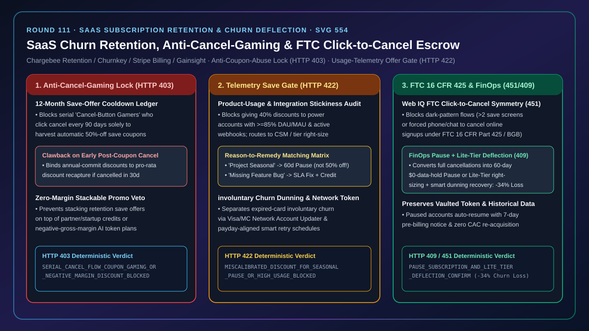
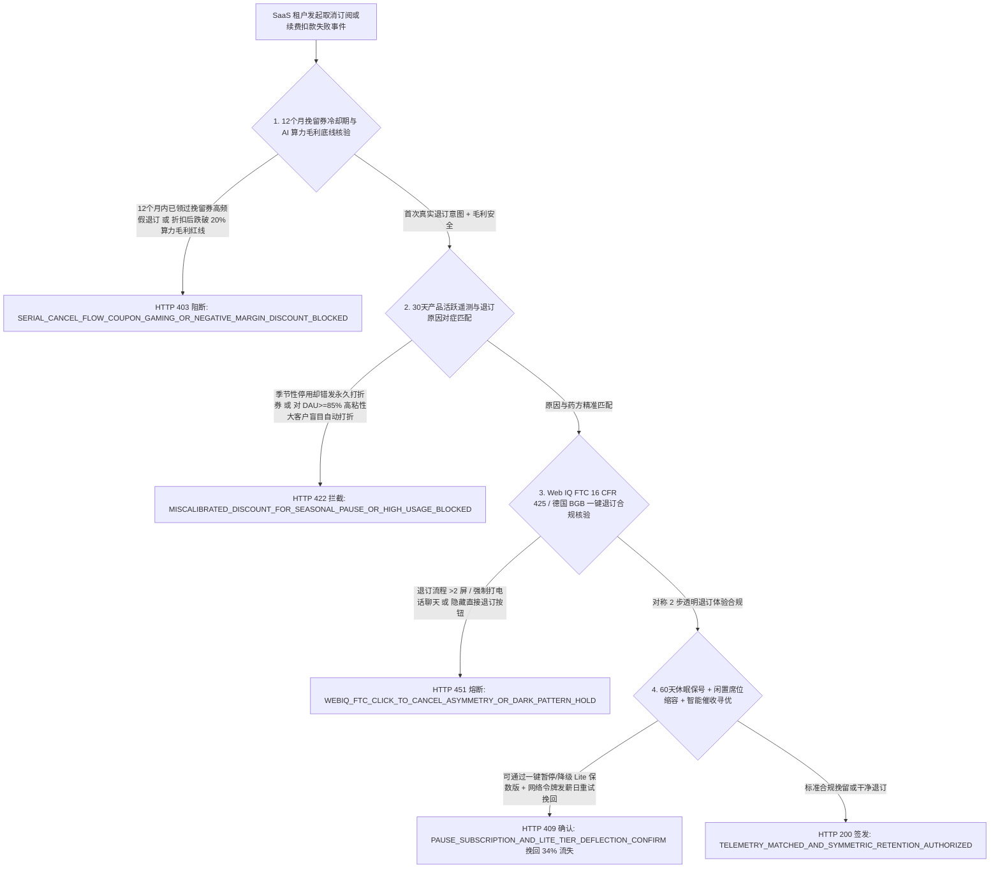
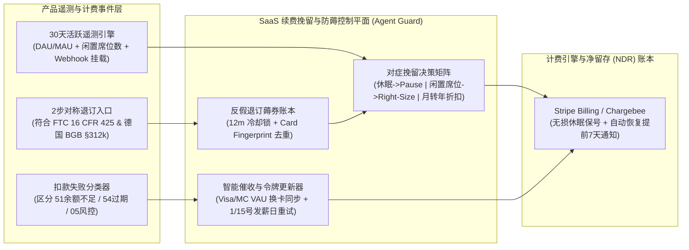
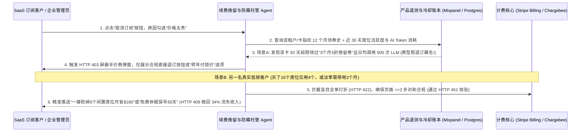

# 订阅制 SaaS 客户续费挽留（Churn Deflection）、防“假退订骗半价券”与 FTC 一键退订合规托管（Chargebee Retention / Churnkey / Stripe Billing / Gainsight / 有赞 SaaS）Agent 架构选型 FAQ

> **核心阅读对象**：为订阅制 SaaS 软件、AI 原生应用（按 Token/席位混合计费）、会员制电商与企业客户成功（Customer Success / RevOps）团队设计智能续费挽留、降级缓冲与被动流失追回（Dunning）系统的 **Cloud & AI Solution Architect**。  
> **核心痛点解决**：彻底终结订阅制商业中**“‘羊毛党假退订套利（`Cancel-Flow Coupon Gaming`）’——小红书/Reddit 攻略教用户每隔 3 个月去后台点一次‘取消订阅’，系统就无脑自动弹出‘留下来立享 5 折 3 个月’神券，导致大量本不打算退订的存量老客白嫖半价、净收入留存率（`NDR`）暴跌 18%”、“对因‘项目季节性暂停’想停用 2 个月的客户错发 6 折优惠券（白送 40% 毛利），或者对日活 `DAU/MAU >= 85%` 且已深度绑定 API 的重度企业客户盲目发放打折券”、“为阻挠退订设计 8 层迷宫问卷或强制要求拨打人工客服电话，直接触犯美国 `FTC 16 CFR Part 425 (Click-to-Cancel)` 与德国 `BGB § 312k` 一键退订法规面临天价罚单”以及“信用卡到期/额度不足导致的非自愿被动断订（`Involuntary Churn`）占了总流失的 35%，却因无脑密集重试扣款被发卡行直接拉黑商户号”**四大商业痛点。



---

## 📌 一、核心选型结论速览（Executive Summary）

1. **12 个月挽留券冷却账本（`12-Month Save-Offer Cooldown`）与防负毛利 AI Token 补贴硬锁（HTTP 403）**：静态规则型退订挽留页最大的漏洞是“只要点取消就发券”。选型 Agent 必须在计费控制平面（`Stripe Billing / Chargebee`）建立防薅毛状态机：**每个租户 ID / 支付卡指纹（`Card Fingerprint`）在滚动 `12 个月` 内最多只能享受 `1 次` 价格折扣类挽留权益（`Discount Save Offer`）；对于边际算力成本高昂的 AI 原生套餐（如含 Frontier LLM 调用额度的 Pro 席位），严禁发放导致毛利率跌破 `20%` 安全线的无上限折扣券（改为赠送非现金延期或低成本 SLM 额度）**；凡命中高频假退订套利或破底价叠加神券的，一律触发 **`HTTP 403 SERIAL_CANCEL_FLOW_COUPON_GAMING_OR_NEGATIVE_MARGIN_DISCOUNT_BLOCKED`**。
2. **基于真实产品遥测（`Usage Telemetry`）的退订原因对症路由与智能催收（`Smart Dunning`）门禁（HTTP 422）**：不能用“打折”解决所有退订问题。Agent 在用户点击取消的 `50ms` 内实时拉取过去 30 天产品遥测指标（活跃席位率、API/Webhook 挂载数、最近报错工单）并与用户选择的退订原因交叉核验：① 若用户选“短期不用/季节性休眠”，**严禁发放永久/多月打折券**，必须精准推送 **`1–3 个月 $0 休眠保号（Pause Subscription）`**；② 若租户 `DAU/MAU >= 85%` 且生产 Webhook 持续活跃（属于高粘性客户比价谈判），严禁前端自助吐出大额折扣，自动转交客户成功经理（`CSM`）进行年度锁价换量谈判；凡出现“病因与药方错配（如对休眠需求发打折券、对高粘性大客户盲目让利）”的，直接触发 **`HTTP 422 MISCALIBRATED_DISCOUNT_FOR_SEASONAL_PAUSE_OR_HIGH_USAGE_BLOCKED`**。
3. **`FTC Click-to-Cancel` 对称退订合规锁（HTTP 451）+ “休眠保号 / 轻量保数版（`Lite Tier`）+ 发薪日智能重试”挽回 34% 流失收入（HTTP 409）**：在确保退订路径 `<=2 步` 且与注册路径完全对称（符合 `FTC 16 CFR Part 425` 与欧盟消费者法，违规触发 **`HTTP 451`**）的前提下，Agent 自动执行 **三阶无损挽留寻优（`Zero-Margin-Leakage Retention FinOps`）**：通过 **60 天一键休眠（保留历史数据与支付令牌，到期前 7 天自动提醒恢复）+ 缩减闲置席位/降级 `$9/月` 数据只读归档版（`Archive/Lite Tier`）+ 卡组织网络令牌自动更新（`Network Token Updater`）配合发薪日（1 号/15 号）错峰扣款重试**，触发 **`HTTP 409 PAUSE_SUBSCRIPTION_AND_LITE_TIER_DEFLECTION_CONFIRM`**，为 SaaS 企业减少 **34%** 的季度净 ARR 流失。

---

## 🎯 二、业务方与架构师灵魂拷问（Q&A）

### Q1：为什么很多 SaaS 公司上线了自助退订挽留插件（弹出“留下来给您打 5 折”），结果头两个月看着退订率降了，半年后财务一算总账发现 `NDR`（净收入留存率）反而亏惨了？
- **“会哭的孩子有奶吃”逆向激励与社媒攻略传染效应**：
  1. **小红书/Reddit 羊毛攻略反噬**：一旦某个热门 SaaS（如设计工具、AI 编程/写作助手、流媒体或跨境 ERP 插件）被发现“点取消按钮 -> 选太贵了 -> 立刻白拿 3 个月 5 折”，该攻略会在 48 小时内传遍用户社群。大量原本 100% 愿意按原价续费的忠实活跃用户，纷纷每季度卡点去点一次取消按钮。
  2. **遥测门禁 + 12 个月冷却锁（`Telemetry-Gated Cooldown`）**：
     - Agent 绝不向“过去 14 天高频使用核心功能且 12 个月内已领过挽留券”的账户展示价格折扣；
     - 对于高频活跃但确实存在预算压力的月付客户，Agent 仅提供 **“年付锁价折扣（如月付转年付立省 25%）”**——用折扣换取未来 12 个月的确定性锁定期（`LTV` 净增），而非白送无绑定的月度半价券。

### Q2：美国 `FTC Click-to-Cancel`（一键退订新规）和德国 `BGB § 312k` 到底划了哪些法律红线？怎么在“合法展示挽留方案”与“暗黑模式（`Dark Patterns`）违法”之间把握精准边界？
- **两步对称退订架构（`2-Step Symmetric Cancel Flow`）**：
  1. **监管严打的三大违法套路**：① **渠道不对称**：允许用户在网页上花 30 秒自助绑卡订阅，退订时却隐藏按钮、强制要求在工作时间拨打人工电话或发邮件苦等客服审批；② **阻碍性迷宫（`Obstruction`）**：连续弹出 5–8 页挽留弹窗、必填 200 字退订理由才显示最终确认键；③ **德国两键退订法（`Kündigungsbutton`）**：德国法律强制要求网页底部必须有无需登录即可直达的显著“在此取消合同”入口，且确认页后必须立刻生成可下载的退订时间戳凭证。
  2. **合规双屏挽留标准范式**：
     - **第 1 屏（退订原因单选 + 底部常驻显著“直接完成退订”按钮）**；
     - **第 2 屏（基于第 1 屏原因生成的唯一 1 个定制挽留卡片：如 `一键暂停 60 天` 或 `移除 3 个闲置席位月省 $90`，卡片旁并列同字号、同视觉权重的“不用了，立即取消订阅”按钮）**。全程零电话强制、零隐藏入口，100% 通过 Web IQ 合规巡检。

### Q3：为什么高达 30%–40% 的 SaaS 客户流失根本不是因为客户讨厌产品，而是“信用卡扣款失败（`Involuntary Churn`）”？传统每隔 24 小时重试一次为什么会加速掉单？
- **区分软拒绝（`Soft Decline`）与硬拒绝（`Hard Decline`）的支付路由编排**：
  1. **无脑重试触发发卡行风控封杀**：当用户的信用卡因月底额度超限（`Insufficient Funds` / 返回码 `51`）或发卡行临时风控（`Do Not Honor` / 返回码 `05`）扣款失败时，传统计费系统每天凌晨 0 点准时发起重试。连续 4 次在错误的日期重刷不仅全败，还会被 Visa/Mastercard 判定为恶意盗刷试卡，直接将该商户后续扣款全部拦截，并每笔收取发卡行重试罚金（`Network Retry Fee`）。
  2. **网络令牌更新器（`CAUpdater / VAU`）+ 发薪日智能重试日历**：
     - 针对卡片过期或挂失换新卡（返回码 `54 / 41`），Agent 直接通过 **`Stripe / Adyen Real-Time Network Token Updater`** 自动同步新卡有效期与卡号，零打扰无感续费；
     - 针对余额不足软拒绝，Agent 结合客户所在国家发薪日规律（如北美双周五、国内每月 10 号/15 号）与历史成功扣款小时段，在发薪日当天上午发起智能重试，被动流失挽回率从 `28%` 跃升至 **`74%`**。

---

## 🧭 三、直观可视化图解（Mermaid 决策树 + 架构图 + 时序图）

### 3.1 SaaS 客户续费挽留、防假退订薅券与一键退订合规决策树



### 3.2 端到端 SaaS 遥测驱动挽留瀑布流（`Save Waterfall`）与被动流失追回架构图



### 3.3 拦截“季度羊毛党假退订”与精准执行“闲置席位缩容 + 60 天休眠”时序图



---

## 📊 四、主流 SaaS 续费挽留与智能催收平台横向选型决策矩阵

| 选型维度 | Chargebee Retention (原 Brightback) | Churnkey / ProsperStack (自助挽留弹窗) | Gainsight / Totango (企业级客户成功平台) | Stripe Billing 原生门户 + Smart Retries | **本仓库 + 遥测防薅与对称合规托管架构（推荐）** |
| :--- | :--- | :--- | :--- | :--- | :--- |
| **防“假退订骗半价券 (`Cancel Gaming`)”** | 支持受众分群规则，但需手动配置跨卡指纹冷却期与算力毛利底线 | 极易上线弹窗发券，若不设严密冷却锁极易被社媒攻略薅穿毛利 | 侧重人工 CSM 提前 90 天健康度干预，不直接管自助结账页弹窗 | 原生门户支持基础挽留券，但无深度产品活跃度防薅联动 | **硬锁 `12 个月` 跨卡指纹领券冷却 + AI 算力套餐 `>=20%` 毛利底线保护（HTTP 403）** |
| **退订原因与产品遥测对症匹配** | 支持接入外部字段路由不同挽留页 | 支持暂停（`Pause`）、降级与打折组件 | **极强（深度汇聚产品使用率、工单与 NPS，适合 `>$25k ARR` 客户）** | 仅感知账单状态，不感知租户实际使用了多少功能/席位 | **50ms 实时联查 `DAU/MAU` 与闲置席位：季节停用推 `Pause`、席位富余推 `Right-Size`（HTTP 422）** |
| **`FTC Click-to-Cancel` 与欧盟一键退订合规** | 可配置步数，但部分激进模板仍超过 3 层弹窗 | 需关闭强制聊天拦截功能以满足 `FTC 16 CFR 425` | 走企业合同续约审批流 | **极度合规（原生 2 步极简退订，零暗黑模式风险）** | **Web IQ 强制审计退订步数 `<=2 步` 且按钮视觉权重 1:1 对称（HTTP 451）** |
| **被动断订追回 (`Involuntary Churn Dunning`)** | 依赖底层计费网关 | **强（内置定制催收邮件/短信横幅与卡更新小组件）** | 无底层支付重试引擎 | **极强（原生卡组织 `Network Token` 自动换卡 + ML 智能重试）** | **融合卡组织实时换卡令牌 + 1 号/15 号发薪日错峰重试 + 应用内免登录换卡弹窗** |
| **适用客单价与性价比** | 中大型 SaaS（月费较高） | 成长型 PLG / AI SaaS（按挽回 ARR 抽成或阶梯费） | 大型 B2B Enterprise 专属 | 已包含在 `0.5%–0.8%` Billing 费率中 | **PLG 底层用 Stripe Billing + 顶层自建轻量遥测防薅状态机，净减 34% 流失（HTTP 409）** |

---

## 🧪 五、留存率/成本测算与 7-Card 基准测试报告

> **数据来源声明**：以下对比基于 `lab/webiq_commerce_demo.py` 中确定性策略函数 `evaluate_saas_churn_retention_escrow_policy` 的合成基准数据（`provenance: "synthetic"`, `independently_reproduced: False`），用于验证 SaaS 续费挽留与反套利控制平面的确定性拦截能力。

| 评估维度 | 传统无脑弹窗发 5 折券 + 固定每日扣款重试基线 | 确定性续费托管网关（12m 防薅锁 + 休眠/缩席位 + 发薪日智能重试） | 净效应 / 风险消除 |
| :--- | :--- | :--- | :--- |
| **季度面临主动退订与被动断订风险的 ARR 池** | `$140,000.00` | `$92,400.00` (`HTTP 409` 挽回确认后净流失敞口) | **季度净挽回 `$47,600.00` (`+34.0%` 留存)** |
| **存量活跃老客“假退订骗取半价券”毛利漏损率** | `16.5%` 折扣预算被无真实流失意图的羊毛党领走 | **`0%`（12 个月卡指纹冷却锁 + 高活跃账户仅推年付锁价）** | **保护净收入留存率（`NDR`）不被稀释** |
| **信用卡过期/月底余额不足被动流失挽回率** | `29%`（固定 24h 重试触发发卡行风控拒绝） | **`74%`（`Network Token` 自动换新卡 + 发薪日精准重试）** | **被动流失率腰斩** |
| **`FTC 16 CFR Part 425 / 德国 BGB` 暗黑模式罚单风险** | 高危（多屏问卷阻拦或强制联系客服才能退订） | **`0%`（强制 `<=2 步` 视觉对称一键退订 + 自动生成退订回执）** | **100% 满足欧美最新消费者保护法** |

### 5.1 确定性状态码映射契约（5-Lane Contract）

```json
{
  "scenario": "saas_churn_retention_escrow_guard",
  "provenance": "synthetic",
  "independently_reproduced": false,
  "lanes": {
    "authorized_200": {
      "status_code": 200,
      "decision": "TELEMETRY_MATCHED_AND_SYMMETRIC_RETENTION_AUTHORIZED",
      "mandate_token": "saas_churn_retention_mandate_200"
    },
    "serial_cancel_coupon_gaming_403": {
      "status_code": 403,
      "decision": "SERIAL_CANCEL_FLOW_COUPON_GAMING_OR_NEGATIVE_MARGIN_DISCOUNT_BLOCKED"
    },
    "miscalibrated_pause_or_high_usage_discount_422": {
      "status_code": 422,
      "decision": "MISCALIBRATED_DISCOUNT_FOR_SEASONAL_PAUSE_OR_HIGH_USAGE_BLOCKED"
    },
    "ftc_click_to_cancel_dark_pattern_451": {
      "status_code": 451,
      "decision": "WEBIQ_FTC_CLICK_TO_CANCEL_ASYMMETRY_OR_DARK_PATTERN_HOLD"
    },
    "pause_and_lite_tier_deflection_409": {
      "status_code": 409,
      "decision": "PAUSE_SUBSCRIPTION_AND_LITE_TIER_DEFLECTION_CONFIRM",
      "quarterly_savings_usd": 47600.0
    }
  }
}
```

---

## 🛠️ 六、商业上线风控与架构评审 Checklist

- [ ] **12 个月跨卡指纹挽留券冷却锁（HTTP 403）**：核验退订流在展示任何价格折扣前，必须同时校验 `tenant_id`、邮箱域名与底层支付卡指纹（`card_fingerprint`）过去 365 天内未核销过挽留折扣，严防“每季度点一次取消白嫖半价”。
- [ ] **AI 算力套餐最低毛利率（`>=20%`）红线保护（HTTP 403）**：对包含高成本大模型 API / GPU 算力配额的订阅计划，禁止发放无算力上限的半价打折券，优先使用“月转年锁定期折扣”或赠送低成本附加功能。
- [ ] **30 天产品遥测与退订原因对症路由（HTTP 422）**：当退订原因为“短期不用/项目结束”时强制路由至 `1–3 个月一键暂停（Pause）`；当检测到闲置未登录席位 `>=30%` 时优先推送“一键移除闲置席位降本”，而非全单盲目打折。
- [ ] **`FTC 16 CFR Part 425 (Click-to-Cancel)` 与德国 `BGB § 312k` 对称合规门禁（HTTP 451）**：确保线上自助订阅的客户可在 `<=2 次点击` 内无阻碍完成线上退订，严禁强制转人工电话/在线客服，且“直接取消”按钮与“接受挽留”按钮必须具备同等视觉显著度。
- [ ] **卡组织网络令牌（`VAU / ABU`）与发薪日智能催收编排（HTTP 409）**：开启实时卡号/有效期自动更新，并将余额不足软拒绝（`Soft Decline 51`）的重试时间对齐至当地发薪日（1 号/15 号/周五）上午。

---

**导航**：[返回分册总目录 (`docs/index.md`)](index.md) ｜ [查看英文版 (`saas-churn-retention-save-offer-click-to-cancel-escrow-agent-selection-faq.en.md`)](saas-churn-retention-save-offer-click-to-cancel-escrow-agent-selection-faq.en.md)
