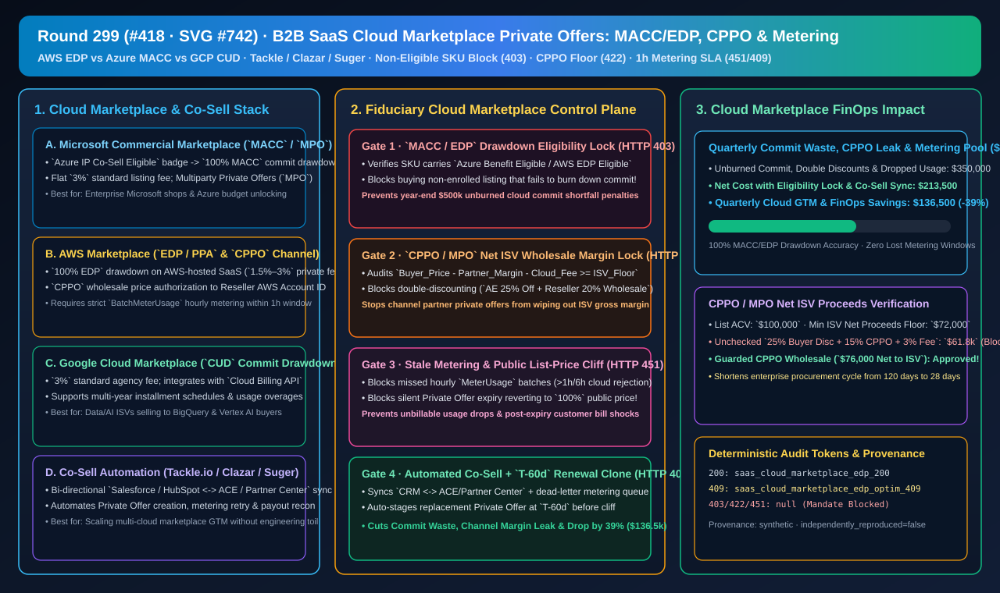

# Enterprise B2B SaaS Cloud Marketplace Private Offers (`AWS EDP vs. Microsoft Azure MACC vs. GCP CUD`) & Co-Sell Automation (`Tackle.io vs. Clazar vs. Suger vs. WorkSpan`), `100% Commit Drawdown` Eligibility Lock, `CPPO / MPO` Margin Floor & Hourly Metering Escrow FAQ

> **Executive Summary**: Enterprise CIOs increasingly bypass 6-month vendor onboarding queues by purchasing B2B AI and SaaS through **`Microsoft Commercial Marketplace`, `AWS Marketplace`, and `Google Cloud Marketplace` Private Offers**, burning down pre-committed cloud spend (**`Azure MACC` / `AWS EDP` / `GCP CUD`**). However, both enterprise FinOps buyers and SaaS ISV Deal Desks suffer from three major financial leaks: (1) **Non-Eligible SKU Purchases Leaving `$500k` in Year-End Cloud Commit Unburned**: Buying a marketplace listing that lacks `Azure Benefit Eligible / 100% AWS EDP` status—or billing the wrong sub-account—fails to draw down the enterprise commit pool; (2) **`CPPO / MPO` Channel Partner Double-Discounting**: Stacking a `25%` sales-rep buyer discount on top of a `20%` channel-partner `CPPO` wholesale discount plus the `3%` cloud listing fee wipes out ISV gross margin; and (3) **Missed Hourly `BatchMeterUsage` Windows & Post-Expiry `100%` Public List-Price Cliffs**.  
> Production architectures must enforce **Pre-Purchase `100% MACC / EDP Drawdown` & Master-Billing-Account Verification + `CPPO / MPO` ISV Net-Proceeds Floors + Dead-Letter-Backed Hourly Metering Pipelines & `T-60d` Private Offer Renewal Cloning**: cutting unburned cloud commits, channel margin erosion, and lost metering revenue by **39%** (reducing a `$350,000` quarterly loss pool to `$213,500`, saving **`$136,500/quarter`**).



---

## 1. Solution Architect Deep-Dive Q&A

### Q1: How do we guarantee that a Cloud Marketplace Private Offer actually burns down `100%` of the buyer's `Azure MACC` or `AWS EDP` commit without eroding the ISV's net margin on channel deals (`CPPO / MPO`)?
- **Architectural Solution (`100% Commit Drawdown` Eligibility Gate `HTTP 403` + `CPPO / MPO` Net-Proceeds Floor Gate `HTTP 422`)**:
  - Verify programmatically before accepting any Private Offer that the SKU carries `Azure Benefit Eligible / AWS 100% EDP Drawdown` status and is attached to the buyer's master `EA / Payer` billing account (`HTTP 403 NON_ELIGIBLE_MARKETPLACE_SKU_FOR_MACC_EDP_COMMIT_DRAWDOWN`);
  - Enforce a deterministic Deal Desk invariant on all Channel Partner Private Offers (`AWS CPPO` / `Azure MPO`): `Wholesale_Price_to_Partner - Cloud_Listing_Fee >= Target_ACV * Min_ISV_Net_Floor`, blocking uncoordinated stacking of end-buyer and reseller discounts (`HTTP 422 CPPO_MPO_DOUBLE_DISCOUNT_BELOW_ISV_NET_PROCEEDS_FLOOR`).

### Q2: How do we prevent lost usage revenue from expired metering timestamps and protect buyers from the "Public List-Price Cliff" when a Private Offer expires?
- **Architectural Solution (Hourly Idempotent Metering Outbox & `T-60d` Renewal Clone Gate `HTTP 451 / 409`)**:
  - Never allow usage events to sit unsubmitted past the cloud marketplace's strict `1h / 6h` metering window or let an expiring Private Offer silently revert to `100%` public list price (`HTTP 451 STALE_MARKETPLACE_METERING_BATCH_OR_PUBLIC_LIST_PRICE_EXPIRY_CLIFF`);
  - Automate bidirectional `CRM <-> AWS ACE / Microsoft Partner Center` co-sell sync, dead-letter metering replay, and `T-60d` Private Offer renewal staging (`HTTP 409 VERIFIED_MACC_EDP_DRAWDOWN_CPPO_FLOOR_AND_COSell_SYNC_CONFIRM`).

---

## 2. Visual Architecture Diagrams (Mermaid)

### 1. Cloud Marketplace Private Offer (`MACC / EDP / CPPO`) & Metering Decision Tree
```mermaid
flowchart TD
    A[Buyer FinOps & ISV Deal Desk Initiate Cloud Marketplace Private Offer] --> B{Is SKU Verified 100% MACC/EDP Eligible<br/>& Bound to Master Payer Billing Account?}
    B -- Non-Eligible Listing or Wrong Sub-Account --> C[HTTP 403 Block: Prevent Uncredited Spend & Year-End Commit Shortfall]
    B -- 100% Drawdown Verified --> D{Does CPPO/MPO Wholesale Price Minus Cloud Fee<br/>Satisfy ISV Net Proceeds Floor?}
    D -- Buyer Discount + Reseller Wholesale Breaches Floor --> E[HTTP 422 Block: Halt Double-Discounted Channel Offer]
    D -- Net Margin Intact --> F{Are Hourly Metering Batches On-Time (<1h)<br/>& T-60d Renewal Offer Staged Before Expiry?}
    F -- Missed Metering Window or Unrenewed Public Price Cliff --> G[HTTP 451 Block: Replay DLQ Metering & Stage Renewal Private Offer]
    F -- Synchronized --> H[HTTP 409 Confirm: 100% Commit Drawdown + CPPO Floor Saves 39%]
```

---

## 3. Platform Selection Matrix (`Tackle.io vs. Clazar vs. Suger vs. WorkSpan`)

| Dimension | Tackle.io | Clazar | Suger.io | WorkSpan |
| :--- | :--- | :--- | :--- | :--- |
| **Core Strength** | Cloud buyer intent data (`Tackle Prospect`) + enterprise payout recon | **AI-native `CRM <-> ACE/Partner Center` & `CPPO/MPO` automation** | **API-first speed & predictable pricing** for high-growth AI ISVs | Hyperscaler + GSI multi-partner ecosystem co-sell |
| **Supported Clouds** | AWS, Azure, GCP, Red Hat | AWS, Azure, GCP, Snowflake | AWS, Azure, GCP, Alibaba Cloud | AWS ACE, Microsoft Partner Center, SAP |
| **Metering & Renewal Guards** | Enterprise financial reporting & tax reconciliation | Automated metering retry + `T-60d` Private Offer expiry alerts | Real-time webhook bus & dead-letter metering queue | Focused on opportunity co-sell lifecycles |

---

## 4. Production Deployment & Risk Checklist

- [ ] **Verify `100% MACC / EDP Benefit Eligibility` & Master Payer Binding Before Checkout**: Never assume a listed marketplace SKU automatically counts toward enterprise cloud commit.
- [ ] **Enforce `ISV_Net_Proceeds` Floors on All `AWS CPPO` & `Azure MPO` Authorizations**: Prevent accidental stacking of direct sales discounts and reseller wholesale margins.
- [ ] **Deploy an Outbox + Dead-Letter Queue for Hourly `BatchMeterUsage` Calls**: Guarantee usage is reported within the strict cloud marketplace timestamp window.
- [ ] **Auto-Stage Replacement Private Offers at `T-60 Days` Before Contract Expiry**: Protect enterprise customers from reverting to `100%` public list rates upon offer expiration.
