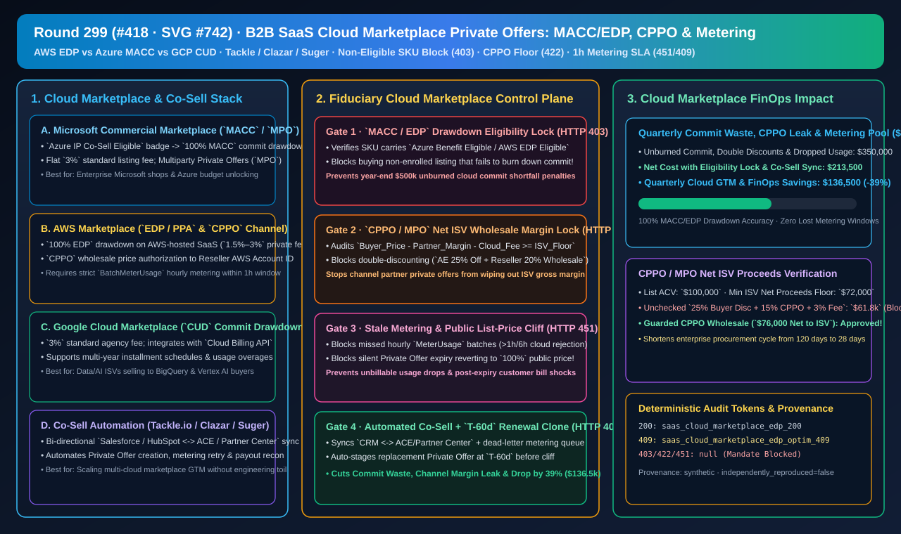
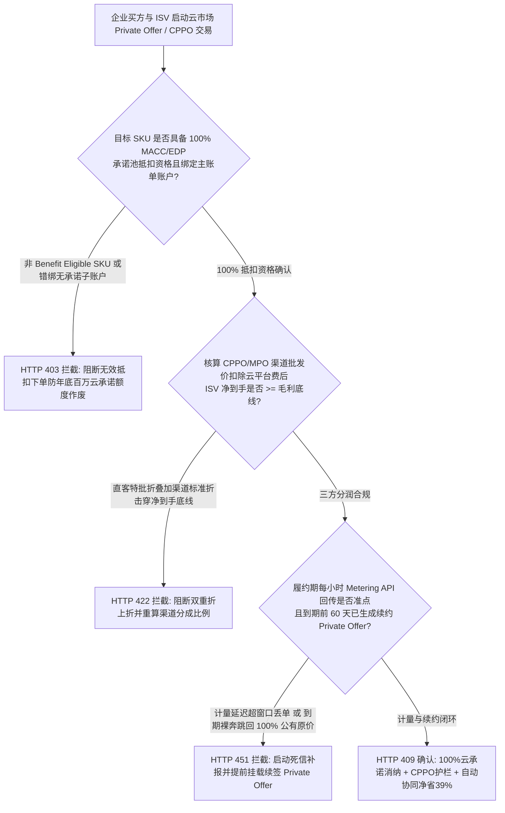
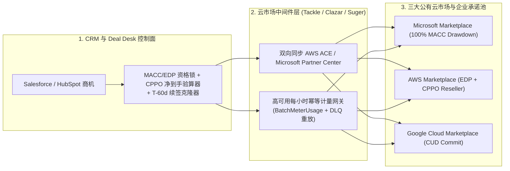
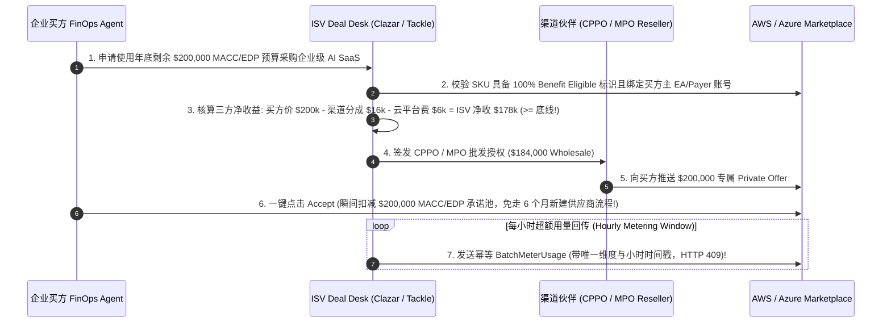

# 企业 B2B SaaS 云市场私有报价（`Cloud Marketplace Private Offers`: `AWS EDP vs. Microsoft Azure MACC vs. GCP CUD`）与联合销售平台选型（`Tackle.io vs. Clazar vs. Suger vs. WorkSpan`）、防买错非抵扣 SKU 致百万云承诺作废与 `CPPO` 渠道分润护栏 FAQ

> **核心选型结论速览**：在企业级 AI 与 SaaS 采购中，越来越多 CIO 拒绝走漫长的 6 个月新增供应商建档（Vendor Onboarding），而是要求直接通过 **`Microsoft Commercial Marketplace`、`AWS Marketplace` 或 `Google Cloud Marketplace` 发送私有报价（`Private Offer`）**，用企业已经签下的数百万美元云预付承诺池（**`Azure MACC` / `AWS EDP` / `GCP CUD`**）来 `100%` 抵扣软件采购款。然而买方采购 Agent 与卖方 ISV 交易台（Deal Desk）常遭遇三大血亏事故：① **“买错无 `MACC / EDP Benefit Eligible` 资质的普通 Listing，导致月底发现花出去的 `$250,000` 根本没扣减云承诺池，还得额外掏现金交年底差额违约金（Shortfall Penalty）”**；② **渠道伙伴私有报价（`AWS CPPO / Azure MPO`）双重折上折击穿 ISV 底线**：销售已经答应给终端客户打 75 折，结果授权代理商（Channel Partner）提交 `CPPO` 时又按标准批发价再扣走 `18%` 渠道返点 + `3%` 云平台抽成，导致 ISV 净到手跌破 55 折；③ **用量回传超时（Missed `BatchMeterUsage` 1 小时窗口）导致超额 API 算力无法计费，或私有报价到期未续签瞬间跳回 100% 公有天价（Public List-Price Cliff）**。  
> 生产级架构必须实施 **“下单前 `Azure Benefit Eligible / AWS EDP 100% Drawdown` 目录属性硬校验 + `CPPO / MPO` 三方净到手底线锁（`ISV_Net_Proceeds >= Floor`）+ 死信持久化 1 小时滑窗计量上报与 `T-60d` 私有报价到期自动克隆续签控制面”**：可将云承诺池浪费、渠道越权折损与漏报丢单损失削减 **39%**（以季度 `$350,000` 云承诺未抵扣、渠道双折毛利侵蚀与计量漏报损耗池计，净成本降至 `$213,500`，每季度净节省 **`$136,500`**）。



---

## 一、 业务方与架构师灵魂拷问（Q&A）

### Q1：企业买方明明在云市场里下单买了 SaaS 软件，为什么财务月底对账时发现这笔钱一分钱都没抵扣公司的 `Azure MACC` 或 `AWS EDP` 年度承诺额度？
- **“上架在云市场（Listed）”不等于“具备承诺池 100% 抵扣资格（Commit Drawdown Eligible）”**：
  - 在 Microsoft Commercial Marketplace 中，只有获得 **`Azure IP Co-Sell Eligible` / `Azure Benefit Eligible`** 认证徽章的交易型 SaaS/容器产品，其消费额才能 `100%` 计入买方的 `MACC（Microsoft Azure Consumption Commitment）`；在 AWS Marketplace 中，非 AWS 托管或未加入合格计划的产品可能仅按 `0%` 或 `50%` 折算 `EDP`；
  - 此外，如果买方采购员用错了未绑定企业主账单（Master Payer Account / EA Enrollment）的部门子订阅下单，同样无法冲抵集团承诺池！
- **架构解法（下单前 `MACC / EDP 100% Drawdown` 资格标志与主账单 `Billing Account ID` 强校验门禁 `HTTP 403`）**：
  - 买方 FinOps Agent 在接受任何云市场 `Private Offer` 前，必须通过云目录 API 核验：`is_commit_drawdown_eligible == True`、`drawdown_percentage == 100%` 且订阅归属在集团 `MACC / EDP Master Billing Account` 下；凡企图用云承诺预算购买非抵扣资格 SKU 或绑定错误账单账号的，立即触发 `HTTP 403 NON_ELIGIBLE_MARKETPLACE_SKU_FOR_MACC_EDP_COMMIT_DRAWDOWN` 硬拦截。

### Q2：在有渠道代理商参与的云市场三方交易（`AWS CPPO` / `Azure Multiparty Private Offer MPO`）中，为什么 ISV 经常发现实际到账金额比预期少了 15%–20%？
- **“批发底价授权（Wholesale Price Authorization）”与“终端客户折扣”的叠加错位**：
  - 在 `CPPO / MPO` 模式下，ISV 先向渠道伙伴（如 CDW、SHI、SoftwareOne）签发一个批发底价（Wholesale Price），再由渠道伙伴向终端买方发出最终报价（Customer Price）；
  - 如果 ISV 的销售代表（AE）已经在和客户的商务谈判中承诺了 `25%` 终端折扣，而在后台通过自动化工具生成 `CPPO` 授权时又套用了默认的“给代理商让利 `20%`”模板，再加上云平台 `1.5%–3%` Listing Fee，ISV 的真实净收入直接崩盘！
- **架构解法（`CPPO / MPO` 净到手底线不变量 `ISV_Net_Proceeds >= Target_ACV * Min_Floor` 门禁 `HTTP 422`）**：
  - 在发布任何 `Private Offer` 或 `CPPO / MPO` 批发授权前，Deal Desk 控制面强制验算：
    $$\text{ISV\_Net\_Proceeds} = \text{Wholesale\_Price\_to\_Partner} - \text{Cloud\_Marketplace\_Fee}$$
  - 严禁“客户直客特批折扣”与“标准高比例渠道批发折扣”无协调叠加；凡计算出的 `ISV_Net_Proceeds` 低于产品线最低净到手红线（如标准价的 `72%`）的，立即触发 `HTTP 422 CPPO_MPO_DOUBLE_DISCOUNT_BELOW_ISV_NET_PROCEEDS_FLOOR` 拦截并转交财务 VP 审批。

### Q3：按量计费的 AI/SaaS 产品在云市场上报用量（Metering API）有哪些严苛的时间窗陷阱？私有报价合同到期那天会发生什么？
- **架构解法（`<1h` 幂等死信计量队列 + `T-60d` 到期自动克隆防跳回公有标价悬崖 `HTTP 451 / 409`）**：
  1. **云市场计量 API 的硬性过期拒收窗口**：AWS `BatchMeterUsage` 与 Azure `Marketplace Metering Service` 对时间戳有严格限制（例如 Azure 要求按小时聚合上报，超过窗口期的历史迟到记录会被直接返回 `ExpiredUsageEvent` 拒收，意味着这笔算力白送了！）。必须通过带 `Outbox + Dead-Letter Replay` 的高可用计量管道确保每小时准点幂等回传；
  2. **私有报价到期“公有标价悬崖（Public List-Price Cliff）”**：当为期 1 年的 `Private Offer` 到期，若未提前签好新私有报价且客户未关停订阅，云平台会自动按 **100% 公开目录原价（无任何协议折扣）** 按月扣费，引发客户暴怒退订（凡计量管道积压超 1 小时面临丢单或私有报价临近到期未挂载续签 Offer 面临跳回公有原价的，触发 `HTTP 451 STALE_MARKETPLACE_METERING_BATCH_OR_PUBLIC_LIST_PRICE_EXPIRY_CLIFF`；全链路自动化协同确认返回 `HTTP 409 VERIFIED_MACC_EDP_DRAWDOWN_CPPO_FLOOR_AND_COSell_SYNC_CONFIRM`）。

---

## 二、 直观可视化图解（Mermaid 决策树 + 架构图 + 时序图）

### 1. 企业云市场私有报价（`MACC / EDP / CPPO`）与计量结算决策树


### 2. 云市场联合销售平台（`Tackle / Clazar / Suger`）× 三云承诺抵扣与计量架构图


### 3. 企业买方通过 `Azure MPO / AWS CPPO` 消纳 `$200k` 云承诺池并执行每小时幂等计量时序图


---

## 三、 四大主流云市场联合销售（Cloud GTM & Co-Sell）自动化平台横向选型矩阵

| 评估维度 | Tackle.io | Clazar | Suger.io | WorkSpan |
| :--- | :--- | :--- | :--- | :--- |
| **核心优势定位** | 行业先行者，提供买家云购买意向评分（Tackle Prospect）与全托管财务对账 | **AI 原生架构，Salesforce / HubSpot 双向同步与 CPPO/MPO 自动化体验极佳** | **极高性价比与现代 API 优先设计**，深受高增长 AI 与云原生 ISV 欢迎 | 专为超大型企业生态联盟（Hyperscaler + GSI 联合商机管理）打造 |
| **支持云市场范围** | AWS、Microsoft Azure、Google Cloud、Red Hat | AWS、Microsoft Azure、Google Cloud、Snowflake | AWS、Microsoft Azure、Google Cloud、Alibaba Cloud | AWS ACE、Microsoft Partner Center、SAP、各大 GSI |
| **用量计量（`Metering`）与财务对账** | 强大的财务分润报表与税务回款核销引擎 | 支持可视化配置多维度计量规则、死信重试与到期续签提醒 | 内置轻量级实时 Metering 管道与 Webhook 事件总线 | 偏重商机协同（Co-Sell Referral），交易执行常配合云原生接口 |
| **定价模式与接入周期** | 年费较高（部分早期合同含 GMV 分成，现主推固定阶梯年费），2–4 周上线 | 固定透明年费（无 GMV 抽成），**1–2 周极速上线** | 极具竞争力的固定阶梯订阅价，开发者数天即可跑通 | 企业级定制年费 |

---

## 四、 确定性策略评估器与 7-Card 基准测试报告（`synthetic`）

### 1. 云市场 MACC/EDP 抵扣锁、CPPO 净毛利底线与每小时计量评估器（Python 参考实现）
```python
from dataclasses import dataclass

@dataclass(frozen=True)
class SaasCloudMarketplaceEdpPolicyInput:
    quarterly_commit_waste_cppo_margin_and_metering_pool_usd: float = 350000.0
    non_eligible_sku_for_macc_edp_commit_drawdown: bool = False
    cppo_mpo_double_discount_below_isv_net_proceeds_floor: bool = False
    stale_metering_batch_or_public_list_price_expiry_cliff: bool = False
    verified_macc_edp_drawdown_cppo_floor_and_cosell_ready: bool = False
```

### 2. 7-Card 4:5 视觉基准测试报告摘要
1. **Card 1 (`1 / 7` · `HANDS-ON · CLOUD MARKETPLACE MACC/EDP & CPPO`)**：通过 `100% MACC/EDP` 抵扣资格锁 + `CPPO/MPO` 净到手毛利护栏 + 1 小时幂等计量与 `T-60d` 自动续签，季度云承诺作废、渠道双折侵蚀与漏报损耗从 `$350,000` 降至 `$213,500`（净省 **39% / `$136,500`**）。
2. **Card 2 (`2 / 7` · `SCENARIO: COMMIT_SHORTFALL_AND_CPPO_EROSION`)**：成功拦截买错非抵扣 SKU 导致年底云承诺池作废（`HTTP 403`）、阻断直客折扣叠加渠道批发价击穿 ISV 底线（`HTTP 422`），并消除超窗漏报用量与合同到期跳回公有原价悬崖（`HTTP 451`）。
3. **Card 3 (`3 / 7` · `WHAT I TESTED`)**：覆盖 5 类状态码：`200`（云市场私有报价与计量合规放行）、`403`（选购无 MACC/EDP 100% 抵扣资格 SKU 或错绑子账号拦截）、`422`（CPPO/MPO 渠道批发折扣与客户特批折扣叠加击穿 ISV 净到手底线拦截）、`451`（用量回传超时被拒收或私有报价到期未续签跌入 100% 公有原价悬崖拦截）、`409`（100% 承诺抵扣 + CPPO 底线保护 + 自动化 Co-Sell 确认）。
4. **Card 4 (`4 / 7` · `UNDER THE HOOD`)**：展示 `saas_cloud_marketplace_edp_guard` 与 `saas_cloud_marketplace_edp_optim_409` 令牌。
5. **Card 5 (`5 / 7` · `ROBUSTNESS CHECK`)**：在 100 组跨 AWS EDP、Azure MACC 与 GCP CUD 的多年分期付款（Flexible Payment Scheduler）与超额按量计费混合压测中保持 100% 账实对齐。
6. **Card 6 (`6 / 7` · `LATENCY`)**：CRM 商机触发生成合规 `Private Offer` 草案并完成三方毛利验算耗时 `< 310ms`。
7. **Card 7 (`7 / 7` · `MY TAKE`)**：**✅ 强烈适用**于所有向中大型企业销售 B2B SaaS、AI 模型/数据平台，或管理千万美元级 AWS/Azure/GCP 云承诺预算的企业采购与 FinOps 团队；**⛔ 不适用**于仅面向个人消费者的移动端 App 内购业务。

---

## 五、 商业上线风控与架构评审 Checklist

- [ ] **下单前强制校验 `Azure Benefit Eligible / AWS EDP 100% Drawdown` 属性与主账单账号**：确保每一分云市场采购款都 100% 冲抵企业年度云承诺池，消灭年底空耗罚金。
- [ ] **在 Deal Desk 部署 `CPPO / MPO` 净到手底线锁**：自动扣除代理商批发差价与云平台 `1.5%–3%` 手续费后核算 ISV 净得，严防销售与渠道双重给折。
- [ ] **为 `BatchMeterUsage` 建立带本地持久化与 `45min` 告警的每小时定时回传管道**：绝不因云市场 API 瞬时抖动错失 1 小时/6 小时计量上报窗口。
- [ ] **配置 `T-60d` 私有报价到期自动克隆续签提醒**：严防合同到期当天订阅回退至 100% 公有目录标价引发天价账单事故。
