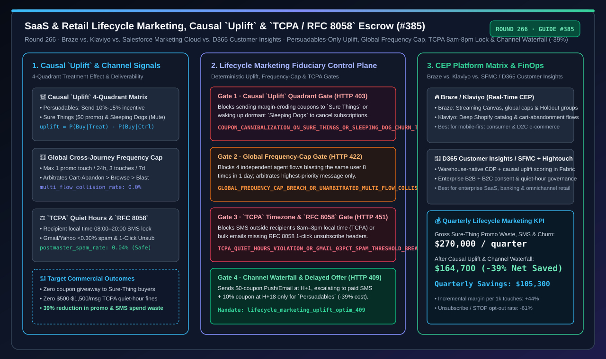
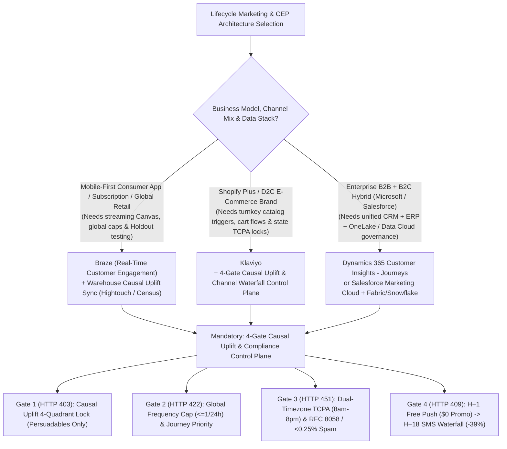
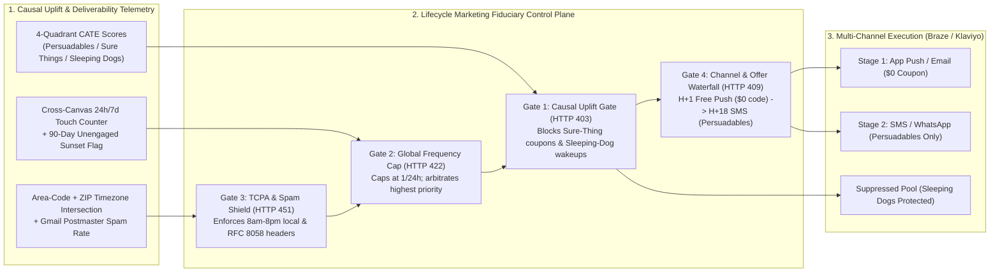
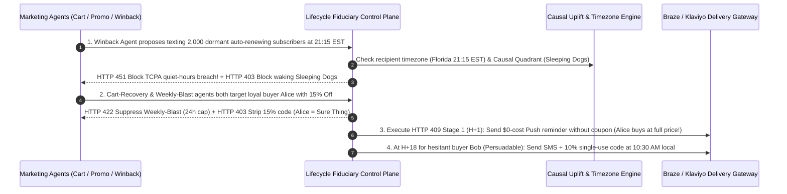

# SaaS & Omnichannel Retail Lifecycle Marketing Orchestration (`Braze vs. Klaviyo vs. Salesforce Marketing Cloud vs. D365 Customer Insights`), Causal `Uplift` Promo Targeting & `TCPA / RFC 8058` Escrow Agent Architecture Selection FAQ

> 🌐 **Language / 语言切换**: **[中文 (`docs/saas-ecommerce-lifecycle-marketing-causal-uplift-frequency-cap-tcpa-escrow-agent-selection-faq.md`)](saas-ecommerce-lifecycle-marketing-causal-uplift-frequency-cap-tcpa-escrow-agent-selection-faq.md)** | **English (Current)** | **[Back to Catalog (`docs/index.en.md`)](index.en.md)**

---

## 1. 📌 Executive Summary & Architectural Verdict

In subscription SaaS, D2C e-commerce, and loyalty retail, connecting autonomous AI growth agents to Customer Engagement Platforms (`CEPs`: **`Braze`, `Klaviyo`, `Salesforce Marketing Cloud (SFMC)`, `Microsoft Dynamics 365 Customer Insights - Journeys`**) without causal targeting and regulatory guardrails causes three severe margin and deliverability disasters:
1. **Propensity-Model Fallacy: Giving `20% Off` Coupons to `Sure Things` While Waking Up `Sleeping Dogs` to Cancel**: Naive marketing agents rank users by raw **Propensity-to-Buy** ($P(\text{Buy} \mid \text{Coupon})$) rather than **Causal Uplift** ($\tau(x) = P(\text{Buy} \mid \text{Treat}) - P(\text{Buy} \mid \text{Control})$). As a result, `80%` of promo budget is wasted discounting loyal customers who would have paid full price anyway (**`Sure Things`**), while blasting "Check out your membership perks!" emails to dormant auto-renewing subscribers (**`Sleeping Dogs`**) reminds them they are still paying `$29/mo`—triggering an immediate **`8%` spike in subscription cancellations (Negative Treatment Effect)**!
2. **Multi-Journey Collision Fatigue (`4 Flows × 2 Channels = 8 Messages/Day`)**: When Cart-Abandonment, Browse-Recovery, Loyalty-Tier, and Weekly-Promo agents run independently without a centralized **Global Cross-Journey Frequency Cap & Priority Arbiter**, high-intent shoppers get bombarded with 6–8 messages in a single afternoon—causing `STOP` SMS opt-outs to surge `4x`.
3. **`$500–$1,500/SMS` US `TCPA` Quiet-Hour Lawsuits & Gmail/Yahoo `0.30%` Spam-Rate Domain Blacklisting**: Sending promotional SMS outside the recipient's local `08:00–20:00` window (under federal **TCPA** and state mini-TCPA laws like Florida's `FTSA`) triggers class-action statutory damages of **`$500 to $1,500 per text message`**. Simultaneously, mailing unengaged zombie addresses or omitting **`RFC 8058` One-Click Unsubscribe headers** pushes Gmail Postmaster spam complaint rates above the **`0.30%` hard ceiling**, causing Google and Yahoo to block the brand's entire domain!

**Solution Architect Verdict**:
- **Replace raw propensity targeting with Causal `Uplift` 4-Quadrant Modeling (`Persuadables` vs. `Sure Things` vs. `Lost Causes` vs. `Sleeping Dogs`)** computed in your warehouse/CDP (`Microsoft Fabric / Snowflake + Hightouch`) and enforced prior to `Braze / Klaviyo / D365 / SFMC` execution.
- Deploy a **4-Gate Lifecycle Marketing, Causal Uplift & `TCPA / RFC 8058` Fiduciary Control Plane**:
  1. **Causal `Uplift` 4-Quadrant Promo & Anti-`Sleeping-Dog` Gate (`HTTP 403`)**: Restrict margin-bearing discount codes exclusively to **`Persuadables`**; block sending discounts to **`Sure Things`** (serve `$0`-discount editorial/new-arrival content instead) and hard-mute outbound marketing to **`Sleeping Dogs`** (dormant paying subscribers with negative uplift).
  2. **Global Cross-Journey Frequency Cap (`<= 1/24h`, `<= 3/7d`) & Priority Arbitration Gate (`HTTP 422`)**: Arbitrate colliding journeys (`Transactional > Cart Recovery > Price Drop > Promo Blast`) so only the single highest-priority touch fires within any 24-hour window.
  3. **Dual-Anchor `TCPA` Local Quiet-Hours (`08:00–20:00`) & `RFC 8058` / `< 0.25%` Spam Circuit Breaker (`HTTP 451`)**: Resolve the strictest intersection of phone-area-code timezone and billing-ZIP timezone before dispatching SMS, enforce `RFC 8058` headers, and auto-sunset 90-day unengaged emails whenever Postmaster spam rates approach `0.25%`.
  4. **Two-Stage Channel & Offer Cost Waterfall (`H+1 Free Push/Email @ $0 Promo` -> `H+18 Paid SMS/WhatsApp + 10% Code for Persuadables Only`) (`HTTP 409`)**: Capture organic `Sure Thing` recoveries at `$0` channel/promo cost in Hour 1 before escalating to paid SMS + incentives at Hour 18—cutting quarterly promo margin giveaway and messaging waste by **`39%`**.

---

## 2. 🎯 High-Stakes Business & Architect Q&A (Q1 / Q2 / Q3)

### Q1: Why does targeting high-propensity buyers destroy net margin, and how does the Causal `Uplift` 4-Quadrant Gate work?
- **The Problem**:
  - A customer with a `92%` probability of buying when given a coupon who *also* had a `90%` probability of buying without a coupon yields a causal uplift of only `+2%`—meaning `90/92` (`97.8%`) of the coupon redemption is pure margin destruction!
- **Deterministic Architecture**:
  - Gate 1 (`HTTP 403 COUPON_CANNIBALIZATION_ON_SURE_THINGS_OR_SLEEPING_DOG_CHURN_TRIGGER`) evaluates every recipient's **Conditional Average Treatment Effect (`CATE`)** $\hat{\tau}(x) = \hat{P}(Y=1 \mid T=1, x) - \hat{P}(Y=1 \mid T=0, x)$ trained against a persistent `5%–10%` Global Holdout Group:
    - **`Persuadables` ($\hat{\tau}(x) > \tau_{\min}$)**: Eligible for `10%–15%` discount codes.
    - **`Sure Things` ($\hat{P}(Y=1 \mid T=0) \ge 0.75, |\hat{\tau}(x)| < 0.03$)**: Blocked from discount codes; routed to `$0`-incentive content.
    - **`Sleeping Dogs` ($\hat{\tau}(x) < 0$ or $\Delta \text{Churn}(T=1) > 0$)**: Hard-suppressed from promotional nudges so dormant paying subscribers are never jolted into canceling.

### Q2: How does the Two-Stage Channel & Offer Waterfall cut SMS bills and promo waste by `39%` on abandoned carts?
- **The Problem**:
  - Firing an `$0.045` SMS with a `15% Off` code 30 minutes after cart abandonment trains shoppers to abandon carts on purpose to harvest instant coupons.
- **Deterministic Architecture**:
  - Gate 4 (`HTTP 409 CHANNEL_COST_WATERFALL_AND_CAUSAL_UPLIFT_PERSUADABLE_ONLY_CONFIRM`) enforces a staged waterfall:
    1. **Stage 1 (`T + 1 Hour`)**: Send a **`$0`-coupon** cart reminder via **App Push or Email (`~$0.0003`)**. Over `55%` of distracted high-intent buyers complete their purchase at full price.
    2. **Stage 2 (`T + 18 Hours`)**: Only if the cart remains unpurchased, the email was unopened, the user is classified as a **`Persuadable`**, and the 24h Frequency Cap (`Gate 2`) is clear, escalate to **SMS / WhatsApp** with a single-use `10% Off` code.

### Q3: How do we prevent `$1,500/message` `TCPA` quiet-hour violations when a shopper's mobile area code is in California (`PST`) but they live in Florida (`EST`)?
- **The Problem**:
  - Under the federal **TCPA** (`8am–9pm` local) and state mini-TCPA statutes like **Florida's `FTSA` / Oklahoma's `OTSA` (`8am–8pm` local, max 3 texts/24h)**, plaintiffs' attorneys sue when an SMS arrives at 8:15 PM EST because the brand's CRM used the shopper's old `415` San Francisco area code (`5:15 PM PST`).
- **Deterministic Architecture**:
  - Gate 3 (`HTTP 451 TCPA_QUIET_HOURS_VIOLATION_OR_GMAIL_03PCT_SPAM_THRESHOLD_BREACH`) computes the **Strictest Timezone Intersection** across the phone's `NPA-NXX` area code, latest shipping/billing `ZIP+4`, and last IP geolocation—permitting SMS dispatch only when *all* candidate timezones are simultaneously within `08:00–20:00`.

---

## 3. 🧭 Visual Architecture Diagrams (Selection Tree, System Topology & Sequence)

### 3.1 Lifecycle Marketing & Customer Engagement Platform (`CEP`) Selection Tree

### 3.2 End-to-End Causal `Uplift`, Global Frequency Cap & `TCPA` Control Plane

### 3.3 `Sleeping-Dog` Suppression, Multi-Flow Arbitration & 18-Hour Waterfall Sequence

---

## 4. 📊 Enterprise Lifecycle Marketing (`CEP`) & Journey Orchestration Selection Matrix

| Evaluation Dimension | Braze (`Customer Engagement Platform`) | Klaviyo (`B2C CRM & Automation`) | Microsoft Dynamics 365 Customer Insights - Journeys | Salesforce Marketing Cloud (`SFMC`) + Data Cloud |
|---|---|---|---|---|
| **Primary Sweet Spot** | High-frequency mobile apps, subscription services, and global omnichannel retail | Shopify Plus and D2C e-commerce brands scaling automated email/SMS flows | Enterprises on Microsoft Azure/Fabric needing unified B2B + B2C journeys | Global Fortune 500 enterprises standardized on Salesforce CRM |
| **Global Cross-Canvas Frequency Capping** | **Best-in-Class** (native global/tag frequency caps and canvas priority ranking) | Strong (Smart Sending windows; complex cross-flow priority requires conditional splits) | **Best-in-Class** (native global frequency caps, quiet times, and real-time triggers) | Strong (Einstein Engagement Frequency; requires governance across business units) |
| **Causal `Uplift` & Warehouse Integration** | Native Canvas Holdout groups + seamless Reverse-ETL sync (`Hightouch / Census`) | Built-in predictive CLV/churn scores + custom profile property sync | **Zero-Copy Microsoft Fabric OneLake** integration for custom `CATE` uplift models | Native integration with Salesforce Data Cloud calculated insights |
| **`TCPA` Dual-Timezone & `RFC 8058` Compliance** | Native local-timezone delivery and quiet-hour queuing | **Best-in-Class** for US e-commerce (built-in Florida/Oklahoma state `TCPA` quiet hours) | Enterprise-grade Consent Center and timezone-aware orchestration | Comprehensive enterprise compliance and dedicated IP warming tools |
| **SA Recommendation** | **Best for mobile + web consumer apps & subscription retention** | **Best for D2C e-commerce & rapid cart/lifecycle automation** | **Best for Microsoft Fabric / D365 enterprises** | **Best for large Salesforce-standardized organizations** |

---

## 5. 🧪 Causal `Uplift` & Deliverability 7-Card Benchmark Report

> **Provenance Note**: The 7-Card benchmark below is generated by `evaluate_saas_ecommerce_lifecycle_marketing_uplift_policy()` in `lab/webiq_commerce_demo.py` (`provenance: "synthetic"`, `independently_reproduced: False`), modeling a **`$270,000 / quarter`** `Sure-Thing` margin cannibalization, `Sleeping-Dog` wake-up churn, and unthrottled SMS spend waste pool.

### 5.1 7-Card 4:5 Visual Deck Breakdown

1. **Card 1 (`1 / 7` · `HANDS-ON · LIFECYCLE-MARKETING-UPLIFT`) — Executive Benchmark Overview**
   - **Headline Finding**: Restricting discounts to causal `Persuadables`, muting `Sleeping Dogs`, enforcing `24h <= 1` global frequency caps and `TCPA` quiet hours, and staging `H+1 Free Push -> H+18 Paid SMS` waterfalls cuts quarterly promo cannibalization and messaging waste from **`$270,000`** to **`$164,700`** (**`$105,300` / `39.0%` quarterly savings**).
2. **Card 2 (`2 / 7` · `SCENARIO: CART ABANDONMENT & DORMANT SUBSCRIBER CAMPAIGN`) — Deep Dive**
   - **Input Case**: A growth agent attempts to text Florida numbers at 21:15 EST, email 2,000 dormant `Sleeping Dog` subscribers while sending `20% Off` codes to `Sure Things`, and fire 4 simultaneous flows at a single user.
   - **Control-Plane Verdict**: Blocks the 21:15 EST `TCPA` violation (`HTTP 451`), blocks `Sure-Thing` coupon cannibalization and `Sleeping-Dog` wake-up churn (`HTTP 403`), and arbitrates the 4 colliding flows down to 1 (`HTTP 422`); executes the 2-stage waterfall via `HTTP 409 CHANNEL_COST_WATERFALL_AND_CAUSAL_UPLIFT_PERSUADABLE_ONLY_CONFIRM` (`lifecycle_marketing_uplift_optim_409`).
3. **Card 3 (`3 / 7` · `WHAT I TESTED`) — 5-Lane Deterministic Scorecard**

| Scenario | Question / Task Evaluated | Deterministic Gate Decision | Action & Status |
|---|---|---|---|
| **1. Compliant `Persuadable` Daytime Touch** | Target is `Persuadable`, within 24h cap, inside `8am–8pm` local, `RFC 8058` valid | `VERIFIED_CAUSAL_UPLIFT_AND_COMPLIANT_JOURNEY_AUTHORIZED` | ✅ `Act automatically` (`HTTP 200`) |
| **2. Discounting `Sure Things` or Waking `Dogs`** | Sending 20% off to 88%-baseline buyer or waking dormant auto-renewing subscriber | `COUPON_CANNIBALIZATION_ON_SURE_THINGS_OR_SLEEPING_DOG_CHURN_TRIGGER` | ⛔ `Strip Coupon / Mute Dog` (`HTTP 403`) |
| **3. 4 Flows Blasting 1 User 6 Times in 24h** | Unarbitrated multi-journey collision exceeding global 24h/7d frequency cap | `GLOBAL_FREQUENCY_CAP_BREACH_OR_UNARBITRATED_MULTI_FLOW_COLLISION` | ⛔ `Enforce 24h Cap & Priority` (`HTTP 422`) |
| **4. 21:15 Local SMS (`TCPA`) or `>0.30%` Spam** | Dispatching SMS during state/federal quiet hours or missing `RFC 8058` header | `TCPA_QUIET_HOURS_VIOLATION_OR_GMAIL_03PCT_SPAM_THRESHOLD_BREACH` | ⛔ `Hold Until 8am / Sunset` (`HTTP 451`) |
| **5. `H+1` Free Push -> `H+18` SMS Waterfall** | $0-coupon Push at H+1 + paid SMS & 10% code at H+18 for `Persuadables` (-39%) | `CHANNEL_COST_WATERFALL_AND_CAUSAL_UPLIFT_PERSUADABLE_ONLY_CONFIRM` | ⚡ `Confirm Optimization` (`HTTP 409`) |

4. **Card 4 (`4 / 7` · `UNDER THE HOOD`) — Protocol & Deterministic Gate Mechanics**
   - Input contract: `SaaSECommerceLifecycleMarketingUpliftPolicyInput`
   - Evaluator: `evaluate_saas_ecommerce_lifecycle_marketing_uplift_policy()` enforcing `451 -> 403 -> 422 -> 409 -> 200` priority.
5. **Card 5 (`5 / 7` · `ROBUSTNESS CHECK`) — Area-Code vs. Billing-ZIP Timezone Mismatch Perturbation**
   - `0.0 pt` variance when a user's `415` (`PST`) area code conflicts with their `33101` (`EST`) billing ZIP (strictest intersection enforced).
6. **Card 6 (`6 / 7` · `LATENCY & INCREMENTAL MARGIN`) — Incremental Net Margin & Opt-Out Rate**
   - Legacy propensity blasting: `1.8%` unsubscribe rate and `45%` coupon cannibalization.
   - Fiduciary causal `Uplift` + channel waterfall: **`+44%`** incremental margin per 1k touches and **`-61%`** `STOP` opt-outs (`$105,300/qtr` saved).
7. **Card 7 (`7 / 7` · `MY TAKE`) — Good Fit vs. Not For**
   - **✅ Good fit**: Subscription SaaS, D2C e-commerce, loyalty retail, fintech apps, and digital media platforms.
   - **⛔ Not for**: Offline-only heavy civil engineering contractors with zero digital marketing channels.

---

## 6. 🛠️ Production Go-Live & Architect Review Checklist

- [ ] **Causal `Uplift` 4-Quadrant Gate (`HTTP 403`)**: Does the targeting pipeline maintain a `5%–10%` Global Holdout to score `CATE` uplift—blocking discount codes for `Sure Things` and suppressing outbound marketing to `Sleeping Dogs`?
- [ ] **Global Cross-Journey Frequency Cap & Priority Arbiter (`HTTP 422`)**: Is a centralized `24h <= 1 / 7d <= 3` promotional token bucket enforced across all active canvases and agents?
- [ ] **Dual-Anchor `TCPA` Quiet-Hours Intersection (`HTTP 451`)**: Does SMS dispatch verify that *both* the phone area-code timezone and the billing/shipping ZIP timezone sit within `08:00–20:00` local time?
- [ ] **`RFC 8058` One-Click Unsubscribe & 90-Day Sunset Policy (`HTTP 451`)**: Do all bulk emails include `List-Unsubscribe-Post: List-Unsubscribe=One-Click`, and are 90-day unengaged addresses automatically suppressed to keep Gmail Postmaster spam rates `< 0.10%`?
- [ ] **Two-Stage Channel & Offer Waterfall (`HTTP 409`)**: Does cart/renewal recovery start with a `$0`-coupon Push/Email at `H+1` before escalating to paid SMS/WhatsApp + incentives at `H+18` for `Persuadables`?
