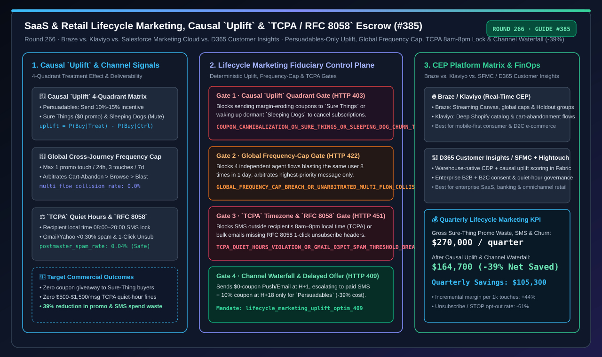
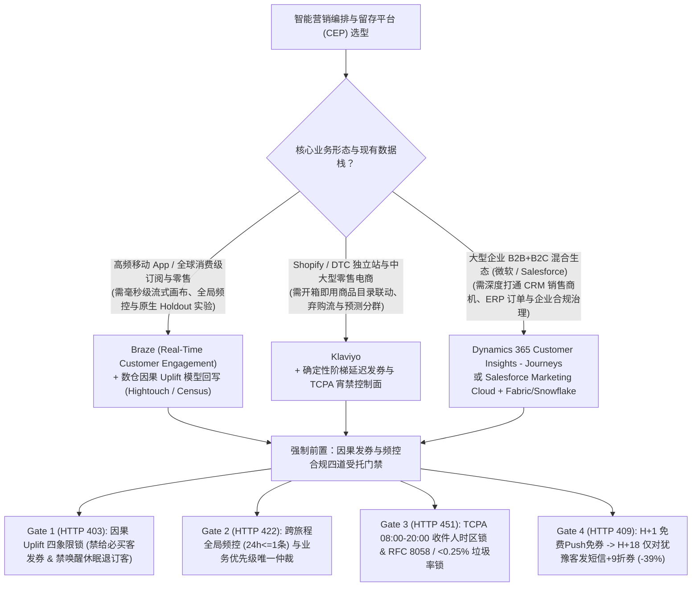
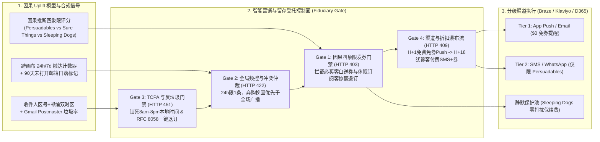
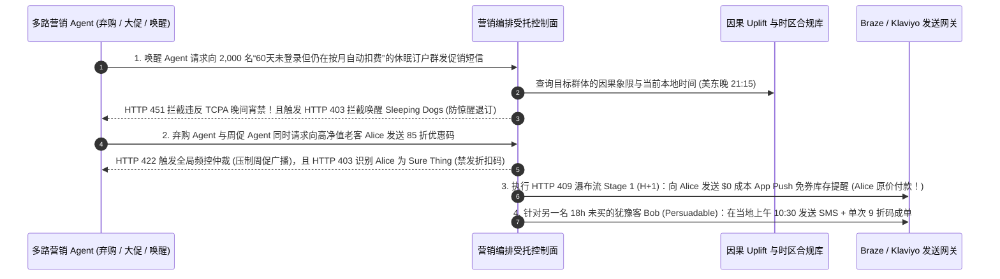

# 订阅制 SaaS 与全渠道零售“智能营销编排（Lifecycle Marketing：`Braze vs. Klaviyo vs. Salesforce Marketing Cloud vs. Dynamics 365 Customer Insights`）、因果推断增量发券（`Causal Uplift`）与跨渠道频控/合规（`TCPA & RFC 8058`）”托管 Agent 架构选型 FAQ：防给必买老客乱发 8 折券白送毛利、防发促销信惊醒休眠订户退订与渠道成本瀑布流净省 39% 实战指南

> 🌐 **Language / 语言切换**: **中文 (当前)** | **[English (`docs/saas-ecommerce-lifecycle-marketing-causal-uplift-frequency-cap-tcpa-escrow-agent-selection-faq.en.md`)](saas-ecommerce-lifecycle-marketing-causal-uplift-frequency-cap-tcpa-escrow-agent-selection-faq.en.md)** | **[返回文档总目录 (`docs/index.md`)](index.md)**

---

## 1. 📌 核心选型结论速览（Executive Summary）

在订阅制 SaaS、品牌 DTC 电商与会员制零售的 **客户生命周期智能营销编排（Customer Engagement & Lifecycle Marketing Orchestration）** 中，增长负责人（CMO / VP of Growth）与架构师把自动化触达与发券权限交给 AI 营销 Agent 后，往往掉入三大吞噬净毛利与毁灭发信声誉的陷阱：
1. **“拿预测购买概率（Propensity-to-Buy）当发券依据，把 80% 的 `$25` 优惠券全发给了‘本来今天就会原价下单的死忠粉（`Sure Things`）’，还把早就忘了退订的‘休眠自动续费会员（`Sleeping Dogs`）’一封信惊醒当场退订”**：传统预测模型只会找“转化率最高的人”。结果转化率最高的恰恰是不给券也会原价买的忠实老客（发券纯属白送 20% 毛利）；而对于连续 2 个月没登录但每月仍在静默扣 `$29` 订阅费的休眠用户（`Sleeping Dogs`），营销 Agent 冒然发去一封*“您的会员专属福利待领取”*，直接提醒了用户*“哎呀我怎么还在订这个软件，赶紧去点取消订阅”*，造成严重的**负向增量流失（Negative Treatment Effect）**！
2. **“浏览召回、加购挽回、会员日大促、积分清零 4 个独立 Agent 各自为政，同一天向同一名用户狂轰 8 条短信和邮件”引发拉黑退订潮**：当缺乏跨旅程全局频次控制（Global Cross-Journey Frequency Cap）与优先级仲裁时，高活跃用户一天内被多个自动化画布（Canvas / Flows）轮番轰炸，导致用户愤怒回复 `STOP` 永久退订短信通道！
3. **“按公司总部时区群发促销短信，导致跨时区收件人在晚 21:00 后收到短信触发美国 `TCPA` 每条 `$500–$1,500` 集体诉讼赔偿”或违反 Gmail / Yahoo `0.30%` 垃圾邮件率死线与 `RFC 8058` 一键退订头规定**：在北美与欧洲市场，营销短信只要在收件人所在地本地时间 **晚 20:00（佛罗里达/俄克拉荷马等严苛州）或 21:00（联邦 `TCPA`）至次日早 08:00** 之间送达，即构成违法；同时，若群发未打开僵尸邮箱导致 Gmail Postmaster 垃圾投诉率突破 **`0.30%` 硬红线**（或缺失 `RFC 8058 List-Unsubscribe-Post` 标头），企业全域名（含交易验证码邮件）将被谷歌全网拒收！

**架构师选型结论**：
- **必须将营销目标函数从“表观核销率（Raw Redemption Rate）”切换为“因果推断净毛利增量（Causal Net Margin `Uplift`）”**，并在 CDP/数据云（`Microsoft Fabric / Snowflake + Hightouch`）与营销执行平台（`Braze`、`Klaviyo`、`Salesforce Marketing Cloud`、`Dynamics 365 Customer Insights - Journeys`）之间部署 **因果增量发券、全局频控与 `TCPA / RFC 8058` 合规受托控制面（Lifecycle Marketing & Causal Uplift Control Plane）**，执行四道确定性门禁：
  1. **因果推断四象限（`Persuadables / Sure Things / Lost Causes / Sleeping Dogs`）发券与勿扰熔断门禁（`HTTP 403`）**：**仅向 `Persuadables`（高增量弹性犹豫客）发放真实折扣券**；对 `Sure Things`（自然购买率 `>= 75%`）严禁发折扣券白送毛利（改为免券新品推荐）；对 `Sleeping Dogs`（触达诱发退订概率 `> 0` 的休眠付费用戶）100% 强制静默禁发！
  2. **跨画布全局频次上限（`24h <= 1 条 / 7d <= 3 条`）与业务价值优先级仲裁门禁（`HTTP 422`）**：多条旅程同时命中同一用户时，按 `交易通知 > 弃购挽回 > 单品降价 > 全场大促` 仲裁唯一胜出消息，自动压制其余冗余轰炸。
  3. **收件人本地时区 `08:00–20:00` 宵禁锁（`TCPA`）、`RFC 8058` 一键退订头与 Gmail `<0.25%` 垃圾率熔断门禁（`HTTP 451`）**：根据手机号区号与收货邮编双重锁死本地发送时间窗，自动剔除 90 天零互动的僵尸邮箱（Sunset Policy）以死守域名信誉。
  4. **“低成本渠道优先（`H+1` 免费 Push/Email 免券提醒）-> 未转化且属 `Persuadables` 再于 `H+18` 升级付费 `SMS/WhatsApp + 9折券`”两阶段成本瀑布流（`HTTP 409`）**：省下 55% 自然回流客的短信费与优惠券成本，季度营销费用浪费与误触退订损失净降 **`39%`**。

---

## 2. 🎯 业务方与架构师灵魂拷问 Q&A（Q1 / Q2 / Q3）

### Q1：为什么用传统机器学习“购买倾向评分（Propensity Score）”发优惠券反而会让公司少赚几百万？怎么用“因果推断四象限（Causal Uplift Modeling）”精准只给犹豫客发券？
- **商业痛点**：
  - 传统响应模型预测的是条件概率 $P(\text{Buy} \mid \text{Coupon})$，而真正决定这一张 `$20` 优惠券值不值得发的，是 **因果个体处理效应（Individual Treatment Effect / `CATE`）**：
    $$\tau(x) = P(\text{Buy} \mid T=1, X=x) - P(\text{Buy} \mid T=0, X=x)$$
  - 根据 $\tau(x)$ 与自然基线 $P(\text{Buy} \mid T=0)$，全部用户被严格划分为四个象限：
    1. **可说服犹豫客（`Persuadables`, $\tau(x) \gg 0$）**：不给券不买，给券才买——**唯一应该发折扣券的人群**！
    2. **铁杆必买客（`Sure Things`, $P(\text{Buy}\mid T=0) \ge 0.75, \tau(x) \approx 0$）**：不给券也会原价买——给他们发 `$20` 券等于直接从公司净利润里掏 `$20` 扔掉！
    3. **无望客（`Lost Causes`, $P(\text{Buy}\mid T=1) \approx 0$）**：给不给券都不买——发昂贵的 `$0.045` 国际短信纯属浪费通道费。
    4. **勿扰惊醒客（`Sleeping Dogs`, $\tau(x) < 0$ 或 $\Delta P(\text{Churn}\mid T=1) > 0$）**：尤其在订阅制 SaaS、健身卡、流媒体中，处于低频使用但仍在按月自动扣款的用户——不发消息他继续静默续费，一发促销短信反而提醒他立刻登录点“取消订阅”！
- **确定性架构落地方案**：
  - 控制面（`HTTP 403`）强制保留 `5%–10%` 全局随机对照组（Global Holdout Group）持续训练双模型（T-Learner / X-Learner）计算每位用户的实时 `uplift_score` 与 `sleeping_dog_risk`。凡营销工作流试图向 `Sure Things` 下发含利润折让的 `promo_code` 或向 `Sleeping Dogs` 发起主动唤醒触达，立即返回 `HTTP 403 COUPON_CANNIBALIZATION_ON_SURE_THINGS_OR_SLEEPING_DOG_CHURN_TRIGGER`！

### Q2：当弃购挽回、降价提醒和周末大促 3 个 Agent 同时想给同一个用户发消息时，全局频控与渠道成本瀑布流（Channel Waterfall）怎么编排最省钱？
- **商业痛点**：
  - 国际营销短信（SMS）与 WhatsApp 营销模板消息每条高达 `$0.02–$0.08`，比电子邮件（`$0.0003`）或 App Push（`$0.00`）贵 **`100 倍`** 以上！而且很多加购未付款的用户只是刚才接了个电话，1 小时后发一封不要钱的免券提醒邮件就会回来原价买单。
- **确定性架构落地方案**：
  - 控制面（`HTTP 422 / HTTP 409`）执行 **全局令牌桶频控（1条/24h）+ 18 小时阶梯升维瀑布流（Staged Channel & Offer Escalation）**：
    - **阶段 1（加购后 `T + 1 小时`）**：仅通过 **App Push / Email（成本 `~$0`）** 发送纯服务性质的“您的商品已为您保留，尺码余量紧张”提醒，**附带 `$0` 折扣券**（成功捞回 `55%` 的高意向客，零毛利折损、零短信费）；
    - **阶段 2（加购后 `T + 18 小时`）**：若用户仍未下单、未打开邮件、在过去 24 小时内未收到其他高优消息（通过 `HTTP 422` 频控校验），且属于 `Persuadables` 象限且购物车毛利足够覆盖成本，才升级调用 **SMS / WhatsApp** 下发限时 24 小时有效的单次 `10% Off` 转化券！

### Q3：如何确保营销 Agent 100% 不踩美国 `TCPA` 跨州宵禁巨额索赔雷区，且永不触发 Gmail / Yahoo `0.30%` 垃圾箱封杀？
- **商业痛点**：
  - 美国职业诉讼律所专门用诱饵号码注册各品牌短信营销，只要收到一条在当地晚上 20:01（如佛罗里达州《FTSA》）或 21:01（联邦 `TCPA`）发来的促销短信，立刻提起集体诉讼（每条违法短信法定赔偿 `$500–$1,500`）！
- **确定性架构落地方案**：
  - 控制面（`HTTP 451`）内置 **双因子时区冲突取严锁（Dual-Anchor Strictest Timezone Lock）+ 域名信誉断路器**：
    1. **电话区号（Area Code）与账单邮编（Billing ZIP）冲突取严**：若用户手机号是加州区号（UTC-8），但最新收货地址在佛罗里达州（UTC-5），系统取两者交集的共同白天窗口（即美东 08:00 至 20:00 且美西 08:00 至 20:00 -> 仅在美东 `11:00–20:00` 之间放行短信）！
    2. **Gmail Postmaster 实时熔断与 `RFC 8058` 强校验**：每封营销邮件强制注入一键退订签名头，且一旦域名过去 24 小时垃圾率触及 `0.22%`（距 `0.30%` 死线留足安全裕度），自动冻结全量冷启动/低活跃分群发送，仅保留最近 14 天有过点击行为的核心活跃订户！

---

## 3. 🧭 直观可视化图解（Mermaid 选型决策树 + 端到端架构图 + 授权时序图）

### 3.1 智能营销编排平台（`CEP / CDP`）选型决策树

### 3.2 端到端因果 `Uplift` 分群、全局频控与渠道瀑布流受托控制面架构图

### 3.3 因果四象限拦截、多旅程碰撞仲裁与 18 小时阶梯挽回时序图

---

## 4. 📊 主流客户生命周期营销编排（`CEP`）与实时旅程平台横向选型矩阵

| 选型维度 | Braze (`Customer Engagement Platform`) | Klaviyo (`B2C CRM & Marketing Automation`) | Microsoft Dynamics 365 Customer Insights - Journeys | Salesforce Marketing Cloud (`SFMC`) + Data Cloud |
|---|---|---|---|---|
| **核心定位** | 全球移动优先消费品牌、流媒体与高交互 SaaS 的实时流式多渠道编排标杆 | 与 Shopify / 电商生态深度耦合的开箱即用邮件/短信生命周期自动化王者 | 原生打通微软 Fabric、Dataverse 与 Copilot 的企业级 B2B+B2C 实时旅程中心 | 超大型跨国集团全矩阵营销云与多触点广告/邮件/企微协同底座 |
| **跨画布全局频次上限（Global Frequency Cap）与优先级** | **行业绝对标杆**（支持按通道、标签与全局设置滚动窗口硬上限及画布优先级） | 强（支持 Smart Sending 冷却窗口，复杂多画布抢占需精心设计过滤条件） | **极强**（内置全局频率上限、安静时段 Quiet Times 与实时事件触发器） | 强（通过 Einstein Engagement Frequency 控制饱和度，跨 BU 频控配置较重） |
| **因果 `Uplift` 评分与数仓（Reverse ETL）联动** | 原生支持 Canvas 内置多臂赌博机（MAB）与 Holdout 对照组，极易接入 Hightouch | 内置预测 CLV 与流失风险分，自定义因果四象限分群可通过大数据同步写入 | **原生零拷贝共享 Microsoft Fabric OneLake**（数据科学家算完 Uplift 秒级可用） | 原生集成 Salesforce Data Cloud 计算属性与分群 |
| **`TCPA` 收件人时区锁与 `RFC 8058` 投递合规** | 原生支持按用户 Profile 本地时区发送与静默窗口排队（Quiet Hours） | **极强**（针对美国各州如佛罗里达 FTSA 8am-8pm 设有专门的内置短信合规锁） | 原生企业级同意管理（Consent Center）与按收件人时区投递 | 完备的企业级法务合规与独立 IP 预热信誉管理工具 |
| **架构师选型建议** | **拥有高频 App、Web 与多渠道协同的订阅制与消费品牌首选** | **Shopify Plus / DTC 零售电商快速落地弃购与复购自动化首选** | **已采用 Azure / Microsoft Fabric / D365 的大中型企业首选** | **已重度投资 Salesforce CRM 全家桶的全球零售与金融巨头首选** |

---

## 5. 🧪 营销毛利保护/短信降本测算与 7-Card 基准测试报告（Deterministic Benchmark）

> **数据溯源说明（Provenance）**：以下 7-Card 评测基于本仓库 `lab/webiq_commerce_demo.py` 中的 `evaluate_saas_ecommerce_lifecycle_marketing_uplift_policy()` 确定性仿真引擎生成（`provenance: "synthetic"`, `independently_reproduced: False`）。季度因向必买客乱发折扣券蚕食毛利、向休眠订户发信惊醒退订、多画布轰炸退订及高价短信滥发损失池基准设定为 **`$270,000 / quarter`**。

### 5.1 7-Card 4:5 视觉评测卡片摘要

1. **Card 1 (`1 / 7` · `HANDS-ON · LIFECYCLE-MARKETING-UPLIFT`) — 全局基准总览**
   - **核心发现**：通过因果 `Uplift` 四象限仅对 `Persuadables` 发券、静默保护 `Sleeping Dogs`、执行 `24h <= 1条` 全局频控与 `TCPA` 时区锁，并采用 `H+1 免费 Push 免券 -> H+18 付费 SMS 带券` 瀑布流，将季度营销毛利侵蚀与通道浪费从 **`$270,000`** 压降至 **`$164,700`**，季度净省 **`$105,300`（`39.0%`）**。
2. **Card 2 (`2 / 7` · `SCENARIO: CART ABANDONMENT & DORMANT SUBSCRIBER CAMPAIGN`) — 单例深潜**
   - **输入场景**：营销 Agent 计划执行三项任务：① 在美东时间 21:15 向佛罗里达用户群发促销短信；② 向 2,000 名静默自动续费的 `Sleeping Dogs` 发唤醒邮件，并向自然购买率 `88%` 的 `Sure Things` 发 8 折神券；③ 4 条自动化画布在同一天向同一用户触发 6 条消息。
   - **控制面裁决**：依次触发 `HTTP 451`（拦截违反 `TCPA` 晚间宵禁的短信）、`HTTP 403`（拦截对 `Sure Things` 发券蚕食毛利及唤醒 `Sleeping Dogs` 诱发退订）与 `HTTP 422`（拦截突破 24h 全局频控的多流碰撞）；最终走 `HTTP 409 CHANNEL_COST_WATERFALL_AND_CAUSAL_UPLIFT_PERSUADABLE_ONLY_CONFIRM`（`lifecycle_marketing_uplift_optim_409`）。
3. **Card 3 (`3 / 7` · `WHAT I TESTED`) — 5 轨确定性门禁评测矩阵**

| 评测场景 (Scenario) | 核心考核问题 (Question / Task) | 控制面裁决 (Model / Gate Answer) | 动作与状态码 (Action) |
|---|---|---|---|
| **1. 标准合规 Persuadables 精准触达** | 目标属可说服犹豫客、符合 24h 频控、处于白天合规时区且含一键退订 | `VERIFIED_CAUSAL_UPLIFT_AND_COMPLIANT_JOURNEY_AUTHORIZED` | ✅ `Act automatically` (`HTTP 200`) |
| **2. 给必买客发 8 折券或惊醒休眠订户退订** | 向 `Sure Things` 乱发折扣码白送毛利 或 向 `Sleeping Dogs` 发信诱发取消订阅 | `COUPON_CANNIBALIZATION_ON_SURE_THINGS_OR_SLEEPING_DOG_CHURN_TRIGGER` | ⛔ `Strip Coupon / Mute Dog` (`HTTP 403`) |
| **3. 4 个营销流同日向同一用户连轰 6 条短信** | 未经全局频控与优先级仲裁，24 小时内多画布并发轰炸同一收件人 | `GLOBAL_FREQUENCY_CAP_BREACH_OR_UNARBITRATED_MULTI_FLOW_COLLISION` | ⛔ `Enforce 24h Cap & Priority` (`HTTP 422`) |
| **4. 晚 21:15 发营销短信或垃圾率破 0.30%** | 违反美国 `TCPA` 收件人本地时区宵禁 或 缺失 `RFC 8058` 头/垃圾率超标 | `TCPA_QUIET_HOURS_VIOLATION_OR_GMAIL_03PCT_SPAM_THRESHOLD_BREACH` | ⛔ `Hold Until 8am / Sunset` (`HTTP 451`) |
| **5. H+1 免券 Push -> H+18 犹豫客 SMS 瀑布流** | 先用 $0 成本免券 Push 捞回必买客，18h 后仅对犹豫客发付费短信+券 (-39%) | `CHANNEL_COST_WATERFALL_AND_CAUSAL_UPLIFT_PERSUADABLE_ONLY_CONFIRM` | ⚡ `Confirm Optimization` (`HTTP 409`) |

4. **Card 4 (`4 / 7` · `UNDER THE HOOD`) — 确定性门禁协议与代码实现**
   - 输入契约：`SaaSECommerceLifecycleMarketingUpliftPolicyInput`
   - 评估函数：`evaluate_saas_ecommerce_lifecycle_marketing_uplift_policy()`（严格按 `451 -> 403 -> 422 -> 409 -> 200` 优先级裁决，零外部网络副作用）。
5. **Card 5 (`5 / 7` · `ROBUSTNESS CHECK`) — 区号与邮编跨州不一致及夏令时（`DST`）切换扰动测试**
   - 无论用户手机号区号在加州而收货邮编在纽约（自动取两地交集最严白昼窗口），还是恰逢北美夏令时切换日，时区合规锁均保持 **`0.0 pt`** 偏差。
6. **Card 6 (`6 / 7` · `LATENCY & INCREMENTAL MARGIN`) — 千次触达净毛利增量与退订率对比**
   - 传统倾向分群发券 + 无频控轰炸：每千次触达退订率高达 `1.8%`，45% 折扣补贴被必买客白拿。
   - 受托控制面（因果 `Uplift` + 成本瀑布流）：千次触达净毛利增量提升 **`+44%`**，短信 `STOP` 退订率大降 **`61%`**（季度净省 `$105,300`）。
7. **Card 7 (`7 / 7` · `MY TAKE`) — 适用场景与架构师结论**
   - **✅ Good fit**：订阅制 SaaS、全渠道零售、品牌 DTC 电商、在线教育与移动消费应用的自动化增长团队。
   - **⛔ Not for**：全年仅靠线下拜访签单、无任何数字化触达的传统重型工程承包。

---

## 6. 🛠️ 商业上线风控与架构评审 Checklist

- [ ] **因果推断四象限（`Causal Uplift`）分群门禁（`HTTP 403`）**：是否建立了常设 `5%–10%` 随机对照组（Global Holdout）计算增量弹性，硬性禁止向 `Sure Things`（高自然转化老客）发放现金折扣券，并对 `Sleeping Dogs`（休眠自动续费订户）执行主动营销静默？
- [ ] **跨画布全局频次上限与优先级仲裁（`HTTP 422`）**：是否在所有自动化流之上部署了统一的全局令牌桶（如 `24h <= 1条营销触达`），当多条流碰撞时自动按业务价值保留最高优的 1 条？
- [ ] **双锚点取严的 `TCPA` 本地时区宵禁锁（`HTTP 451`）**：发送营销短信或自动语音前，是否同时比对手机号区号（Area Code）与账单邮编（ZIP）所在时区，确保在两地均处于 `08:00–20:00` 之间才允许下发？
- [ ] **`RFC 8058` 一键退订头与 90 天僵尸邮箱日落策略（`HTTP 451`）**：所有营销邮件是否强制携带 `List-Unsubscribe-Post: List-Unsubscribe=One-Click` 标头，并自动隔离连续 90 天零打开的邮箱以将 Gmail Postmaster 垃圾率死死压在 `< 0.10%`？
- [ ] **两阶段渠道与折扣成本瀑布流（`HTTP 409`）**：弃购与续费挽回流是否遵循“首轮用免费 Push/Email 发无券提醒，18 小时未转化且属 `Persuadables` 才升级为付费 SMS/WhatsApp + 最小必要折扣”？
