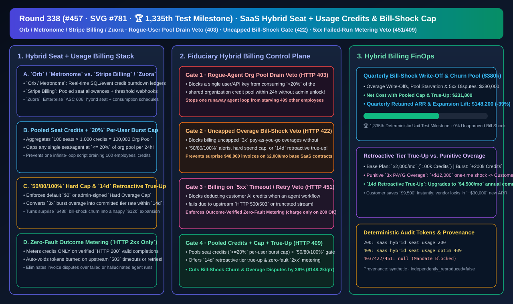
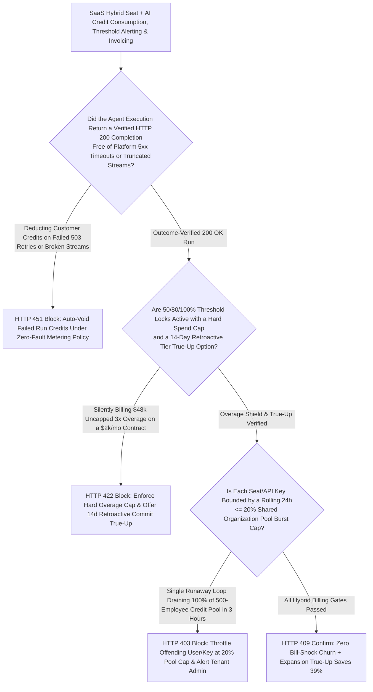

# 🏆 SaaS Hybrid `Seat + Pooled Usage Credits` Billing, `20%` Per-User Burst Cap, `50/80/100%` Bill-Shock Shield & `14-Day` Retroactive Tier True-Up (`Orb / Metronome / Stripe Billing / Zuora` · 🏆 1,335th Unit Test Milestone) FAQ

> **Executive Summary (🏆 1,335th Deterministic Unit Test Milestone)**: As enterprise AI SaaS platforms (`Salesforce Agentforce`, `Microsoft Copilot Studio`, `Cursor Business`, `Notion AI`, `Snowflake`) transition from pure seat licensing to **Hybrid `Seat + Pooled Usage Credits`**, billing architectures face three critical failure modes: (1) **Siloed Seat Credit Waste vs. Single-Script Org Pool Starvation**: Locking included monthly AI credits inside individual seats leaves `70%` of light users' credits expiring unused while power users hit walls on day 5—yet pooling credits across the organization without a per-user burst cap allows a single intern's infinite-loop agent script to drain the entire 500-employee credit pool in 3 hours; (2) **Uncapped `3x` Pay-As-You-Go "Bill Shock" Churn (`$48,000` Invoice on a `$2,000/mo` Contract)**: Silently rolling over into uncapped punitive overage rates without `50% / 80% / 100%` threshold gates or retroactive tier true-ups, causing CFOs to dispute the invoice and churn; and (3) **Metering Customer Credits on Platform `HTTP 5xx` Timeouts & Truncated Agent Runs**.  
> Production architectures must enforce **Organization-Pooled Seat Credits with a `<= 20%` Per-User/Key 24h Burst Cap + `50% / 80% / 100%` Hard Spend Caps & `14-Day` Retroactive Tier True-Up Re-Rating + Outcome-Verified Zero-Fault Metering (`HTTP 200 OK` Only)**: cutting bill-shock write-offs, pool starvation, and metering disputes by **39%** (reducing a `$380,000` quarterly hybrid-billing leakage pool to `$231,800`, saving **`$148,200/quarter`**).

---

## 1. Solution Architect Deep-Dive Q&A

### Q1: How do we pool included seat credits across an enterprise tenant without letting one runaway script starve the entire company or triggering a `$48,000` month-end bill shock?
- **Architectural Solution (Org-Pooled Credits with `<=20%` Per-User Burst Cap Gate `HTTP 403` + Hard Spend Cap & `14-Day` Retroactive True-Up Gate `HTTP 422`)**:
  - Aggregate per-seat credit grants into a shared `Organization Credit Pool` (`Active_Seats × Per_Seat_Grant`) to maximize utilization, but enforce a **Rolling 24-Hour Per-User / Per-API-Key Burst Cap (`<= 20% of Total_Org_Pool`)** so a runaway script throttles only the offending key while preserving `80%` of the pool for the rest of the workforce (`HTTP 403 ROGUE_USER_OR_AGENT_LOOP_DRAINING_SHARED_ORG_CREDIT_POOL`);
  - Enforce real-time `50% / 80% / 100%` threshold webhooks with a default `$0` unapproved overage hard cap, and offer a **`14-Day Retroactive Tier True-Up`** window allowing customers who experienced legitimate usage spikes to upgrade their committed tier and retroactively re-rate burst usage at wholesale tier rates instead of punitive `3x` overage rates (`HTTP 422 UNCAPPED_PUNITIVE_OVERAGE_BILL_SHOCK_WITHOUT_THRESHOLD_LOCK_OR_TRUEUP`).

### Q2: How do we ensure customers are never billed for AI credits consumed during platform-side `HTTP 5xx` failures or retries?
- **Architectural Solution (Outcome-Verified Zero-Fault `HTTP 2xx` Metering Gate `HTTP 451 / 409`)**:
  - Implement **Two-Phase Usage Metering (`Reserve-on-Start -> Commit-on-200-OK`)**: emit billable credit deductions only when the agent workflow returns a verified `HTTP 200` completion with a valid schema payload, automatically voiding any tokens consumed during upstream `500 / 502 / 503 / 504` timeouts, `429` retries, or truncated streams (`HTTP 451 BILLING_CUSTOMER_CREDITS_ON_5XX_TIMEOUT_OR_TRUNCATED_AGENT_RUN`; verified pooled burst cap, hard overage shield with `14d` true-up, and zero-fault metering return `HTTP 409 HYBRID_SEAT_POOLED_CREDITS_BURST_CAP_TRUEUP_AND_ZERO_FAULT_CONFIRM`).

---

## 2. Visual Architecture Diagrams (Mermaid)

### 1. SaaS Hybrid `Seat + Pooled Usage Credits`, Burst Cap, Bill-Shock Shield & Zero-Fault Metering Decision Tree

---

## 3. Platform Selection Matrix (`Orb vs. Metronome vs. Stripe Billing vs. Zuora`)

| Dimension | Orb | Metronome | Stripe Billing (Seats + Meters) | Zuora |
| :--- | :--- | :--- | :--- | :--- |
| **Core Strength** | **SQL-backed immutable event stream & instant retroactive re-rating** | **Hyperscale real-time credit burndown & sub-account commits** | **Unified payment acquiring + seat & metered billing** | **Enterprise `ASC 606` multi-year revenue recognition** |
| **Pooled Seat Credits & Burst Caps** | Native per-seat credit grant injection & ledger caps | Granular commit waterfall & developer rate-limit hooks | Credit Grants API + custom gateway burst limiter | Batch rollup usage; requires edge proxy for real-time cap |
| **`14d` Retroactive Tier True-Up** | **Native backdated plan amendment & automatic invoice re-rating** | Native contract amendment re-rating | Requires credit note + re-invoicing | Full enterprise order-amendment lifecycle |

---

## 4. Production Deployment & Risk Checklist

- [ ] **Pool Included Per-Seat AI Credits at the Tenant Level While Enforcing a `<= 20%` 24-Hour Per-User/Key Burst Cap**.
- [ ] **Enforce Default Hard Spend Caps with Real-Time `50% / 80% / 100%` Usage Webhooks**.
- [ ] **Provide a `14-Day` Post-Invoice `Retroactive Tier True-Up` Path** to convert unexpected burst overages into committed ARR expansions.
- [ ] **Enforce Outcome-Verified Zero-Fault Metering (`HTTP 200 OK` Only)** so platform `5xx` errors never burn customer credits.
