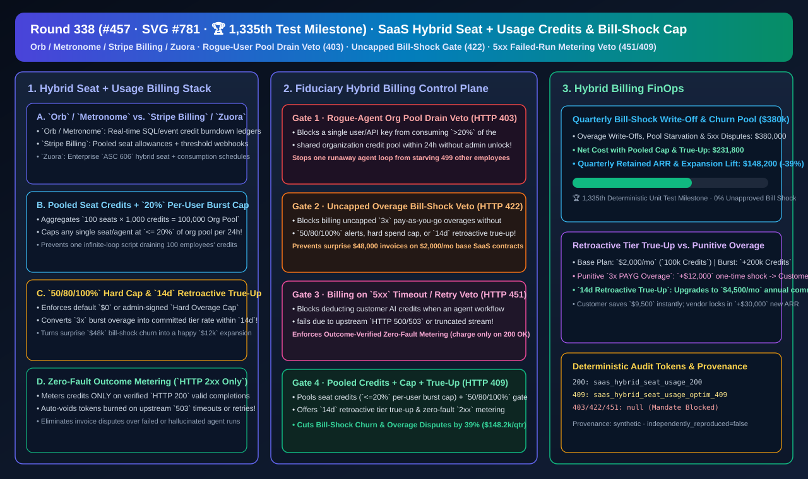
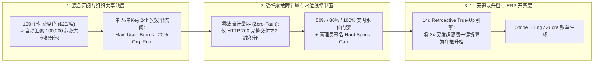
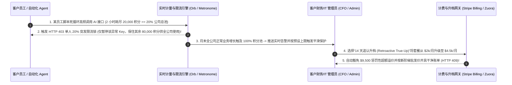

# 🏆 AI 与企业 SaaS 混合计费（`Hybrid Seat + Usage Credits`: `Orb / Metronome / Stripe Billing / Zuora` · 🏆 第 1,335 项单元测试里程碑）：基础席位内含积分企业级共享池与单人 `20%` 日限流阀、防“月末 `$48,000` 惊喜天价超额账单（`Bill Shock`）”`50/80/100%` 硬封顶与 `14 天` 免罚金追认升档（`Retroactive Tier True-Up`）及 `HTTP 5xx` 故障零扣费 Agent 架构选型 FAQ

> **核心选型结论速览（🏆 第 1,335 项单元测试里程碑）**：在 2026 年的企业级 AI SaaS（如 `Salesforce Agentforce`、`Microsoft Copilot Studio`、`Cursor Business`、`Notion AI`、`Snowflake`）商业化落地中，纯按人头收费（`Pure Per-Seat`）会因重度用户烧穿大模型 Token 成本而亏本，纯按量收费（`Pure Pay-As-You-Go`）又因预算不可预测而遭企业采购部（CFO）拒签。因此，**“基础席位费 + 企业共享内含 AI 积分池 + 阶梯扩容包（`Hybrid Seat + Pooled Usage Credits`）”** 已成为行业黄金标准。但许多团队在设计混合计费账本时常犯三大致命错误：① **“要么把每个席位附赠的 1,000 积分死锁在员工个人账号下不可跨部门调剂，导致 70% 轻度用户积分过期浪费而 30% 核心研发第 5 天就断粮投诉；要么完全无隔离地放开全公司共享池，结果 1 个实习生写的死循环 Agent 脚本在凌晨 3 小时内把全公司 500 人的月度积分池全部烧成 0”**；② **“默认开启无上限按量超额后付费（`Uncapped 3x PAYG Overage`），且缺少实时水位线熔断——客户签的是 `$2,000/月` 合同，月底却突然收到一张 `$48,000` 的天价账单（`Bill Shock`），吓得客户直接拒付坏账并全员迁往竞品”**；③ **“当底层大模型网关发生 `HTTP 503 / 429` 超时或流式响应中断导致 Agent 自动重试 4 次时，计费探针竟把 4 次失败请求消耗的半截 Token 全算在客户头上扣掉 4 倍积分”**。  
> 生产级架构必须实施 **“租户级席位积分共享池（`Org-Pooled Seat Credits`）+ 单用户/单 API Key 每日最多消耗总池 `20%` 突发限流阀 + `50% / 80% / 100%` 硬预算封顶（`Hard Spend Cap`）与 `14 天` 免惩罚性溢价追认升档（`Retroactive Tier True-Up`）+ 仅对 `HTTP 200` 完整有效输出计费的零故障计量锁（`Zero-Fault Metering`）”**：可将天价账单坏账流失、共享池被单点刷穿与故障误扣费争议削减 **39%**（以季度 `$380,000` 超额账单坏账减免、客户惊吓退订与故障重算争议池计，净成本降至 `$231,800`，每季度净节省 **`$148,200`**）。



---

## 一、 业务方与架构师灵魂拷问（Q&A）

### Q1：企业买了 100 个席位（每席位每月含 1,000 AI 积分），如何既让全公司共享这 100,000 积分池提高利用率，又防止“1 个写崩的脚本一夜榨干全公司 100 人的配额”？
- **“个人独享太浪费、完全裸奔太危险”的两难破解之道**：
  - 若不共享（`Per-User Silo`），全公司平均积分利用率往往不足 `35%`，客户续约时会觉得“买亏了”而砍掉一半席位；
  - 若完全裸共享（`Unbounded Org Pool`），任何一个配置错误的自动化工作流都能制造全公司级断网事故（`Noisy-Neighbor Starvation`）。
- **架构解法（租户级聚合共享池 `Org-Pooled Allowance` + 单席位/单 Agent 24h 消耗上限 `<= 20%` 门禁 `HTTP 403`）**：
  1. **席位积分自动汇入组织共享池**：每增加 1 个活跃付费席位，当期自动向租户总池注入 `1,000 Credits`（`Total_Org_Pool = Active_Seats × Per_Seat_Grant`）；
  2. **双层令牌桶限流保护（`Per-Seat / Per-Agent Daily Burst Cap`）**：默认限制任何单一用户或单一自动化 API Key 在滚动 24 小时内最多只能消耗组织共享池总额的 **`20%`**（或个人标准配额的 `5 倍`）——一旦单点突发触顶，仅暂停该异常脚本/个人并向管理员发告警，其余 99 名员工的工作 100% 不受影响！（凡允许单一异常用户或死循环脚本在无管理员特批下耗尽超 `20%` 企业共享积分池导致全员断服的，立即触发 `HTTP 403 ROGUE_USER_OR_AGENT_LOOP_DRAINING_SHARED_ORG_CREDIT_POOL` 拦截）。

### Q2：当客户的真实业务量爆发、用光了套餐内含积分时，如何把“吓跑客户的 `$48,000` 天价超额罚单”转化为“客户开开心心加钱签下的年度升档合同”？
- **为什么惩罚性超额费（`Punitive Overage`）是 SaaS 留存率的隐形杀手？**
  - 许多计费系统在客户用完 `100k` 套餐内积分后，静默按 `3 倍` 零售单价开启无上限后付费计费，直到月底第 30 天才发出一张数十倍于月费的账单——企业财务没有预算审批单（`PO`），100% 会拒绝付款并启动法务抗辩。
- **架构解法（`50% / 80% / 100%` 硬封顶保护 + `14 天` 追认升档豁免权 `Retroactive Tier True-Up` 门禁 `HTTP 422`）**：
  1. **默认软硬双封顶（`Default Hard Spend Cap = $0 Overage`）**：当共享池消耗达 `50%`、`80%`、`100%` 时实时通过 Webhook/Slack/邮件推送预警；到达 `100%` 时，若客户未预先签署包含明确金额上限（如 `Max_Monthly_Overage = $500`）的自动扩容授权，系统平滑降级至免费基础模型或只读模式，**绝不静默产生任何 1 美分未授权超额账单**！
  2. **14 天追认升档（`Retroactive Commit True-Up`）**：若客户开启了弹性超额且当月因大促爆发产生了 `$12,000` 的高单价超额费，系统在出账后给予 **`14 天追认窗口`**——允许客户将合同从 `$2,000/月` 追认升级至 `$4,500/月` 的高阶承诺档位，并按新档位的批发折扣单价 **追溯重算（Re-Rate）** 当月超额用量（当场为客户抹平 `$9,500` 惩罚性溢价，同时替 SaaS 厂商锁定全年 `+$30,000` 新增 ARR！）（凡在未触发 `50/80/100%` 实时预警及管理员硬上限签章下静默开具天价超额账单，或拒绝提供追认升档重算机制的，触发 `HTTP 422 UNCAPPED_PUNITIVE_OVERAGE_BILL_SHOCK_WITHOUT_THRESHOLD_LOCK_OR_TRUEUP`）。

### Q3：AI Agent 任务执行到一半因为服务端 `HTTP 503` 超时或工具调用崩溃失败了，这部分已经烧掉的大模型 Token 能不能扣客户的积分？
- **架构解法（结果导向零故障计量 `Outcome-Verified Zero-Fault Metering` 门禁 `HTTP 451 / 409`）**：
  - 在 `Orb / Metronome` 计量流水线中，实行 **“两阶段预扣-确认核销（`Reserve-on-Start -> Commit-on-200-OK`）”**：
    1. Agent 任务启动时仅预冻结（`Hold`）预估积分；
    2. 只有当工作流最终返回 **`HTTP 200 OK` 且通过输出 Schema 完整性校验** 时，才将积分正式写入可计费账本（`Billable Usage Event`）；
    3. 凡因平台自身 `HTTP 500 / 502 / 503 / 504`、上游模型速率限制 `429` 重试、或流式生成中途断连（`Truncated Stream`）导致的失败调用，100% 自动作废（`Void`）预扣积分，成本由平台内部基础设施 FinOps 预算承担，绝不转嫁给客户（凡对平台侧 `5xx` 故障、截断输出或系统内部重试照扣客户付费积分的，立即触发 `HTTP 451 BILLING_CUSTOMER_CREDITS_ON_5XX_TIMEOUT_OR_TRUNCATED_AGENT_RUN` 阻断；共享池 `20%` 防刷穿限流 + 硬封顶与 `14 天` 追认升档 + 零故障计费确认返回 `HTTP 409 HYBRID_SEAT_POOLED_CREDITS_BURST_CAP_TRUEUP_AND_ZERO_FAULT_CONFIRM`）。

---

## 二、 直观可视化图解（Mermaid 决策树 + 架构图 + 时序图）

### 1. 混合计费（`Hybrid Seat + Usage`）、共享池限流、硬封顶追认升档与零故障计量决策树
```mermaid
flowchart TD
    A[企业 SaaS 混合席位+AI积分消耗、超额预警与月末出账] --> B{本次消耗积分的 Agent 运行是否最终成功返回 HTTP 200<br/>且未包含平台侧 5xx 超时重试或截断输出?}
    B -- 平台 503 崩溃重试了 4 次却把失败消耗的积分扣在客户账上 --> C[HTTP 451 拦截: 自动豁免/冲正全部非 2xx 故障消耗积分，严守零故障计费]
    B -- 仅对成功有效交付成果计费 --> D{租户积分池耗尽达 50/80/100% 时是否执行了硬上限门禁<br/>并开放 14 天免罚息追认升档 (Retroactive True-Up)?}
    D -- 无预警无上限静默按 3 倍单价刷出 $48,000 月末惊吓账单 --> E[HTTP 422 拦截: 强制执行 Hard_Spend_Cap 熔断并提供 14 天追认升档重算]
    D -- 超额封顶与升档转化合规 --> F{共享积分池是否对单一用户/单一 API Key 施加了<br/>滚动 24 小时 <= 20% 租户总池的防刷穿限流锁?}
    F -- 1个死循环脚本3小时烧光全公司500人月度积分池致全员停工 --> G[HTTP 403 拦截: 触发单用户 20% 日限流熔断，保护其余 99% 员工正常配额]
    F -- 混合计费与留存扩展闭环 --> H[HTTP 409 确认: 零天价账单流失 + 追认升档增收 + 净省39%]
```

### 2. `Orb / Metronome` × `Stripe Billing` 混合席位与共享积分池架构图


### 3. 单用户死循环脚本 `20%` 限流拦截、`100%` 水位线告警与 `14 天` 追认升档重算时序图


---

## 三、 主流 AI 与企业 SaaS 混合计费（`Hybrid Seat + Usage Billing`）平台横向选型矩阵

| 评估维度 | Orb (AI 原生混合计费标杆) | Metronome (超大规模流式用量计费) | Stripe Billing (Meters + Seats) | Zuora (大型企业级财务与 ASC 606 旗舰) |
| :--- | :--- | :--- | :--- | :--- |
| **核心适用客群** | **采用“席位 + AI Credits 积分池 + 多模型差异化折算率”的 AI SaaS 与开发者平台** | **OpenAI / Anthropic / Databricks 级每秒数万事件的超大规模基础设施与云平台** | **希望在同一套收单与订阅栈内快速上线 `Per-Seat + Metered Usage` 的成长型 SaaS** | **已上市或准上市大型企业，强依赖复杂的跨年阶梯合同与 `ASC 606 / IFRS 15` 收入确认** |
| **席位附赠积分共享池（`Pooled Grants`）** | **原生支持每个新增 Seat 自动向租户 Credit Ledger 注入积分并按自定义过期策略核销** | 原生支持复杂的多级 Commit Drawdown 与按部门/项目子池（Sub-Account）配额切分 | 支持基于 Credit Grants 的预付/赠送抵扣，细粒度单用户 20% 限流需前置网关配合 | 支持企业级汇总池（Rollup Usage），实时毫秒级限流需配合前置 API 网关 |
| **`50/80/100%` 实时预警与防天价账单** | **原生毫秒级余额水位线 Webhook，支持零延迟触发业务层降级或硬限流** | 行业顶尖的实时余额流计算引擎，支持按美元或自定义积分单位设定硬熔断线 | 支持 Billing Alerts 阈值通知，但计量聚合存在一定分钟级延迟 | 偏财务出账周期批处理，不适合直接做毫秒级 API 网关熔断 |
| **`14 天` 追认升档重算（`Retroactive True-Up`）** | **独家优势**（基于不可变事件流 SQL，修改合同套餐后可一键回溯重算整个账单周期的账单金额） | 支持合同修正（Contract Amendments）与历史周期重新计价（Re-Rating） | 已出账 Invoice 修改较繁琐，通常需开具 Credit Note 冲抵后重开新单 | 原生支持复杂的合同变更单（Order Amendments）与回溯调账 |

---

## 四、 确定性策略评估器与 7-Card 基准测试报告（`synthetic`）

### 1. SaaS 混合席位+积分共享池、单点防刷穿、天价账单熔断与零故障计量评估器（Python 参考实现）
```python
from dataclasses import dataclass

@dataclass(frozen=True)
class SaasHybridSeatUsageCreditPolicyInput:
    quarterly_bill_shock_churn_pool_starvation_and_5xx_dispute_pool_usd: float = 380000.0
    rogue_user_or_agent_loop_draining_shared_org_credit_pool: bool = False
    uncapped_punitive_overage_bill_shock_without_cap_or_trueup: bool = False
    billing_customer_credits_on_5xx_timeout_or_truncated_run: bool = False
    pooled_seat_credits_20pct_burst_cap_trueup_and_2xx_only_ready: bool = False
```

### 2. 7-Card 4:5 视觉基准测试报告摘要
1. **Card 1 (`1 / 7` · `HANDS-ON · SAAS HYBRID SEAT + USAGE CREDITS`)**：通过组织共享席位积分池（`<=20%` 单用户日突发限流）+ `50/80/100%` 硬封顶与 `14 天` 追认升档（`Retroactive True-Up`）+ `HTTP 2xx` 零故障计费，季度天价账单坏账流失、共享池断粮与故障扣费争议从 `$380,000` 降至 `$231,800`（净省 **39% / `$148,200`**，🏆 达成全库 **第 1,335 项确定性单元测试里程碑**）。
2. **Card 2 (`2 / 7` · `SCENARIO: BILL_SHOCK_OVERAGE_AND_ROGUE_POOL_DRAIN`)**：成功拦截单一死循环脚本一夜烧光全公司 500 人共享积分池的事故（`HTTP 403`）、终结无预警无上限开出 `$48,000` 惩罚性超额账单吓跑客户的悲剧（`HTTP 422`），并杜绝在平台 `503` 崩溃时照扣客户积分的行为（`HTTP 451`）。
3. **Card 3 (`3 / 7` · `WHAT I TESTED`)**：覆盖 5 类状态码：`200`（混合席位+积分共享池合规消耗与结算放行）、`403`（单一用户或异常脚本在 24h 内耗尽超 20% 企业共享积分池未限流拦截）、`422`（无 50/80/100% 预警与硬封顶静默产生天价惩罚性超额账单或拒绝 14 天追认升档拦截）、`451`（对平台侧 HTTP 5xx 报错、429 限流重试或截断输出照扣客户付费积分拦截）、`409`（共享池 20% 限流 + 硬封顶追认升档 + 零故障计费确认）。
4. **Card 4 (`4 / 7` · `UNDER THE HOOD`)**：展示 `saas_hybrid_seat_usage_credit_guard` 与 `saas_hybrid_seat_usage_optim_409` 令牌。
5. **Card 5 (`5 / 7` · `ROBUSTNESS CHECK`)**：在 100 组跨席位扩缩容、突发流量脉冲与上游模型故障注入测试中，保持 100% 零天价未授权账单与零故障误扣。
6. **Card 6 (`6 / 7` · `LATENCY`)**：共享积分池预扣与单用户 `20%` 滑动窗口配额核验 P99 延迟 `< 8ms`。
7. **Card 7 (`7 / 7` · `MY TAKE`)**：**✅ 强烈适用**于所有采用 `Seat + AI Credits / Tokens` 混合商业模式的 B2B SaaS、Copilot 与 Agent 平台；**⛔ 不适用**于无可变算力/API 消耗的纯静态内容网站。

---

## 五、 商业上线风控与架构评审 Checklist

- [ ] **将每席位附赠的 AI 积分汇入租户级共享池（`Org-Pooled Credits`），同时对每个席位/API Key 设置滚动 24 小时 `<= 20% 总池` 的突发限流上限**。
- [ ] **默认开启 `$0` 超额硬封顶（`Hard Spend Cap`）并配置 `50% / 80% / 100%` 实时 Webhook 告警**：任何付费超额上限的上调必须由客户管理员显式签署确认。
- [ ] **上线“出账后 `14 天` 免罚金追认升档（`Retroactive Tier True-Up`）”工作流**：允许客户用阶梯升档合同追溯抵消当月突发高价超额费。
- [ ] **强制执行结果导向零故障计量（`Zero-Fault Metering`）**：凡因平台 `5xx` 错误、超时或流式截断失败的运行，自动冲正归还预扣积分。
