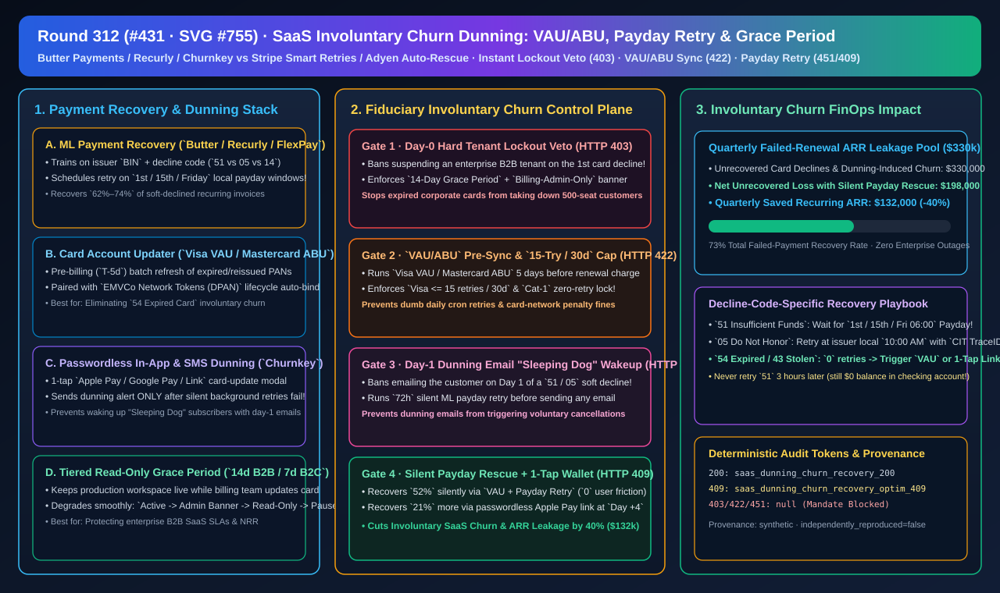
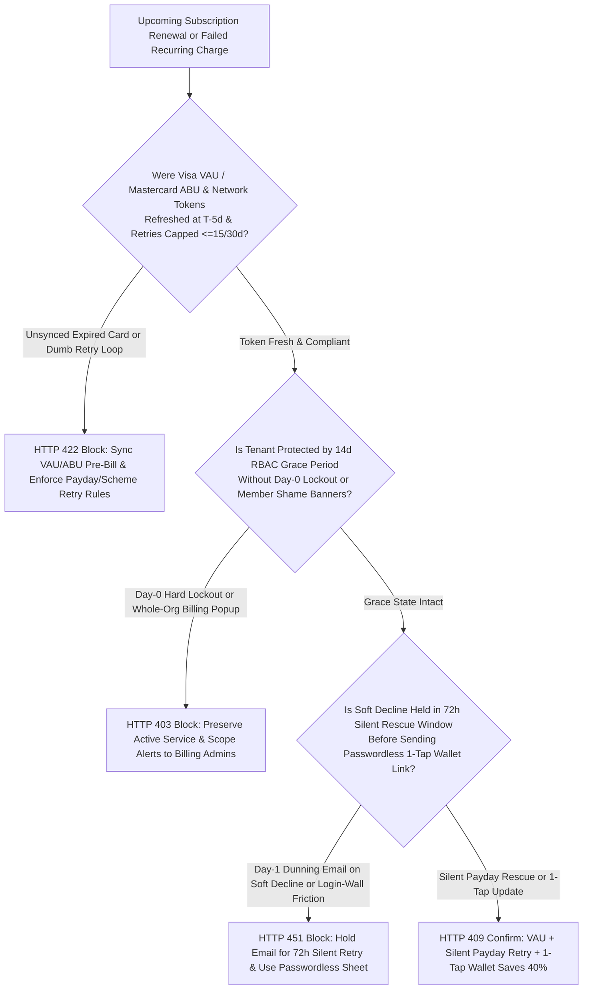

# SaaS Involuntary Churn & Payment Recovery (`Butter Payments / Recurly / Churnkey vs. Stripe Smart Retries / Adyen Auto-Rescue`), `Visa VAU / Mastercard ABU` Pre-Sync, Silent Payday Retries & 14-Day Read-Only Grace Period FAQ

> **Executive Summary**: In subscription SaaS, AI apps, streaming media, and membership commerce, **`25%–40%` of total subscriber churn is involuntary**—caused by expired cards, virtual card ceiling hits, pre-payday insufficient funds (`Code 51`), or false-positive issuer fraud blocks (`Code 05`). Yet naive dunning architectures commit three revenue-destroying mistakes: (1) **Day-0 Hard Tenant Lockouts & Whole-Company Shame Banners**: Immediately locking a 500-seat enterprise B2B workspace or showing a red `"Payment Failed"` banner to every end-user engineer the second a procurement card expires; (2) **Unsynced `Visa VAU / Mastercard ABU` Tokens & Dumb 24-Hour Cron Retries**: Retrying `51 Insufficient Funds` every 6 hours (when the checking account is still empty) or retrying `14/54` hard declines past Visa's `15-retry / 30-day` limit; and (3) **Day-1 Dunning Emails Waking Up "Sleeping Dog" Subscribers to Cancel**.  
> Production architectures must enforce **14-Day RBAC-Scoped Tiered Grace Periods (`Active -> Billing-Admin Banner -> Read-Only -> Pause`) + Pre-Billing (`T-5d`) `VAU / ABU + Network Token` Refresh & Decline-Code-Aware Payday Retries (`1st / 15th / Friday 06:00`) + 72-Hour Silent Rescue Windows Followed by Passwordless 1-Tap Wallet Update Sheets**: cutting involuntary ARR leakage and dunning-induced churn by **40%** (reducing a `$330,000` quarterly loss pool to `$198,000`, recovering **`$132,000/quarter` in ARR**).

---

## 1. Solution Architect Deep-Dive Q&A

### Q1: Why must B2B SaaS platforms never lock a tenant on Day 0 of a failed renewal, and why do fixed-interval 24-hour cron retries fail?
- **Architectural Solution (14-Day RBAC Grace State Machine `HTTP 403` + `T-5d VAU/ABU` & Payday Retry Gate `HTTP 422`)**:
  - Never suspend an active workspace on the first failed renewal charge or broadcast billing alerts to non-admin users (`Role == Member`); enforce a **14-Day Tiered Grace Period** restricting billing banners strictly to `Billing_Admin / Owner` roles and degrading smoothly to `Read-Only Mode` before suspension (`HTTP 403 DAY_ZERO_HARD_TENANT_LOCKOUT_OR_NON_ADMIN_BILLING_SHAME_BANNER`);
  - Sync **`Visa Account Updater (VAU)` / `Mastercard Automatic Billing Updater (ABU)`** and `EMVCo Network Tokens` 5 days prior to billing (`T-5d`), and schedule soft-decline retries by decline code and issuer BIN payday calendars (`1st / 15th / Friday 06:00 local time` for `51 Insufficient Funds`) within Visa's `<=15 retries / 30d` ceiling (`HTTP 422 UNSYNCED_VAU_ABU_EXPIRED_CARD_OR_DUMB_CRON_RETRY_CAP_BREACH`).

### Q2: Why does sending a dunning email on Day 1 of a soft decline increase voluntary cancellations by 18%?
- **Architectural Solution (`72-Hour` Silent Rescue Window & Passwordless 1-Tap Wallet Update `HTTP 451 / 409`)**:
  - Over `50%` of soft declines (`05 Do Not Honor`, `51 Insufficient Funds`) recover automatically within `72 hours` via silent background retries; emailing a low-usage subscriber on Day 1 wakes up "Sleeping Dogs" and prompts them to cancel (`HTTP 451 DAY_ONE_DUNNING_EMAIL_SLEEPING_DOG_WAKEUP_OR_LOGIN_WALL_FRICTION`);
  - Suppress customer-facing dunning emails for the first `72 hours` on soft declines, and if unrecovered by `Day +4`, send a signed passwordless link opening a **1-Tap `Apple Pay / Google Pay / Stripe Link` payment update drawer** (`HTTP 409 VAU_PRE_SYNC_SILENT_PAYDAY_RESCUE_AND_1TAP_WALLET_UPDATE_CONFIRM`).

---

## 2. Visual Architecture Diagrams (Mermaid)

### 1. SaaS Involuntary Churn Recovery, `VAU/ABU` & Grace Period Decision Tree

---

## 3. Platform Selection Matrix (`Butter / FlexPay vs. Recurly / Chargebee vs. Stripe Smart Retries vs. Churnkey`)

| Dimension | Butter Payments / FlexPay | Recurly / Chargebee | Stripe Smart Retries + Billing | Churnkey |
| :--- | :--- | :--- | :--- | :--- |
| **Core Strength** | **ML-driven issuer-BIN & decline-code silent recovery** | **Enterprise multi-PSP subscription billing & failover dunning** | **Zero-config native ML retries + automatic Network Tokens** | **In-app RBAC banners, passwordless 1-tap card update & cancel flows** |
| **Silent Payday Timing** | **Industry highest lift (`+15%–25%`)** on `05 / 51` soft declines | Cross-PSP cascade retry on soft declines | Trains on billions of global Stripe signals | Triggers after silent PSP retries exhaust |
| **Customer Update UX** | Backend API orchestration | Hosted account management pages | Stripe Customer Portal + `Link` | **Embedded 1-tap Apple Pay / Google Pay modal** |

---

## 4. Production Deployment & Risk Checklist

- [ ] **Replace Day-0 Lockouts with a 14-Day Tiered Grace State Machine**: Keep workspaces active during recovery and display payment alerts exclusively to `Billing_Admin` users.
- [ ] **Run `Visa VAU / Mastercard ABU` Batch Syncs at `T-5 Days` Before Renewal**: Refresh reissued card numbers and expiration dates before attempting capture.
- [ ] **Enforce a `72-Hour` Silent Rescue Window on All Soft Declines (`05 / 51`)**: Let payday-timed ML retries recover the invoice silently before sending any customer email.
- [ ] **Use Signed Passwordless `1-Tap Apple Pay / Google Pay` Update Drawers on Day 4**: Never force a customer to reset a forgotten password just to update an expired credit card.
