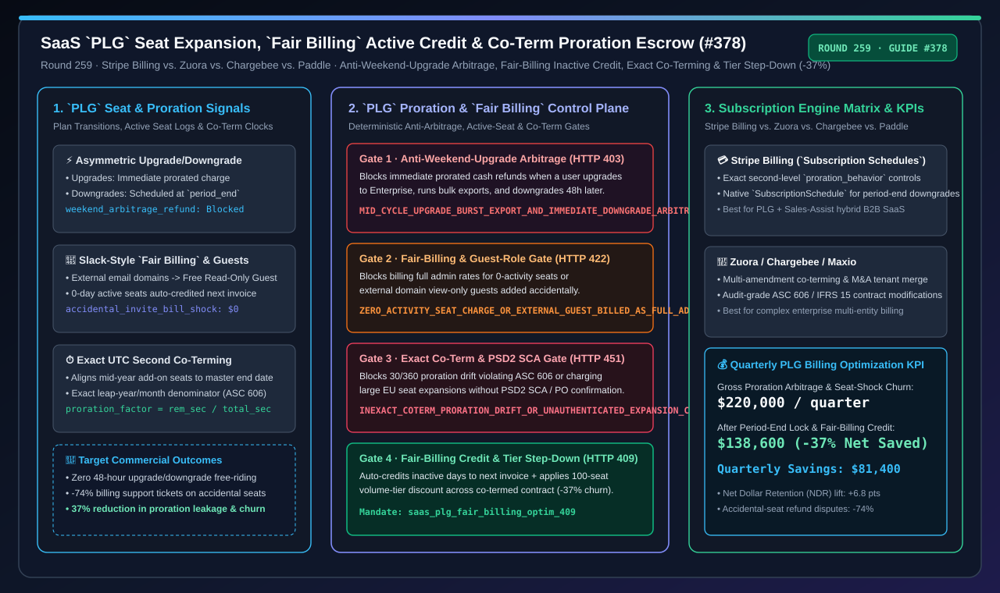
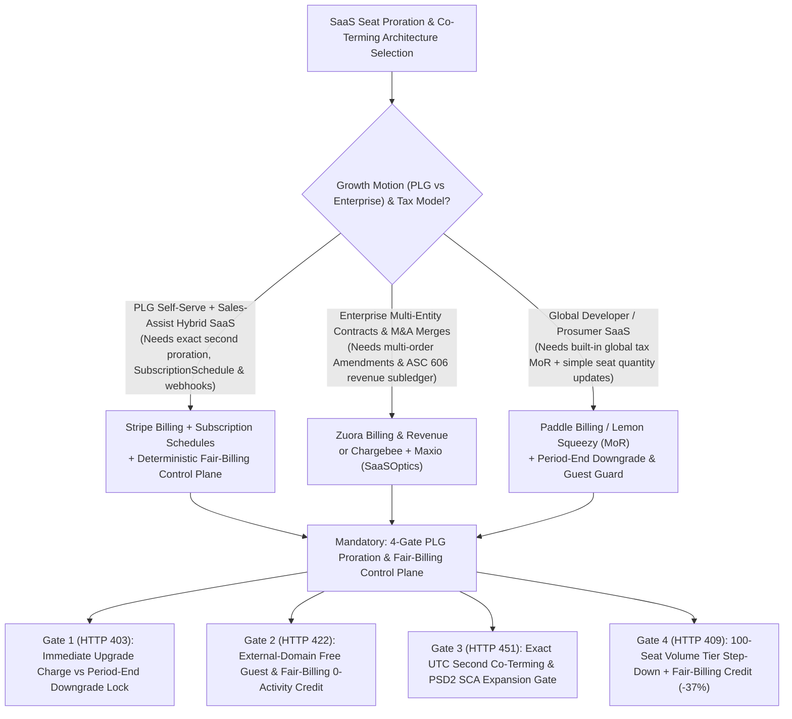
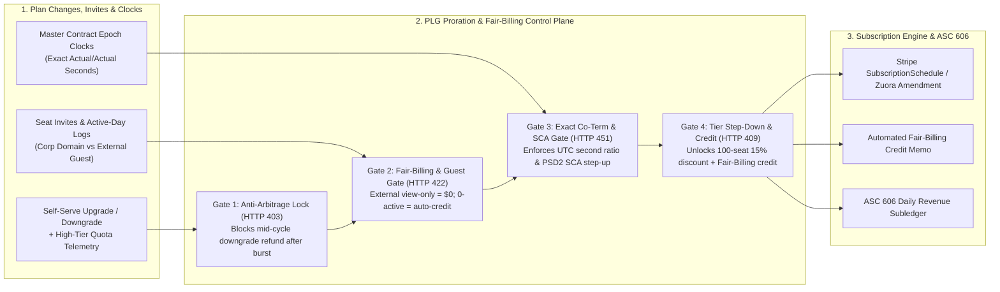
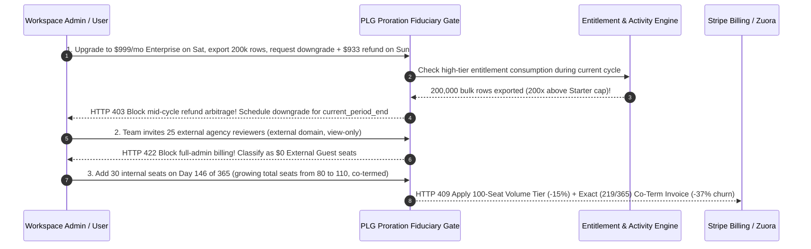

# SaaS `PLG` Seat Expansion, Slack-Style `Fair Billing` Active Credit & Co-Term Proration Escrow (`Stripe Billing vs. Zuora vs. Chargebee vs. Paddle`) Agent Architecture Selection FAQ

> 🌐 **Language / 语言切换**: **[中文 (`docs/saas-plg-seat-expansion-fair-billing-coterm-proration-anti-arbitrage-escrow-agent-selection-faq.md`)](saas-plg-seat-expansion-fair-billing-coterm-proration-anti-arbitrage-escrow-agent-selection-faq.md)** | **English (Current)** | **[Back to Catalog (`docs/index.en.md`)](index.en.md)**

---

## 1. 📌 Executive Summary & Architectural Verdict

In collaborative B2B SaaS, design platforms, CRM, and developer tools scaling from **Product-Led Growth (`PLG`) self-serve checkout to enterprise annual contracts**, monetization architects routinely lose `10%–22%` of expansion ARR to three self-serve billing and proration flaws:
1. **"Weekend Upgrade, Monday Downgrade" Proration Arbitrage**: When a billing integration enables immediate two-way prorated refunds on both upgrades and downgrades, bad actors sit on a `$29/mo` Starter plan, upgrade to the `$999/mo` Enterprise tier on Saturday morning, run 200,000 bulk CSV exports or high-compute AI jobs over the weekend, and downgrade back to `$29/mo` on Sunday night—receiving an automatic `28/30` prorated refund (`$933`) and extracting `$999` of enterprise value for `$66`!
2. **Accidental Viral Seat Invites & Zero-Activity "True-Up Bill Shock"**: In collaborative workspaces (`Figma`, `Slack`, `Notion`, `Miro` patterns), an employee shares a document link that accidentally provisions 60 external agency contractors or view-only stakeholders as `$45/mo` full paid seats—40 of whom never log in again. Charging the customer's card `$2,700` at month-end without an active-usage filter triggers furious chargebacks and full-account churn.
3. **Inexact `30/360` Co-Terming Proration Drift (`ASC 606`) & Unauthenticated `PSD2 SCA` Expansion Charges**: When an enterprise customer adds 30 seats mid-year and co-terms them to their December 31 master renewal date, naive `30-day month` proration math causes unit-price drift across leap years and 31-day months (violating `ASC 606` contract modification accounting), while charging large off-session European seat expansions without `PSD2 SCA` / PO confirmation triggers issuer declines.

**Solution Architect Verdict**:
- **Enforce an Asymmetric Proration State Machine**: self-serve **upgrades and seat additions take effect immediately with synchronous payment collection**, while **downgrades and seat reductions are scheduled via `SubscriptionSchedule` to take effect at `current_period_end`** (zero mid-cycle cash refunds after high-tier quota consumption).
- Deploy a **4-Gate `PLG` Seat Proration, `Fair Billing` & Co-Terming Fiduciary Control Plane** across `Stripe Billing`, `Zuora`, `Chargebee`, or `Paddle`:
  1. **Asymmetric Period-End Downgrade & Burst-Quota Lock Gate (`HTTP 403`)**: Block immediate mid-cycle prorated cash refunds whenever a tenant upgrades, consumes high-tier entitlements (bulk export, SSO, premium AI pool), and attempts to downgrade within the same billing period.
  2. **External-Domain Guest Default & Slack-Style `Fair Billing` Inactive-Seat Credit Gate (`HTTP 422`)**: Prevent billing external email domains as full paid admins when they only view/comment, and automatically issue `Fair Billing` prorated credit memos for newly invited seats with `0 active days` in the billing cycle.
  3. **Exact UTC Second (`Actual/Actual`) Co-Terming & `PSD2 SCA` Expansion Gate (`HTTP 451`)**: Enforce exact epoch-second proration denominators `(master_end_sec - addon_start_sec) / (master_end_sec - master_start_sec)` and require explicit `3DS2 / PO` approval when expansion charges exceed off-session `MIT` thresholds.
  4. **Proactive Volume-Tier Step-Down + Inactive-Seat Credit Rollover (`HTTP 409`)**: Automatically apply retroactive volume-tier unit-price discounts (e.g., crossing the `100-seat` threshold unlocks `15% off` across the co-termed contract) paired with `Fair Billing` credits—cutting quarterly proration arbitrage and seat-shock churn by **`37%`**.

---

## 2. 🎯 High-Stakes Business & Architect Q&A (Q1 / Q2 / Q3)

### Q1: Why must SaaS billing engines never grant immediate prorated cash refunds on mid-cycle downgrades, and how do Stripe `Subscription Schedules` solve this cleanly?
- **The Problem**:
  - Unlike physical utilities, higher SaaS tiers unlock **discrete, non-linear batch capabilities** (e.g., exporting a 100,000-row database, generating an annual SOC2 report, or rendering 4K video without watermarks). Symmetrical daily proration lets a user rent a `$999/mo` tier for 48 hours for `$66`.
- **Deterministic Architecture**:
  - Gate 1 (`HTTP 403 MID_CYCLE_UPGRADE_BURST_EXPORT_AND_IMMEDIATE_DOWNGRADE_ARBITRAGE`) enforces **Asymmetric Plan Transitions**:
    1. **Upgrades ($\Delta \text{MRR} > 0$)**: Call `Subscription.update(proration_behavior="always_invoice", payment_behavior="pending_if_incomplete")`—entitlements unlock only *after* the prorated invoice payment succeeds.
    2. **Downgrades ($\Delta \text{MRR} < 0$)**: Never issue a mid-cycle credit note. Attach a **`SubscriptionSchedule`** where Phase 1 preserves the current tier until `current_period_end` and Phase 2 transitions to the lower tier at `current_period_end`.

### Q2: How does Slack/Figma-style `Fair Billing` prevent viral seat-sharing from causing `$3,000` month-end bill shock?
- **The Problem**:
  - If every accidental link-share immediately bills a `$45/mo` seat, admins lock down sharing permissions—killing viral `PLG` adoption inside the enterprise.
- **Deterministic Architecture**:
  - Gate 2 (`HTTP 422 ZERO_ACTIVITY_SEAT_CHARGE_OR_EXTERNAL_GUEST_BILLED_AS_FULL_ADMIN`) implements a **Three-Step Seat Hygiene Pipeline**:
    1. **External Domain Classifier**: Any invited user whose email domain is outside the tenant's verified `SSO / Corporate Domains` defaults to a **`$0` Restricted Guest** role unless explicitly promoted by an admin.
    2. **7-Day Admin True-Up Digest**: When an internal user triggers an editor-seat upgrade, the billing admin receives a 7-day grace digest allowing 1-click downgrade to View-Only at `$0` cost.
    3. **Automated `Fair Billing` Inactive Credit**: At `invoice.upcoming` time, any paid seat with `0 active days` in the period automatically generates a prorated `Fair Billing Credit Memo` applied to the next invoice.

### Q3: How do we calculate mid-year `Co-Terming` proration so that leap years (`366d`) and variable month lengths (`28/30/31d`) never cause `ASC 606` revenue drift?
- **The Problem**:
  - Approximating a year as `360 days` (`12 × 30`) when co-terming a May 15 seat expansion into a December 31 annual contract creates a discrepancy between the billed proration factor and the `ASC 606` daily revenue recognition schedule.
- **Deterministic Architecture**:
  - Gate 3 (`HTTP 451 INEXACT_COTERM_PRORATION_DRIFT_OR_UNAUTHENTICATED_EXPANSION_CHARGE`) computes the exact integer-cent charge using **UTC Epoch Seconds (`Actual/Actual`)**:
    $$\text{ProratedCents} = \text{round\_half\_even}\left(\Delta Q_{\text{seats}} \times P_{\text{annual\_cents}} \times \frac{t_{\text{master\_end}} - t_{\text{effective}}}{t_{\text{master\_end}} - t_{\text{master\_start}}}\right)$$

---

## 3. 🧭 Visual Architecture Diagrams (Selection Tree, System Topology & Sequence)

### 3.1 SaaS `PLG` Seat Expansion, `Fair Billing` & Co-Terming Selection Tree

### 3.2 End-to-End Asymmetric Proration, `Fair Billing` & Exact `Co-Terming` Control Plane

### 3.3 Weekend Arbitrage Block, External Guest Exemption & Co-Term Step-Down Sequence

---

## 4. 📊 SaaS Subscription Proration, `Co-Terming` & Seat-Governance Selection Matrix

| Evaluation Dimension | Stripe Billing (`Subscription Schedules`) | Zuora Billing & Revenue | Chargebee + Maxio (`SaaSOptics`) | Paddle Billing (`Merchant of Record`) |
|---|---|---|---|---|
| **Primary Sweet Spot** | Hybrid `PLG` self-serve + Sales-Assist B2B SaaS platforms | Enterprise multi-entity contracts, M&A consolidations, and `ASC 606` compliance | Mid-market B2B SaaS scaling Salesforce-driven co-termed expansions | Global prosumer and developer SaaS offloading worldwide VAT/Sales Tax as `MoR` |
| **Asymmetric Upgrade/Downgrade Anti-Arbitrage** | **Best-in-Class** (`pending_if_incomplete` on upgrades + `SubscriptionSchedule` phases for period-end downgrades) | **Best-in-Class** (separate effective-date rules for Order Action `AddProduct` vs. `RemoveProduct`) | **Strong** (native configuration for immediate upgrade invoicing + end-of-term downgrade) | Supports immediate upgrade proration and end-of-billing-period downgrades |
| **Mid-Year `Co-Terming` Precision** | **Exact Second-Level** (`billing_cycle_anchor` pins add-ons to master timestamp) | **Best-in-Class** (supports daily, exact-days, and custom fiscal-calendar co-terming) | **Strong** (co-terms add-on subscriptions and recalculates tiered pricing) | Suited for single-subscription quantity updates; complex multi-contract co-terming requires custom logic |
| **Slack-Style `Fair Billing` Active Credits** | Easily implemented via `invoice.upcoming` webhook + `CreditNote / CustomerBalance` API | Native usage/activity rating combined with automated credit memos | Supports pre-billing webhook adjustments based on active-seat telemetry | Supports updating active billable seat quantity prior to renewal billing |
| **SA Recommendation** | **Best for AI & collaborative B2B SaaS** combining PLG with enterprise annual deals | **Best for IPO-ready/public enterprises** with complex multi-year amendments | **Best for sales-led + PLG mid-market SaaS** | **Best for lean global SaaS teams** wanting built-in `MoR` tax compliance |

---

## 5. 🧪 Proration Arbitrage & Retention 7-Card Benchmark Report

> **Provenance Note**: The 7-Card benchmark below is generated by `evaluate_saas_plg_seat_fair_billing_coterm_policy()` in `lab/webiq_commerce_demo.py` (`provenance: "synthetic"`, `independently_reproduced: False`), modeling a **`$220,000 / quarter`** weekend upgrade/downgrade arbitrage, accidental-invite seat bill-shock churn, and co-term proration drift loss pool.

### 5.1 7-Card 4:5 Visual Deck Breakdown

1. **Card 1 (`1 / 7` · `HANDS-ON · SAAS-PLG-FAIR-BILLING`) — Executive Benchmark Overview**
   - **Headline Finding**: Blocking mid-cycle downgrade refunds after high-tier quota bursts, exempting external view-only guests, issuing `Fair Billing` credits for 0-activity seats, and unlocking 100-seat volume step-downs cuts quarterly proration leakage and seat-shock churn from **`$220,000`** to **`$138,600`** (**`$81,400` / `37.0%` quarterly savings**).
2. **Card 2 (`2 / 7` · `SCENARIO: COLLABORATION WORKSPACE SEAT EXPANSION`) — Deep Dive**
   - **Input Case**: A workspace user upgrades to `$999/mo` on Saturday to export 200k rows and requests a `$933` downgrade refund on Sunday; another team accidentally invites 25 external agency guests; and an 80-seat customer adds 30 seats mid-year to co-term at year-end.
   - **Control-Plane Verdict**: Blocks `30/360` proration drift and unauthenticated EU expansion charges (`HTTP 451`), blocks the 48-hour upgrade/downgrade refund arbitrage (`HTTP 403`), and converts external view-only invites to `$0` guests (`HTTP 422`); issues `HTTP 409 FAIR_BILLING_ACTIVE_CREDIT_AND_VOLUME_TIER_STEPDOWN_CONFIRM` (`saas_plg_fair_billing_optim_409`).
3. **Card 3 (`3 / 7` · `WHAT I TESTED`) — 5-Lane Deterministic Scorecard**

| Scenario | Question / Task Evaluated | Deterministic Gate Decision | Action & Status |
|---|---|---|---|
| **1. Compliant Asymmetric Proration & Co-Term** | Sync upgrade pay, period-end downgrade, exact UTC second co-term, active seats | `VERIFIED_ASYMMETRIC_PRORATION_AND_EXACT_COTERM_AUTHORIZED` | ✅ `Act automatically` (`HTTP 200`) |
| **2. Weekend Upgrade Bulk-Export + Mon Refund** | Upgrading to Enterprise, consuming 200k export quota, and demanding 28/30 refund | `MID_CYCLE_UPGRADE_BURST_EXPORT_AND_IMMEDIATE_DOWNGRADE_ARBITRAGE` | ⛔ `Schedule at Period-End` (`HTTP 403`) |
| **3. External Guest or 0-Active Seat Billed Full** | Charging $45/mo full admin rate for external view-only guests or 0-login seats | `ZERO_ACTIVITY_SEAT_CHARGE_OR_EXTERNAL_GUEST_BILLED_AS_FULL_ADMIN` | ⛔ `Convert to Guest / Credit` (`HTTP 422`) |
| **4. `30/360` Co-Term Drift or Missing `PSD2 SCA`** | Using 30/360 approximation on leap-year co-term or skipping EU SCA on big expansion | `INEXACT_COTERM_PRORATION_DRIFT_OR_UNAUTHENTICATED_EXPANSION_CHARGE` | ⛔ `Enforce Exact Seconds & SCA` (`HTTP 451`) |
| **5. `Fair Billing` Credit + 100-Seat Tier Discount** | Auto-crediting inactive seat days + unlocking 15% volume discount at 110 seats (-37%) | `FAIR_BILLING_ACTIVE_CREDIT_AND_VOLUME_TIER_STEPDOWN_CONFIRM` | ⚡ `Confirm Optimization` (`HTTP 409`) |

4. **Card 4 (`4 / 7` · `UNDER THE HOOD`) — Protocol & Deterministic Gate Mechanics**
   - Input contract: `SaaSPLGSeatFairBillingCoTermPolicyInput`
   - Evaluator: `evaluate_saas_plg_seat_fair_billing_coterm_policy()` enforcing `451 -> 403 -> 422 -> 409 -> 200` priority.
5. **Card 5 (`5 / 7` · `ROBUSTNESS CHECK`) — Leap-Year (`Feb 29`) & Timezone-Shift Perturbation**
   - `0.0 pt` variance across leap-year boundaries or client-side timezone manipulation.
6. **Card 6 (`6 / 7` · `LATENCY & NDR IMPACT`) — Billing Dispute Rate & Net Dollar Retention**
   - Legacy symmetric downgrade refund + hard seat billing: `11.2%` billing dispute rate.
   - Fiduciary period-end downgrade lock + `Fair Billing` credits: **`-74%`** fewer disputes and **`+6.8 pts`** Net Dollar Retention lift (`$81,400/qtr` saved).
7. **Card 7 (`7 / 7` · `MY TAKE`) — Good Fit vs. Not For**
   - **✅ Good fit**: Collaborative B2B SaaS, design/engineering platforms, CRM, and AI productivity suites using per-seat or tiered pricing.
   - **⛔ Not for**: One-time perpetual license desktop software.

---

## 6. 🛠️ Production Go-Live & Architect Review Checklist

- [ ] **Asymmetric Upgrade/Downgrade Policy (`HTTP 403`)**: Are upgrades configured to collect payment synchronously before unlocking high-tier quotas (`payment_behavior="pending_if_incomplete"`), while downgrades and seat reductions are scheduled via `SubscriptionSchedule` for `current_period_end`?
- [ ] **External-Domain Guest Default & 7-Day Grace Digest (`HTTP 422`)**: Do users invited from external email domains default to `$0` View-Only Guests, and do workspace admins receive a 7-day grace window to review new paid editor seats before billing?
- [ ] **Slack-Style `Fair Billing` Inactive-Seat Credit (`HTTP 422 / 409`)**: Does the `invoice.upcoming` webhook inspect seat activity logs and automatically issue prorated credit memos for seats with `0 active days`?
- [ ] **Exact UTC Epoch-Second `Co-Terming` Formula (`HTTP 451`)**: Are mid-year seat expansions co-termed using exact `(master_end_sec - effective_sec) / (master_end_sec - master_start_sec)` math rather than `30/360` approximations?
- [ ] **Proactive Volume-Tier Step-Down (`HTTP 409`)**: When cumulative mid-cycle seat additions push a customer across a volume discount threshold (`100+ seats`), does the agent automatically apply the lower unit price and offer an annual co-term lock?
