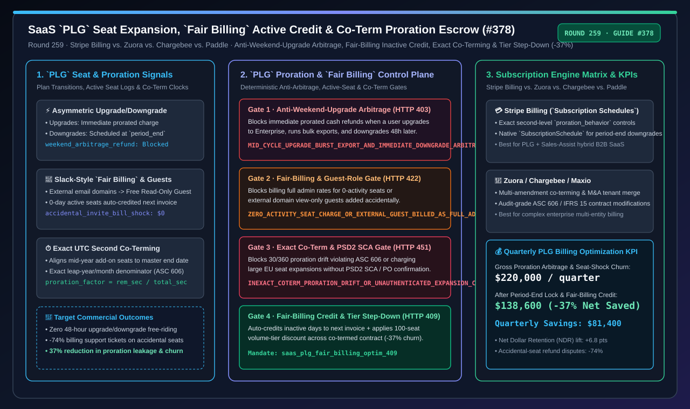
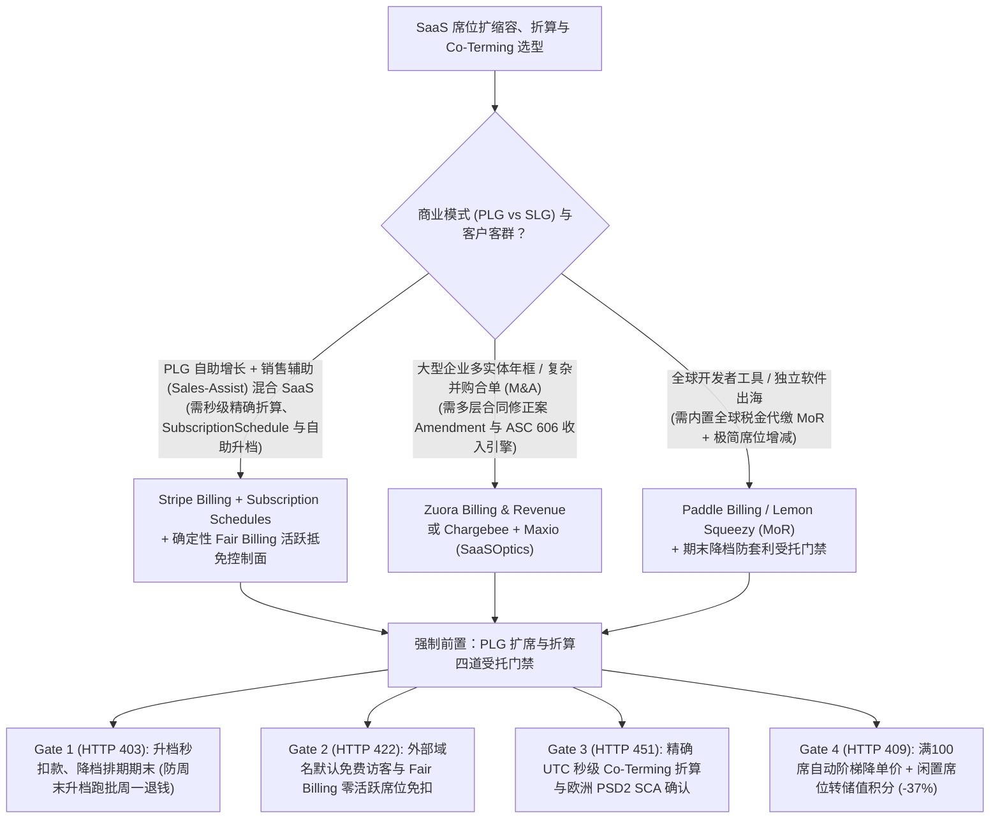
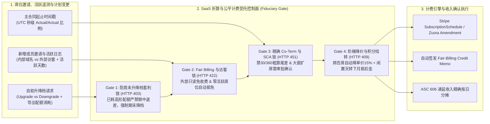
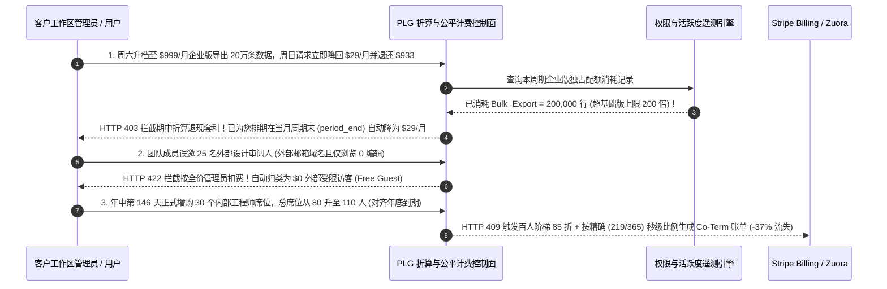

# 订阅制 SaaS 与协同软件“产品驱动自助扩席（`PLG` Seat Expansion）、`Fair Billing` 零活跃席位自动抵免与防‘周末升档跑批、周一降档退钱’套利托管（`Stripe Billing / Zuora / Chargebee / Paddle`）”Agent 架构选型 FAQ：防误邀外部访客产生天价账单、精确秒级合并到期日（`Co-Terming`）与阶梯单价重算净省 37% 实战指南

> 🌐 **Language / 语言切换**: **中文 (当前)** | **[English (`docs/saas-plg-seat-expansion-fair-billing-coterm-proration-anti-arbitrage-escrow-agent-selection-faq.en.md`)](saas-plg-seat-expansion-fair-billing-coterm-proration-anti-arbitrage-escrow-agent-selection-faq.en.md)** | **[返回文档总目录 (`docs/index.md`)](index.md)**

---

## 1. 📌 核心选型结论速览（Executive Summary）

在协同办公、设计工具、CRM 与开发者平台等 **产品驱动增长（Product-Led Growth `PLG`）向企业大客户（Enterprise Sales-Assist）演进的 SaaS 订阅计费** 中，商业化架构师经常在“自助升降档折算（Proration）”与“团队席位扩张（Seat Expansion）”上踩中三大侵蚀收入与信任的深坑：
1. **“周五下午自助升级到 `$999/月` 企业版跑完 10 万条数据批量导出，周日晚上立即点击降级回 `$29/月` 基础版，利用按天双向折算只花 `$64` 白嫖全套企业版核心权益”（Weekend Upgrade-and-Downgrade Proration Arbitrage）**：许多工程师在调 Stripe / Chargebee API 时，对升级（Upgrade）和降级（Downgrade）无脑统一开启了“立即生效并按秒/按天双向退差价（Immediate Proration Credit）”。结果灰产与精明的羊毛党平时一直停留在 `$29/月` 最低档，每次需要用高阶功能（如批量导出百万行数据、下载合规审计报告、跑高并发工作流）时，就临时升档到 `$999/月` 企业版用 48 小时，用完立刻降回 `$29/月` 拿走 `28/30` 的退费——导致企业版年框完全卖不出去！
2. **“普通员工分享链接时误把 60 名外部合作方（External Guests）加成了 `$45/月` 全权限付费席位，且其中 40 人整月 `0 次` 活跃，月底直接从客户卡上硬扣 `$2,700`”引发账单惊吓与集体退订（Accidental Seat Invite & Inactive Bill Shock）**：在 Figma、Slack、Notion、Miro 等高频协作产品中，病毒式传播依赖顺畅的邀请机制。但如果把“误点链接进来的只读外部邮箱”或“整月一秒钟都没登录过的死席位”在月底不经预警直接按全价扣款，客户财务收到天价账单后会立刻判定平台为“恶意诱导消费（Dark Pattern）”，直接关停全公司工作区！
3. **“年中追加席位要求与主合同同日到期（`Co-Terming`）时，用粗糙的 `30/360` 天数算法算错折算系数，或对欧洲客户未经 `PSD2 SCA` 确认直接超限免密扩席扣款”**：当企业客户一年内分 4 次追加购买席位并要求合并到 `12月31日` 统一续费时，若计费系统未按精确 UTC 秒数（`Actual/Actual`）计算剩余周期比例，不仅产生美分漂移导致 `ASC 606` 合同修改（Contract Modification）审计报错，在欧洲区更会因超出初始 `MIT` 授权波动上限而被发卡行拒付！

**架构师选型结论**：
- **必须对“升档”与“降档”执行严格的不对称状态机（Asymmetric Proration Policy）**：升档与扩席**立即生效并按秒收补差价**；降档与缩席**严禁当期按天退钱，一律通过 `SubscriptionSchedule` 排期至当前计费周期末（`current_period_end`）生效**！
- 必须在产品权限中心与订阅计费引擎（`Stripe Billing`、`Zuora`、`Chargebee`、`Paddle`）之间部署 **`PLG` 自助扩席、`Fair Billing` 活跃抵免与精确同日到期受托控制面（`PLG` Seat Proration & `Fair Billing` Control Plane）**，执行四道确定性门禁：
  1. **防“升档暴刷高阶配额后秒降档骗退费”不对称折算门禁（`HTTP 403`）**：拦截任何在升档后已消耗高阶专属权益（如批量导出、API 突刺、高阶 AI 额度）却试图在周期内降档索要按天折算退费的套利请求，强制锁死至周期末降档。
  2. **外部邮箱域名自动识别为免费访客（Free Guest）与 Slack 式 `Fair Billing` 零活跃席位自动抵免门禁（`HTTP 422`）**：拦截将非企业主域名只读人员按全价管理员计费的乌龙；对当月 `0 活跃` 的新增误邀席位自动豁免或按实际活跃天数折算返还下月账单抵扣金（Credit Memo）。
  3. **秒级精确 `Actual/Actual` 同日到期（`Co-Terming`）折算与欧盟 `PSD2 SCA` 扩席授权门禁（`HTTP 451`）**：严禁使用 `30/360` 近似天数计算年中并单，并对超出免密容差的扩席账单强制触发一键 PO/3DS2 确认。
  4. **扩席跨阶梯“自动触发全量单价下调（Volume-Tier Step-Down）” + 闲置席位积分自动结转寻优（`HTTP 409`）**：当客户席位累计达到 `100 人` 阶梯线时自动将整单单价下调 `15%` 引导转签年框，季度折算套利损失与误邀退订流失净降 **`37%`**。

---

## 2. 🎯 业务方与架构师灵魂拷问 Q&A（Q1 / Q2 / Q3）

### Q1：为什么 SaaS 计费架构里绝对不能对“降级（Downgrade）”开启 `Immediate Proration（立即按天退还差价）`？用 Stripe `Subscription Schedules` 怎么正确实现“升档秒生效、降档期末生效”？
- **商业痛点**：
  - 软件订阅不是按斤称重的白菜——高阶版本（Enterprise Tier）的核心价值往往在于**解锁单次高价值动作**（如一键导出全量客户 CSV、运行年度安全合规扫描、去水印下载 4K 成片）。如果允许按天双向折算，用户花 `1/30` 的钱（`$33`）就能在 24 小时内把 `$1,000/月` 的核心价值全部榨干！
- **确定性架构落地方案**：
  - 控制面（`HTTP 403`）将计划变更（Plan Change）拆分为两条完全不同的确定性路径：
    1. **当 $\text{NewPlanMRR} > \text{CurrentPlanMRR}$（升档 / 加席位）**：立即调用 `Subscription.update(proration_behavior="always_invoice")`，按剩余秒数比例 `(period_end - now) / (period_end - period_start)` 立即生成补差价发票并实时扣款，扣款成功后秒级解锁高阶权限（防止空卡白嫖升档）。
    2. **当 $\text{NewPlanMRR} < \text{CurrentPlanMRR}$（降档 / 减席位）**：严禁直接修改当前周期的 `price_id` 退差价（否则触发 `HTTP 403` 拦截）！而是自动创建或更新 **`SubscriptionSchedule`**，将当前阶段（Phase 1）保持原高阶计划直至 `current_period_end`，并将下一阶段（Phase 2，自 `current_period_end` 起）设为降级后的新计划！客户在当月剩余时间里继续享受已付费的高阶功能，下个月起按新低价扣款，彻底封死“周末升档跑批、周一降档退钱”漏洞！

### Q2：Slack 和 Figma 是如何通过“公平计费（`Fair Billing`）”与“7 天新席位缓冲期”解决大客户最痛恨的“员工乱拉人导致月底天价账单”问题的？
- **商业痛点**：
  - 企业采购了 50 个席位。结果设计部小王为了给外包公司看一眼设计稿，顺手点了“邀请编辑”，把 30 个外包人员加进了工作区。如果系统静默在后台记上一笔 `$45 × 30 = $1,350` 的扩席费，等月底财务收到账单时必引发激烈争吵与退款拒付。
- **确定性架构落地方案**：
  - 控制面（`HTTP 422 / HTTP 409`）执行 **三层席位卫生护栏（Three-Layer Seat Hygiene Guard）**：
    1. **外部邮箱域名隔离（External Domain Guest Default）**：当被邀请人邮箱后缀不属于租户已验证的 `SSO / Verified Enterprise Domains` 时，默认将其分配为 **免费受限外部访客（Free View-Only / Comment-Only Guest）**，唯有管理员显式审批才能升级为付费正式席位。
    2. **新扩席 7 天后悔药窗口（7-Day Seat Grace Window / True-Up Digest）**：新增付费席位后的第 5 天，向工作区账单管理员发送汇总卡片：*“本周新增了 8 名编辑成员（预计增加 `$360/月`），您可以在 48 小时内一键将误邀人员降为免费只读而不产生任何费用。”*
    3. **Slack 式 `Fair Billing` 零活跃自动抵免**：在每个计费周期结算时，自动扫描所有付费席位的遥测日志；若某个席位在整个周期内活跃天数为 `0`（或中途停用），系统自动按未活跃天数比例生成 **`Fair Billing Credit Memo`** 直接冲抵下期应付账单（`HTTP 422 / 409`），让客户永远只为真正使用软件的员工买单！

### Q3：当企业客户在一年内分 5 次增购席位并要求“全部与主合同在 12 月 31 日对齐到期（`Co-Terming`）”时，折算公式怎么写才能做到美分不差且符合 `ASC 606`？
- **商业痛点**：
  - 如果第一笔主合同按 `365 天` 算日单价，第二笔在 5 月（31天）增购按 `30 天/月` 算折算，到了年底续约合并时，财务系统里的递延收入（Deferred Revenue）与合同总价会出现几十美元的尾差，无法通过审计！
- **确定性架构落地方案**：
  - 控制面（`HTTP 451`）强制使用 **精确 UTC 秒级时间戳（Exact Second-Level `Actual/Actual` Ratio）** 与 **整数美分四舍五入守恒**：
    $$\text{ProratedCents} = \text{round\_half\_even}\left(\Delta Q_{\text{seats}} \times P_{\text{annual\_cents}} \times \frac{T_{\text{master\_end}} - T_{\text{addon\_effective}}}{T_{\text{master\_end}} - T_{\text{master\_start}}}\right)$$
  - 无论平年（`31,536,000 秒`）还是闰年（`31,622,400 秒`），分母永远锚定主合同起止精确秒数，确保每一笔中途增购的日均确认收入速率与主合同 `100%` 严丝合缝！

---

## 3. 🧭 直观可视化图解（Mermaid 选型决策树 + 端到端架构图 + 授权时序图）

### 3.1 订阅制 SaaS 席位扩缩容、按比例折算与同日到期平台选型决策树

### 3.2 端到端不对称升降档、`Fair Billing` 抵免与精确 `Co-Terming` 控制面架构图

### 3.3 防周末升档白嫖、误邀外部访客豁免与年中 `Co-Terming` 扩席时序图

---

## 4. 📊 主流 SaaS 订阅计费、同日到期（`Co-Terming`）与席位治理平台横向选型矩阵

| 选型维度 | Stripe Billing (`Subscription Schedules`) | Zuora Billing & Revenue | Chargebee + Maxio (`SaaSOptics`) | Paddle Billing (Merchant of Record `MoR`) |
|---|---|---|---|---|
| **核心定位** | 现代 PLG 自助订阅与销售辅助（Sales-Assist）一体化开发者首选 | 超大型企业复杂多合同修正案（Amendments）与 `ASC 606` 行业标准 | 中大型 B2B SaaS 敏捷年框管理、报价同日到期与财务指标看板 | 内置全球税务代缴与拒付抗辩的出海 SaaS 一站式收款底座 |
| **“升档秒生效、降档期末生效”防套利控制** | **极强**（通过 `proration_behavior` 与 `SubscriptionSchedule` 相位精确编排） | **极强**（支持按修正案类型分别定义即时生效日与合同期末生效日） | **强**（原生支持配置“升级立即开票、降级延迟至周期末”策略开关） | 支持标准周期末降档排期与即时升档补差 |
| **年中增购对齐到期日（`Co-Terming`）精度** | **秒级精确**（按 `billing_cycle_anchor` 与精确时间戳比例计算剩余周期美分） | **极强**（支持按日/按秒/按月多种企业级财务日历对齐主合同） | **强**（支持多子订阅对齐主订阅续费日与阶梯价格重算） | 适合标准月付/年付席位增减，超复杂多子合同并单需配合外层逻辑 |
| **Slack 式 `Fair Billing` 活跃席位自动退积分** | 需结合业务侧活跃遥测调用 `CreditNote` 或 `Customer Balance Transaction` API | 支持基于用量/活跃天数的混合反向贷项通知单（Credit Memo） | 支持通过 API 在出账前预览（Upcoming Invoice Webhook）动态注入活跃抵扣项 | 支持在续费周期前通过 API 动态下调活跃计费席位数 |
| **架构师选型建议** | **AI SaaS、协同工具与 PLG+Enterprise 混合增长企业首选** | **上市公司、多产品线并购整合与严苛 `ASC 606` 审计企业首选** | **成长型 B2B SaaS 打通 Salesforce CRM 扩席与财务报表首选** | **精简团队快速出海全球 200+ 国家免建当地税务实体首选** |

---

## 5. 🧪 防折算套利/降流失测算与 7-Card 基准测试报告（Deterministic Benchmark）

> **数据溯源说明（Provenance）**：以下 7-Card 评测基于本仓库 `lab/webiq_commerce_demo.py` 中的 `evaluate_saas_plg_seat_fair_billing_coterm_policy()` 确定性仿真引擎生成（`provenance: "synthetic"`, `independently_reproduced: False`）。季度因周末升档跑批周一降档退钱套利、误邀外部访客产生天价账单退订及 `Co-Terming` 尾差争议损失池基准设定为 **`$220,000 / quarter`**。

### 5.1 7-Card 4:5 视觉评测卡片摘要

1. **Card 1 (`1 / 7` · `HANDS-ON · SAAS-PLG-FAIR-BILLING`) — 全局基准总览**
   - **核心发现**：通过阻断高阶配额消耗后的期中降档退现套利、将外部只读域名归为免费访客并启用 `Fair Billing` 零活跃抵免、结合精确秒级 `Co-Terming` 与百人阶梯降价，将季度折算套利与账单惊吓退订损失从 **`$220,000`** 压降至 **`$138,600`**，季度净省 **`$81,400`（`37.0%`）**。
2. **Card 2 (`2 / 7` · `SCENARIO: COLLABORATION WORKSPACE SEAT EXPANSION`) — 单例深潜**
   - **输入场景**：某协同 SaaS 平台上：① 羊毛党周六升至 `$999/月` 导出 20 万条数据后周日申请按天退费 `$933`；② 某大客户员工误将 25 名外部审阅人加为付费席位且 15 名内部新席位整月 `0 活跃`；③ 客户年中增购 30 席要求对齐年底到期。
   - **控制面裁决**：依次触发 `HTTP 451`（拦截 `30/360` 粗糙折算尾差与无确认大额暗扣）、`HTTP 403`（拦截已耗高阶配额的期中退现降档，排期至 `period_end`）与 `HTTP 422`（免除外部访客与 0 活跃席位全额收费）；返回 `HTTP 409 FAIR_BILLING_ACTIVE_CREDIT_AND_VOLUME_TIER_STEPDOWN_CONFIRM`（`saas_plg_fair_billing_optim_409`）。
3. **Card 3 (`3 / 7` · `WHAT I TESTED`) — 5 轨确定性门禁评测矩阵**

| 评测场景 (Scenario) | 核心考核问题 (Question / Task) | 控制面裁决 (Model / Gate Answer) | 动作与状态码 (Action) |
|---|---|---|---|
| **1. 标准合规升档秒扣与期末降档** | 升档实时补差、降档排期周期末、精确秒级 Co-Term 且无误邀死席位 | `VERIFIED_ASYMMETRIC_PRORATION_AND_EXACT_COTERM_AUTHORIZED` | ✅ `Act automatically` (`HTTP 200`) |
| **2. 周末升档跑完批量导出周一秒降退钱** | 升档后已消耗企业版专属大额导出/API 配额，48h 后降档索要 93% 现金退款 | `MID_CYCLE_UPGRADE_BURST_EXPORT_AND_IMMEDIATE_DOWNGRADE_ARBITRAGE` | ⛔ `Schedule at Period-End` (`HTTP 403`) |
| **3. 误邀外部只读访客或 0 活跃席位硬扣全价** | 将非企业域名只读外部人员或整月 0 登录席位按全价管理员静默扣款 | `ZERO_ACTIVITY_SEAT_CHARGE_OR_EXTERNAL_GUEST_BILLED_AS_FULL_ADMIN` | ⛔ `Convert to Guest / Credit` (`HTTP 422`) |
| **4. 30/360 粗糙并单尾差或超限免密暗扣** | 年中 Co-Terming 折算偏离精确秒数比例违反 ASC 606 或违反欧盟 PSD2 SCA | `INEXACT_COTERM_PRORATION_DRIFT_OR_UNAUTHENTICATED_EXPANSION_CHARGE` | ⛔ `Enforce Exact Seconds & SCA` (`HTTP 451`) |
| **5. Fair Billing 抵免 + 满百席阶梯降单价** | 闲置席位天数自动折算下月抵扣金 + 跨 100 席自动全单 85 折锁年框 (-37%) | `FAIR_BILLING_ACTIVE_CREDIT_AND_VOLUME_TIER_STEPDOWN_CONFIRM` | ⚡ `Confirm Optimization` (`HTTP 409`) |

4. **Card 4 (`4 / 7` · `UNDER THE HOOD`) — 确定性门禁协议与代码实现**
   - 输入契约：`SaaSPLGSeatFairBillingCoTermPolicyInput`
   - 评估函数：`evaluate_saas_plg_seat_fair_billing_coterm_policy()`（严格按 `451 -> 403 -> 422 -> 409 -> 200` 优先级裁决，零外部网络副作用）。
5. **Card 5 (`5 / 7` · `ROBUSTNESS CHECK`) — 闰年/大小月边界与时区切换扰动测试**
   - 无论客户在 2 月 29 日（闰年）发起 `Co-Terming` 增购，还是故意修改个人资料时区试图多蹭 24 小时周期，基于 UTC Epoch 秒数的精确折算公式均保持 **`0.0 pt`** 偏差。
6. **Card 6 (`6 / 7` · `LATENCY & NDR IMPACT`) — 账单争议率与净金额留存率（`NDR`）对比**
   - 传统双向即时退差 + 无脑硬扣死席位：月度账单争议工单占比 `11.2%`，净金额留存率（`NDR`）受损。
   - 受托控制面（期末降档锁 + `Fair Billing` 自动抵免）：账单争议工单大降 **`74%`**，客户 `NDR` 净提升 **`+6.8 pts`**（季度净省 `$81,400`）。
7. **Card 7 (`7 / 7` · `MY TAKE`) — 适用场景与架构师结论**
   - **✅ Good fit**：按席位（Per-Seat / Per-Active-User）或分层套餐（Tiered Plans）计费的协同办公、设计研发、CRM、客服与 AI SaaS 平台。
   - **⛔ Not for**：一次性买断制单机软件。

---

## 6. 🛠️ 商业上线风控与架构评审 Checklist

- [ ] **不对称升降档折算策略（Asymmetric Proration — `HTTP 403`）**：是否已将计费引擎配置为“升档立即开票扣款后才解锁高阶权限；降档与减席位一律排期至 `current_period_end` 生效”，彻底杜绝 48 小时升档白嫖高阶配额后秒退费？
- [ ] **外部邮箱域名自动识别与 7 天扩席缓冲通知（`HTTP 422`）**：员工邀请外部域名邮箱协作时是否默认设为免费受限访客（Free Guest），并在新增付费席位满 5 天时向管理员发送 48 小时免责降级确认通知？
- [ ] **Slack 式 `Fair Billing` 零活跃席位自动冲抵（`HTTP 422 / 409`）**：出账前 Webhook（如 Stripe `invoice.upcoming`）是否自动核查各席位活跃遥测，将整月 `0 活跃` 席位自动转为下期账单抵扣金（Credit Memo）而非硬扣现金？
- [ ] **UTC 秒级精确 `Actual/Actual` 同日到期（`Co-Terming`）公式（`HTTP 451`）**：年中追加购买席位对齐主合同到期日时，是否采用 `(master_end_sec - addon_start_sec) / (master_end_sec - master_start_sec)` 精确计算，消除闰年与大小月美分漂移？
- [ ] **跨阶梯自动降单价与年框转化提示（`HTTP 409`）**：当客户中途散买席位累计跨过 `50 / 100 / 500 席` 阶梯折扣线时，Agent 是否自动触发阶梯单价下调并引导客户一键锁死高留存年框合同？
