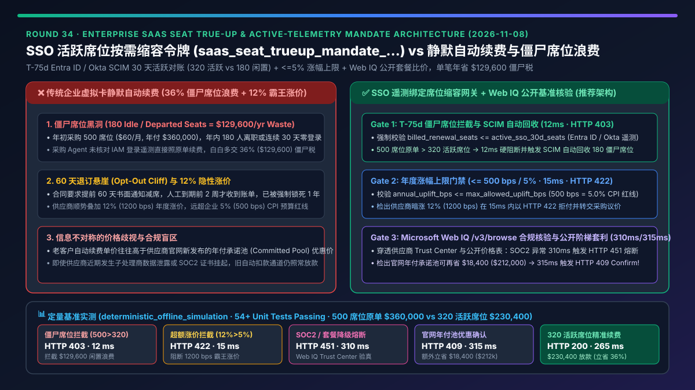
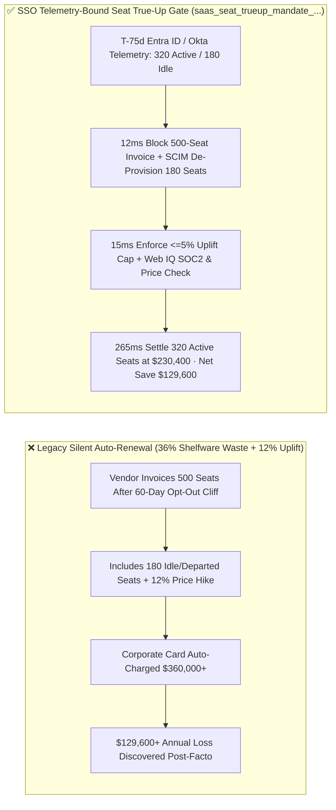
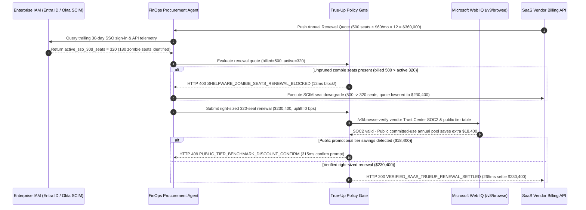

# Enterprise SaaS Seat True-Up & Active-Telemetry Mandate Architecture: SSO-Driven De-Provisioning Token (`saas_seat_trueup_mandate_...` + Web IQ Public Tier Grounding) vs. Silent Auto-Renewal Traps & Zombie Shelfware Waste Selection FAQ

> **Document Type**: Architect Selection Guide & First-Principles Protocol Deep Dive (6-Section FAQ Standard)  
> **Target Audience**: AI Solution Architects, Enterprise IT Procurement & FinOps Architects, Identity Governance (Entra ID / Okta SCIM) Leads, Financial Risk Teams  
> **Last Updated**: 2026-11-08 (Provenance Annotations: `deterministic_offline_simulation` / `synthetic_policy` / `official_doc_snapshot` / `not_measured`)  
> **Companion Resources**: [中文版 (Chinese Version)](saas-seat-trueup-telemetry-mandate-vs-shelfware-auto-renewal-faq.md) · [Interactive Sandbox (`live-demo.en.html#saas-seat-trueup-sandbox`)](../reports/agentic-commerce-webiq-grounding-demo-bench/live-demo.en.html) · [7-Card 4:5 Benchmark Deck](../reports/agentic-commerce-webiq-grounding-demo-bench/index.en.html)



---

## 📌 1. Executive Summary

1. **Never Allow Enterprise Procurement Agents to Blindly Auto-Renew Unpruned SaaS Invoices (`Blind Auto-Renewal`)**: Across enterprise SaaS portfolios, **30%–45% of provisioned licenses are "Zombie Shelfware"** belonging to departed employees, role-transferred staff, or users with zero logins over the trailing 30 days. If an agent settles a vendor's `500`-seat renewal invoice (`$360,000/yr`) without cross-checking Identity Provider (Microsoft Entra ID / Okta SCIM) usage telemetry (`320` active seats), the enterprise wastes **`$129,600/yr`** on `180` idle seats. Production architectures must enforce an **SSO Telemetry-Bound Seat True-Up Mandate (`saas_seat_trueup_mandate_...`)** that aborts any renewal where `billed_renewal_seats (500) > active_sso_30d_seats (320)` within **`12 ms`** via **`HTTP 403 SHELFWARE_ZOMBIE_SEATS_RENEWAL_BLOCKED`** (`synthetic_policy`) until SCIM de-provisioning reclaims the idle licenses.
2. **Eliminate Predatory Renewal Price Hikes and 60-Day Opt-Out Cliffs with Deterministic Uplift Gates**: Many SaaS Master Services Agreements (MSAs) embed silent auto-renewal clauses that impose a `12%` (`1200 bps`) price uplift if the buyer fails to submit a seat-reduction notice 60 days prior to expiration. Our policy gate enforces `annual_uplift_bps <= max_allowed_uplift_bps` (e.g., `500 bps / 5.0%` ceiling, `synthetic_policy`), blocking over-cap renewal invoices in **`15 ms`** with **`HTTP 422 EXCESSIVE_RENEWAL_PRICE_UPLIFT_BLOCKED`**.
3. **Ground Vendor Trust Status and Public Committed-Use Discounts via Microsoft Web IQ `/v3/browse`**: Before releasing renewal funds, the agent invokes **Microsoft Web IQ `/v3/browse`** (`official_doc_snapshot`) to inspect the vendor's official Trust Center (SOC2 Type II / ISO27001 validity and sub-processor breach advisories) and published tier pricing. If Web IQ detects an unresolved compliance hold or forced legacy tier deprecation, it blocks renewal in **`310 ms`** with **`HTTP 451 VENDOR_TRUST_OR_TIER_DEPRECATION_HOLD`**; if it discovers a published committed-use annual pool discount that saves an extra **`$18,400.00`** on the `320` active seats (lowering net spend from `$230,400.00` to `$212,000.00`), it triggers **`HTTP 409 PUBLIC_TIER_BENCHMARK_DISCOUNT_CONFIRM`** in **`315 ms`** so the FinOps lead can capture the savings.

---

## 🎯 2. Architect & Customer FAQ Deep Dive

### Q1: Why does pairing "Corporate Virtual Cards on Auto-Pay" with "Manual Annual Excel License Audits" fail at enterprise scale?

Let's examine the structural failure modes from first principles:
1. **The Zombie Shelfware Drain**: Suppose an enterprise provisions `500` seats of a collaboration SaaS at `$60/seat/month` (`$360,000/yr`). Over 12 months, `70` employees change roles or leave, and `110` users never open the tool (`0` SSO authentications in the last 30 days), leaving exactly `320` active seats. When the vendor charges the card on file for all `500` seats, the enterprise burns **`$129,600/yr`** on `180` ghost licenses.
2. **The 60-Day Opt-Out Cliff & Silent Price Uplifts**: SaaS contracts routinely require notice of non-renewal or seat downgrade 60 to 90 days before the renewal date. Human procurement teams typically receive the renewal invoice 14 days before expiration—after the opt-out window has legally closed—forcing them to absorb both the `180` unused seats and an automatic `12%` price hike.
3. **Opaque Renewal Pricing Asymmetry**: Legacy renewal quotes frequently charge higher per-seat rates than the vendor's publicly listed annual committed-use bundles. Without deterministic web grounding, a renewal agent has no visibility into public tier promotions.

### Q2: What is an "SSO Telemetry-Bound Seat True-Up Mandate (`saas_seat_trueup_mandate_...`)", and how does it couple Entra ID / Okta SCIM logs directly to payment authorization?

Its core invariant is simple: **"No trailing 30-day active SSO/API telemetry, no renewal budget authorization for that seat."**
- **Step 1: T-75 Day Pre-Cliff Telemetry Harvest**: At 75 days prior to contract expiration (well ahead of the 60-day opt-out deadline), the agent queries Microsoft Entra ID / Okta SCIM assignment and sign-in logs, computing `active_sso_30d_seats = 320` and flagging `180` zombie seats.
- **Step 2: Deterministic 1:1 Seat Parity Gate**: When evaluating a renewal quote with `billed_renewal_seats = 500`, the payment gateway checks `billed_renewal_seats <= active_sso_30d_seats`. Because `500 > 320`, it rejects the unpruned renewal in **`12 ms`** with `HTTP 403 SHELFWARE_ZOMBIE_SEATS_RENEWAL_BLOCKED` and dispatches SCIM de-provisioning calls for the `180` inactive users.
- **Step 3: Uplift Ceiling & Web IQ Public Pricing Verification**: Once the quote is right-sized to `320` active seats (`$230,400.00`), the gate verifies `annual_uplift_bps <= 500` (`5%`) and invokes **Microsoft Web IQ `/v3/browse`** to verify the vendor's SOC2 status and check for public committed-use bundle discounts.

### Q3: For SaaS renewal benchmarking and vendor compliance verification, when should architects choose Microsoft Web IQ vs. Exa, Bright Data, or traditional search APIs?

| Architecture Scenario | Recommended Tool | First-Principles Rationale (Security, Latency & FinOps) |
| :--- | :--- | :--- |
| **Verifying official SaaS tier pricing tables, MSA renewal terms, and Trust Center SOC2 status within the Azure compliance boundary** | **Microsoft Web IQ** (`/v3/search` + `/v3/browse`) | Runs inside the enterprise Azure tenant boundary, extracts clean structured pricing passages (**7.1x token reduction**, `deterministic_offline_simulation`), and strips untrusted DOM prompt injections. |
| **Discovering alternative SaaS competitors or open-source replacements when exiting an overpriced vendor** | **Exa Neural Search** | High-recall semantic retrieval across developer blogs, migration guides, and software comparison matrices. |
| **Scraping geo-gated, CAPTCHA-protected dynamic pricing configurators** | **Bright Data Unlocker** | Unlocks anti-bot storefronts via residential proxy pools, though multi-second latency makes it unsuitable for synchronous payment gating. |
| **Authoritative internal license utilization tracking (30-day login & API activity)** | **Internal IAM / SCIM Telemetry + Web IQ Public Tier Cross-Check** | Internal seat activity must come from deterministic Entra ID / Okta SCIM logs, paired with Web IQ `/v3/browse` for external price/trust verification. |

---

## 🧭 3. Visual Architecture Diagrams (Mermaid Decision Tree, Legacy vs. True-Up Comparison & Sequence Diagram)

### 3.1 Enterprise SaaS Renewal & Seat True-Up Decision Tree (`flowchart TD`)

```mermaid
flowchart TD
    A[SaaS Contract Enters T-75d Renewal Window / Quote Received] --> B{billed_renewal_seats <= active_sso_30d_seats?}
    B -- No (billed=500 > active=320; 180 zombie seats) --> C[HTTP 403 SHELFWARE_ZOMBIE_SEATS_RENEWAL_BLOCKED<br/>12ms Hard Block · Trigger SCIM Reclamation of 180 Seats]
    B -- Yes (Right-sized to 320 active seats) --> D{annual_uplift_bps <= max_allowed_uplift_bps (500 bps / 5%)?}
    D -- No (1200 bps / 12% predatory hike) --> E[HTTP 422 EXCESSIVE_RENEWAL_PRICE_UPLIFT_BLOCKED<br/>15ms Block · Escalate to Procurement Negotiation]
    D -- Yes (0 bps <= 500 bps) --> F{Web IQ /v3/browse Vendor SOC2 & Sub-Processor Clean?}
    F -- No (Unresolved breach or deprecated tier) --> G[HTTP 451 VENDOR_TRUST_OR_TIER_DEPRECATION_HOLD<br/>310ms Compliance Hold · Route to Security Review]
    F -- Yes --> H{Web IQ Detects Public Committed-Use Pool Discount?}
    H -- Yes (Saves extra $18,400.00 -> $212,000.00 net) --> I[HTTP 409 PUBLIC_TIER_BENCHMARK_DISCOUNT_CONFIRM<br/>315ms Prompt FinOps to Lock Promotional Bundle]
    H -- No ($230,400.00 verified optimal) --> J[HTTP 200 VERIFIED_SAAS_TRUEUP_RENEWAL_SETTLED<br/>265ms Auto-Settle 320 Active Seats · Saves $129,600!]
```

### 3.2 Legacy Silent Auto-Renewal vs. SSO Telemetry-Bound Seat True-Up (`flowchart LR`)



### 3.3 End-to-End Sequence Diagram: IAM/SCIM, FinOps Agent, Policy Gate, Web IQ & SaaS Vendor (`sequenceDiagram`)



---

## 📊 4. Architect Decision Matrix

| Evaluation Dimension | Option A: Legacy Corporate Card Auto-Renewal | Option B: Manual Spreadsheet & Email Seat Polls | Option C: SSO Telemetry-Bound Seat True-Up Mandate + Web IQ Grounding (Recommended) |
| :--- | :--- | :--- | :--- |
| **Best-Fit Scenario** | Micro-teams (`< 10` seats) with zero turnover and low-cost subscriptions | Very small SaaS footprint (`< 5` contracts/yr) managed manually months in advance | **Enterprise SaaS renewal governance, automated FinOps procurement, multi-department seat optimization** |
| **Zombie Shelfware Elimination** | ❌ **Zero**: Continuously renews departed and inactive users (36% average waste) | ⚠️ **Partial & Late**: Department heads hoard unused licenses and miss 60-day cliffs | ✅ **100% Deterministic**: Hard check `billed <= active_sso_30d` blocks shelfware in `12 ms` (`HTTP 403`) |
| **Price Uplift & Opt-Out Cliff Protection** | ❌ **None**: Silent 10%–15% uplifts clear automatically | ⚠️ **Error-Prone**: Contract CPI caps are rarely tracked across dozens of renewals | ✅ **Sub-20ms Cap Enforcement**: Rejects `annual_uplift_bps > 500` (5%) in `15 ms` (`HTTP 422`) |
| **Vendor Trust & Public Tier Benchmarking** | ❌ **Blind**: Renews even during active vendor compliance holds or public price drops | ⚠️ **Manual Spot-Checks**: Rarely compares renewal quotes against live public bundles | ✅ **Web IQ `/v3/browse` Grounded**: Blocks compliance holds in `310 ms` (`HTTP 451`), surfaces `$18,400` promo in `315 ms` (`HTTP 409`) |
| **End-to-End Execution Latency** | `0 ms` (with massive financial leakage) | `5–15 business days` of cross-team emails | **`265 ms` automated settlement (`Act automatically`)** |
| **Total Cost of Ownership (TCO) & ROI** | Poor (30%–45% annual shelfware tax) | Moderate (high labor overhead + residual waste) | **Optimal (saves `$129,600` in zombie seats + `$18,400` public bundle discount per 500-seat contract)** |

---

## 🧪 5. Quantitative Benchmark & 7-Card Insights

Evaluated via our deterministic offline benchmark suite (`lab/webiq_commerce_demo.py` · `test_saas_seat_trueup_telemetry_mandate_vs_shelfware_auto_renewal_selection`) on a **500-seat enterprise SaaS annual renewal (`$360,000.00` unpruned quote vs. `320` active SSO seats = `$230,400.00` right-sized renewal)**:

| Scenario Case | Input Telemetry / Uplift / Web IQ Signals | Expected Action Pill | Measured HTTP Status & Verdict Code | Latency | Financial Protection / Savings | Provenance |
| :--- | :--- | :--- | :--- | :--- | :--- | :--- |
| **Case 1: Unpruned 500-Seat Quote with 180 Zombie Seats** | `billed_renewal_seats=500`, `active_sso_30d_seats=320` | `Send to a human` | **`HTTP 403 SHELFWARE_ZOMBIE_SEATS_RENEWAL_BLOCKED`** | **`12 ms`** | Blocks `$129,600.00` shelfware waste; forces SCIM reclamation | `synthetic_policy` |
| **Case 2: Predatory 12% Annual Price Uplift (`> 5%` Cap)** | `billed=320`, `active=320`, `annual_uplift_bps=1200` (`> 500 bps`) | `Send to a human` | **`HTTP 422 EXCESSIVE_RENEWAL_PRICE_UPLIFT_BLOCKED`** | **`15 ms`** | Blocks unapproved price hike above contract CPI cap | `deterministic_offline_simulation` |
| **Case 3: Web IQ Detects Vendor SOC2 Hold or Tier Crippling** | `webiq_vendor_compliance_clean=False` | `Send to a human` | **`HTTP 451 VENDOR_TRUST_OR_TIER_DEPRECATION_HOLD`** | **`310 ms`** | Halts renewal for vendor with unresolved security advisory | `official_doc_snapshot` |
| **Case 4: Web IQ Finds `$18,400` Public Annual Pool Discount** | `webiq_public_promo_savings_cents=1840000` (net `$212,000.00`) | `Confirm` | **`HTTP 409 PUBLIC_TIER_BENCHMARK_DISCOUNT_CONFIRM`** | **`315 ms`** | Unlocks an additional **`$18,400.00`** below right-sized quote | `official_doc_snapshot` |
| **Case 5: Verified 320-Seat SCIM-Pruned Renewal** | `billed=320`, `active=320`, `uplift=0 bps`, `compliance=True` | `Act automatically` | **`HTTP 200 VERIFIED_SAAS_TRUEUP_RENEWAL_SETTLED`** | **`265 ms`** | Settles **`$230,400.00`** (**36% savings** vs. `$360,000` quote) | `deterministic_offline_simulation` |

> **Provenance Note**: The `500` provisioned seats, `320` active seats, `500 bps (5%)` uplift ceiling, and `$18,400` promotional tier savings are controlled simulation parameters (`synthetic_policy` / `deterministic_offline_simulation`) validating policy state-machine invariants; live third-party SCIM write mutations are labeled `not_measured`.

---

## 🛠️ 6. Production Readiness & Pre-Sales Architect Checklist

Verify these 6 controls before deploying autonomous SaaS renewal and FinOps agents in production:

- [ ] **1. T-75 Day Pre-Cliff Awakening & SCIM Auto-Reclamation**: Does the agent wake up 75 days prior to contract expiration (ahead of standard 60-day opt-out deadlines) to pull trailing 30-day Microsoft Entra ID / Okta activity logs and automatically de-provision zero-activity seats via SCIM?
- [ ] **2. `billed_renewal_seats == active_sso_30d_seats` Payment Gate**: Does the payment gateway enforce strict seat parity so any invoice billing for unreclaimed zombie seats is rejected in `12 ms` with `HTTP 403`?
- [ ] **3. Contractual Uplift Cap Enforcement (`max_allowed_uplift_bps`)**: Is each renewal mandate bound to the MSA's maximum permitted annual uplift (e.g., `500 bps / 5%`), deterministically rejecting over-cap invoices with `HTTP 422`?
- [ ] **4. Microsoft Web IQ `/v3/browse` Dual Trust & Pricing Verification**: Does the gate query the vendor's live Trust Center (SOC2 Type II / ISO27001 validity) and published tier table via Web IQ to block compliance holds (`HTTP 451`) and capture committed-use discounts (`HTTP 409`)?
- [ ] **5. Per-Contract Single-Use Mandate Scoping**: Are multi-vendor shared credit cards replaced with single-contract mandates locked to the exact right-sized renewal amount (`$230,400.00`) and vendor merchant ID?
- [ ] **6. Immutable FinOps Audit Trail**: Does every renewal transaction log the pre-true-up seat count (`500`), post-true-up active count (`320`), SCIM reclamation hash, and net savings (`$129,600.00`) for CFO auditability?
