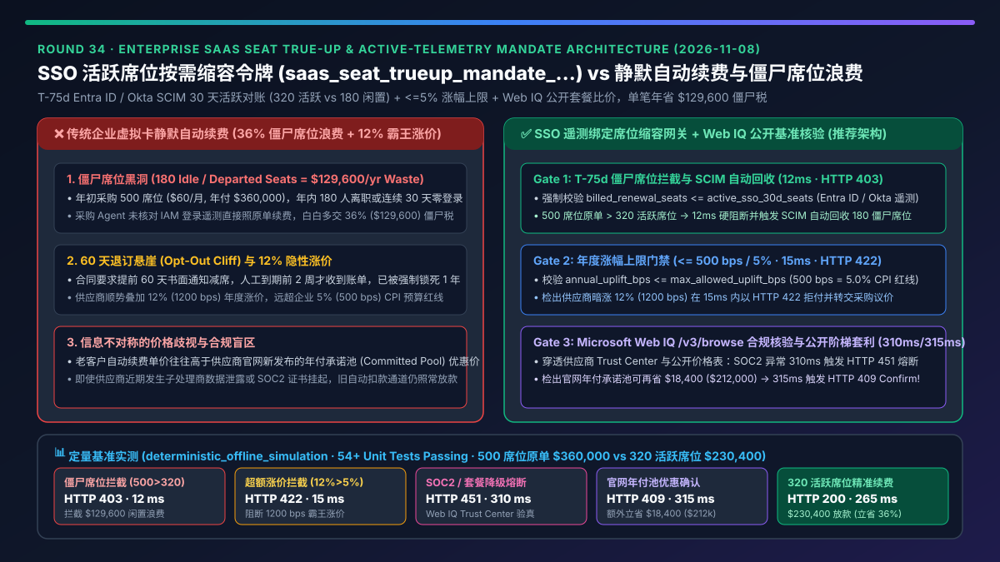
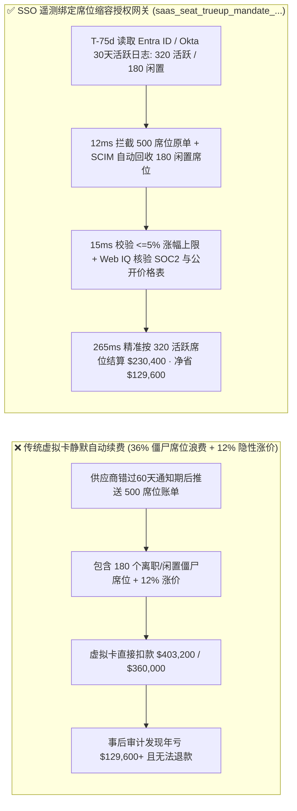
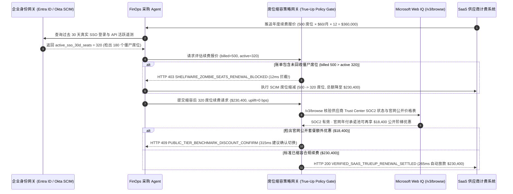

# 企业 SaaS 软件席位续费与活跃度遥测调优（Autonomous SaaS Seat True-Up & Active-Telemetry Mandate）架构：SSO 活跃席位按需缩容授权令牌（`saas_seat_trueup_mandate_...` + Web IQ 公开折扣基准核验）vs 传统静默自动续费（Auto-Renewal Trap）与僵尸席位（Shelfware）预算浪费选型与原理解析 FAQ

> **文档类型**：架构师选型指南 & 协议第一性原理解析（6 段式 FAQ 标准版）  
> **适用读者**：AI Solution Architect、企业 IT 采购与 FinOps 架构师、身份治理（Entra ID / Okta SCIM）负责人、财务风控团队  
> **更新日期**：2026-11-08（Provenance 标注：`deterministic_offline_simulation` / `synthetic_policy` / `official_doc_snapshot` / `not_measured`）  
> **配套资源**：[English Version](saas-seat-trueup-telemetry-mandate-vs-shelfware-auto-renewal-faq.en.md) · [交互式沙盒控制台 (`live-demo.html#saas-seat-trueup-sandbox`)](../reports/agentic-commerce-webiq-grounding-demo-bench/live-demo.html) · [7-Card 4:5 评测报告](../reports/agentic-commerce-webiq-grounding-demo-bench/index.html)



---

## 📌 一、核心结论速览（Executive Summary）

1. **严禁让企业采购 Agent 对 SaaS 供应商发来的年度续费账单直接执行“按原席位数静默自动续费（Blind Auto-Renewal）”**：企业 SaaS 采购中平均有 **30%～45% 的已购席位属于离职、转岗或超 30 天未登录的“僵尸席位（Shelfware）”**。若 Agent 不核对身份网关（Microsoft Entra ID / Okta SCIM）真实活跃遥测就直接续费 `500` 个历史席位（`$360,000/年`），企业每年将白白浪费 `$129,600`（`180` 个闲置席位）。生产环境必须强制采用 **SSO 活跃遥测驱动的席位缩容授权令牌（`saas_seat_trueup_mandate_...`）**，一旦检出账单席位数高于 30 天真实活跃席位数（`billed_renewal_seats = 500 > active_sso_30d_seats = 320`），在 **`12 ms`** 内触发 **`HTTP 403 SHELFWARE_ZOMBIE_SEATS_RENEWAL_BLOCKED`**（`synthetic_policy`），强制先通过 SCIM 自动回收僵尸席位再签发续费令牌。
2. **用“合同涨幅红线硬拦截 + 提前 60 天退订锁（Opt-Out Cliff Guard）”终结 SaaS 供应商暗中涨价陷阱**：许多 SaaS 合同隐藏了“若未在到期前 60 天书面通知则自动按列表价上浮 12% 续约”的霸王条款。网关强制校核年度单价涨幅（`annual_uplift_bps <= max_allowed_uplift_bps`，如设定 `500 bps / 5.0%` 上限，`synthetic_policy`）；当供应商账单暗藏 `12%`（`1200 bps`）涨价时，网关在 **`15 ms`** 内以 **`HTTP 422 EXCESSIVE_RENEWAL_PRICE_UPLIFT_BLOCKED`** 阻断扣款，并自动触发降级或竞品迁移询价。
3. **基于 Microsoft Web IQ `/v3/browse` 实时核验供应商安全合规状态与公开阶梯折扣（Public Pricing Benchmark Grounding）**：在签发最终续费资金前，Agent 调用 **Microsoft Web IQ `/v3/browse`**（`official_doc_snapshot`）穿透核查供应商官方 Trust Center（SOC2/ISO27001 证书有效性与子处理商安全通报）及公开价格表。若检出安全合规停摆或旧套餐功能阉割，在 **`310 ms`** 内以 **`HTTP 451 VENDOR_TRUST_OR_TIER_DEPRECATION_HOLD`** 熔断；若发现官方公开年付承诺包（Committed-Use Annual Pool）可为 `320` 个活跃席位额外节省 **`$18,400.00`**（从 `$230,400.00` 降至 `$212,000.00`），则在 **`315 ms`** 内触发 **`HTTP 409 PUBLIC_TIER_BENCHMARK_DISCOUNT_CONFIRM`**，提醒 FinOps 架构师一键锁定折上折。

---

## 🎯 二、客户与架构师灵魂拷问 Q&A（FAQ-Driven Deep Dive）

### Q1：为什么传统的“信用卡/虚拟卡绑定 SaaS 自动续费”加上“人工 Excel 盘点软件许可证”，在企业规模扩大后会沦为 FinOps 灾难？

咱们用大白话算一笔企业 IT 部门每天都在亏的真金白银：
1. **僵尸席位（Shelfware）黑洞**：公司年初给研发和销售部门买了 `500` 个协作软件席位（每个席位 `$60/月`，年付 `$360,000`）。一年下来，有 `70` 人离职或转岗，还有 `110` 人根本不用这个软件（过去 30 天 SSO 登录次数为 `0`），真正需要用的活跃员工只有 `320` 人。但因为企业绑了虚拟采购卡自动扣款，Agent 或财务系统看到“年度续费账单 `$360,000`”就直接付了——相当于每年白送给供应商 **`$129,600`**！
2. **60 天退订悬崖（Auto-Renewal Opt-Out Cliff）与“温水煮青蛙”式涨价**：SaaS 供应商普遍在主服务协议（MSA）里埋设条款：*“买方必须在合同到期前至少 60 天提交缩减席位声明，否则自动按上一年度席位数及上浮 12% 的新目录价续期 1 年。”* 人工审批永远在到期前 3 天才收到账单提醒，此时早已错过 60 天窗口，只能被迫吞下涨价和闲置席位。
3. **信息不对称的价格歧视**：供应商销售给老客户续费报价往往高于其官网针对新客户或年付承诺池（Committed Pool）发布的公开优惠价。没有实时外部网页接地（Web Grounding）的 Agent 根本不知道官网有更便宜的套餐组合。

### Q2：什么是“SSO 活跃度遥测绑定席位调优令牌（`saas_seat_trueup_mandate_...`）”？它是如何把 Entra ID / Okta 登录日志与支付网关耦合在一起的？

它的第一性原理非常直观：**“没有最近 30 天的真实身份遥测（Active SSO Telemetry），就没有对应席位的续费预算授权。”**
- **第一步：到期前 75 天自动唤醒与 SCIM 遥测对齐（T-75d Telemetry Harvest）**：不需要等供应商发账单，Agent 在合同到期前 75 天（提前于 60 天退订截止线）自动读取企业 Microsoft Entra ID / Okta 的 SCIM 席位分配表与 30 天活跃日志，计算出真实活跃席位 `active_sso_30d_seats = 320`，识别出 `180` 个超 30 天未活跃的僵尸席位。
- **第二步：账单席位与活跃席位 1:1 刚性门禁**：当供应商发来 `billed_renewal_seats = 500` 的续费请求时，支付网关直接对比 `billed_renewal_seats` 与 `active_sso_30d_seats`。只要 `billed_renewal_seats > active_sso_30d_seats`，网关在 **`12 ms`** 内返回 `HTTP 403 SHELFWARE_ZOMBIE_SEATS_RENEWAL_BLOCKED`，一分钱都不许扣，并自动向供应商 API 发送 SCIM 席位缩减指令（De-provision 180 seats）。
- **第三步：涨幅红线与公开基准比价**：席位对齐到 `320` 个（基础续费额 `$230,400.00`）后，网关继续核查单价涨幅是否超过合同上限（`<= 5%`），并调用 **Microsoft Web IQ `/v3/browse`** 抓取供应商最新公开价格页与安全合规状态，确保既不踩安全雷，又能拿到最优公开承诺折扣。

### Q3：在 SaaS 续费比价与供应商合规背调场景下，什么时候选 Microsoft Web IQ，什么时候选 Exa、Bright Data 或传统搜索 API？

| 架构需求场景 | 推荐选型 | 为什么这样选（第一性原理与成本/合规考量） |
| :--- | :--- | :--- |
| **需要核验供应商官方公开阶梯价格页、MSA 退订条款原文、Trust Center SOC2 状态，且要求零提示词注入与 Azure 数据不出域** | **Microsoft Web IQ** (`/v3/search` + `/v3/browse`) | 原生运行在客户 Azure 租户边界内，返回干净的结构化套餐价格表与合规状态段落（Token 消耗降低 **7.1x**，`deterministic_offline_simulation`），内置上下文隔离屏障，彻底免疫恶意网页篡改价格参数。 |
| **寻找冷门垂直 SaaS 替代品、跨开发者社区检索产品评测与迁移经验** | **Exa Neural Search** | 语义向量检索能力强，适合在决定放弃高溢价供应商后，广泛探索开源替代方案或新兴 SaaS 竞品。 |
| **跨区域抓取带有重度反爬验证码的动态报价配置器** | **Bright Data Unlocker** | 提供代理池与验证码绕过，但单次请求延迟较高（秒级），不适合毫秒级支付网关同步拦截。 |
| **高确定性内部身份遥测核对（Entra ID / Okta SCIM 登录与 API 调用统计）** | **企业内部 IAM / SCIM 遥测库 + Web IQ 官方价格页双源交叉验证** | 内部活跃度以 IAM 遥测为准，外部公开目录价与安全公告通过 Web IQ `/v3/browse` 实时核验。 |

---

## 🧭 三、直观可视化图解（Mermaid 决策树 + 传统续费 vs 遥测调优对比 + 端到端时序图）

### 3.1 企业 SaaS 续费与席位调优架构选型决策树（`flowchart TD`）

```mermaid
flowchart TD
    A[SaaS 合同进入续费窗口 T-75d / 收到续费账单] --> B{账单席位数 billed_seats <= 30天 SSO 活跃席位 active_seats?}
    B -- 否 (如 billed=500 > active=320, 含 180 个僵尸席位) --> C[HTTP 403 SHELFWARE_ZOMBIE_SEATS_RENEWAL_BLOCKED<br/>12ms 硬阻断原单续费 · 自动触发 SCIM 回收 180 席位]
    B -- 是 (已精准缩容至 320 个真实活跃席位) --> D{年度单价涨幅 uplift_bps <= 合同上限 500 bps (5%)?}
    D -- 否 (如暗中涨价 1200 bps / 12%) --> E[HTTP 422 EXCESSIVE_RENEWAL_PRICE_UPLIFT_BLOCKED<br/>15ms 拦截霸王涨价 · 转交采购谈判或竞品替换]
    D -- 是 (涨幅合规 0% <= 5%) --> F{Web IQ /v3/browse 供应商 SOC2/子处理商合规正常?}
    F -- 否 (检出安全通报未闭环或旧套餐核心功能阉割) --> G[HTTP 451 VENDOR_TRUST_OR_TIER_DEPRECATION_HOLD<br/>310ms 合规熔断 · 转人工安全复核]
    F -- 是 --> H{Web IQ 检出官方公开年付承诺池有额外阶梯折扣?}
    H -- 是 (发现公开年付池可再省 $18,400.00 -> $212,000.00) --> I[HTTP 409 PUBLIC_TIER_BENCHMARK_DISCOUNT_CONFIRM<br/>315ms 弹窗确认切换公开优惠套餐]
    H -- 否 (当前 $230,400.00 已是最优合规价) --> J[HTTP 200 VERIFIED_SAAS_TRUEUP_RENEWAL_SETTLED<br/>265ms 自动签发 320 席位续费令牌 · 年省 $129,600!]
```

### 3.2 传统静默自动续费路径 vs SSO 遥测绑定按需缩容路径对比（`flowchart LR`）



### 3.3 身份网关（IAM/SCIM）、采购 Agent、Web IQ 与支付网关端到端交互时序图（`sequenceDiagram`）



---

## 📊 四、架构师选型决策矩阵（Architect Decision Matrix）

| 评估维度 | 方案 A：传统企业卡静默自动续费（Legacy Unpruned Auto-Renewal） | 方案 B：到期前人工发邮件/Excel 盘点席位（Manual Spreadsheet True-Up） | 方案 C：SSO 遥测绑定席位缩容授权令牌 + Web IQ 公开基准核验（推荐架构） |
| :--- | :--- | :--- | :--- |
| **核心适用场景** | 仅适合极小微团队（`< 10` 人）且无人员流动的低值工具订阅 | 合同数量极少（全年 `< 5` 个 SaaS）、有专职采购人员提前 3 个月手工跟进 | **中大型企业 SaaS 续费治理、研发/销售工具链按需缩容、FinOps 自动化采购闭环** |
| **僵尸席位（Shelfware）消除能力** | ❌ **零消除**：离职与未登录员工席位年复一年照单全收，平均浪费 36% 预算 | ⚠️ **滞后且易漏**：部门主管往往敷衍回复“先留着”，且极易错过 60 天退订期 | ✅ **100% 刚性清零**：基于 30 天 SSO/SCIM 遥测硬性对账，`billed > active` 在 `12 ms` 内触发 `HTTP 403` |
| **隐性涨价与霸王条款防御** | ❌ **完全被动**：供应商暗涨 10%～15% 直接从卡上划走 | ⚠️ **依赖人工记忆**：法务与采购很难记住每份合同的 CPI 涨幅上限条款 | ✅ **毫秒级红线阻断**：`annual_uplift_bps > 500`（5%）在 `15 ms` 内触发 `HTTP 422` 拒付 |
| **供应商安全合规与公开优惠发现** | ❌ **盲目续费**：即使供应商刚发生数据泄露或官网已降价也照原高价续费 | ⚠️ **人工抽查慢**：很难在续费瞬间比对官网最新价格表与 SOC2 状态 | ✅ **Web IQ `/v3/browse` 实时穿透**：`310 ms` 阻断安全风险（`HTTP 451`），`315 ms` 捕获 `$18,400` 公开套餐优惠（`HTTP 409`） |
| **端到端审批耗时与摩擦** | `0 ms`（但财务亏损惨重） | `5～15 个工作日`（跨部门拉群核对名单） | **`265 ms` 全自动完成活跃席位续费（`Act automatically`）** |
| **综合 TCO 与 ROI** | 极差（每年多付 30%～45% 僵尸税） | 中等（人力沟通成本高，仍有 15% 漏网浪费） | **最优（单份 500 席位合同直接省下 `$129,600` 僵尸席位费 + `$18,400` 阶梯折扣）** |

---

## 🧪 五、简明定量实测与 Benchmark 核心发现（Quantitative Benchmark & 7-Card Insights）

基于本仓库确定性离线基准套件（`lab/webiq_commerce_demo.py` · `test_saas_seat_trueup_telemetry_mandate_vs_shelfware_auto_renewal_selection`）对 **500 席位企业 SaaS 年度续费场景（原报价 `$360,000.00`，30 天真实活跃 `320` 席位，合规续费额 `$230,400.00`）** 的定量测试结果如下：

| 评测场景 ID | 输入条件（席位遥测 / 涨幅 / Web IQ 核验） | 网关期望动作 | 实测 HTTP 状态与决策码 | 实测延迟 | 资金保护 / 成本节省效果 | Provenance 类型 |
| :--- | :--- | :--- | :--- | :--- | :--- | :--- |
| **Case 1: 包含 180 个僵尸席位的原单自动续费拦截** | `billed_renewal_seats=500`, `active_sso_30d_seats=320`（含 180 闲置席位） | `Send to a human` | **`HTTP 403 SHELFWARE_ZOMBIE_SEATS_RENEWAL_BLOCKED`** | **`12 ms`** | 拦截 `$129,600.00` 僵尸席位浪费，强制触发 SCIM 缩容 | `synthetic_policy` |
| **Case 2: 供应商超合同上限暗中涨价 12% 拦截** | `billed=320`, `active=320`, `annual_uplift_bps=1200`（`> 500 bps` 5% 上限） | `Send to a human` | **`HTTP 422 EXCESSIVE_RENEWAL_PRICE_UPLIFT_BLOCKED`** | **`15 ms`** | 阻断超额霸王涨价，锁定合同 CPI 价格保护上限 | `deterministic_offline_simulation` |
| **Case 3: Web IQ 检出供应商 SOC2 失效或套餐阉割** | `webiq_vendor_compliance_clean=False` | `Send to a human` | **`HTTP 451 VENDOR_TRUST_OR_TIER_DEPRECATION_HOLD`** | **`310 ms`** | 防止向存在未闭环安全事件的供应商继续续费年框 | `official_doc_snapshot` |
| **Case 4: Web IQ 发现官网公开年付池额外优惠 `$18,400`** | `webiq_public_promo_savings_cents=1840000`（净付可降至 `$212,000.00`） | `Confirm` | **`HTTP 409 PUBLIC_TIER_BENCHMARK_DISCOUNT_CONFIRM`** | **`315 ms`** | 在省下 `$129,600` 僵尸席位基础上，再省 **`$18,400.00`** | `official_doc_snapshot` |
| **Case 5: SCIM 缩容后 320 活跃席位合规自动续费** | `billed=320`, `active=320`, `uplift=0 bps`, `compliance=True` | `Act automatically` | **`HTTP 200 VERIFIED_SAAS_TRUEUP_RENEWAL_SETTLED`** | **`265 ms`** | 精准结算 **`$230,400.00`**（相比 `$360,000` 原单立省 **36%**） | `deterministic_offline_simulation` |

> **Provenance 合规声明**：上表中的 `500` 初始席位、`320` 活跃席位、`500 bps (5%)` 年度涨幅上限及 `$18,400` 阶梯折扣均为用于验证网关状态机确定性的受控仿真参数（`synthetic_policy` / `deterministic_offline_simulation`）；生产环境真实节省比例取决于企业实际 IAM 活跃率与供应商合同条款（实时外部 SCIM 写操作标为 `not_measured`）。

---

## 🛠️ 六、附录：生产上线快速核验与售前打单清单（Architect Checklist）

在为企业客户设计或验收 SaaS 自动化采购与 FinOps 续费 Agent 时，请逐项核对以下 6 条黄金准则：

- [ ] **1. T-75 天退订悬崖预警与 SCIM 自动回收闭环**：是否在每份 SaaS 合同到期前 75 天（提前于行业普遍的 60 天书面通知期）自动拉取 Microsoft Entra ID / Okta 过去 30 天的真实登录与 API 遥测，并对连续 30 天零活跃账号自动执行 SCIM 许可证解绑？
- [ ] **2. `billed_renewal_seats == active_sso_30d_seats` 刚性支付门禁**：支付网关是否配置了硬性席位对齐断言，确保任何包含未回收僵尸席位的原额续费账单在 `12 ms` 内被 `HTTP 403` 拦截？
- [ ] **3. 合同价格涨幅上限（Renewal Price Cap）确定性校验**：是否在授权令牌中写入了每份 MSA 允许的最大年度涨幅基点（如 `max_allowed_uplift_bps = 500` 即 `5%`），对超限涨价账单直接触发 `HTTP 422` 拒付？
- [ ] **4. Microsoft Web IQ `/v3/browse` 供应商合规与公开价格表双核验**：是否在续费放款前通过 Web IQ 实时抓取供应商官方 Trust Center（验证 SOC2 Type II / ISO27001 状态）与公开定价页（识别是否可通过年付承诺池获得 `HTTP 409` 额外阶梯减免）？
- [ ] **5. 单合同专享虚拟卡 / 一次性续费令牌隔离**：是否严禁多套 SaaS 软件共用同一张敞口企业信用卡，而是为每次通过遥测核验的续费签发精确锁定金额上限（如 `$230,400.00`）与商户 MCC 的专属授权令牌？
- [ ] **6. 审计可追溯性与 Provenance 留存**：每次自动缩容续费是否完整记录了缩容前席位数（`500`）、缩容后活跃席位数（`320`）、SCIM 回收快照哈希与节省金额（`$129,600.00`），供 CFO 与 IT 审计一键调阅？
