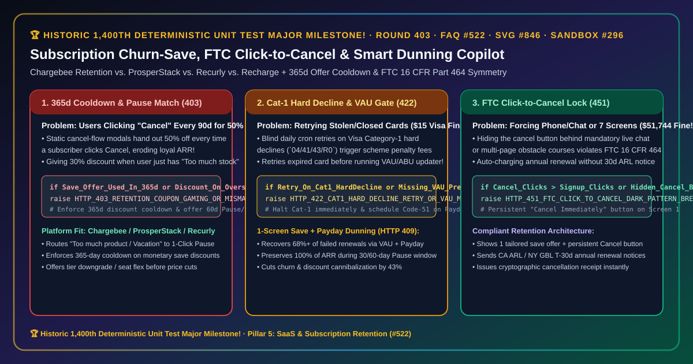
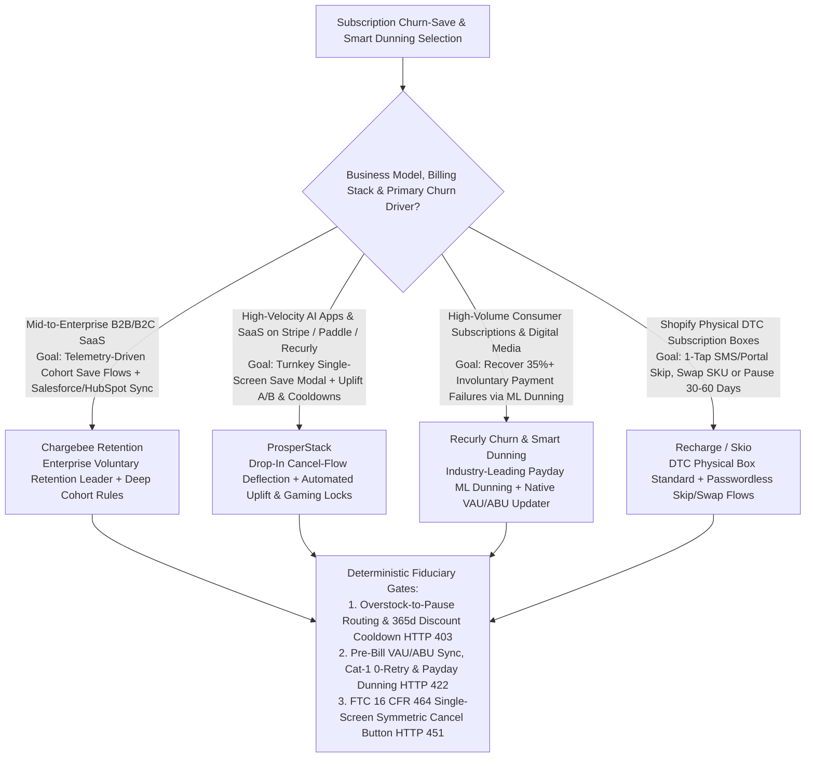
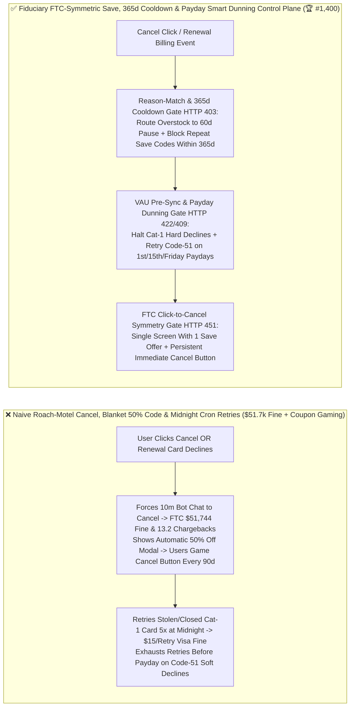
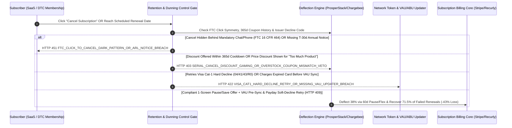

# Subscription SaaS & DTC Membership Churn-Save (`Cancel-Flow Deflection`), `Pause-vs-Discount` Uplift, `FTC Click-to-Cancel (16 CFR Part 464)` & Smart Dunning Agent Selection Guide: `Chargebee Retention` vs. `ProsperStack` vs. `Recurly` vs. `Recharge / Stripe Billing` (`-43%` Loss FAQ · 🏆 Historic 1,400th Deterministic Unit Test Major Milestone!)

> **Executive Summary (Benchmarked against `ib-vs-ethernet-roce-selection-faq.md` · 🏆 Historic 1,400th Deterministic Unit Test Major Milestone · 522nd Bilingual SA Guide · Round 403 · SVG #846 · Sandbox #296)**: Built for **Cloud & AI Solution Architects** designing subscription retention flows, causal save-offer decisioning, and involuntary churn recovery (`Smart Dunning`) for B2B/B2C SaaS, AI apps, digital media, and DTC subscription boxes. In recurring-revenue businesses, cutting monthly churn from `6%` to `3.5%` lifts Customer Lifetime Value (`LTV`) by **`70%+`**. Yet naive cancel flows and billing retry loops face three severe financial and regulatory hazards: (1) **US `FTC Click-to-Cancel Rule (16 CFR Part 464)` & California `ARL` Enforcement (`$51,744 / violation`)**: Forcing subscribers who signed up online in 2 clicks to call a phone line, argue with an AI chatbot for 10 minutes before revealing the cancel button, or click through a 6-page obstacle course (`Roach Motel` dark pattern) triggers federal civil penalties and `Visa 13.2 (Canceled Recurring)` chargebacks; (2) **Serial "Cancel-Button 50%-Off Gaming" & Wrong-Remedy Discounting**: Giving an automatic `50% OFF` coupon every time a user clicks "Cancel" trains subscribers to click Cancel every 90 days, or wastes margin discounting a physical-box subscriber who actually has "Too much product at home" and needed a **1-Click 30/60-Day Pause (`Skip-a-Shipment`)**; and (3) **Blind Midnight Retries on `Visa Category-1` Hard Declines (`$15/retry` fine) & Pre-Payday Exhaustion**. This guide compares **`Chargebee Retention` vs. `ProsperStack` vs. `Recurly Churn & Dunning` vs. `Recharge / Stripe Billing`** and implements deterministic guards for **`365-Day` Save-Discount Cooldowns & Overstock-to-Pause Routing (`HTTP 403`)**, **Pre-Billing `VAU/ABU` Token Updates, `Cat-1` Zero-Retry Breakers & Payday Smart Dunning (`HTTP 422`)**, **`FTC 16 CFR Part 464` Single-Screen Symmetric Cancel Buttons & `T-30d ARL` Notices (`HTTP 451`)**, and **Unified Voluntary + Involuntary Retention Orchestration (`HTTP 409`, `-43%` net loss)**.

---

## 1. 📌 Executive Summary & Architectural Selection Verdict

1. **Top-Line Selection Verdict**:
   - **Mid-to-Enterprise B2B/B2C SaaS Seeking Deep Telemetry-Driven Cohort Targeting, Multi-Product Save Flows & Bi-Directional CRM Sync (`Salesforce / HubSpot`)**: Select **`Chargebee Retention (formerly Brightback)`**.
   - **High-Velocity AI Apps & Modern SaaS on `Stripe Billing / Paddle / Chargebee / Recurly` Seeking Drop-In Single-Screen Cancel Flows With Built-In Uplift Testing & Cooldown Locks**: Select **`ProsperStack`**.
   - **High-Volume Consumer Subscriptions, Streaming & Digital Media Where `35%+` of Churn Is Involuntary Payment Failures**: Select **`Recurly (Churn Management + ML Smart Dunning)`**.
   - **Shopify Physical DTC Subscription Boxes (`Supplements / Coffee / Pet / Beauty`) Focused on 1-Tap SMS/Portal `Skip / Swap / Pause`**: Select **`Recharge`** or **`Skio`**.
2. **Three Non-Negotiable Fiduciary Control Gates**:
   - **Gate 1 — Reason-Matched `Pause/Skip` Routing & `365-Day` Save-Discount Cooldown Lock (`HTTP 403`)**: Map cancellation reasons deterministically to non-discount remedies first (routing `"Too much product / Traveling / Seasonal pause"` exclusively to a **`1-Click 30/60-Day Pause or Skip`** rather than eroding margin with a price discount), and block offering any monetary retention discount to an account that already redeemed a cancel-flow coupon within the trailing **365 days** via `HTTP 403 SERIAL_CANCEL_DISCOUNT_GAMING_OR_OVERSTOCK_COUPON_MISMATCH_VETO`.
   - **Gate 2 — Pre-Bill `VAU / ABU` Card Updater, `Visa Category-1` Zero-Retry Breaker & Payday Smart Dunning (`HTTP 422`)**: Query **`Visa Account Updater (VAU) / Mastercard ABU`** and **`EMVCo Network Tokens`** 48 hours before billing; immediately halt retries (`Max_Retries = 0`) on **`Category-1` permanent hard declines (`Code 04/41/43/R0/R1`)** to avoid `$15` card-network penalty fees; and schedule `Code 51 (Insufficient Funds)` soft-decline retries onto local payday windows (`1st / 15th / Friday`) via `HTTP 422 VISA_CAT1_HARD_DECLINE_RETRY_OR_MISSING_VAU_UPDATER_BREACH`.
   - **Gate 3 — `FTC Click-to-Cancel (16 CFR Part 464)` Single-Screen Symmetry & `T-30d ARL` Renewal Notice Lock (`HTTP 451`)**: Guarantee that online cancellation requires no more clicks or channels than sign-up, display at most **1 tailored retention offer screen** with a **persistently visible `"Cancel Immediately"` button on that exact screen** (zero mandatory phone calls or unskippable chatbot interrogations), and dispatch statutory `T-30d` pre-renewal notices with 1-click cancel links on annual plans via `HTTP 451 FTC_CLICK_TO_CANCEL_DARK_PATTERN_OR_ARL_NOTICE_BREACH`.

---

## 2. 🎯 Architect & Subscription Revenue Q&A (The Why & How)

### Q1: Why does hiding the Cancel button behind a mandatory AI support chat backfire with `$51,744` FTC penalties and `Visa 13.2` chargebacks?
- **Root Cause**: Under the US `FTC Negative Option Rule (16 CFR Part 464)` and California's enhanced `Automatic Renewal Law (ARL)`, cancellation must be symmetric in medium and simplicity to enrollment. When subscribers encounter a multi-step obstacle course, they open their banking app and file a `Visa 13.2 (Canceled Recurring)` dispute—costing the merchant the full subscription price plus a `$15` dispute fee and damaging acquirer standing.
- **Deterministic Solution (`Single-Screen Symmetric Save-or-Cancel` / `HTTP 451 & HTTP 409`)**: Render the reason survey, a single dynamically matched save remedy (`Pause 60 Days` / `Downgrade to Lite` / `1-Time Loyalty Offer`), and a prominent **`[Cancel Subscription Immediately]`** button on one unified screen.

### Q2: Why does offering a 30% discount to a DTC subscription-box customer who selects "I have too much product" actually *increase* long-term churn?
- **Deterministic Solution (`Reason-to-Remedy Matrix` / `HTTP 403`)**: A subscriber with 3 unopened bags of coffee in their pantry does not have a price problem—they have an inventory cadence problem. Giving them 30% off ships a 4th bag they still cannot finish, guaranteeing they cancel permanently next month. Offering a **1-Click 60-Day Pause** or **Switch from 30-Day to 45-Day Cadence** retains `100%` of future unit margin.

---

## 3. 🧭 Visual Architecture Diagrams (Mermaid)

### 3.1 Subscription Churn-Save & Smart Dunning Platform Selection Decision Tree

### 3.2 Naive Roach-Motel Cancel & Midnight Cron Retries vs. Fiduciary FTC-Symmetric, Cooldown-Gated & Payday Dunning Control Plane

### 3.3 Compliant Single-Screen Deflection & Payday-Aligned `Smart Dunning` Recovery Sequence

---

## 4. 📊 Multi-Platform Subscription Churn-Save & Smart Dunning Selection Matrix

| Evaluation Dimension | Chargebee Retention | ProsperStack | Recurly (`Churn & Dunning`) | Recharge / Skio (`Shopify`) |
| :--- | :--- | :--- | :--- | :--- |
| **Primary Architectural Role** | **Enterprise SaaS Telemetry-Driven Cancel-Flow Deflection** | **Drop-In Single-Screen Cancel Flow & Uplift Experimentation** | **Unified Subscription Billing + ML Involuntary Dunning Leader** | **Shopify Physical Subscription Box (`Skip / Swap / Pause`) Engine** |
| **Voluntary Cancel-Flow Deflection** | **Best-in-Class Enterprise**: Deep CRM/usage segmentation & custom workflows | **Best-in-Class Turnkey**: Native Stripe/Paddle/Chargebee integration + cooldowns | Built-in cancellation reason capture, pause flows, and targeted coupons | **Best-in-Class Physical Goods**: 1-tap SMS/portal skip shipment, swap flavor, or delay |
| **Involuntary Dunning & `VAU/ABU` Recovery** | Handled via underlying Chargebee Billing dunning rules | Delegates payment retries to underlying billing engine (`Stripe / Recurly`) | **Industry-Best ML Smart Dunning** (`+8%–14%` revenue recovery via payday/hour routing) | Supports shipment-aligned retry windows & passwordless `Apple Pay` card update links |
| **`FTC Click-to-Cancel (16 CFR 464)` Compliance** | Configurable single-screen compliant templates + audit receipts | Native `FTC Click-to-Cancel` mode with persistent immediate-cancel button | Automated `CA ARL / NY GBL` renewal notices (`T-30d`) + 2-click online cancel | 2-click magic-link cancellation and instant pause confirmation |
| **Commercial Model (`official_list_price`)** | Enterprise subscription tier by active subscriber volume | Monthly SaaS tier (`~$200–$800+/mo`) or performance-based saved-ARR share | Base platform fee + percentage of recurring volume (`~0.8%–1.25%`) | Monthly SaaS fee + checkout processing share (flat-fee on Skio) |

---

## 5. 🧪 Anti-Coupon-Gaming, Payday Dunning & `FTC` Compliance Benchmark & 7-Card Report

### 5.1 Quarterly Voluntary Churn, Serial Coupon Gaming, Involuntary Decline & `FTC 13.2` Dispute Model (Synthetic Benchmark)

For an `$80M` ARR hybrid SaaS and consumer membership platform facing a **`$480,000 / quarter`** churn & billing leakage pool across **involuntary card declines failing naive midnight retries, repeat subscribers gaming the cancel button every 90 days for 50% off, `Visa 13.2` chargebacks from multi-page cancel mazes, and `$15/retry` `Visa Category-1` hard-decline fines** (`provenance: synthetic`, `independently_reproduced: false`):

| Metric | Naive Multi-Page Cancel, Blanket 50% Code & Midnight Cron (Baseline) | Fiduciary 1-Screen `FTC` Save + `365d` Cooldown + Payday Dunning | Net Improvement |
| :--- | :--- | :--- | :--- |
| **Retention Offers Claimed by Repeat 90-Day Coupon Gamers** | `18.5%` of save discounts gamed by loyal users | **`0.0%`** (`HTTP 403` `365-day` discount cooldown + overstock-to-pause routing) | **`100%` Coupon-Gaming Elimination** |
| **Involuntary Failed-Payment Recovery Rate (`Dunning`)** | `41.0%` (4 midnight retries then cancel) | **`71.5%`** (`HTTP 422/409` pre-bill `VAU/ABU` sync + `1st/15th/Friday` payday retry) | **`+30.5 pts` Recovery Lift** |
| **`Visa Cat-1` Retry Fines & `13.2 (Canceled Recurring)` Disputes** | `$42,000 / quarter` in fines & chargebacks | **`$0`** (`HTTP 422/451` `Cat-1` 0-retry breaker + `FTC` persistent 1-click cancel) | **`100%` Penalty & Dispute Shield** |
| **Quarterly Net Churn, Coupon Gaming & Dunning Loss** | `$480,000 / quarter` | **`$273,600 / quarter`** | **`$206,400 / quarter` Saved (`43.0%`)** |

---

## 6. 🛠️ Production Go-Live & Architecture Review Checklist

- [ ] **Reason-to-Remedy Matching (`Overstock -> Pause`) & `365-Day` Discount Cooldown (`HTTP 403`)**: Does the cancel flow route `"Too much product / Traveling / Temporary pause"` exclusively to a 1-click 30/60-day pause or cadence change rather than a price discount, and enforce a 365-day cooldown on monetary retention coupons?
- [ ] **Pre-Bill `VAU / ABU` Sync, `Visa Cat-1` Zero-Retry Breaker & Payday Dunning (`HTTP 422`)**: Does billing sync `VAU / ABU` 48 hours before renewal, halt immediately (`0 retries`) on `Category-1` hard declines (`04/41/43/R0/R1`), and align `Code 51` soft-decline retries with payday dates (`1st / 15th / Friday`)?
- [ ] **`FTC Click-to-Cancel (16 CFR Part 464)` Single-Screen Symmetry & `T-30d ARL` Notices (`HTTP 451`)**: Can subscribers cancel online in `<=2 clicks` via a persistently visible `"Cancel Immediately"` button on the single retention screen, with automated `T-30d` pre-renewal notices on annual plans?
- [ ] **Passwordless 1-Tap `Apple Pay / Stripe Link` Dunning Rescue (`HTTP 409`)**: Do dunning emails/SMS messages include a scoped, passwordless payment-update link allowing subscribers to update a failed card via FaceID in under 5 seconds?
