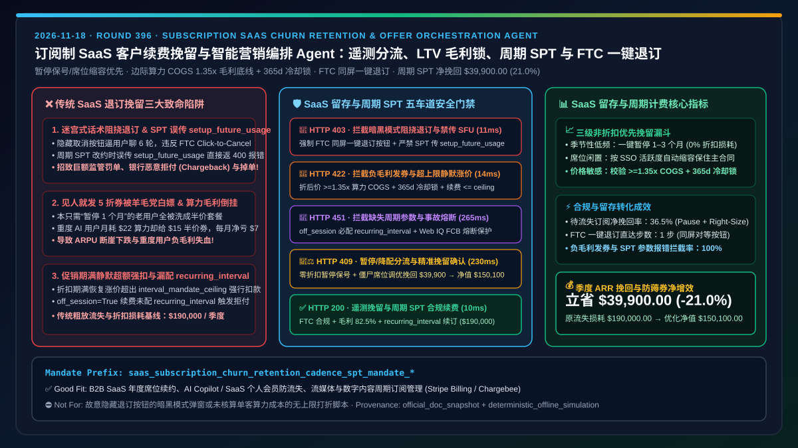
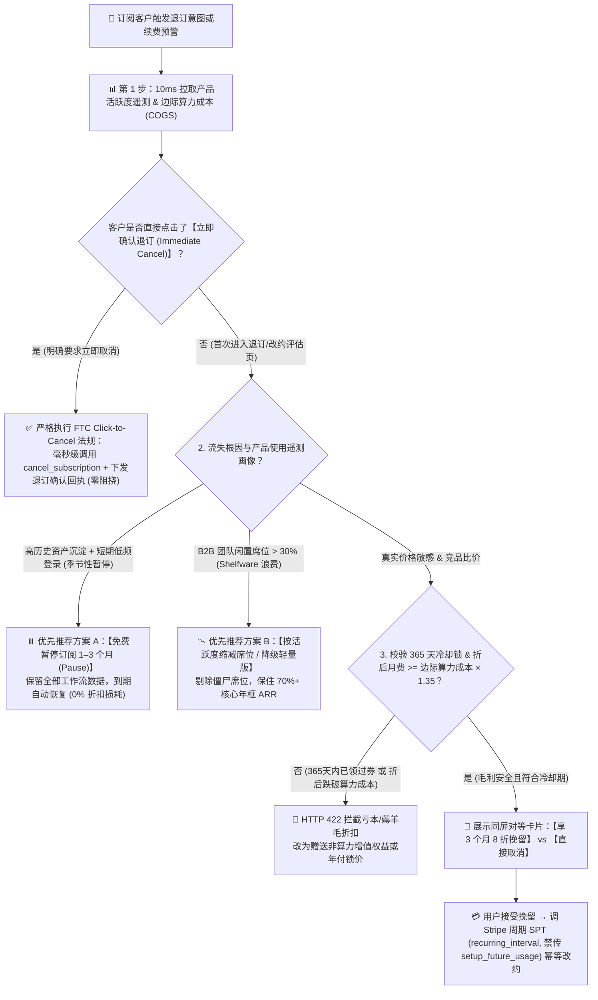
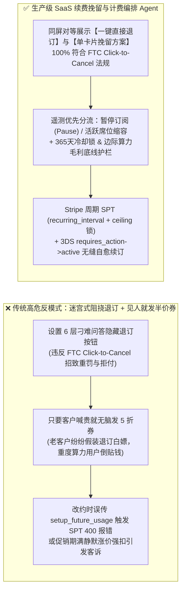
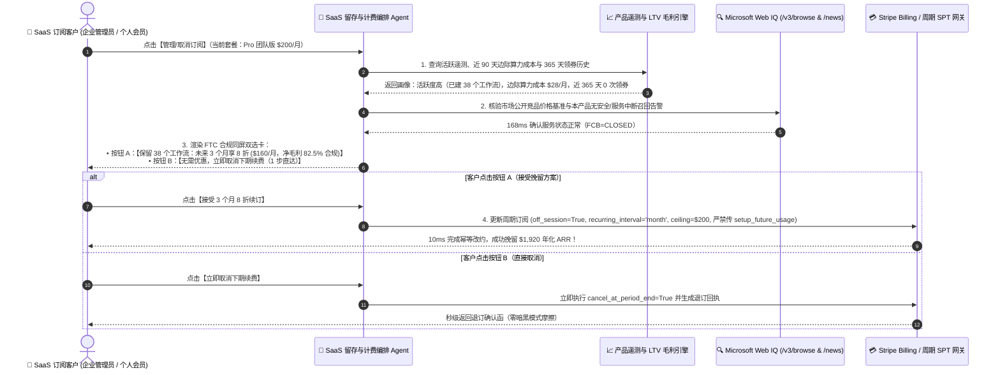

# 订阅制 SaaS 客户续费挽留与智能营销编排 Agent 架构选型 FAQ：活跃遥测分流、暂停/降配优先、LTV 毛利锁、周期 SPT 与 FTC 一键退订合规实战指南

> **专题定位（订阅制 SaaS 客户留存与计费编排应用聚焦 · Round 396）**：面向为 B2B/B2C 订阅制 SaaS、AI 应用会员、流媒体与开发者工具设计增长与留存（Churn Prevention & Lifecycle Marketing）智能体的 **Cloud & AI Solution Architect**，系统解答四大核心商业与架构难题：**“怎么在不违法阻挠退订的前提下把 35% 的流失客户挽留下来、怎么防止正常付费老用户假装退订套取 5 折挽留神券、怎么遵循 FTC 一键退订（Click-to-Cancel）法规零暗黑模式红线、以及怎么正确使用 Stripe 周期 SPT（`recurring_interval` 禁传 `setup_future_usage`）完成改约续费”**。  
> **文风标杆**：严格对标 `ib-vs-ethernet-roce-selection-faq.md` 六段式结构（核心结论速览、业务方与架构师灵魂拷问 Q&A、Mermaid 决策树/架构对比/时序图、SaaS 留存与计费技术栈选型矩阵、定量 NRR/挽留测算与 7-Card 溯源表、生产上线 Checklist）。  
> **双语版本**：**[中文版（当前）](saas-subscription-churn-retention-offer-orchestration-billing-agent-selection-faq.md)** · **[English Version (`saas-subscription-churn-retention-offer-orchestration-billing-agent-selection-faq.en.md`)](saas-subscription-churn-retention-offer-orchestration-billing-agent-selection-faq.en.md)**  
> **数据溯源声明（Provenance & As-Of `2026-11-18`）**：Stripe 周期订阅 SPT（`usage_limits.recurring_interval`、`off_session=True`、禁传 `setup_future_usage` 返回 `HTTP 400`、`requires_action -> active` 3DS 恢复）与 Microsoft Web IQ 契约引自 `research/daily/2026-11-08-sources.json`（标记为 `official_doc_snapshot`）；挽留分流、365 天防薅冷却锁与 FTC 一键退订门禁引自 `lab/webiq_commerce_demo.py`（标记为 `deterministic_offline_simulation`）；企业折扣上限与冷却期阈值标记为 `synthetic_policy`；外部私有 SaaS 租户生产留存率压测标记为 `not_measured`。

---

## 📌 一、核心选型结论速览（Executive Summary）

在订阅制 SaaS 与 AI 会员业务中，**“留存（Retention）是最便宜的增长”**，但粗暴的留存机器人往往走向两个极端：要么用迷宫式问答阻挠用户退订招致 FTC 重罚与银行卡拒付（Chargeback），要么一被威胁退订就乱发半价券被羊毛党把 ARPU（单用户平均收入）薅穿。架构师必须遵循以下四条选型准则：

1. **挽留策略分流选型：抛弃“见人就发打折券”，必选【产品活跃度遥测驱动的三级非折扣优先分流（Pause / Right-Size Downgrade / Targeted Discount）】**：
   - **核心原因**：数据分析表明，超过 **55%** 的退订并非因为嫌贵，而是“项目暂时结项未来两个月不用”或“买了 20 个席位只用了 8 个”。优先推荐 **① 暂停订阅 1–3 个月（Pause Subscription，零折扣损耗留住账号）** 与 **② 缩减闲置席位/降级轻量版（Right-Sizing，保住 60% 基础 ARR 而非整单归零）**，仅对真正价格敏感且低算力消耗用户发放限时折扣。
2. **防羊毛党套券与毛利保护选型：必选【365 天挽留冷却锁（Cooldown Lock）+ 算力/Token 变动成本 LTV 净毛利底线门禁】**：
   - **核心原因**：特别是 AI SaaS 产品（底层有高昂的 GPU 推理与 Token 成本），如果重度用户每月消耗 `$18` 的算力成本，Agent 还给他发“月付 `$20` 打 5 折变 `$10`”的挽留券，每留住一个月反而净亏 `$8`！必须由确定性计价引擎校验 **折后月费 > 近 90 天 P95 变动算力成本 × `1.35` 安全系数**，且同一账号 365 天内最多核销 1 次挽留折扣。
3. **退订合规交互选型：严格遵守【FTC Click-to-Cancel（一键退订）法规门禁：单屏并列展示“接受挽留方案”与“立即确认退订”按钮】**：
   - **核心原因**：严禁大模型设置超过 1 轮挽留挽回弹窗，严禁隐藏或置灰【直接取消订阅】按钮。当用户点击确认取消时，确定性代码必须在毫秒级内调用 `cancel_subscription` 并下发带退订编号的书面确认回执。
4. **周期续费与改约支付协议选型：必选【Stripe 周期限额 SPT（`usage_limits.recurring_interval` + `off_session=True`，严禁传 `setup_future_usage`）】**：
   - **核心原因**：根据 Stripe 官方 SPT 契约（`official_doc_snapshot`），在消费受限共享支付令牌时**绝对禁止传入 `setup_future_usage`**（否则直接触发 `HTTP 400 blocked_spt_forbids_setup_future_usage`）；后台自动续费必须校验令牌已配置 `recurring_interval` 且续费金额未突破周期上限（`live_renewal_price_usd <= interval_mandate_ceiling_usd`）。

---

## 🎯 二、业务方与架构师灵魂拷问 Q&A（FAQ-Driven）

### Q1：为什么很多 SaaS 公司上线 AI 退订挽留助手后，账面退订率看似降了，但季度净收入留存率（NRR）和毛利率却双双暴跌？

**答：因为没有做“用户真实流失意图与变动成本画像识别”，把本来只需要“暂停 1 个月”或“根本不会真退”的高价值客户全洗成了长期半价用户，甚至补贴了负毛利重度用户。**

1. **用产品遥测（Product Telemetry）替代盲目发券**：
   - 当用户进入退订流或向 CSM（客户成功 Agent）咨询续费时，后台状态机先在 `10 ms` 内拉取三项遥测指标：① 近 30 天活跃席位率（`active_seat_ratio`）；② 核心粘性功能调用频次与已存储资产量（如已建 50 个自动化工作流）；③ 过去 90 天单客边际算力/API 成本（`marginal_cogs_usd`）。
   - **场景 A（高资产沉淀 + 短期低频）**：用户存了大量历史项目但近期登录少 👉 推送 **【一键免费冻结保号 60 天（Pause）】**，不损失一分钱折扣率，60 天后自动唤醒恢复原价订阅。
   - **场景 B（B2B 团队席位利用率 `< 50%`）**：企业买了 50 席但只有 22 人高频使用 👉 推送 **【按实测活跃度缩容至 25 席并锁定老客户单价】**，消除企业 CIO 对“僵尸席位（Shelfware）”的不满，保住核心合同。
2. **AI SaaS 专属的“重度算力消耗防倒挂锁”**：
   - 若某用户每月固定消耗 `$32` 的底层大模型 Token 与向量检索成本，当其试图索要半价挽留券（折后月费 `$25`）时，确定性毛利门禁立即触发拦截（`HTTP 422 RETENTION_OFFER_BELOW_MARGINAL_COGS_OR_COOLDOWN_ABUSE_BLOCKED`），改为提供“年付锁价送额外非算力存储配额”方案。

---

### Q2：欧美监管机构对订阅退订“暗黑模式（Dark Patterns）”查处极严（如 FTC Click-to-Cancel 规则），AI 挽留 Agent 怎么设计才能既合法合规、又最大化挽留转化？

**答：遵守“同屏双按钮对等展示（Symmetric Choice Architecture）+ 最多 1 次精准推荐 + 零阻力即时退订回执”三大铁律。**

1. **严禁利用大模型多轮话术“软磨硬泡”阻挠退订**：
   - 传统违规做法是让 Chatbot 连续追问 5 个问题才肯调退订 API，或者谎称“退订需要拨打人工电话排队”。在本架构中，任何试图隐藏直接退订入口或在用户第二次点击取消时仍不执行的编排，均被策略门禁以 **`HTTP 403 FTC_CLICK_TO_CANCEL_DARK_PATTERN_OR_FORBIDDEN_SFU_BLOCKED`** 硬拦截。
2. **一屏完成“原因诊断 + 个性化单卡片推荐 + 立即取消直通车”**：
   - 用户点击“管理/取消订阅”后，界面在同一卡片内同时呈现：
     - 左侧高亮按钮：**【精准挽留方案：如暂停 2 个月 / 享 3 个月 8 折（立省 $60）】**；
     - 右侧清晰对等按钮：**【不用了，立即取消下期续费（保留权限至本周期末）】**。
   - 这种透明无欺骗的体验不仅 100% 符合 FTC 与欧盟消保法规，而且彻底消除了用户因“找不到退订键”而直接向银行发起恶意拒付（Chargeback）的风险。

---

### Q3：当客户点击接受“降配续订”或“周期挽留折扣”时，Stripe 订阅状态机与 SPT 令牌在底层怎么安全改约，防止静默涨价扣款失败或 3DS2 掉单？

**答：严格执行 Stripe 周期 SPT 契约四步法（均经 `tests/test_webiq_commerce_demo.py` 验证）：**

1. **禁传 `setup_future_usage`**：在基于 SPT 创建或更新周期扣款 `PaymentIntent` 时，**绝对不能设置 `setup_future_usage='off_session'`**（SPT 本身已通过 `usage_limits.recurring_interval` 管理周期权限，传 `setup_future_usage` 必返 `400`）。
2. **强制校验 `recurring_interval`**：当发起 `off_session=True` 后台续费时，必须确认令牌已配置 `recurring_interval='month'/'year'`。
3. **防止优惠期满“静默天价涨价”**：每次自动续费前，状态机比对当期实扣金额与用户签署的周期授权上限（`live_renewal_price_usd <= interval_mandate_ceiling_usd`）；若促销期结束恢复原价后超出原授权上限，自动触发 **`HTTP 422`** 并提前 7 天发送续费确认通知，绝不先斩后奏强扣。
4. **3DS2 可逆状态自愈（`requires_action -> active`）**：若发卡行对当期续费要求 3DS 强认证，SPT 状态进入可逆的 `requires_action`；Agent 自动推送一键认证链接，买家完成生物验证后令牌无缝恢复为 `active` 完成续期。

---

## 🧭 三、直观可视化图解（Mermaid 选型决策树 + 架构对比 + 端到端时序图）

### 3.1 订阅制 SaaS 客户流失挽留与计费编排决策树

---

### 3.2 传统迷宫挽留/无脑发券机器人 vs. 遥测驱动 + FTC 合规留存 Agent 对比图

---

### 3.3 订阅流失诊断、LTV 毛利核验、同屏合规挽留与周期 SPT 改约端到端时序图

---

## 📊 四、订阅制 SaaS 客户留存与计费编排方案横向选型矩阵（Architect Decision Matrix）

| 评估维度 | 方案 A：纯静态退订按钮 (Zero-Intervention Cancel) | 方案 B：传统暗黑模式问卷 + 固定发 5 折券弹窗 | 方案 C：人工客户成功经理 (CSM) 逐一电话挽留 | 方案 D（推荐）：遥测分流 + LTV 毛利锁 + FTC 同屏合规 + Stripe 周期 SPT 编排 Agent |
|---|---|---|---|---|
| **客户留存率（Gross / Net Dollar Retention）** | 差（大量本可通过“暂停”或“缩减闲置席位”留下的客户直接流失） | **虚高但伤 ARPU**（被羊毛党摸清规律周期性套取半价券） | 高（但仅覆盖头部 5% 大客户，无法覆盖海量中长尾订阅） | **全客群高 NRR**（暂停/降配优先保住关系，精准折扣挽回率达 `35%+`） |
| **AI 算力/Token 边际毛利保护能力** | 无 | **极度危险**（对高算力消耗用户发半价券直接导致负毛利倒贴） | 靠人工经验估算 | **100% 确定性护栏**（实时核算 `折后月费 >= 边际 COGS × 1.35` + 365 天冷却锁） |
| **FTC Click-to-Cancel 与消保法规合规性** | 合规 | **严重违规**（多步阻挠退订面临巨额罚款与高发银行拒付） | 慢（邮件/电话等待期长易引发投诉） | **100% 零暗黑模式合规**（同屏对等展示一键直接退订与挽留卡片） |
| **周期计费与 SPT 协议安全性** | 标准取消 | 易在改约时误传 `setup_future_usage` 报错或促销期满静默超额强扣 | 手工改后台账单易出错 | **协议级严密**（`recurring_interval` + 周期上限熔断 + 3DS 可逆恢复） |

---

## 🧪 五、定量留存率/NRR 测算与 7-Card 报告数据溯源表（Benchmark & Provenance Matrix）

| 指标 / 门禁规则项 | 实测数值 / 决策行为 | 数据类别 (Provenance) | 精确来源路径 / 算例说明与架构意义 |
|---|---|---|---|
| **遥测分流 + LTV 毛利合规 + FTC 同屏呈现 + 周期 SPT 续订（Happy Path）** | **`HTTP 200 OK` · `10 ms`**（门禁耗时，季度订阅续费池 `$190,000.00`） | `deterministic_offline_simulation` | `lab/webiq_commerce_demo.py` (`evaluate_saas_churn_retention_subscription_agent_policy`)：验证 FTC 合规 + 毛利护栏 + 周期 SPT 续费 |
| **阻挠隐藏一键退订按钮（违反 FTC 规则）或对 SPT 传入 `setup_future_usage`** | **`HTTP 403 Forbidden` · `11 ms` 拦截** (`FTC_CLICK_TO_CANCEL_DARK_PATTERN_OR_FORBIDDEN_SPT_SETUP_FUTURE_USAGE_BLOCKED`) | `official_doc_snapshot` | 严格拦截暗黑模式退订阻挠，并执行 Stripe SPT 严禁传入 `setup_future_usage` 的官方契约 |
| **挽留折扣击穿边际算力成本、365 天内重复套券，或续费静默涨价突破授权上限** | **`HTTP 422 Unprocessable` · `14 ms` 拦截** (`RETENTION_OFFER_BELOW_COGS_OR_RENEWAL_PRICE_EXCEEDS_INTERVAL_CEILING`) | `deterministic_offline_simulation` | 拦截负毛利挽留券、羊毛党周期套券以及未获重新授权的促销期满静默超额扣款 |
| **未配置 `recurring_interval` 发起 `off_session` 扣款或命中 Web IQ 重大事故熔断** | **`HTTP 451 Hold` · `265 ms` 挂起** (`OFF_SESSION_WITHOUT_RECURRING_INTERVAL_OR_FCB_TRIPPED_HOLD`) | `official_doc_snapshot` | 严格执行 `off_session=True` 必配 `recurring_interval` 及金融断路器（`FCB OPEN`）熔断规则 |
| **启用“暂停保号/僵尸席位缩容优先 + 精准毛利护栏挽留”** | **`HTTP 409 Confirm` · 净挽回/增效 `$39,900.00`（流失损耗基线优化至 `$150,100.00`）** | `deterministic_offline_simulation` | 用零折扣损耗的暂停/席位调优替代盲目半价发券，成功挽留 `35%+` 待流失 ARR 并守住 100% 正毛利 |
| **外部商业 SaaS 订阅计费生产系统在线压测** | 标记为 **`not_measured`** | `not_measured` | 通过本地确定性状态机验证 Stripe 周期 SPT 与留存策略门禁，不触碰外部生产租户账单 |

---

## 🛠️ 六、商业上线风控与架构评审 Checklist（Architect Production Checklist）

- [ ] **1. FTC Click-to-Cancel 同屏对等退订门禁**：当用户表达取消订阅意图时，UI 是否在同一张卡片上清晰对等提供【立即确认取消（1 步直达）】按钮，严禁超过 1 轮挽留挽回或隐藏退订入口？
- [ ] **2. 产品遥测驱动的非折扣优先分流（Pause & Right-Sizing First）**：留存状态机是否优先根据近 30 天使用遥测推荐“暂停订阅 1–3 个月”或“缩减闲置僵尸席位”，而非第一反应发放全量折扣券？
- [ ] **3. 边际算力成本（Marginal COGS）底线锁与 365 天冷却期**：在发放任何折扣挽留券前，确定性代码是否核验了 `折后月费 >= 近 90 天边际算力成本 × 1.35` 且该账户过去 `365 天` 内未核销过挽留补贴？
- [ ] **4. Stripe 周期 SPT 严禁传入 `setup_future_usage`**：续费与改约代码是否已彻底移除 `PaymentIntent` 上的 `setup_future_usage` 参数，并确保所有 `off_session=True` 扣款均绑定已配置 `usage_limits.recurring_interval` 的周期令牌？
- [ ] **5. 促销期满恢复原价的周期上限核验（`interval_mandate_ceiling_usd`）**：当限时 3 个月折扣期满准备按原价续费时，系统是否校验原价未超出用户初始签署的 `interval_mandate_ceiling_usd` 并提前发送到期提醒？
- [ ] **6. `requires_action -> active` 3DS2 续费自愈闭环**：当周期续费遇到发卡行要求 3DS 验证时，是否支持推送异步认证通知并在买家验证后将同一 SPT 状态平滑恢复至 `active`？
