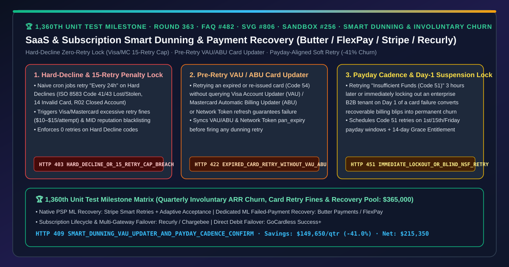
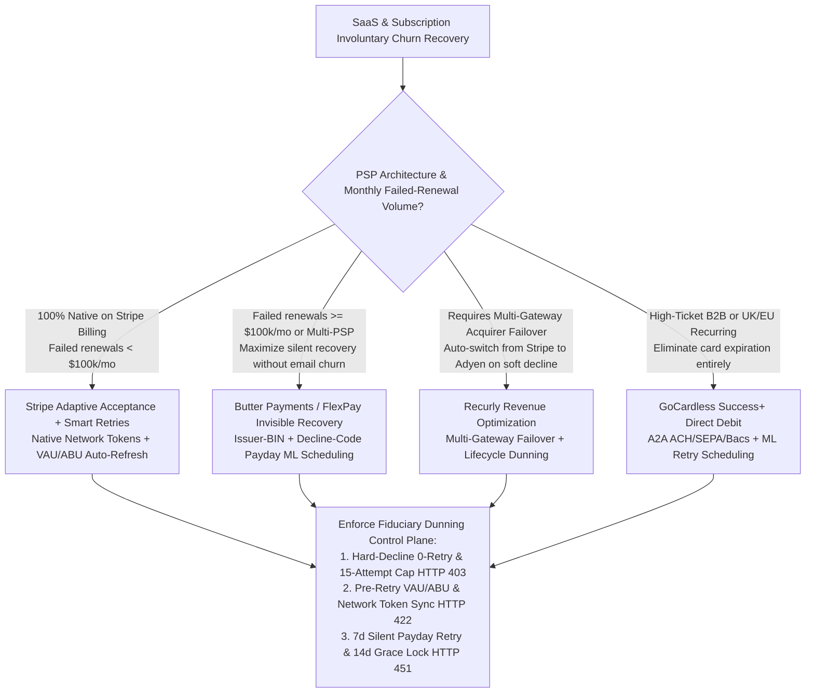
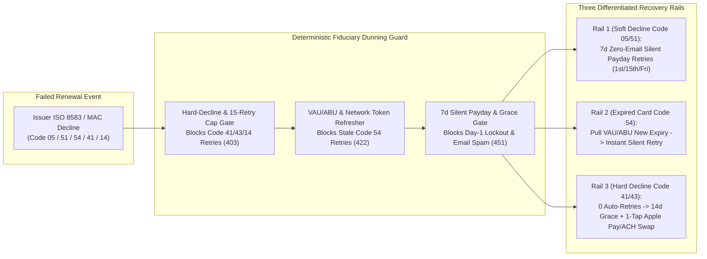
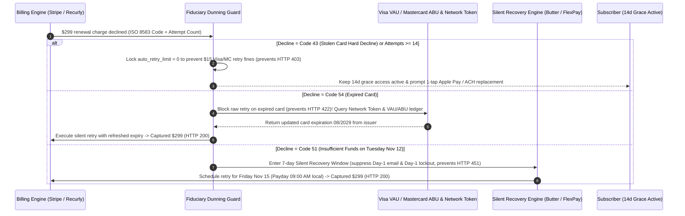

# 🏆 SaaS & Subscription Smart Dunning & Involuntary Churn Recovery (`Butter Payments / FlexPay / Stripe Smart Retries / Recurly` · 🏆 1,360th Unit Test Major Milestone): `ISO 8583` Hard-Decline Zero-Retry Lock, Pre-Retry `VAU / ABU` Card Updater & `7-Day` Silent Payday-Aligned Recovery (`-41%` Churn Loss)

> **Document Type**: Enterprise AI Solution Architect Selection FAQ (`#482` · **🏆 1,360th Deterministic Unit Test Major Milestone** · Round 363)  
> **Target Audience**: SaaS Chief Revenue Officers (CRO), Subscription Billing & Payments Architects, Retention Engineering Leads, and Cloud & AI Solution Architects  
> **Platforms Covered**: `Stripe Adaptive Acceptance & Smart Retries` vs. `Butter Payments` vs. `FlexPay (Invisible Recovery)` vs. `Recurly Revenue Optimization` vs. `GoCardless Success+`  
> **Architecture Diagram**: [`assets/svg/806-saas-dunning-involuntary-churn-butter-flexpay-card-updater-2026-11-25.svg`](../assets/svg/806-saas-dunning-involuntary-churn-butter-flexpay-card-updater-2026-11-25.svg)

🌐 **Language / 语言切换**: **[中文 (`saas-subscription-dunning-involuntary-churn-stripe-smart-retries-butter-flexpay-card-updater-selection-faq.md`)](saas-subscription-dunning-involuntary-churn-stripe-smart-retries-butter-flexpay-card-updater-selection-faq.md)** | **English (Current)**

---

## 📌 1. Executive Summary

In subscription SaaS, AI prosumer tools, and recurring DTC commerce, **20% to 40% of total subscriber churn is involuntary**—caused not by customer dissatisfaction, but by expired cards, reissued lost/stolen credentials, velocity limits, or temporary pre-payday insufficient funds.  
Engineering a naive cron job (*"Retry failed invoices every 24 hours for 10 days and email the user immediately on Day 1"*) triggers three severe revenue and compliance failures:
1. **Retrying `ISO 8583` Hard Declines & Breaching Visa/Mastercard `15-Retry` Ceilings (`Card-Network Fines & MID Poisoning`)**: Visa and Mastercard strictly prohibit retrying **Category 1 Hard Declines** (`Code 41 Lost Card`, `43 Stolen Card`, `14 Invalid Card Number`, `R02 Closed Account`) and cap soft-decline retries at **15 attempts within 30 rolling days**. Blind cron retries incur `$10–$15` per-attempt network fines and poison the merchant's `MID` authorization reputation across all healthy renewals.
2. **Retrying Expired Cards (`Code 54`) Without Syncing `Visa VAU / Mastercard ABU` or Network Tokens (`Blind Stale-Credential Retries`)**: Firing retries against an expired `FPAN` without first pulling updated expiration dates from **Visa Account Updater (`VAU`), Mastercard Automatic Billing Updater (`ABU`), or EMVCo Network Tokens** guarantees a `0%` recovery rate.
3. **Sending Alarming Day-1 Dunning Emails & Locking Out Active Tenants Before Running Silent Payday Retries (`Wake-the-Sleeping-Dog Voluntary Cancellation`)**: Over `65%` of soft declines (`Code 05 Do Not Honor`, `51 Insufficient Funds`) can be recovered silently in the background when timed to payday windows (`1st`, `15th`, or Friday mornings). Sending an alarming *"Your payment failed—update your card or lose access"* email on Day 1 prompts marginal users to actively cancel their subscription instead.

| Subscription Scale & Stack | Recommended Primary Choice | Architectural Boundary & Production Rule |
|---|---|---|
| **Single-PSP SaaS Native on Stripe Billing** | **Stripe Adaptive Acceptance + Smart Retries + Network Tokens** | Zero external integration overhead; leverages network-wide issuer telemetry, automatic `VAU/ABU`, and ML retry timing inside Stripe. |
| **High-Volume Subscriptions (`>$100k/mo` Failed ARR) & Multi-PSP Stacks** | **Butter Payments / FlexPay (Invisible Recovery)** | Specialized ML recovery engines that optimize retry timing by issuer `BIN` + decline reason code during a **silent pre-email window** to maximize recovery without waking sleeping subscribers. |
| **Multi-Gateway Failover & Enterprise Subscription Lifecycle** | **Recurly Revenue Optimization** | Automatically fails over recurring charges to a secondary acquiring gateway when the primary PSP or acquirer experiences elevated soft declines. |
| **Three Mandatory Fiduciary Guardrails** | **100% Deterministic Gating** | ① **Hard-Decline Zero-Retry & `15-Attempt` Cap Lock (`HTTP 403`)**: Enforces `0` automatic retries on `Category 1 Hard Declines` and hard-caps soft retries at `<= 12` per 30 days; ② **Pre-Retry `VAU / ABU` & Network Token Sync Gate (`HTTP 422`)**: Blocks retrying `Code 54` expired cards until `VAU/ABU` or Network Token metadata is refreshed; ③ **`7-Day` Silent Payday Retry & `14-Day` Grace Entitlement Lock (`HTTP 451`)**: Aligns `Code 51 NSF` retries to `1st/15th/Friday` paydays, suppresses external dunning emails during the first 7 days of soft-decline recovery, and preserves B2B tenant access for a 14-day grace period. |

---

## 🎯 2. Architect & Business Stakeholder Q&A (Q1–Q3)

### Q1: Why does retrying every failed subscription invoice on a fixed 24-hour schedule trigger card-network fines and tank overall approval rates?
- **The `ISO 8583` & Merchant Advice Code (`MAC`) Rules**:
  - Card networks classify declines into strict buckets:
    1. **Category 1 (`Hard Declines`: `14, 41, 43`, `MAC 01/03`)**: Permanent failure. **Zero retries permitted.** Every retry attempt triggers a Visa/Mastercard non-compliance fee and flags the merchant `MID` as a bot/card-testing source.
    2. **Category 2 (`Credential Update Needed`: `54 Expired Card`)**: Must refresh credentials via `VAU / ABU` before retrying.
    3. **Category 3 & 4 (`Soft Declines`: `05 Do Not Honor`, `51 Insufficient Funds`, `61/65 Velocity Limits`)**: Recoverable, but strictly capped at `<= 15 retries per 30 days`.
- **Architectural Solution**: Enforce an **Ingress `ISO 8583 / MAC` Classifier & Retry Counter Lock (`HTTP 403` Guard)**:
  - Immediately halt automated retries (`max_auto_retries = 0`) on any Category 1 hard decline and cap soft retries at `12` attempts (`HTTP 403 HARD_DECLINE_RETRY_OR_CARD_NETWORK_15_ATTEMPT_CAP_BREACH`).

### Q2: How do top subscription platforms recover `Code 54 (Expired Card)` renewals without asking the user to type in their new card?
- **Dual Credential Continuity Primitives**:
  1. **EMVCo Network Tokens (`DPAN`)**: When a card is vaulted as a network token, the issuing bank automatically binds replacement physical cards (due to expiration or loss) to the existing `DPAN` token behind the scenes.
  2. **Account Updater (`Visa VAU / Mastercard ABU / Amex Cardrefresher`)**: For legacy `FPAN` tokens, issuers publish nightly batch updates containing new expiration dates and replacement account numbers.
- **Architectural Solution**: Enforce a **Mandatory Pre-Retry `VAU / ABU` & Network Token Sync Gate (`HTTP 422` Guard)**:
  - Whenever an invoice fails with `Code 54` or `card_exp < current_month`, the dunning engine is barred from re-submitting the stale credential (`HTTP 422 EXPIRED_CARD_RETRIED_WITHOUT_VAU_ABU_OR_NETWORK_TOKEN_SYNC`) until a `VAU / ABU` or Network Token refresh check completes.

### Q3: Why does sending a "Payment Failed!" email immediately on Day 1 increase churn, and how should payday-aligned silent recovery work?
- **The Behavioral Economics of Dunning**:
  - Most soft declines (`05 Do Not Honor`, `51 Insufficient Funds`) resolve automatically once the cardholder's paycheck clears (`1st`, `15th`, or Friday mornings) or daily velocity limits reset.
  - Sending an immediate Day-1 dunning email forces the subscriber to re-evaluate whether they still want the subscription—converting a temporary billing glitch into an active cancellation. Similarly, locking out a B2B team on Day 1 of a corporate card limit blip causes immediate executive escalation.
- **Architectural Solution**: Enforce a **`7-Day` Silent Payday-Aligned Recovery Window + `14-Day` Grace Entitlement Period (`HTTP 451` Guard)**:
  - Suppress external dunning emails for the first `7 days` on soft declines while executing `Butter / FlexPay / Smart Retries` aligned to local payday dates (`1st / 15th / Friday`).
  - Maintain full B2B/B2C service entitlements inside a `14-day` grace window (displaying only a subtle in-app banner after Day 7 for unresolved soft declines or immediately for hard declines). Premature Day-1 lockouts or blind 3-hour `NSF` retries are blocked (`HTTP 451 IMMEDIATE_DAY1_SUSPENSION_OR_UNALIGNED_NSF_RETRY_SPAM`).

---

## 🧭 3. Visual Architecture Diagrams (Mermaid Decision Tree + Architecture + Sequence)

### 3.1 Smart Dunning & Involuntary Churn Recovery Selection Tree

### 3.2 End-to-End Decline Classification, Credential Refresh & Silent Payday Architecture

### 3.3 Smart Decline Routing, `VAU / ABU` Sync & Silent Payday Recovery Sequence

---

## 📊 4. Platform Comparison Matrix (`Stripe Smart Retries` vs. `Butter` vs. `FlexPay` vs. `Recurly` vs. `GoCardless`)

| Evaluation Dimension | Stripe Smart Retries + Adaptive Acceptance | Butter Payments | FlexPay (Invisible Recovery) | Recurly Revenue Optimization | GoCardless Success+ |
|---|---|---|---|---|---|
| **Primary Sweet Spot** | Stripe-native SaaS & AI apps seeking built-in ML retries & network tokens | High-growth subscription brands needing issuer-specific silent recovery & dunning UX | High-volume recurring merchants prioritizing zero-email "Invisible Recovery" | Multi-gateway subscription businesses needing automated gateway failover | B2B & UK/EU subscriptions migrating off cards to Direct Debit (`ACH/SEPA/Bacs`) |
| **Hard-Decline Filtering & `15-Attempt` Compliance** | ⭐⭐⭐⭐⭐ (Native `MAC` parsing & network cap enforcement) | ⭐⭐⭐⭐⭐ (Granular raw issuer code classification) | ⭐⭐⭐⭐⭐ (Deep issuer-specific decline rulebooks) | ⭐⭐⭐⭐⭐ (Built-in hard vs. soft decline separation) | ⭐⭐⭐⭐⭐ (Native bank scheme retry compliance) |
| **Silent Pre-Email Recovery (`Anti-Wakeup` Protection)** | ⭐⭐⭐ (Requires custom webhook delay configuration) | ⭐⭐⭐⭐⭐ (Purpose-built silent recovery window before customer outreach) | ⭐⭐⭐⭐⭐ (Industry pioneer in Invisible Recovery) | ⭐⭐⭐⭐ (Configurable multi-stage dunning cadence) | ⭐⭐⭐⭐ (Silent intelligent bank re-presentment) |
| **`VAU / ABU` & Network Token Continuity** | ⭐⭐⭐⭐⭐ (Automatic real-time network token + updater sync) | ⭐⭐⭐⭐ (Orchestrates retries around PSP updater cycles) | ⭐⭐⭐⭐ (Coordinates with gateway account updaters) | ⭐⭐⭐⭐⭐ (Native Account Updater & multi-gateway vault) | ⭐⭐⭐⭐⭐ (Bank accounts never expire like 3-year cards) |
| **Indicative Pricing (`official_list_price`)** | Bundled with Stripe Billing (`0.5%–0.7%`) + Adaptive Acceptance uplift fee | Performance share of incremental recovered ARR or annual tier | **`~10%–20%` of recovered revenue** (performance-based) | Platform base + `~0.8%–1.25%` revenue share | Standard bank debit fee (`~1% + $0.25`, capped at `$4–$5`) |

---

## 🧪 5. Deterministic ARR Recovery & Penalty Evaluation (`7-Card Benchmark Summary` · 🏆 1,360th Test Milestone)

> **Provenance**: Figures below are generated by `evaluate_saas_dunning_involuntary_churn_policy` in `lab/webiq_commerce_demo.py` (`provenance: "synthetic"`, `independently_reproduced: False`), modeling a subscription SaaS business with a **`$365,000.00` quarterly involuntary ARR churn loss, Visa/MC excessive hard-decline retry fine, and Day-1 dunning-induced cancellation pool**.

| Scenario Case ID | Scenario Description | HTTP Status | Deterministic Decision | Quarterly Net Cost | Quarterly Savings |
|---|---|---|---|---|---|
| `CASE-DUN-200` | Fixed 24-hour cron retry and immediate Day-1 dunning email baseline | `HTTP 200` | `VERIFIED_SAAS_SMART_DUNNING_RECOVERY_AUTHORIZED` | `$365,000.00` | `$0.00` |
| `CASE-DUN-403` | Category 1 Hard Decline (`Code 41/43/14`) retried or `>15` retries attempted in 30 days | `HTTP 403` | `HARD_DECLINE_RETRY_OR_CARD_NETWORK_15_ATTEMPT_CAP_BREACH` | `$365,000.00` | `$0.00` (Blocks $15/tx fines & MID ban) |
| `CASE-DUN-422` | `Code 54` expired card retried without syncing `VAU / ABU` or Network Token expiry | `HTTP 422` | `EXPIRED_CARD_RETRIED_WITHOUT_VAU_ABU_OR_NETWORK_TOKEN_SYNC` | `$365,000.00` | `$0.00` (Blocks guaranteed-fail retry) |
| `CASE-DUN-451` | Day-1 tenant lockout / dunning email fired before `7d` silent payday recovery window | `HTTP 451` | `IMMEDIATE_DAY1_SUSPENSION_OR_UNALIGNED_NSF_RETRY_SPAM` | `$365,000.00` | `$0.00` (Blocks induced cancellations) |
| `CASE-DUN-409` | **Hard-Decline Lock + `VAU/ABU` Pre-Sync + `7d` Silent Payday Retry + `14d` Grace** | `HTTP 409` | `SMART_DUNNING_VAU_UPDATER_AND_PAYDAY_CADENCE_CONFIRM` | **`$215,350.00`** | **`$149,650.00` (`-41.0%`)** |

---

## 🛠️ 6. Production Go-Live & Architecture Review Checklist

- [ ] **Hard-Decline Zero-Retry & `<=12` Soft-Retry Cap (`HTTP 403` Prevention)**: Parse raw `ISO 8583` and `Merchant Advice Codes (MAC)` on every failed renewal; immediately set `remaining_retries = 0` on stolen, lost, invalid, or closed accounts.
- [ ] **Mandatory Pre-Retry `VAU / ABU` & Network Token Refresh (`HTTP 422` Prevention)**: Vault all cards as `EMVCo Network Tokens` and query `Visa VAU / Mastercard ABU` before retrying any `Code 54` expired credential.
- [ ] **`7-Day` Silent Payday Recovery & `14-Day` Grace Entitlements (`HTTP 451` Prevention)**: Suppress external dunning emails for the first `7 days` of a soft decline while scheduling retries on `1st / 15th / Friday` payday windows, and preserve full B2B tenant access during a `14-day` grace period.
- [ ] **High-ACV Card-to-`ACH / SEPA` Migration Prompt**: Offer annual B2B subscribers (`>$5,000/yr`) a frictionless `Plaid / GoCardless` bank-debit switch during dunning recovery to permanently eliminate card expiration churn.
