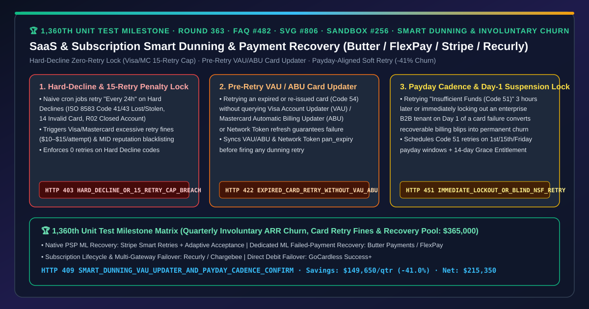
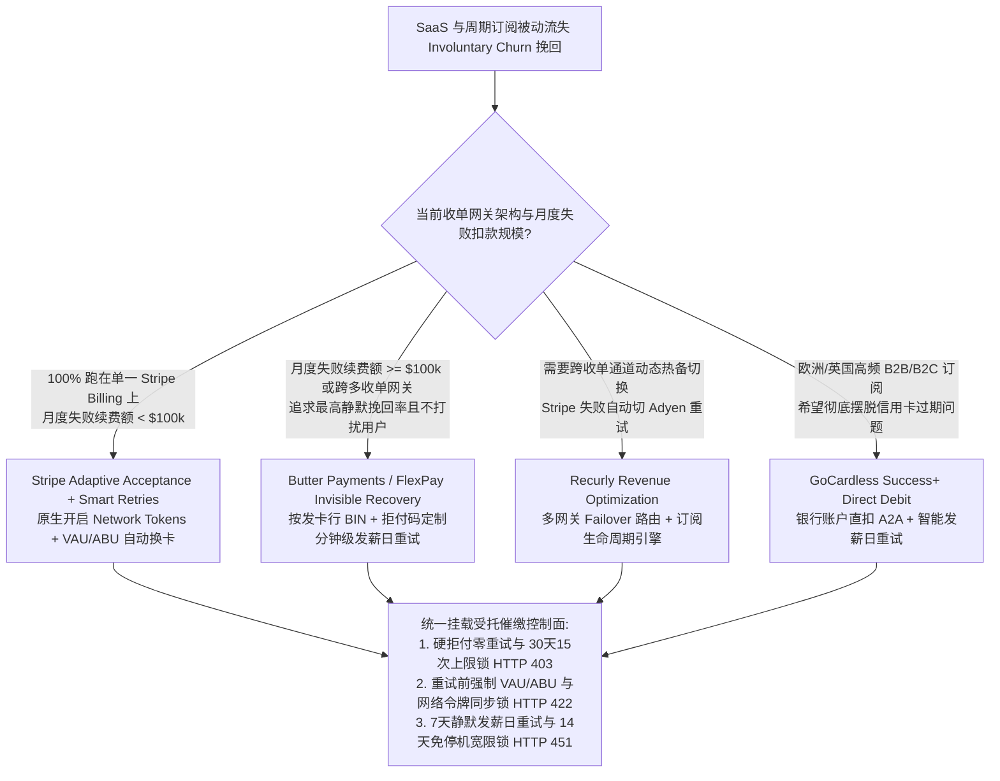
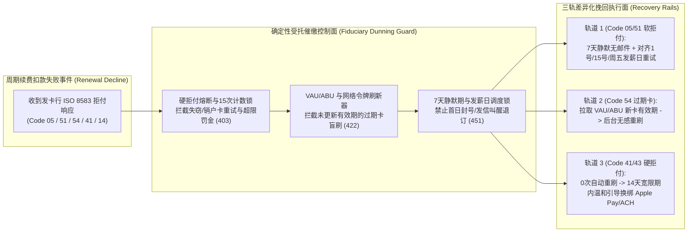
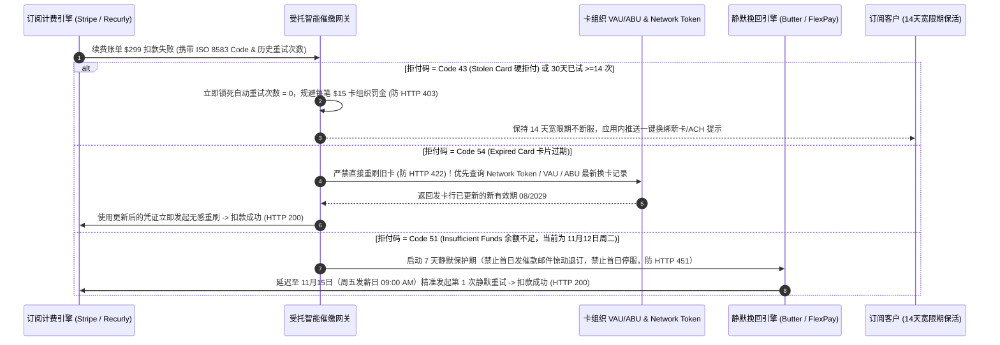

# 🏆 SaaS 与订阅电商被动流失挽回与智能催缴重试智能体（`Involuntary Churn & Smart Dunning`: `Butter Payments / FlexPay / Stripe Smart Retries / Recurly` · 🏆 第 1,360 项单元测试重大里程碑）：硬拒付零重试防卡组织罚金（`ISO 8583 Hard Decline Lock`）、重试前卡号自动换新（`Visa VAU / Mastercard ABU`）与发薪日窗口（`1st / 15th Payday Retry`）净省 41% 指南

> **文档类型**：企业级 AI Solution Architect 选型决策指南（Selection FAQ · `#482` · **🏆 第 1,360 项确定性单元测试重大里程碑** · Round 363）  
> **适用读者**：SaaS 首席营收官（CRO）、订阅计费与支付架构师、增长留存负责人与 Cloud & AI Solution Architect  
> **核心覆盖平台**：`Stripe Adaptive Acceptance & Smart Retries` vs. `Butter Payments` vs. `FlexPay (Invisible Recovery)` vs. `Recurly Revenue Optimization` vs. `GoCardless Success+`  
> **关联架构图**：[`assets/svg/806-saas-dunning-involuntary-churn-butter-flexpay-card-updater-2026-11-25.svg`](../assets/svg/806-saas-dunning-involuntary-churn-butter-flexpay-card-updater-2026-11-25.svg)

🌐 **语言切换 / Language**: **中文 (当前)** | **[English (`saas-subscription-dunning-involuntary-churn-stripe-smart-retries-butter-flexpay-card-updater-selection-faq.en.md`)](saas-subscription-dunning-involuntary-churn-stripe-smart-retries-butter-flexpay-card-updater-selection-faq.en.md)**

---

## 📌 一、核心选型结论速览（Executive Summary）

在订阅制 SaaS、AI 会员工具与周期购电商（Subscription Box）中，**高达 20%–40% 的总客户流失并非因为客户不喜欢产品（主动退订），而是因为信用卡过期、挂失换卡、单日限额或发薪日前夕余额不足导致的扣款失败——即“被动流失（`Involuntary Churn`）”**！  
如果工程团队自己写一个粗糙的定时任务（如“扣款失败后每隔 24 小时无脑重试一次，连试 10 次，失败就立刻封禁客户账号并群发刺眼的红色催款邮件”），企业将同时踩中三大败局：
1. **对“挂失卡/销户卡（`Hard Decline`）”无脑重复发起扣款，触发 Visa / Mastercard 超限重试高额罚金并拉黑商户收单号（`MID Reputation Poisoning`）**：Visa 与 Mastercard 严禁对硬拒付代码（如 `Code 41 Lost Card`、`43 Stolen Card`、`14 Invalid Card`）发起任何重试，且对软拒付也严格限制 **30 天内最多重试 `15 次`**。违规暴力重试不仅每次被罚 `$10–$15`，更会导致发卡行把该商户的正常续费也当成盗刷测卡攻击（Card Testing）集体拦截！
2. **卡片早已到期换新（`Code 54 Expired Card`），却不先调卡组织账户更新器（`VAU / ABU`）而对着旧有效期死磕（`Blind Retry Without Card Updater`）**：持卡人银行卡到期后银行寄了新卡（卡号或有效期已变），如果不先通过 **网络令牌（Network Token）或 `Visa Account Updater (VAU) / Mastercard ABU`** 拉取新有效期就盲目重刷旧卡，刷 100 次也是 100% 失败。
3. **对“余额不足（`Code 51 Insufficient Funds`）”在 3 小时后原地重刷，并在扣款失败第 1 天立刻停掉企业客户生产权限或狂发催款信，把“被动扣款小故障”逼成“主动永久退订”（`Immediate Lockout & Dunning Email Induced Churn`）**：很多平时低频使用的用户根本没注意还在续费，收到一封吓人的 `"您的付款失败，请立即点此绑新卡"` 邮件后，干脆顺手点了“取消订阅”！

| 选型维度与订阅规模 | 推荐主选方案 | 适用边界与架构落地准则 |
|---|---|---|
| **已全量使用 Stripe Billing 的中大型 SaaS 与 AI 订阅** | **Stripe Adaptive Acceptance + Smart Retries + Network Tokens** | 零外部集成成本，直接在收单底层利用数十亿笔全局发卡行水位数据动态微调报文（MCC/MID/Token）并择时重试。 |
| **多支付网关（Braintree / Adyen / Stripe）之上追求极致净挽回率** | **Butter Payments / FlexPay** | 专注于“静默无感挽回（Invisible Recovery）”的机器学习专业引擎，针对每个发卡行（Chase / BofA / Capital One）与特定拒付原因码定制到分钟级的发薪日重试策略，尽量不发催款邮件惊动用户。 |
| **全生命周期多网关故障转移（Multi-Gateway Failover）订阅管理** | **Recurly** | 擅长当主通道收单行偶发故障时，自动将续费请求无缝切至备用收单通道重试。 |
| **三大确定性风控红线** | **100% 强制拦截** | ① **硬拒付零重试与 30天 15次上限锁（`HTTP 403`）**：命中 `ISO 8583 Category 1 Hard Decline` 立即终止自动重试（0 次重试），软拒付严格封顶 `< 15 次/30d`；② **重试前强制同步 `VAU / ABU` 与网络令牌锁（`HTTP 422`）**：针对过期卡或换卡代码（`54 / 14`），未完成 `VAU/ABU` 更新或网络令牌刷新前严禁重刷旧卡；③ **发薪日（`1号/15号/周五`）对齐重试与 `14 天` 静默宽限期锁（`HTTP 451`）**：`Code 51` 余额不足强制对齐发薪日窗口重试，且前 7 天禁止发催款邮件骚扰用户、前 14 天禁止粗暴关停 B2B 客户生产环境。 |



---

## 🎯 二、业务方与架构师灵魂拷问 Q&A（Q1–Q3）

### Q1：同样是续费扣款失败，为什么发卡行返回的 `ISO 8583` 拒付代码决定了“有的绝对不能再试、有的必须换时间试”？
- **卡组织四类拒付分类标准（Visa / Mastercard Decline Categories）**：
  1. **Category 1 — 永久硬拒付（`Hard Declines`：如 `04 Pick Up Card`, `14 Invalid Card Number`, `41 Lost Card`, `43 Stolen Card`, `R02 Closed Account`）**：卡片已永久作废或被盗挂失。**卡组织明确规定重试次数上限为 `0 次`**！继续重刷不仅 100% 失败，还会被 Visa 处以超标罚金并降低商户全盘信用分。
  2. **Category 2 — 凭证过期/变更（`Credential Lifecycle`：如 `54 Expired Card`, `33`）**：不可直接重刷原卡面，必须先等待或触发 `VAU / ABU` 换新凭证后再刷。
  3. **Category 3 — 临时资金/限额不足（`Soft Declines - Funds`：如 `51 Insufficient Funds`, `61 Exceeds Withdrawal Limit`, `65 Activity Count Limit`）**：最适合对齐发薪日或次月初额度重置时点重试。
  4. **Category 4 — 发卡行系统超时或通用风控（`Generic / System Soft Declines`：如 `05 Do Not Honor`, `91 Issuer Unavailable`）**：适合间隔数小时或切换网络令牌密文重试。
- **架构解法**：在催缴状态机入口部署 **`ISO 8583 / RAW MAC` 拒付代码硬分类拦截器（防 `HTTP 403`）**：凡命中 Category 1 硬拒付或滚动 30 天累计重试达 `14 次` 的账单，立即物理锁死自动刷卡接口（`HTTP 403 HARD_DECLINE_RETRY_OR_CARD_NETWORK_15_ATTEMPT_CAP_BREACH`），转入应用内温和换卡引导。

### Q2：客户实体信用卡到期换了新卡，为什么他从来没来我们网站改过卡号，头部 SaaS 公司却能继续扣款成功？
- **两大底层换卡黑科技**：
  1. **卡组织网络令牌（`EMVCo Network Tokens`）**：在客户首次绑卡时，将 16 位明文卡号（`FPAN`）置换为卡组织签发的网络令牌（`DPAN`）。当客户挂失旧卡或到期换新卡时，发卡行在卡组织后台自动将新卡绑定到同一个 `DPAN` 上，商户端根本不需要改任何东西就能无感继续扣款！
  2. **自动账单更新器（`Visa Account Updater - VAU` / `Mastercard ABU` / `Amex Cardrefresher`）**：对于历史存量非网络令牌卡，发卡行每天向 VAU/ABU 批量同步最新换发的卡号与新有效期。
- **架构解法**：实施 **过期卡重试前强制 `VAU / ABU & Network Token` 预同步门禁（防 `HTTP 422`）**：
  - 当收到 `Code 54 (Expired Card)` 或发现卡片 `exp_month / exp_year < current_month` 时，严禁对着旧过期卡直接调 `POST /charges`（拦截 `HTTP 422 EXPIRED_CARD_RETRIED_WITHOUT_VAU_ABU_OR_NETWORK_TOKEN_SYNC`）；必须先查询 `VAU / ABU` 更新账本，若拿到新有效期则立即静默重刷，若确认无更新记录再向客户发送一键 Apple Pay / Passkey 换卡链接。

### Q3：为什么“扣款失败第 1 秒就给客户发邮件催款”反而会让客户流失率翻倍？什么叫“静默挽回期（Silent Recovery Window）”？
- **行为经济学反直觉真相（The Wake-the-Sleeping-Dog Effect）**：
  - 数据统计表明，超过 **65% 的软拒付（如 `05 Do Not Honor` 或 `51 Insufficient Funds`）只要在接下来 `1–14 天` 的发薪日（每月 `1 号`、`15 号` 或周五上午）通过后台算法静默重试，根本不需要用户做任何操作就能自己扣款成功**！
  - 反之，如果你在第 1 天失败瞬间就给用户发一封红色警告邮件 `"您的 $49 月度订阅扣款失败，请立即登录更新信用卡"`，很多处于边际犹豫状态的客户看到邮件后想：“正好我这阵子忙没怎么用，干脆取消算了”——一封愚蠢的催款邮件亲手把 **静默可挽回的被动失败** 变成了 **不可逆的主动退订**！
  - 对于企业 B2B 客户，第 1 天就因为公司采购卡额度刷爆而直接关停全公司 200 名员工的登录权限，更会引发严重生产事故投诉。
- **架构解法**：强制执行 **`7 天` 静默算法挽回期 + 发薪日节奏对齐 + `14 天` B2B 权限宽限期锁（`Silent Recovery & Grace Entitlement Lock` · 防 `HTTP 451`）**：
  - **Day 1 – Day 7（100% 静默期）**：对于软拒付，严禁发送任何外部催款邮件/短信！由 `Butter / FlexPay / Smart Retries` 对齐客户所在国发薪日窗口（1号/15号/周五）静默重试 3–4 次；
  - **Day 8 – Day 14（温和提醒与宽限保活）**：若静默重试仍未成功，在应用内顶部展示非阻断横幅并提供 `14 天` 完整服务宽限期（Grace Period）。任何在软拒付首日立即封号、首日群发催款信、或在 `Code 51` 后间隔几小时盲目重刷的行为直接拦截（`HTTP 451 IMMEDIATE_DAY1_SUSPENSION_OR_UNALIGNED_NSF_RETRY_SPAM`）。

---

## 🧭 三、直观可视化图解（Mermaid 选型决策树 + 智能催缴架构图 + 时序图）

### 3.1 订阅被动流失挽回与智能催缴（Smart Dunning）平台选型决策树



### 3.2 端到端拒付码分流、无感换卡与 7 天静默发薪日挽回架构图



### 3.3 智能拒付码识别、静默发薪日挽回与防误封号时序图



---

## 📊 四、主流订阅被动流失挽回与智能催缴平台横向选型矩阵

| 评估维度 | Stripe Smart Retries + Adaptive Acceptance | Butter Payments | FlexPay (Invisible Recovery) | Recurly Revenue Optimization | GoCardless Success+ |
|---|---|---|---|---|---|
| **核心技术机制** | 收单底层全局发卡行 ML 重试 + 报文自适应调优 + 原生网络令牌 | 面向现代订阅品牌的发卡行级精细化静默挽回与催缴编排 | 专注“零用户打扰（Invisible Recovery）”的拒付码级 AI 重试引擎 | 多网关订阅管理 + 跨收单通道自动故障切换（Gateway Failover） | 银行账户直扣（ACH / SEPA / Bacs）+ 失败账单智能择日重扣 |
| **硬拒付识别与卡组织 15 次上限保护** | ⭐⭐⭐⭐⭐（原生识别 MAC 码并自动遵守 Visa/MC 次数红线） | ⭐⭐⭐⭐⭐（极细粒度解析原始收单行返回码，0 违规罚金） | ⭐⭐⭐⭐⭐（内置全球数千家发卡行专属规则库） | ⭐⭐⭐⭐⭐（原生区分 Hard vs Soft Decline 策略） | ⭐⭐⭐⭐⭐（遵循各清算所 ACH/Bacs 重试限制） |
| **对“发催款信诱发主动退订”的抑制能力** | ⭐⭐⭐（需商户自行配置延迟发送 Webhook 邮件） | ⭐⭐⭐⭐⭐（核心主打先静默算法挽回、最后才温和触达） | ⭐⭐⭐⭐⭐（强调 Invisible Recovery，最大化减少催款邮件打扰） | ⭐⭐⭐⭐（支持高度可定制的多阶段 Dunning 邮件流） | ⭐⭐⭐⭐（平滑排期重扣） |
| **无感换卡（Network Tokens & VAU/ABU）** | ⭐⭐⭐⭐⭐（自动内置全网实时更新） | ⭐⭐⭐⭐（依赖底层 PSP 开启并协同调度） | ⭐⭐⭐⭐（协同底层收单网关换卡后触发重试） | ⭐⭐⭐⭐⭐（内置 Account Updater 与多网关 Token 库） | ⭐⭐⭐⭐⭐（银行账户无 3 年到期换卡困扰，被动流失率天然极低） |
| **参考收费模式（`official_list_price`）** | Smart Retries 含在 Stripe Billing（`0.5%–0.7%`）；Adaptive Acceptance 按挽回额抽成 | 按增量净挽回收入分成（Performance / Uplift Share）或年框 | 按成功挽回金额抽佣（约挽回额的 `10%–20%`） | 平台基础月费 + 约 `0.8%–1.25%` 交易额抽成 | 基础银行直扣费率（约 `1% + $0.25`，封顶 `$4–$5`） |

---

## 🧪 五、转化率/成本测算与 7-Card 基准测试报告（Deterministic Evaluation · 🏆 1,360th Test Milestone）

> **数据来源说明（Provenance）**：以下季度损益数据来自 `lab/webiq_commerce_demo.py` 中的确定性评估器 `evaluate_saas_dunning_involuntary_churn_policy`（`provenance: "synthetic"`, `independently_reproduced: False`），用于量化对比“定时死板重刷 + 首日发催款信/封号”与“硬拒付零重试锁 + VAU/ABU 先换卡后重刷 + 7天静默发薪日挽回”的季度 ARR 留存增益。

### 5.1 基准测试场景输入与确定性状态码矩阵

- **设定场景**：某年 ARR `$45M` 的混合 B2B/B2C SaaS 平台，每季度因信用卡过期与软拒付未能挽回导致的被动流失 ARR、对硬拒付暴力重试招致的 Visa/MC 罚金、以及首日粗暴催款/封号逼走客户的损失池（`quarterly_involuntary_churn_arr_loss_retry_fines_and_lockout_pool_usd`）为 **`$365,000.00`**。

| 测试用例 ID | 场景描述 | 触发确定性状态码 | 决策枚举 (`decision`) | 季度净成本 (USD) | 季度净节省 (USD) |
|---|---|---|---|---|---|
| `CASE-DUN-200` | 传统固定间隔（Day 1/3/5/7）机械重试与即时催款邮件基线 | `HTTP 200` | `VERIFIED_SAAS_SMART_DUNNING_RECOVERY_AUTHORIZED` | `$365,000.00` | `$0.00` |
| `CASE-DUN-403` | 对 `Code 41/43/14` 硬拒付继续发起重试，或单笔账单 30 天内重试超过 `15 次` | `HTTP 403` | `HARD_DECLINE_RETRY_OR_CARD_NETWORK_15_ATTEMPT_CAP_BREACH` | `$365,000.00` | `$0.00` (阻断卡组织高额罚金与封号) |
| `CASE-DUN-422` | 针对 `Code 54` 过期卡未先同步 `VAU / ABU` 或网络令牌就直接对旧过期卡重刷 | `HTTP 422` | `EXPIRED_CARD_RETRIED_WITHOUT_VAU_ABU_OR_NETWORK_TOKEN_SYNC` | `$365,000.00` | `$0.00` (阻断无效废卡死磕) |
| `CASE-DUN-451` | 软拒付首日立刻停掉客户服务/群发警告催款信诱发退订，或对 `Code 51` 余额不足原地盲刷 | `HTTP 451` | `IMMEDIATE_DAY1_SUSPENSION_OR_UNALIGNED_NSF_RETRY_SPAM` | `$365,000.00` | `$0.00` (阻断叫醒退订与误关停) |
| `CASE-DUN-409` | **启用硬拒付零重试锁 + VAU/ABU 预更新 + 7天静默发薪日重试与 14天宽限期** | `HTTP 409` | `SMART_DUNNING_VAU_UPDATER_AND_PAYDAY_CADENCE_CONFIRM` | **`$215,350.00`** | **`$149,650.00` (`-41.0%`)** |

### 5.2 核心确定性策略评估代码摘录

```python
@dataclass(frozen=True)
class SaasDunningInvoluntaryChurnPolicyInput:
    quarterly_involuntary_churn_arr_loss_retry_fines_and_lockout_pool_usd: float = 365000.0
    hard_decline_code_retried_or_exceeded_15_attempts_in_30d: bool = False
    expired_card_code54_retried_without_vau_abu_or_network_token_refresh: bool = False
    day1_service_lockout_or_dunning_email_sent_before_7d_silent_payday_retry: bool = False
    hard_decline_filter_vau_updater_and_silent_payday_dunning_ready: bool = False
```

---

## 🛠️ 六、商业上线风控与架构评审 Checklist

- [ ] **硬拒付零重试与 `<=14 次/30d` 熔断器（防 `HTTP 403`）**：解析收单网关原始 `ISO 8583 / Network Advice Code (MAC)`；凡命中挂失、被盗、无效卡号或销户硬拒付立即将剩余自动重试配额清零，并对软拒付严格设置 `Max_Retries = 8–12`（远低于卡组织 15 次高压线）。
- [ ] **全量启用卡组织网络令牌与重试前 `VAU / ABU` 预检（防 `HTTP 422`）**：默认开启 `EMVCo Network Tokens` 与 `Visa VAU / Mastercard ABU`；遇到过期卡拒付时先拉取发卡行换卡记录再发起扣款。
- [ ] **前 7 天“零邮件静默算法挽回”与发薪日节奏对齐（防 `HTTP 451`）**：对软拒付账单推迟 7 天发送外部催款邮件，期间对齐当地发薪日（1号、15号、周五早晨）静默重试，并为企业客户提供至少 `14 天` 不断服宽限期。
- [ ] **高客单 B2B 订阅引导转绑 `ACH / SEPA` 银行直扣**：对年付 `> $5,000` 的企业客户，在续费或换卡页优先引导绑定永不过期的银行直扣（`GoCardless / Stripe ACH`），从物理上根除信用卡 3 年到期导致的被动断订。
