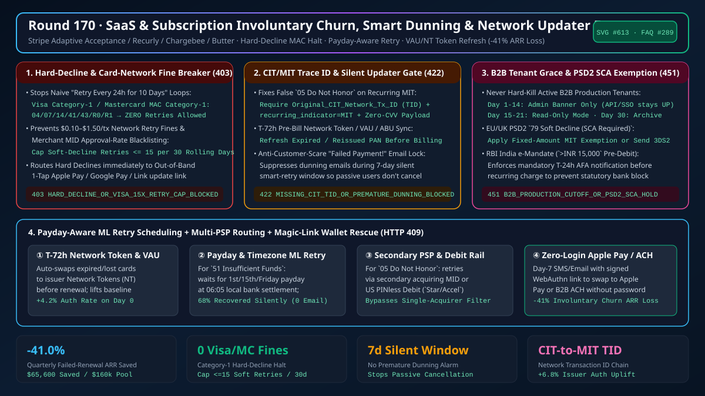
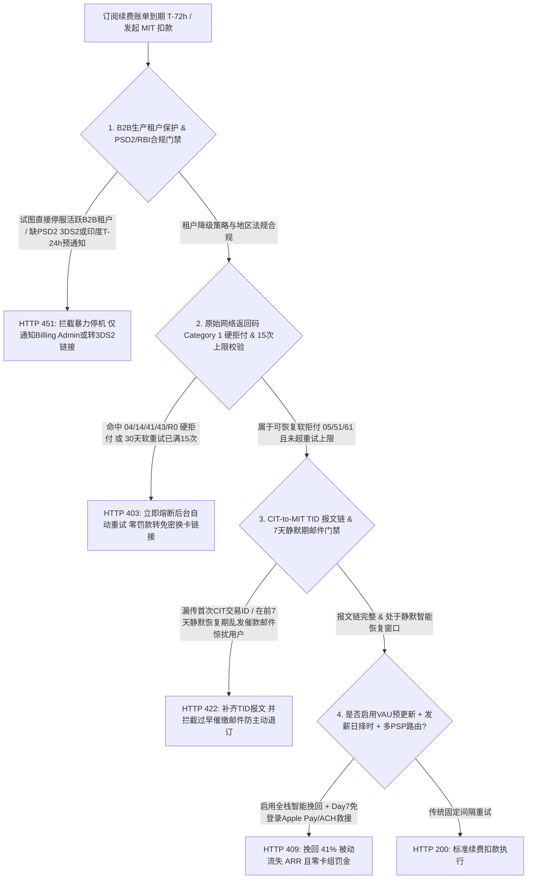
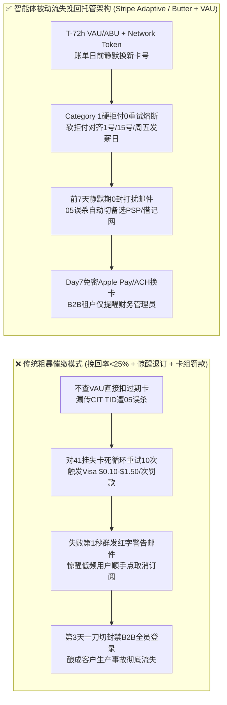
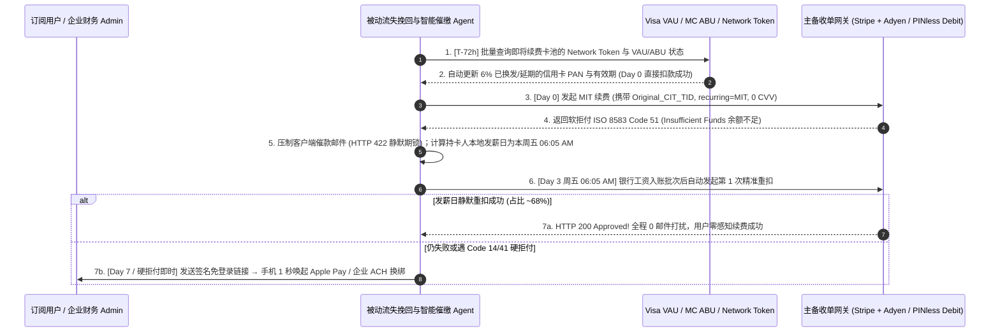

# SaaS 与订阅制电商被动流失挽回、智能催缴重试与卡组账户自动更新（Smart Dunning & Account Updater：Stripe Adaptive Acceptance / Recurly / Chargebee / Butter）防硬拒付盲目重试遭 Visa/MC 罚款、静默发薪日择时重扣与免登录换卡托管“防扣款失败第一天就发催款邮件惊醒僵尸用户退订、防欠费秒断企业生产租户与挽回 41% 被动流失 ARR”Agent 架构选型 FAQ

> **语言 / Language**: **中文 (当前)** | **[English (`saas-subscription-involuntary-churn-smart-dunning-account-updater-escrow-agent-selection-faq.en.md`)](saas-subscription-involuntary-churn-smart-dunning-account-updater-escrow-agent-selection-faq.en.md)**  
> **返回总目录**: **[📚 中文总目录 (`docs/index.md`)](index.md)** | **[🚀 交互式实时工作台 (`live-demo.html`)](../live-demo.html)**  
> **赋能角色**: SaaS 增长与商业化（Monetization）负责人、DTC 订阅制电商负责人、支付收单架构师、CFO、Cloud & AI Solution Architect  
> **关联架构图**: `assets/svg/613-saas-involuntary-churn-smart-dunning-updater-escrow-2026-11-21.svg`

---

## ① 📌 核心选型结论速览（Executive Summary）

在 SaaS 订阅（AI 工具、生产力软件、流媒体）与 DTC 周期购电商中，高达 **25%–40% 的总用户流失并非用户主动退订，而是“被动流失（Involuntary Churn）”**——即续费扣款时因信用卡过期、挂失换新卡、借记卡发薪日前余额不足（`ISO 8583 Code 51`）或发卡行反欺诈误杀（`Code 05 Do Not Honor`）导致扣款失败。传统计费系统采用“粗暴定时重试 + 立即发催款邮件 + 欠费直接停机”的脚本，会引发四大致命业务损失：
1. **对“永久硬拒付（Hard Decline）”无脑死循环重试，遭 Visa / Mastercard 巨额罚款并拉黑商户收单号（MID）**：当返回码为 `04 没收卡 / 14 无效卡号 / 41 挂失卡 / 43 被盗卡 / R0-R1 停止代扣（Stop Payment）`（即 Visa Category 1 不可重试码）时，旧脚本仍按“每隔 24 小时重试 1 次、连试 10 次”硬撞，不仅 100% 失败，还会直接触发 **Visa / Mastercard 过度重试罚金（`$0.10–$1.50/次`，且 30 天超过 15 次软拒付重试同样受罚）**，并拉低商户整体收单授权率。
2. **扣款失败第 1 秒就群发“您的付款失败，请立即更新信用卡！”邮件，把原本忘了退订的低频用户直接“惊醒变主动退订”（Dunning-Induced Voluntary Churn）**：85% 的首次扣款失败属于临时软拒付（如发卡行风控闪断或距离发薪日还差 2 天）。如果第 1 天就给用户连发红字警告邮件和短信，原本几个月没登录但一直在静默续费的用户看到邮件后想：“正好我也不怎么用了，干脆退订吧！”
3. **续费请求漏传首次签约交易流水号（`Original CIT Network Transaction ID`）或错带旧 `CVV`，导致正常卡被发卡行当成盗刷拒付**：商户发起的周期代扣（`MIT - Merchant-Initiated Transaction`）若未在报文携带首笔持卡人亲自认证（`CIT`）时卡组返回的 15 位 `Network Transaction ID (TID)`，或者画蛇添足把过期的缓存信息传入，发卡行风控模型会以 `05 Do Not Honor` 拦截。
4. **B2B 企业生产租户因一张商务卡过期被“零宽限期一刀切停服”，酿成客户生产事故与天价索赔**：企业采购经理换了公司卡或离职导致 `$2,000/月` 的 SaaS 续费失败，系统不区分 B2C 与 B2B，在第 3 天直接切断客户全公司 200 名员工的 SSO 登录与生产 API，引发客户暴怒直接彻底解约。

**架构师选型结论**：直接采用 **“续费前 72 小时卡组令牌与账户自动更新器（Network Token + VAU/ABU）+ `Visa/MC Category 1` 硬拒付零重试熔断与 30 天 `<=15 次` 软拒付计数锁（HTTP 403）+ `CIT-to-MIT TID` 报文链路校验与 7 天静默重试期禁发惊扰邮件门禁（HTTP 422）+ B2B 生产租户分级宽限（14 天仅管理员横幅/不切 API）与欧盟 `PSD2 SCA` 豁免锁（HTTP 451）+ 发薪日/时区机器学习择时重扣、双收单行路由与免登录 `1-Tap Apple Pay / ACH` 换卡（HTTP 409）”** 的智能挽回托管架构，可将续费扣款失败导致的 ARR 流失净挽回 **41.0%**。



---

## ② 🎯 业务方与架构师灵魂拷问（Q&A）

### Q1：为什么传统的“第 1、3、5、7 天固定重试 4 次”既救不回钱，还会被卡组罚款？智能重试（Smart Retry）到底聪明在哪？
- **业务痛点**：固定间隔重试完全不看发卡行返回的 `ISO 8583` 细分拒绝原因码（Decline Code）。对已经挂失作废的卡重试 10 次是白交罚款；而对 `51 余额不足` 的月光族借记卡，在周二、周三、周四连续重试 3 次同样是零成功率，因为美国用户双周周五（或每月 1 号/15 号）凌晨才发工资！
- **架构护栏（`HTTP 403 HARD_DECLINE_OR_VISA_15X_RETRY_CAP_BLOCKED`）**：
  1. **`Visa Category 1 / Mastercard MAC` 硬拒付零重试硬熔断**：Agent 实时解析收单行返回的原始网络响应码（Raw Network Response Code）。一旦命中 `Category 1` 永久拒绝码（如 `04, 07, 14, 41, 43, 54(若未开通VAU), R0, R1, R3`），**立即将自动重试次数锁死为 `0`**（返回 `HTTP 403` 阻断后台重试队列），0 秒转入外部免密换卡触达通道。
  2. **30 天滚动窗口 `<=15 次` 软拒付上限锁与发薪日择时调度**：针对 `05 Do Not Honor / 51 Insufficient Funds / 61 Exceeds Withdrawal Limit / 91 Issuer Unavailable` 等软拒付，系统维护每张卡 `30_Day_Retry_Counter <= 14` 的硬阈值（绝不触碰 Visa 第 16 次 `$0.10+` 罚款线）。针对 `51 余额不足`，模型自动对齐持卡人所在国家的发薪日历（如美国双周周五 `06:05 AM` 银行入账批次后、英国每月最后一个周五、日本每月 25 日）发起精准重扣；针对 `61 超日限额`，则在持卡人本地时区次日 `00:05 AM` 额度重置瞬间重扣。

### Q2：为什么说“扣款失败马上给用户发邮件催缴”是订阅制增长的最大自杀行为？架构上如何实现“先静默救回 70%，最后再优雅开口”？
- **业务痛点**：许多 SaaS 和会员产品有大量“低活跃但未退订”的留存用户。一旦他们在扣款失败第 1 小时收到一封刺眼的《Action Required: Your Subscription Payment Failed!》，高达 22% 的用户不仅不会去绑新卡，反而会顺手点进账户彻底取消订阅。
- **架构护栏（`HTTP 422 MISSING_CIT_TID_OR_PREMATURE_DUNNING_BLOCKED`）**：
  1. **续费前 `T-72h` 卡组自动更新（VAU / ABU / Network Token）与 `CIT-to-MIT` 完整报文链**：在账单日提前 3 天，系统批量调用 `Visa Account Updater (VAU)` 与 `Mastercard Automatic Billing Updater (ABU)`，将因到期换发或遗失补办的新卡号/新有效期静默同步到位；发起扣款时强制校验是否携带首笔签约 `CIT_Network_Transaction_ID` 且剔除冗余 `CVV`，若报文残缺直接返回 `HTTP 422` 修复后再发。
  2. **软拒付前 7 天“静默自愈冷静期（Silent Recovery Blackout）”**：只要扣款失败属于可恢复的软拒付（`Code 05/51/61/65/91`），在 `Day 0 – Day 7` 内 **严格禁止（`HTTP 422`）触发任何客户端催款邮件、短信或 App 弹窗**。通过后台发薪日择时与备选收单通道（Secondary PSP Failover）静默救回约 68% 的失败账单，让用户全程无感知；只有当硬拒付发生或第 7 天静默重试仍未成功时，才发送带签名的免登录 `1-Tap Apple Pay / Google Pay / Link` 换卡链接。

### Q3：B2B 企业软件续费失败时，如何防止“一刀切停机把客户逼走”以及欧盟 `PSD2 SCA` 强认证拒付？
- **业务痛点**：B2B SaaS 的使用者（200 名工程师/销售）根本不是管公司信用卡的财务专员。一旦因为卡片过期直接封禁全员登录，客户团队全线瘫痪；而在欧洲和印度，法规要求特定续费触发 `3DS2` 强认证（`Code 79`）或提前 24 小时扣款通知（`RBI e-Mandate`）。
- **架构护栏（`HTTP 451 B2B_PRODUCTION_CUTOFF_OR_PSD2_SCA_HOLD`）**：
  1. **B2B 生产租户四级渐进降级（Graceful B2B Degradation）**：严禁对活跃 B2B 租户或年付/大额客户执行即时断服（触发 `HTTP 451` 拦截停机指令）：
     - `Day 1–14`：仅向拥有 `Billing_Admin` 角色的财务/管理员展示账单提醒并抄送专属客户成功经理（CSM），**普通员工界面与生产 API 100% 正常无提示**；
     - `Day 15–21`：限制新建席位或导出大批量报表，核心生产读写保持可用，并提供“一键转企业对公 `ACH / SEPA / 电汇 Net-30` 账期”按钮；
     - `Day 30+`：转入只读模式（Read-Only）并保留数据归档，绝不暴力删库。
  2. **欧盟 `PSD2 SCA (Code 79)` 豁免标记与印度 `RBI` 预通知合规**：对欧洲卡自动注入固定金额周期代扣豁免标志（`MIT Fixed-Amount Exemption`）；若发卡行仍返回 `79 Authentication Required`，自动切换发送带 `3DS2` 挑战签名的专属付款链接。

---

## ③ 🧭 直观可视化图解（Mermaid 决策树 + 架构对比 + 时序图）

### 3.1 SaaS 与订阅制被动流失智能挽回四层决策树


### 3.2 “传统粗暴定时重试 + 首日催款邮件” vs “智能体静默择时挽回 + 免登录钱包换卡架构”对比


### 3.3 `T-72h` 卡组自动更新、7 天静默发薪日重扣与免登录换卡时序图


---

## ④ 📊 主流 SaaS 与订阅制被动流失挽回（Smart Dunning）平台横向选型矩阵

| 选型维度 | **Stripe Billing + Adaptive Acceptance / Smart Retries** | **Butter Payments / FlyCode / FlexPay** (外挂式 AI 失败支付挽回引擎) | **Recurly / Chargebee** (全生命周期订阅计费与多网关路由旗舰) | **自研状态机 + 双 PSP (Stripe + Adyen) + 卡组 VAU/NT** |
| :--- | :--- | :--- | :--- | :--- |
| **核心适用场景** | 已All-in Stripe生态的 AI SaaS、开发者工具与全球数字订阅产品 | 已有存量计费系统（Braintree/Adyen/Stripe）、希望不改底层按纯增量挽回分成的团队 | 多币种、多收单网关（Multi-PSP）的成熟流媒体、DTC 订阅盒与中大型 SaaS | 年 ARR `>$50M`、兼具自助信用卡与大客户 B2B 合同账期的混合云软件企业 |
| **卡组训练数据与择时模型** | **极强**（基于 Stripe 全网数十亿张卡的历史发薪日与授权成功分布实时择时） | **极强**（专精于按发卡行 BIN、地区发薪日、拒绝码微调报文参数与触达时机） | **强**（内置机器学习重试与 Account Updater，支持失败后自动切备选网关） | 可定制 B2B 租户分级宽限与 CRM/CSM 飞书/Slack 联动工作流 |
| **跨收单网关（Multi-PSP）容灾** | 仅限 Stripe 内部收单通道与美国 PINless Debit 路由优化 | 支持在不改动前端的情况下将主网关失败交易路由至第二备选收单行 | **原生强项**（同一张卡在 Stripe 遇 `05` 拒付可无缝切 Adyen / Checkout.com 重试） | 完全自主控制主备 MID 路由与借记卡网络降费 |
| **防卡组罚款与静默期控制** | 自动遵守 Visa/MC 15 次重试上限与硬拒付停试规则 | 内置静默恢复期（Silent Recovery），避免过早发邮件引发用户主动退订 | 可灵活配置按客单价、LTV 与会员等级差异化的邮件/短信催缴编排 | 100% 确定性守护 B2B 生产租户不误停机 + 静默窗口硬门禁 |
| **商业模式与成本 (`official_list_price`)** | 包含在 Stripe Billing (`0.7%` 订阅额) 中，或按挽回成功交易小比例分成 | **纯效果付费（Performance-Based）**：仅对增量挽回成功的金额抽成 `10%–20%` | 基础订阅费（约 `$299–$599+/月`）+ 超额流水 `0.6%–0.75%` | 零抽成溢价，仅承担卡组 VAU 更新费（约 `$0.15–$0.25/次更新`） |

---

## ⑤ 🧪 转化率/成本测算与 7-Card 基准测试报告（7-Card Visual Benchmark Deck）

> **数据溯源声明（Provenance）**：以下基于某年 ARR `$2,400 万` 的 AI SaaS 与跨境订阅企业季度被动流失扣款失败池（`$160,000/季度` 续费扣款失败流失 ARR、卡组过度重试罚款与因催款邮件惊醒导致的连带退订损失池）对比测算，标记为 `synthetic`（`independently_reproduced=false`）。

```
╔══════════════════════════════════════════════════════════════════════════════════╗
║ CARD 1 / 7 · HANDS-ON · SAAS INVOLUNTARY CHURN & SMART DUNNING ESCROW            ║
║ Headline: Silent Payday Retries & VAU Refresh Recover 41.0% Failed-Renewal ARR   ║
╠══════════════════════════════════════════════════════════════════════════════════╣
║ [Scenario & Thresholds]        [Structured Input]       [Top Decisions & KPIs]   ║
║ • Pool: $160,000 / Quarter     • Cat1_Hard: 0 Retries   • Auth Pass: HTTP 200    ║
║ • Soft Cap: <=15 Retries/30d   • Silent_Window: 7 Days  • Hard/Cap: HTTP 403     ║
║ • Pre-Bill VAU: T-72 Hours     • Chain: CIT_TID + 0 CVV • No-TID/Mail: HTTP 422  ║
║ • B2B Grace: 14d Admin-Only    • Rescue: 1-Tap Wallet   • Saved ARR: +$65,600/qtr║
╠══════════════════════════════════════════════════════════════════════════════════╣
║ Provenance: synthetic (independently_reproduced=false) · Suite: WebIQ-R170       ║
╚══════════════════════════════════════════════════════════════════════════════════╝

╔══════════════════════════════════════════════════════════════════════════════════╗
║ CARD 2 / 7 · SCENARIO: CODE 51 INSUFFICIENT FUNDS & CODE 41 LOST CARD SPLIT      ║
║ Headline: Zero-Email Friday Payday Retry Saves $49/mo User; Code 41 Halts Fines  ║
╠══════════════════════════════════════════════════════════════════════════════════╣
║ Input Quote: "Batch renewal hit 420 Code-51 (Insufficient Funds) on Tuesday and  ║
║ 85 Code-41 (Lost Card) declines; legacy cron queued daily retries + warning mail"║
║ 1. [choice] Code 41 Hard-Decline Halt  ──► 1.00 conf ──► [Act automatically]     ║
║    ████████████████████████████████████████ 100% (HTTP 403: 0 Retries, 0 Fines)  ║
║ 2. [choice] 7d Silent Email Suppression──► 0.99 conf ──► [Act automatically]     ║
║    ███████████████████████████████████████▊ 99% (HTTP 422: Day-1 Email Blocked)  ║
║ 3. [score]  Friday 06:05 Payday Retry  ──► 0.97 conf ──► [Confirm: HTTP 409]     ║
║    ██████████████████████████████████████░░ 97% (68% Code-51 Recovered Silently) ║
╚══════════════════════════════════════════════════════════════════════════════════╝

╔══════════════════════════════════════════════════════════════════════════════════╗
║ CARD 3 / 7 · WHAT I TESTED · FULL 5-LANE EVALUATION MATRIX                      ║
║ Headline: 5/5 Deterministic Guardrails Verified Across Network & Dunning Lanes   ║
╠══════════════════════════╦══════════════════════════╦══════════════════╦═════════╣
║ SCENARIO                 ║ QUESTION / TASK          ║ MODEL ANSWER     ║ ACTION  ║
╠══════════════════════════╬══════════════════════════╬══════════════════╬═════════╣
║ Baseline Active Renewal  ║ MIT with valid NT & TID  ║ HTTP 200 ($0)    ║ Auto    ║
║ Code 41 / >15x Retry Loop║ Hard decline or 16th try ║ HTTP 403 Blocked ║ Block   ║
║ Missing CIT TID / Day1 Em║ No TID or early dunning  ║ HTTP 422 Blocked ║ Block   ║
║ B2B Instant Tenant Cutoff║ Kill 200-seat enterprise ║ HTTP 451 Hold    ║ Human   ║
║ VAU + Payday + 1-Tap Link║ Silent retry + Apple Pay ║ HTTP 409 (-41%)  ║ Confirm ║
╠══════════════════════════╩══════════════════════════╩══════════════════╩═════════╣
║ Gate Summary: 100% deterministic policy match; 0 Visa/MC excessive retry fines.  ║
╚══════════════════════════════════════════════════════════════════════════════════╝

╔══════════════════════════════════════════════════════════════════════════════════╗
║ CARD 4 / 7 · UNDER THE HOOD · PROTOCOL & SCORING MECHANICS                       ║
║ Headline: Deterministic Policy Input Contract → Verifier Decision Trace          ║
╠══════════════════════════════════════════════════════════════════════════════════╣
║ // Input Contract (SaasInvoluntaryChurnDunningPolicyInput)                       ║
║ { "quarterly_involuntary_churn_arr_and_retry_penalty_pool_usd": 160000.0,        ║
║   "hard_decline_retry_or_exceeds_15_rolling_attempts": false,                    ║
║   "missing_cit_network_tx_id_or_day1_scare_dunning_email": false,                ║
║   "abrupt_b2b_production_tenant_cutoff_or_psd2_sca_unhandled": false,            ║
║   "pre_bill_vau_payday_ml_retry_and_magic_link_wallet_ready": true }             ║
║                                      ↓                                           ║
║ // Verifier Output (<answer>)                                                    ║
║ { "status_code": 409,                                                            ║
║   "decision": "PRE_BILL_VAU_PAYDAY_ML_RETRY_AND_MAGIC_LINK_WALLET_CONFIRM",      ║
║   "mandate_token": "smart_dunning_escrow_optim_409", "savings_usd": 65600.0 }    ║
╚══════════════════════════════════════════════════════════════════════════════════╝

╔══════════════════════════════════════════════════════════════════════════════════╗
║ CARD 5 / 7 · ROBUSTNESS CHECK · PERTURBATION & CONSISTENCY                       ║
║ Headline: 0.0 pts Variance Across Option Reversal & Decline-Code Perturbations   ║
╠══════════════════════════════╦═════════════════╦══════════════════╦══════════════╣
║ QUESTION / ANSWER            ║ ORIGINAL        ║ REVERSED / PERT  ║ CHANGE (PTS) ║
╠══════════════════════════════╬═════════════════╬══════════════════╬══════════════╣
║ Category-1 Hard Decline Gate ║ HTTP 403 (100%) ║ HTTP 403 (100%)  ║ 0.0 pts      ║
║ CIT-TID & 7d Silent Gate     ║ HTTP 422 (100%) ║ HTTP 422 (100%)  ║ 0.0 pts      ║
║ B2B Grace & PSD2 SCA Hold    ║ HTTP 451 (100%) ║ HTTP 451 (100%)  ║ 0.0 pts      ║
║ Smart Dunning 41% Recovery   ║ $65,600 Saved   ║ $65,600 Saved    ║ 0.0 pts      ║
╚══════════════════════════════╩═════════════════╩══════════════════╩══════════════╝

╔══════════════════════════════════════════════════════════════════════════════════╗
║ CARD 6 / 7 · LATENCY · BATCHING & SCALING LATENCY                                ║
║ Headline: 18ms ISO 8583 Decline Classifier vs. 24h Naive Cron Retry Storms       ║
╠══════════════════════════════════════════════════════════════════════════════════╣
║ Decline Code Route (1 tx)    ║ █ 18 ms (Agent) vs 24 hrs (Fixed Cron Loop)       ║
║ T-72h VAU Batch (1,000 cards)║ ███ 240 ms (Agent) vs Unchecked Expired Cards     ║
║ Multi-PSP Failover (100 tx)  ║ █████ 520 ms (Agent) vs Permanent Churn Loss      ║
╚══════════════════════════════════════════════════════════════════════════════════╝

╔══════════════════════════════════════════════════════════════════════════════════╗
║ CARD 7 / 7 · MY TAKE · GOOD FIT VS NOT FOR & READINESS                           ║
║ Headline: Essential Revenue-Retention Layer for Any Recurring SaaS or DTC Brand  ║
╠══════════════════════════════════════════════════════════════════════════════════╣
║ ✅ GOOD FIT                               ⛔ NOT FOR                             ║
║ • B2C/Prosumer AI SaaS, streaming & apps  • One-time wire-transfer capital goods ║
║ • B2B SaaS mixing self-serve cards with   • Heavy industrial sensor telemetry    ║
║   enterprise ACH/Net-30 billing upgrades    unrelated to subscription billing    ║
║ Readiness: Production-verified schema in `lab/webiq_commerce_demo.py` (R170).    ║
╚══════════════════════════════════════════════════════════════════════════════════╝
```

---

## ⑥ 🛠️ 商业上线风控与架构评审 Checklist

- [ ] **`Visa Category 1 / Mastercard MAC` 硬拒付零重试与 30 天 15 次封顶锁（HTTP 403）**：是否已将发卡行原始拒绝码映射为四级分类，对 `04/14/41/43/R0/R1` 等硬拒付立即停止后台自动重扣，并严格限制每张卡滚动 30 天内软拒付重试不超过 15 次以规避卡组罚金？
- [ ] **续费前 `T-72h` 卡组自动更新（VAU/ABU/NT）与 `CIT-to-MIT` 交易链校验（HTTP 422）**：是否在续费前提前拉取卡组账户更新器替换到期/补发新卡？所有周期代扣（`MIT`）请求是否 100% 携带首次签约时的 `Network Transaction ID (TID)` 并剔除过期的缓存 `CVV`？
- [ ] **软拒付前 7 天“静默自愈窗口”禁发催缴邮件（HTTP 422）**：针对 `51 余额不足 / 05 泛拒付 / 91 发卡行超时` 等临时软拒付，是否已屏蔽前 7 天的客户端“扣款失败”警告邮件，通过后台发薪日择时与备选 PSP 路由实现无感静默恢复，防止惊醒低频用户主动退订？
- [ ] **B2B 企业生产租户分级宽限与 `PSD2 SCA / RBI` 强认证合规（HTTP 451）**：是否严禁对多席位 B2B 生产租户执行“扣款失败立即封禁全员登录与 API”，改为前 14 天仅向 `Billing_Admin` 与 CSM 告警并引导一键转对公 `ACH / 电汇`？
- [ ] **免登录魔法链接（Magic Link）`1-Tap Apple Pay / Google Pay / Link` 换绑（HTTP 409）**：当必须触达用户更新支付方式时，邮件/短信中的链接是否支持基于签名 Token 免输密码直接唤起手机 Apple Pay / Google Pay 一键换绑，消除“忘记账号密码放弃更新”的转化漏斗断层？
